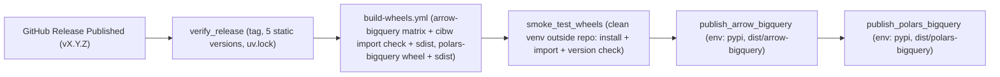

# Automated Dual-Package PyPI Trusted Publishing

* **Author:** Tim Swast (`tswast`)
* **Date:** 2026-10-29

## Overview

This proposal automates publishing Python wheels and source distributions (`sdist`) for both `arrow-bigquery` (`py-arrow-bigquery`) and `polars-bigquery` (`py-polars-bigquery`) to PyPI using GitHub Actions OpenID Connect (OIDC) Trusted Publishing whenever a maintainer publishes a GitHub Release (`vX.Y.Z`). The internal workspace test plugin `polars-expressions-testing` (`py-polars-expressions-testing`) remains unpublished.

Today, wheel builds run on GitHub Actions in [build-wheels.yml](file:///usr/local/google/home/swast/src/github.com/pola-rs/polars-bigquery-client-wt0/.github/workflows/build-wheels.yml#L1-L110), while PyPI uploads are performed manually. Commit `832fe2b9` drafted an initial [release.yml](file:///usr/local/google/home/swast/src/github.com/pola-rs/polars-bigquery-client-wt0/.github/workflows/release.yml#L1-L36), but that draft merges all artifacts into a single `dist/` folder, runs a single publish job, leaves `arrow-bigquery` unpinned in `py-polars-bigquery`'s [pyproject.toml](file:///usr/local/google/home/swast/src/github.com/pola-rs/polars-bigquery-client-wt0/py-polars-bigquery/pyproject.toml#L14-L19), performs no tag-to-version check, and uploads artifacts to PyPI without checking that built wheels install and import cleanly.

## Analysis

### 1. Ordered Publishing, Artifact Isolation, and Manual Partial-Failure Recovery

PyPI uploads happen one file at a time over HTTP rather than as an atomic multi-package transaction, and PyPI permanently blocks re-uploading any `(package, version, filename)` once accepted—even if yanked or deleted.

* **Cross-package ordering and retry isolation**: Renaming build artifacts in [build-wheels.yml](file:///usr/local/google/home/swast/src/github.com/pola-rs/polars-bigquery-client-wt0/.github/workflows/build-wheels.yml#L63-L110) by package prefix (`arrow-bigquery-wheels-*` and `arrow-bigquery-sdist` vs. `polars-bigquery-dist`, each with `if-no-files-found: error`) and splitting [release.yml](file:///usr/local/google/home/swast/src/github.com/pola-rs/polars-bigquery-client-wt0/.github/workflows/release.yml#L18-L36) into two sequential jobs (`publish_arrow_bigquery` followed by `publish_polars_bigquery` via `needs:`) guarantees `arrow-bigquery == <version>` is published before `polars-bigquery == <version>`. If `publish_polars_bigquery` fails on a transient error, GitHub Actions' **"Re-run failed jobs"** retries only `publish_polars_bigquery` using the already-built artifacts without touching `arrow-bigquery`.
* **PEP 740 attestations and manual recovery on mid-package failures**: Keeping `skip-existing: false` (the `pypa/gh-action-pypi-publish` default) preserves PEP 740 cryptographic attestations on all uploaded distributions. If an upload fails partway through `arrow-bigquery`'s multi-file upload—or fails due to a workflow bug requiring a new commit on `main` after `arrow-bigquery == X.Y.Z` has already uploaded—recovery is an explicit manual process documented in [release-procedure.md](file:///usr/local/google/home/swast/src/github.com/pola-rs/polars-bigquery-client-wt0/release-procedure.md#L1-L15): yank any partially published `X.Y.Z` packages on PyPI and cut a new `X.Y.(Z+1)` release. Note that historical `polars-bigquery` releases (`0.1.0`, `0.2.0`) have an unpinned `"arrow-bigquery"` dependency and will pull an orphaned `arrow-bigquery == X.Y.Z` unless yanked; conversely, if both `X.Y.Z` packages uploaded and must be yanked, **`polars-bigquery` must be yanked too**, because exact `==` pins bypass PyPI yanks under PEP 592 if only `arrow-bigquery` is yanked.
* **Concurrency serialization**: [release.yml](file:///usr/local/google/home/swast/src/github.com/pola-rs/polars-bigquery-client-wt0/.github/workflows/release.yml#L1-L36) lacks a `concurrency:` block. Release runs must serialize with `cancel-in-progress: false` so an active PyPI upload is never canceled mid-flight.

> [!WARNING]
> Once `publish_arrow_bigquery` starts uploading to PyPI, maintainers must never click **"Re-run all jobs"** or move/re-push the `vX.Y.Z` git tag, because rebuilt Rust wheels produce new SHA-256 hashes that collide with PyPI's immutable file registry.

### 2. Shared `pypi` Environment, Trusted Publishing (OIDC), and Release Triggers

* **Shared `pypi` environment with strict directory separation**: Both `publish_arrow_bigquery` (`url: https://pypi.org/p/arrow-bigquery`) and `publish_polars_bigquery` (`url: https://pypi.org/p/polars-bigquery`) bind to the shared GitHub Environment `pypi`. Both `arrow-bigquery` and `polars-bigquery` on PyPI must register Trusted Publishers matching `(pola-rs/polars-bigquery-client, release.yml, environment: pypi)`. Because PyPI mints an OIDC token authorized for both projects when both trust the same workflow and `pypi` environment, keeping build artifacts in separate directories (`packages-dir: dist/arrow-bigquery` vs. `packages-dir: dist/polars-bigquery`) is mandatory so neither job uploads the other package's files.
* **Top-level workflow placement**: Both publish jobs must remain directly in [release.yml](file:///usr/local/google/home/swast/src/github.com/pola-rs/polars-bigquery-client-wt0/.github/workflows/release.yml#L18-L36) rather than moving into a `workflow_call` file so the OIDC `job_workflow_ref` claim matches PyPI's Trusted Publisher configuration directly.
* **Tag deployment rules without human approval gates**: Because publishing runs immediately with zero required reviewers on the `pypi` GitHub Environment, the environment's **Deployment Branch and Tag Rules** must allow `v*` tags (`refs/tags/v*`). Restricting `pypi` to the `main` branch blocks `release: [published]` runs (which execute on `refs/tags/vX.Y.Z`), while leaving `pypi` unrestricted would let future branch workflows mint PyPI tokens.
* **GitHub Pre-release flag**: `on: release: types: [published]` also triggers when "Set as a pre-release" is checked (`github.event.release.prerelease == true`). `verify_release` must ensure `prerelease == true` matches PEP 440 pre-release version suffixes (`a`, `b`, `rc`) and rejects mismatches.

### 3. Clean-Room Wheel Import Checks Without Workspace Shadowing

Because PR and `main` CI workflows ([test-py-arrow-unit.yml](file:///usr/local/google/home/swast/src/github.com/pola-rs/polars-bigquery-client-wt0/.github/workflows/test-py-arrow-unit.yml#L1-L87) and [test-py-polars-unit.yml](file:///usr/local/google/home/swast/src/github.com/pola-rs/polars-bigquery-client-wt0/.github/workflows/test-py-polars-unit.yml#L1-L89)) already run full unit test suites, pre-publish wheel validation only needs basic clean-room import and version checks—avoiding any dependency on the unpublished `polars-expressions-testing` Rust plugin or `nanoarrow` on `win_arm64`.

Two lightweight checks ensure built wheels actually load from `site-packages`:

1. **Cross-OS native linking check via `cibuildwheel`**: Configure `test-command` under `[tool.cibuildwheel]` in `py-arrow-bigquery`'s [pyproject.toml](file:///usr/local/google/home/swast/src/github.com/pola-rs/polars-bigquery-client-wt0/py-arrow-bigquery/pyproject.toml#L42-L44) (`python -c "import arrow_bigquery; assert arrow_bigquery._native is not None"`). `cibuildwheel` runs this automatically in a clean non-workspace virtualenv for every built wheel across all 5 OS/architecture runners (`manylinux_2_28`, `musllinux`, Windows x64/ARM64, and macOS ARM64) with zero extra jobs.
2. **Combined two-package clean-room install and import check**: Run a fast check on `ubuntu-latest` inside `$RUNNER_TEMP` (outside the git checkout so root [pyproject.toml](file:///usr/local/google/home/swast/src/github.com/pola-rs/polars-bigquery-client-wt0/pyproject.toml#L7-L8) `[tool.uv.workspace]` and local source folders cannot shadow `site-packages`). Install `"polars-bigquery==$VERSION"` using `--no-project` and `--find-links` pointing to the built `arrow-bigquery` and `polars-bigquery` wheels (since `arrow-bigquery == $VERSION` is not on PyPI yet), then import `arrow_bigquery`, `polars_bigquery`, and `polars_bigquery.core.compiler` (lazily imported outside `__init__.py`), asserting both packages loaded from `site-packages` and report `__version__ == $VERSION`.

### 4. Static Version Declarations (`release-please` Ready) and Fast-Fail Gating

* **Preserving static version strings across 5 Python locations**: Static string literals remain in place across both `pyproject.toml` files and both `core/version.py` files so future release automation (such as `release-please`) can update plain version strings directly without `importlib.metadata` indirection. Pinning `"arrow-bigquery == <version>"` in `py-polars-bigquery`'s [pyproject.toml](file:///usr/local/google/home/swast/src/github.com/pola-rs/polars-bigquery-client-wt0/py-polars-bigquery/pyproject.toml#L15) establishes 5 authoritative Python lockstep version locations:
  1. `py-arrow-bigquery` [pyproject.toml](file:///usr/local/google/home/swast/src/github.com/pola-rs/polars-bigquery-client-wt0/py-arrow-bigquery/pyproject.toml#L7) (`version = "<version>"`)
  2. `py-arrow-bigquery` [version.py](file:///usr/local/google/home/swast/src/github.com/pola-rs/polars-bigquery-client-wt0/py-arrow-bigquery/arrow_bigquery/core/version.py#L1) (`__version__ = "<version>"`, used in BigQuery `User-Agent` headers via [_read_bigquery.py](file:///usr/local/google/home/swast/src/github.com/pola-rs/polars-bigquery-client-wt0/py-arrow-bigquery/arrow_bigquery/_read_bigquery.py#L13-L19))
  3. `py-polars-bigquery` [pyproject.toml](file:///usr/local/google/home/swast/src/github.com/pola-rs/polars-bigquery-client-wt0/py-polars-bigquery/pyproject.toml#L7) (`version = "<version>"`)
  4. `py-polars-bigquery` [pyproject.toml](file:///usr/local/google/home/swast/src/github.com/pola-rs/polars-bigquery-client-wt0/py-polars-bigquery/pyproject.toml#L15) (`"arrow-bigquery == <version>"`)
  5. `py-polars-bigquery` [version.py](file:///usr/local/google/home/swast/src/github.com/pola-rs/polars-bigquery-client-wt0/py-polars-bigquery/polars_bigquery/core/version.py#L1) (`__version__ = "<version>"`, used in BigQuery REST `User-Agent` headers via [_read_bigquery.py](file:///usr/local/google/home/swast/src/github.com/pola-rs/polars-bigquery-client-wt0/py-polars-bigquery/polars_bigquery/_read_bigquery.py#L17-L23))
* **Excluded `0.1.0` manifests**: Version checks explicitly ignore the 5 internal/Rust `0.1.0` manifests (root [pyproject.toml](file:///usr/local/google/home/swast/src/github.com/pola-rs/polars-bigquery-client-wt0/pyproject.toml#L3), `py-polars-expressions-testing` [pyproject.toml](file:///usr/local/google/home/swast/src/github.com/pola-rs/polars-bigquery-client-wt0/py-polars-expressions-testing/pyproject.toml#L7) and [Cargo.toml](file:///usr/local/google/home/swast/src/github.com/pola-rs/polars-bigquery-client-wt0/py-polars-expressions-testing/Cargo.toml#L3), `py-arrow-bigquery` [Cargo.toml](file:///usr/local/google/home/swast/src/github.com/pola-rs/polars-bigquery-client-wt0/py-arrow-bigquery/Cargo.toml#L3), and `crates/arrow-bigquery` [Cargo.toml](file:///usr/local/google/home/swast/src/github.com/pola-rs/polars-bigquery-client-wt0/crates/arrow-bigquery/Cargo.toml#L3)).
* **Shift-left + fast-fail gating**: Checking internal lockstep across the 5 Python declarations plus `uv lock --check` on PRs catches forgotten edits before merge, and running a 10-second `verify_release` job **before** `build_wheels` in [release.yml](file:///usr/local/google/home/swast/src/github.com/pola-rs/polars-bigquery-client-wt0/.github/workflows/release.yml#L11-L17) (verifying `RELEASE_TAG == f"v{version}"`) prevents wasting 5-OS Rust `cibuildwheel` minutes on a mistyped tag.

### 5. `sdist` Archive Sanity, CI Hygiene, and Runbook Updates

* **Fast `sdist` and artifact count checks**: `py-arrow-bigquery` [Cargo.toml](file:///usr/local/google/home/swast/src/github.com/pola-rs/polars-bigquery-client-wt0/py-arrow-bigquery/Cargo.toml#L15) references `path = "../crates/arrow-bigquery"` inside root [Cargo.toml](file:///usr/local/google/home/swast/src/github.com/pola-rs/polars-bigquery-client-wt0/Cargo.toml#L1-L7). Without compiling from `sdist`, a sub-second Python `tarfile`/`zipfile` check verifies that `arrow_bigquery-<version>.tar.gz` bundles `crates/arrow-bigquery`, excludes `py-polars-expressions-testing`, and that expected wheel and `sdist` file counts exist before publishing.
* **CI storage, `uv` build alignment, and security linters**: Setting short `retention-days` (e.g., 7–14 days) on `actions/upload-artifact` in [build-wheels.yml](file:///usr/local/google/home/swast/src/github.com/pola-rs/polars-bigquery-client-wt0/.github/workflows/build-wheels.yml#L63-L110) prevents 90-day binary artifact bloat. Replacing unpinned `pipx run build` ([build-wheels.yml](file:///usr/local/google/home/swast/src/github.com/pola-rs/polars-bigquery-client-wt0/.github/workflows/build-wheels.yml#L81-L101)) with `uv build` aligns CI with [AGENTS.md](file:///usr/local/google/home/swast/src/github.com/pola-rs/polars-bigquery-client-wt0/AGENTS.md#L1-L11). All workflow edits must satisfy [lint-actions.yml](file:///usr/local/google/home/swast/src/github.com/pola-rs/polars-bigquery-client-wt0/.github/workflows/lint-actions.yml#L18-L35) (`actionlint` + `zizmor` `v0.6.2`): 40-char commit SHA pins on every `uses:`, `persist-credentials: false` on `actions/checkout`, and passing `github.ref_name` / `github.event.release.*` strictly via `env:` variables.
* **Runbook cleanup**: Update [release-procedure.md](file:///usr/local/google/home/swast/src/github.com/pola-rs/polars-bigquery-client-wt0/release-procedure.md#L1-L15) to list all 5 static version locations + `uv lock`, clarify release notes vs. the nonexistent `CHANGELOG` file, drop redundant manual wheel downloads/testing, document the shared `pypi` Trusted Publisher setup for both PyPI projects, and document the manual yank-and-bump recovery steps.

## Goals vs. Non-Goals

* **In-Scope Goals:**
  * Automate building and uploading binary wheels and `sdist` archives for `arrow-bigquery` and `polars-bigquery` to PyPI via GitHub Actions OIDC Trusted Publishing (with PEP 740 attestations enabled) on `release: [published]`.
  * Enforce lockstep static versions (`arrow-bigquery == <version>` pinned in `polars-bigquery`) across all 5 Python version locations plus `uv.lock`, gated by a fast-fail `vX.Y.Z` tag check before building wheels.
  * Isolate package artifacts by namespace and publish `arrow-bigquery` before `polars-bigquery` across two sequential jobs sharing the `pypi` GitHub Environment (with no manual reviewer gate).
  * Run basic clean-room wheel import and version checks (`cibuildwheel` native import check across OSes + isolated non-workspace install and import of both wheels together) and fast archive inventory checks before PyPI upload starts.
  * Comply with [lint-actions.yml](file:///usr/local/google/home/swast/src/github.com/pola-rs/polars-bigquery-client-wt0/.github/workflows/lint-actions.yml#L18-L35) (`actionlint` and `zizmor`) and [AGENTS.md](file:///usr/local/google/home/swast/src/github.com/pola-rs/polars-bigquery-client-wt0/AGENTS.md#L1-L11) (`uv`), and update [release-procedure.md](file:///usr/local/google/home/swast/src/github.com/pola-rs/polars-bigquery-client-wt0/release-procedure.md#L1-L15).
* **Out-of-Scope Non-Goals:**
  * Publishing or renaming `py-polars-expressions-testing`, or publishing Rust crates (`crates/arrow-bigquery`) to `crates.io`.
  * Running full `pytest` unit test suites against built wheels or compiling from `sdist` (`--no-binary :all:`) during release CI.
  * Replacing static version strings in `version.py` with `importlib.metadata` or introducing `release-please` in this change.
  * Independent (decoupled) version numbers for `arrow-bigquery` and `polars-bigquery`, automated mid-package retry/recovery workflows (`skip-existing: true` / `workflow_dispatch`), or package classifier/platform matrix expansions.

## Alternatives Weighed

* **Single publish job with merged `dist/` directory (commit `832fe2b9` draft)**: Rejected because upload order is undefined (`polars-bigquery` can appear on PyPI before `arrow-bigquery` finishes uploading) and a failure in `polars-bigquery` prevents isolated job-level retries without hitting already-uploaded `arrow-bigquery` files.
* **Separate GitHub Environments per package (`pypi-arrow-bigquery` and `pypi-polars-bigquery`)**: Rejected in favor of reusing a single shared `pypi` GitHub Environment to minimize repository environment configuration while still enforcing publish order and retry isolation via separate sequential jobs and isolated `packages-dir` directories.
* **Enabling `skip-existing: true` or adding custom `workflow_dispatch` recovery workflows**: Rejected because `skip-existing: true` disables PEP 740 attestations and can mask version collisions; rare mid-package failures are handled manually by yanking and bumping to `X.Y.(Z+1)`.
* **Dynamic `importlib.metadata.version(...)` in `core/version.py` files**: Rejected because keeping plain static string literals preserves compatibility with future `release-please` automation, while automated CI checks prevent drift across the 5 locations.
* **Renaming `polars-expressions-testing` to `polars-bigquery-expressions-testing` and publishing wheels to PyPI**: Rejected because pre-publish checks run before PyPI upload anyway, compiling full `polars = "0.53.0"` across a 5-OS `cibuildwheel` matrix nearly doubles cold Rust CI costs for an internal 12-line test plugin with no external consumers, and basic import checks suffice for wheel validation.
* **Running full `pytest` unit test suites against built wheels**: Rejected because PR and `main` CI already execute full unit test matrices; clean-room import and version checks catch native linking and packaging defects without requiring unpublished test-plugin dependencies.
* **Unpinned `"arrow-bigquery"` dependency in `polars-bigquery`**: Rejected because `pip install --upgrade polars-bigquery` leaves older installed `arrow-bigquery` wheels in place, risking runtime breakage across coupled Rust/Python changes.
* **Manual GitHub Environment approval gate before PyPI upload**: Rejected because a maintainer already triggers releases manually by creating and publishing the GitHub Release.
* **Testing wheel imports inside the repository workspace directory**: Rejected because `uv` workspace `[tool.uv.sources]` (`workspace = true`) and local directory `sys.path` resolution import editable source files instead of built wheels.
* **Full `--no-binary :all:` build-and-install test from `sdist`**: Rejected because compiling Rust + dependencies from source tarballs adds significant CI runtime for low marginal signal once wheel import checks and fast `sdist` archive checks run.
* **Moving PyPI publish jobs into a reusable `workflow_call` workflow**: Rejected because PyPI Trusted Publishing validates the `job_workflow_ref` OIDC claim, making direct publish jobs in top-level `release.yml` simpler to configure and audit.

## Key Decisions & Staging for Next Steps

* **Packages published**: Only `arrow-bigquery` and `polars-bigquery` (wheels + `sdist`); `polars-expressions-testing` remains internal and unpublished.
* **Lockstep static versions (`release-please` friendly)**: Keep plain static version strings across all 5 Python locations (`py-arrow-bigquery` `pyproject.toml` + `version.py`, `py-polars-bigquery` `pyproject.toml` version + `"arrow-bigquery == <version>"` pin + `version.py`) plus `uv.lock`, verified on PRs and in a fast-fail `verify_release` job checking `v<version>` before `build_wheels`.
* **Pre-publish validation scope**: Lightweight `cibuildwheel` `test-command` native import check across all 5 OS runners + clean-room Linux install/import check (outside the checkout via `--find-links`, importing `arrow_bigquery`, `polars_bigquery`, and `polars_bigquery.core.compiler`) + sub-second `sdist`/wheel archive inventory check.
* **Ordered Trusted Publishing with shared `pypi` environment**: Two sequential jobs in top-level `release.yml` (`publish_arrow_bigquery` -> `publish_polars_bigquery`), both using GitHub Environment `pypi` (restricted to `refs/tags/v*`, zero required reviewers) with strictly separate `packages-dir` artifact directories (`dist/arrow-bigquery` and `dist/polars-bigquery`). Both PyPI projects register `(pola-rs/polars-bigquery-client, release.yml, environment: pypi)` as a Trusted Publisher.
* **Attestations and failure recovery**: Keep PEP 740 attestations enabled (`skip-existing: false`) and `concurrency` set to `cancel-in-progress: false`. Cross-package transient failures on `polars-bigquery` use **"Re-run failed jobs"**; mid-package or commit-fix failures follow a documented manual yank-and-bump (`X.Y.(Z+1)`) runbook in `release-procedure.md`.
