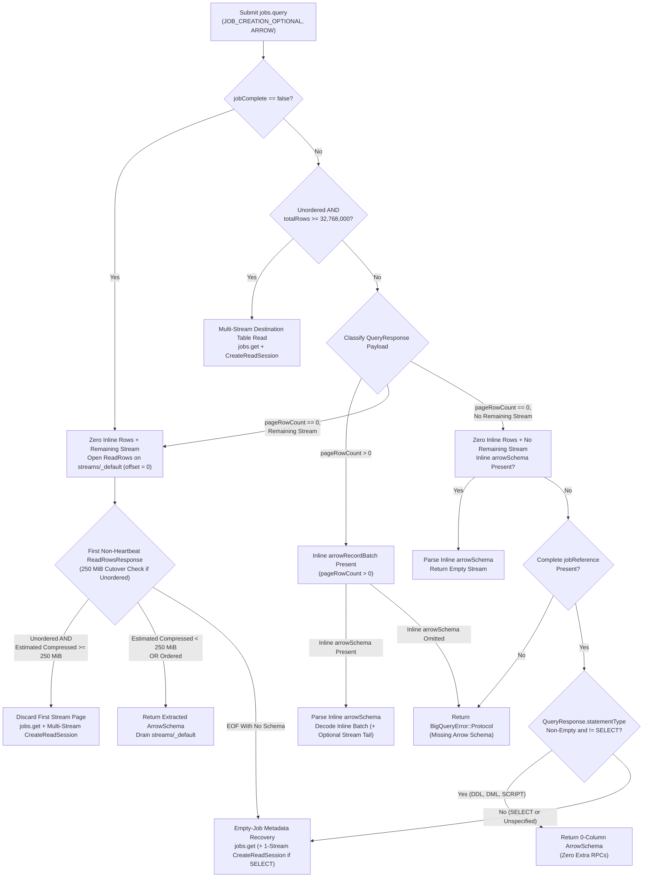

# Handling Completed Large-Result Queries Without Inline Arrow Schemas

*   **Author:** @tswast
*   **Status:** Approved
*   **Date:** 2026-11-02

--------------------------------------------------------------------------------

## Overview

The `arrow-bigquery` Rust crate (and its Python bindings `py-arrow-bigquery` and `polars-bigquery`) executes GoogleSQL queries via Google BigQuery's `jobs.query` REST API and streams results as Apache Arrow Inter-Process Communication (IPC) record batches over the BigQuery Storage Read API (gRPC) and the Arrow C Stream Interface (`ArrowArrayStream`). To avoid job creation overhead on small, fast queries, `arrow-bigquery` submits every query with `jobCreationMode = JOB_CREATION_OPTIONAL`, `queryResultsFormat = ARROW`, and a 200-second initial wait window (`timeoutMs = 200000`).

When a query finishes within that 200-second window (`jobComplete = true`) but its serialized output exceeds BigQuery's inline response limit (~1 MB compressed), BigQuery falls back to creating a job (`jobCreationReason.code = "LARGE_RESULTS"`) and returns zero inline rows (`pageRowCount = 0`, non-empty `pageToken`) while omitting both the inline `arrowRecordBatch` and the inline `arrowSchema`. Today, `arrow-bigquery` treats the missing `arrowSchema` in `QueryResponse` as a fatal protocol error unless an unordered read crosses the existing `32,768,000`-row pre-connect cutover (`250 MiB` multi-stream target divided by an `8`-byte assumed minimum row width), which skips `streams/_default` and opens a parallel destination-table `ReadSession`. This design removes that false protocol failure by resolving missing Arrow schemas lazily from the first non-heartbeat `ReadRowsResponse` on the job's Storage Read API stream (`streams/_default`)—or from a destination-table `ReadSession` when a completed `SELECT` job produces zero rows—while keeping existing multi-stream cutover thresholds unchanged.

## The Problem

Analytical workloads run queries spanning kilobytes to tens of gigabytes through a single `read_query` entry point. After `arrow-bigquery` switched `jobs.query` to `JOB_CREATION_OPTIONAL` and raised the initial `jobs.query` timeout from BigQuery's 10-second default to 200 seconds, almost all interactive and cached queries complete synchronously inside the initial `jobs.query` call (`jobComplete = true`). That exposed four gaps in how `arrow-bigquery` handles completed query responses:

1.  **Unordered medium-to-large queries fail between ~1 MB compressed and 32.7M rows**: In Python (`polars_bigquery.Client.read_query` and `arrow_bigquery.Client.read_query`), `maintain_order` defaults to `False`. When a query returns more than ~1 MB compressed and fewer than `32,768,000` rows, `jobs.query` returns `jobComplete = true` with `jobCreationReason.code = "LARGE_RESULTS"` and omits `arrowSchema`. `arrow-bigquery` rejects the response with `BigQuery protocol error: QueryResponse is missing Arrow schema` instead of reading the schema from the job's default result stream (`streams/_default`).
2.  **Ordered queries fail for all result sizes above ~1 MB compressed**: In Rust (`Query::new`), `maintain_order` defaults to `true`, and Python callers executing `ORDER BY` queries pass `maintain_order=True`. Because ordered reads cannot partition a destination table across unsorted parallel streams, they never take the early `ReadSession` exit. As a result, *every* `LARGE_RESULTS` query finishing within 200 seconds—including 10 GB and larger outputs—currently fails when `maintain_order` is `true`.
3.  **Completed zero-row jobs without inline `arrowSchema` are not resolved consistently, and empty `statementType` bypasses stateless validation**: When `jobComplete = true`, `arrow-bigquery` currently permits a missing `arrowSchema` whenever `totalRows` is absent and `statementType != "SELECT"`. Consequently, it rejects completed non-`SELECT` jobs (Data Definition Language [DDL], Data Manipulation Language [DML], or multi-statement `SCRIPT`) that populate `totalRows = 0`, rejects completed zero-row `SELECT` jobs instead of recovering their typed schema via `jobs.get` and the destination table, and accepts responses with an empty `statementType` (`""`) without inspecting `jobs.get` or requiring a `jobReference`.
4.  **Unit and integration test suites mask live `LARGE_RESULTS` framing**: Unit tests in `arrow-bigquery` mocked zero-row first pages with inline `arrowSchema` populated alongside `pageRowCount = 0` (the inverse of live `LARGE_RESULTS` responses), while the 250,000-row integration test compressed small enough under Zstandard (ZSTD) to return inline without creating a job.

## Goals

*   **Preserve zero extra RPCs on inline `jobs.query` responses**: Keep the fast path for queries whose full result and `arrowSchema` fit inline in `QueryResponse` (`<= ~1 MB` compressed), returning the parsed schema immediately and decoding inline `arrowRecordBatch` payloads without opening any Storage Read API stream or issuing `jobs.get` / `CreateReadSession` calls.
*   **Succeed on all completed `LARGE_RESULTS` queries regardless of row count or ordering**: Allow completed `jobs.query` responses (`jobComplete = true`) that omit inline `arrowSchema` and inline rows to resolve the Arrow schema from `streams/_default` (or a multi-stream `ReadSession` when unordered and above threshold), covering both `maintain_order = false` and `maintain_order = true` from ~1 MB past 10 GB+.
*   **Consistent empty-result and job-failure handling across sync and async completions**: Ensure completed job-backed responses (`jobReference` present) return an empty schema with zero extra RPCs when `QueryResponse.statementType` identifies a non-`SELECT` statement (DDL, DML, `SCRIPT`), inspect `jobs.get` (and destination-table `CreateReadSession` for `SELECT`) when a `SELECT` or unspecified-type job produces zero rows, and map failed-job `ReadRows` gRPC errors into `BigQueryError::JobFailed`.
*   **Preserve protocol validation on malformed stateless responses**: Return `BigQueryError::Protocol` whenever inline `arrowRecordBatch` bytes arrive without an accompanying inline `arrowSchema`, or whenever a zero-row response without a remaining stream lacks both inline `arrowSchema` and a complete `jobReference` (regardless of `statementType`).
*   **Align unit and integration test suites with real BigQuery `LARGE_RESULTS` framing**: Update unit test stubs for zero-row `QueryResponse` pages to omit inline `arrowSchema` and attach `arrowSchema` on the first `ReadRowsResponse`, and add live integration test coverage for `LARGE_RESULTS` queries finishing within `timeoutMs` under both `maintain_order = true` and `maintain_order = false`.

## Non-Goals

*   **Changing multi-stream cutover thresholds (`32,768,000` rows or `250 MiB` compressed)**: Increasing the pre-connect assumed row width above `8` bytes/row risks unnecessary `jobs.get` + `CreateReadSession` setup (~2 s plus session-creation quota) on narrow projections that otherwise drain from `streams/_default` in ~1–2 s, whereas keeping `32,768,000` rows bounds wide-row overhead to one ~1 s `streams/_default` connection before the first-batch size check switches to a parallel `ReadSession`.
*   **Modifying public Python or Rust API signatures**: No new parameters, methods, or configuration flags are added to `arrow_bigquery.Client`, `polars_bigquery.Client`, or `arrow_bigquery::query::Query`.
*   **Changing the 200-second initial wait default or `JOB_CREATION_OPTIONAL`**: Request timeout and job creation mode behavior in `jobs.query` remain unchanged.

## Open Questions

None. Missing-schema fallback behavior and retention of the existing `32,768,000`-row pre-connect threshold are resolved.

## Critical User Journeys (CUJs)

### CUJ 1: Small Query Fitting Inline in `jobs.query` (`<= ~1 MB` Compressed)

*   **Given**: An initialized `polars_bigquery.Client`, `arrow_bigquery.Client`, or Rust `Client::query(sql)` (with either `maintain_order = false` or `maintain_order = true`) executing a `SELECT` query that finishes within `timeoutMs` (`jobComplete = true`) and whose full result fits inline in `QueryResponse` (inline `arrowSchema` present, `pageToken == ""`, and `totalRows` absent or `<= pageRowCount`, including stateless zero-row `SELECT ... LIMIT 0` queries).
*   **When**: The caller invokes `client.read_query(sql)` or `Query::read()`.
*   **Then**: The client parses the inline `arrowSchema` immediately, decodes the inline `arrowRecordBatch` (when `pageRowCount > 0`) off the async I/O runtime, and yields all rows without opening any BigQuery Storage Read API stream or calling `jobs.get` or `CreateReadSession`.

### CUJ 2: Unordered Medium-Size Query (`~1 MB` to `< 250 MiB` Compressed and `< 32,768,000` Rows)

*   **Given**: An initialized `polars_bigquery.Client` or `arrow_bigquery.Client` (default `maintain_order = False`) and a GoogleSQL `SELECT` query producing between ~1 MB and `250 MiB` compressed in fewer than `32,768,000` rows that completes within `timeoutMs`.
*   **When**: The caller invokes `client.read_query(sql)` and BigQuery returns `jobComplete = true`, `jobCreationReason.code = "LARGE_RESULTS"`, `pageRowCount = 0`, non-empty `pageToken`, and no inline `arrowSchema`.
*   **Then**: The client opens `ReadRows` on `projects/{project}/locations/{location}/jobs/{job_id}/streams/_default` at offset `0`, resolves the `ArrowSchema` from the first non-heartbeat `ReadRowsResponse`, confirms from the first batch's compressed byte density that estimated remaining output is below `250 MiB`, and drains all batches from that single stream without issuing `jobs.get` or `CreateReadSession` RPCs.

### CUJ 3: Unordered Large Query (`>= 250 MiB` Compressed Below `32,768,000` Rows, or `>= 32,768,000` Rows)

*   **Given**: An initialized client with `maintain_order = False` and a GoogleSQL `SELECT` query that completes within `timeoutMs` (`jobComplete = true`, `LARGE_RESULTS`, inline `arrowSchema` omitted) with either (a) `totalRows < 32,768,000` and compressed size `>= 250 MiB` or (b) `totalRows >= 32,768,000`.
*   **When**: The caller invokes `client.read_query(sql)`.
*   **Then**: In case (a), the client resolves the `ArrowSchema` from the first non-heartbeat `ReadRowsResponse` on `streams/_default`, detects estimated remaining compressed output `>= 250 MiB`, discards that first stream page before emitting any rows, and switches to a parallel `ReadSession` on the job's destination table (fetched via `jobs.get`) without duplicating or dropping rows. In case (b), the client skips `streams/_default`, fetches the destination table via `jobs.get`, creates a multi-stream `ReadSession`, and streams batches concurrently.

### CUJ 4: Ordered Large Query (`maintain_order = true`, Any Size Above `~1 MB`)

*   **Given**: A Rust `Client::query(sql)` (default `maintain_order = true`) or Python `client.read_query(sql, maintain_order=True)` executing an `ORDER BY` query whose output exceeds ~1 MB compressed (from 10 MB past 10 GB+) and finishes within `timeoutMs` with inline `arrowSchema` omitted.
*   **When**: The caller awaits `Query::read()` and consumes all batches.
*   **Then**: The client does not partition across a destination-table `ReadSession` regardless of `totalRows`; it opens `streams/_default` at offset `0`, resolves the `ArrowSchema` from the first schema-bearing `ReadRowsResponse`, decompresses batches sequentially in arrival order, and yields every row in exact `ORDER BY` sequence.

### CUJ 5: Completed Zero-Row Job vs. Malformed Stateless Response

*   **Given**: A `jobs.query` call that completes within `timeoutMs` (`jobComplete = true`) with `pageRowCount = 0`, no remaining stream (`pageToken == ""`, no unread `totalRows`), and inline `arrowSchema` omitted.
*   **When**: Either (a) BigQuery created a job (a complete `jobReference` with project, job ID, and location is present—e.g., a DDL/DML statement, procedural `SCRIPT`, or job-backed empty `SELECT`), or (b) no complete `jobReference` is present.
*   **Then**: In case (a), the client returns an empty 0-column `ArrowSchema` with zero extra RPCs when `QueryResponse.statementType` identifies a non-`SELECT` statement, or inspects `jobs.get` when `statementType` is `"SELECT"` or omitted (returning `BigQueryError::JobFailed` on job error, an empty `ArrowSchema` if job metadata reports DDL/non-`SELECT`, or the typed `ArrowSchema` from a single-stream destination-table `CreateReadSession` for empty `SELECT` jobs). In case (b), the client returns `Err(BigQueryError::Protocol)` regardless of `statementType`.

## Technical Plan (Architecture)

### Query Response Routing and Lazy Schema Resolution

All production changes are localized to the query execution router in `crates/arrow-bigquery/src/query.rs`. Neither the Storage Read stream state machine (`crates/arrow-bigquery/src/bigquery_read_stream.rs`), the multi-stream coordinator (`crates/arrow-bigquery/src/lib.rs`), nor the Python bindings (`py-arrow-bigquery`, `py-polars-bigquery`) require structural changes, because the existing single-stream reader already supports lazy schema extraction from the first non-heartbeat `ReadRowsResponse` on `streams/_default` and evaluates the `250 MiB` compressed-size cutover before emitting the first batch.

Previously, the query router required an inline `QueryResponse.arrowSchema` across almost all completed (`jobComplete != false`) responses before classifying the payload. Across BigQuery's REST and Storage Read APIs, the serialized Arrow schema can instead originate from three places depending on how BigQuery executes the query: inline on `jobs.query` (`QueryResponse.arrowSchema`), on the first non-heartbeat `ReadRowsResponse` from `streams/_default` (`ReadRowsResponse.arrowSchema`), or on `CreateReadSession` (`ReadSession.arrowSchema`) against the job's destination table. This design moves schema resolution into each payload classification branch so an inline `QueryResponse.arrowSchema` is required only when inline `arrowRecordBatch` bytes are present or when a zero-row response has neither a remaining stream nor a complete `jobReference`:

### Response State Matrix

The table below defines how the query router handles every combination of fields in `QueryResponse`:

| `jobComplete` | Inline `arrowRecordBatch` | Remaining Stream (`pageToken` or Unread `totalRows`) | Inline `arrowSchema` | Schema Source & Execution Path |
| :--- | :--- | :--- | :--- | :--- |
| `false` | Absent | Present (`streams/_default`) | Absent | Open `streams/_default` at offset `0`; extract `ArrowSchema` from first non-heartbeat `ReadRowsResponse` (or run empty-job metadata recovery on EOF without schema). |
| `true` or omitted | Any (`0` rows on `LARGE_RESULTS`) | Ignored (unordered and `totalRows >= 32,768,000`) | Absent or Present | Skip `streams/_default`; fetch destination table via `jobs.get` and open a multi-stream `CreateReadSession`, obtaining `ArrowSchema` from `ReadSession`. |
| `true` or omitted | Present (`pageRowCount > 0`) | Absent or Present (`streams/_default`) | Present | Parse inline `ArrowSchema` immediately; decode inline batch off the async runtime and optionally stream remaining rows from `offset = pageRowCount`. |
| `true` or omitted | Present (`pageRowCount > 0`) | Absent or Present | Absent | Return `Err(BigQueryError::Protocol)` because inline `arrowRecordBatch` bytes cannot be decoded without an Arrow IPC schema header. |
| `true` or omitted | Absent (`pageRowCount == 0`) | Present (`streams/_default`) | Present | Parse inline `ArrowSchema` immediately; read `streams/_default` from offset `0` (evaluating the `250 MiB` cutover check on the first batch when unordered). |
| `true` or omitted | Absent (`pageRowCount == 0`) | Present (`streams/_default`) | Absent | **Fixed `LARGE_RESULTS` path**: open `streams/_default` at offset `0` without an upfront schema; extract `ArrowSchema` from the first non-heartbeat `ReadRowsResponse`, then either drain `streams/_default` or switch to a parallel `ReadSession` when unordered and estimated remaining compressed bytes `>= 250 MiB`. |
| `true` or omitted | Absent (`pageRowCount == 0`) | Absent | Present | Parse inline `ArrowSchema` immediately and return an empty stream with zero extra RPCs (for example, stateless `SELECT 1 LIMIT 0`). |
| `true` or omitted | Absent (`pageRowCount == 0`) | Absent | Absent | Require a complete `jobReference` (`projectId`, `jobId`, and location), returning `Err(BigQueryError::Protocol)` if missing. When present, return an empty 0-column `ArrowSchema` with zero extra RPCs if `statementType` is non-empty and `!= "SELECT"`, or run empty-job metadata recovery (`jobs.get` + 1-stream `CreateReadSession` if `SELECT`) otherwise. |

### Unified Job Stream and Error Resolution

Both incomplete jobs (`jobComplete = false`) and completed zero-first-page queries with remaining rows (`LARGE_RESULTS`) share a single `streams/_default` resolution path governed by three invariants:

1.  **Lazy schema handoff before session cutover**: When `streams/_default` delivers its first non-heartbeat `ReadRowsResponse`, the stream reader forwards the extracted `ArrowSchema` (`ReadRowsResponse.arrowSchema`) to the caller before evaluating the `250 MiB` compressed-size threshold. For unordered reads, remaining compressed output is estimated from the first batch's byte density as `first_batch_bytes * (total_rows - first_batch_rows) / first_batch_rows`, using `ReadRowsResponse.totalEstimatedRowCount` (falling back to `QueryResponse.totalRows` when omitted). If that estimate is `>= 250 MiB`, the client discards the first stream page before decoding and switches to a parallel `CreateReadSession` on the destination table, streaming all partitions from row `0` under the identical `ArrowSchema`.
2.  **Empty-stream metadata recovery**: If `streams/_default` reaches end-of-stream without emitting a schema-bearing frame—or if a completed zero-row job omits inline `arrowSchema` without an upfront non-`SELECT` `statementType`—the client calls `jobs.get`, surfaces `BigQueryError::JobFailed` if the job failed, returns an empty 0-column `ArrowSchema` for DDL/DML/`SCRIPT` jobs, and opens a single-stream `CreateReadSession` on the destination table to recover the typed `ArrowSchema` for zero-row `SELECT` jobs.
3.  **Scoped error enrichment**: The client inspects `jobs.get` to translate stream failures into `BigQueryError::JobFailed` only when `ReadRows` fails with a gRPC transport or service error, avoiding unnecessary `jobs.get` REST calls when local Arrow IPC schema parsing or protocol validation fails.

## Alternatives Considered

### Alternative A: Raising Assumed Row Width from `8` to `50` Bytes (`5,242,880`-Row Threshold)

*   **Pros**: Matches ~50-byte compressed row widths common on multi-column analytical tables, allowing wide unordered queries between `5,242,880` and `32,768,000` rows to skip the initial ~1 s `streams/_default` probe and jump directly to a destination-table `ReadSession`.
*   **Cons**: Penalizes narrow projections (such as single- or two-column scalar scans of a few compressed bytes per row). When total compressed output is below the ~120 MiB break-even point, draining `streams/_default` finishes in ~1–2 s, whereas opening a destination-table `ReadSession` pays ~2 s of `jobs.get` + `CreateReadSession` setup up front—adding sub-second latency to fast queries and consuming per-project `CreateReadSession` quota with no fallback to `streams/_default`.
*   **Reason for Rejection**: Underestimating row width (`8` bytes/row = `32,768,000` rows, the width of a single 64-bit scalar column) has a bounded worst case because the `250 MiB` first-batch compressed-size check measures actual byte density on `streams/_default` and switches wide queries to `CreateReadSession` after one ~1 s probe, whereas overestimating row width unconditionally adds setup latency and session-creation quota consumption on narrow queries.

### Alternative B: Routing All Unordered `LARGE_RESULTS` Queries Directly to a Destination-Table `ReadSession`

*   **Pros**: Avoids opening `streams/_default` and checking first-batch byte density when `maintain_order = false` and `QueryResponse` omits inline `arrowSchema`, fetching both the `ArrowSchema` and parallel stream names via `jobs.get` + `CreateReadSession`.
*   **Cons**: Forces every unordered query between ~1 MB and `250 MiB` compressed to pay ~2 s of `jobs.get` + `CreateReadSession` setup and consume `CreateReadSession` quota instead of opening `streams/_default` directly (~1 s), adding up to ~1 s of setup overhead on medium-size queries. Ordered reads (`maintain_order = true`) still require lazy schema extraction on `streams/_default`, so this approach does not eliminate the `streams/_default` path.
*   **Reason for Rejection**: Opening `streams/_default` at `offset = 0` without an upfront schema resolves the `ArrowSchema` and starts streaming compressed batches in one gRPC call without `jobs.get` or `CreateReadSession` overhead, while retaining first-batch compressed-size cutover for payloads `>= 250 MiB`.

### Alternative C: Fetching Schema or Byte Size via `jobs.get` + `tables.get` Before Opening `streams/_default`

*   **Pros**: Discovers destination-table `numBytes` and schema via REST before opening `streams/_default`, allowing byte-accurate routing between `streams/_default` and `CreateReadSession` when `QueryResponse` omits `arrowSchema`.
*   **Cons**: Requesting `queryResultsFormat = ARROW` causes `jobs.query` to omit `QueryResponse.schema` (`TableSchema`) altogether, and `LARGE_RESULTS` omits inline `arrowSchema` as well. Inspecting table schema or byte size before opening `streams/_default` therefore requires two sequential REST round-trips (`jobs.get` for `configuration.query.destinationTable` followed by `tables.get` for `numBytes`/`schema`), adding extra REST round-trip latency to every medium-size query (~1 MB to `< 250 MiB` compressed) that stays on `streams/_default`.
*   **Reason for Rejection**: The first non-heartbeat `ReadRowsResponse` on `streams/_default` already delivers the serialized `ArrowSchema` alongside the first compressed `ArrowRecordBatch` (whose byte length feeds the `250 MiB` cutover check directly). Extra REST metadata calls are justified only when `streams/_default` yields zero rows or when `totalRows >= 32,768,000`.

## Risks & Mitigations

*   **IAM Permissions on Destination-Table Fallbacks**: Inline `jobs.query` responses require `bigquery.jobs.create`, and `streams/_default` reads add `bigquery.readsessions.getData`. Execution paths that open a destination-table `ReadSession` (unordered reads `>= 32,768,000` rows or `>= 250 MiB` estimated compressed output, and zero-row `SELECT` job schema recovery) additionally require `bigquery.jobs.get`, `bigquery.readsessions.create` on the quota project, and `bigquery.tables.getData` on the temporary destination table. **Mitigation**: Keep inline queries and unordered queries `< 250 MiB` compressed on `jobs.query` and `streams/_default` so `CreateReadSession` permissions are needed only for large multi-stream cutovers and zero-row `SELECT` job schema recovery.
*   **`CreateReadSession` Quota and Retry Latency**: BigQuery enforces per-project `CreateReadSession` rate limits, and the client's session retry policy retries `ResourceExhausted` errors for up to 600 seconds. **Mitigation**: Avoid `CreateReadSession` on all inline queries, all ordered queries, and all unordered queries below `32,768,000` rows and `250 MiB` estimated compressed bytes; cap empty-`SELECT` schema recovery sessions to `max_stream_count = 1`.
*   **Reliance on `Preview` Storage Read API Fields**: Per-stream `arrow_serialization_options` on `_default` streams and `ReadRowsResponse.total_estimated_row_count` are marked `Preview` in `google.cloud.bigquery.storage.v1`. **Mitigation**: Fall back to `QueryResponse.totalRows` when `total_estimated_row_count` is omitted; if neither is populated, estimated remaining bytes evaluate to `0` and the client drains `streams/_default` without error.
*   **Single-Stream Ordered Throughput, Temporary-Table TTL, and `SCRIPT` Parent Jobs**: Ordered queries (`maintain_order = true`) read from a single `streams/_default` stream regardless of size to preserve `ORDER BY`, bounding throughput to one stream and BigQuery's 24-hour temporary result table lifetime. In addition, while `streams/_default` serves multi-statement `SCRIPT` results directly from the parent job, parent `SCRIPT` jobs omit `configuration.query.destinationTable` on `jobs.get` (destination tables live on child jobs) and report `statementType = "SCRIPT"`. **Mitigation**: Multi-statement `SCRIPT` queries below `250 MiB` compressed (and all ordered `SCRIPT` queries) stream directly from the parent job's `streams/_default`; child-job lookup (`jobs.list(parentJobId=...)`) for `>= 250 MiB` unordered or zero-row `SCRIPT` queries and mid-stream fallback changes outside `query.rs` remain out of scope for this fix.

--------------------------------------------------------------------------------

## Non-Functional Requirements

*   **Latency & Quota Bounds**: Inline queries (`<= ~1 MB` compressed) issue zero RPCs beyond `jobs.query`. Unordered medium queries (`~1 MB` to `< 250 MiB` compressed and `< 32,768,000` rows) resolve schema and data in a single `ReadRows` stream on `streams/_default` with zero `jobs.get` or `CreateReadSession` calls. `CreateReadSession` quota is consumed only when unordered results exceed `32,768,000` rows, exceed `250 MiB` estimated compressed bytes on the first-batch size check, or require empty-job `SELECT` schema recovery (`max_stream_count = 1`).
*   **Ordering & Protocol Integrity**: Ordered reads (`maintain_order = true`) never partition across `CreateReadSession` streams at any row count and preserve `ORDER BY` sequence through sequential FIFO batch decoding. Malformed responses—inline `arrowRecordBatch` bytes without inline `arrowSchema`, or zero-row responses without a remaining stream that lack both inline `arrowSchema` and a complete `jobReference`—fail immediately with `BigQueryError::Protocol`.

--------------------------------------------------------------------------------

## Additional Resources

*   [BigQuery REST API `jobs.query` Reference](https://cloud.google.com/bigquery/docs/reference/rest/v2/jobs/query) — Documents `jobCreationMode = JOB_CREATION_OPTIONAL`, `JobCreationReason` (`LARGE_RESULTS`), and `QueryResponse` pagination fields.
*   [`arrow-bigquery` `read_table` & Stream Reconnection Design](./arrow_bigquery_crate_read_table_reconnection.md) — Specifies the Storage Read stream reconnection state machine, lazy `ReadRowsResponse` schema extraction, and CPU thread-pool decode pipeline reused by query reads (excluding query-specific `250 MiB` destination-table cutover, which is summarized in this document).

## Future Improvements

*   **Direct compressed-size routing if exposed on `QueryResponse`**: If BigQuery's `jobs.query` response adds destination-table logical or compressed byte totals alongside `totalRows` on `LARGE_RESULTS`, the query router can route wide `>= 250 MiB` unordered queries directly to a destination-table `ReadSession` without either assuming a fixed row width or paying the ~1 s first-batch probe on `streams/_default`.

--------------------------------------------------------------------------------

## Detailed Implementation Plan

### Phase 1: Core Rust Query Router and Offline Unit Tests

#### 1. `crates/arrow-bigquery/src/query.rs` (Modify)

*   **Type / Scope**: Rust Query Execution Routing and Unit Test Suite
*   **Rationale**: `Query::read` currently rejects any completed (`job_complete != Some(false)`) `LARGE_RESULTS` response that omits inline `QueryResponse.results_schema` unless `!maintain_order && total_rows >= MULTI_STREAM_THRESHOLD_ROWS`, and accepts jobless zero-row responses when `statement_type` is empty (`""`). In addition, `Query::resolve_job_error` currently calls `fetch_job` on non-gRPC stream errors whenever `job_reference` is present, and `query::tests` populates `QueryResponse.results_schema` in zero-first-page stubs where live BigQuery omits it. Updating `Query::read`, `Query::read_job_stream_or_table`, `Query::resolve_job_error`, and `query::tests` together fixes missing-schema resolution across all response states and leaves the core Rust crate buildable and verified offline.
*   **Proposed Changes**:
    *   **`Query::read(&self) -> Result<(ArrowSchemaRef, BigQueryRecordBatchReceiver), BigQueryError>`**:
        *   In the `response.job_complete == Some(false)` branch, return `self.read_job_stream_or_table(&response, stream_name, None).await` directly.
        *   Keep `MULTI_STREAM_THRESHOLD_BYTES`, `MEDIAN_ROW_SIZE_BYTES`, `MULTI_STREAM_THRESHOLD_ROWS`, and the `!self.maintain_order && total_rows >= MULTI_STREAM_THRESHOLD_ROWS` early exit to `self.read_destination_table(&response)` unchanged.
        *   Keep the existing extraction of `serialized_schema: Option<bytes::Bytes>` from `response.results_schema` (`ResultsSchema::ArrowSchema`, mapping empty `serialized_schema` bytes to `None`), `first_page_bytes: Option<bytes::Bytes>` from `response.results` (`Results::ArrowRecordBatch`) via `decode::validate_non_empty_arrow_bytes` (which guarantees `response.page_row_count == 0` whenever `first_page_bytes` is `None`), and `stream_name: Option<String>` (`Some(streams/_default)` when `total_rows > page_row_count` or `!response.page_token.is_empty()`). Remove the unconditional `let Some(serialized_schema) = serialized_schema else { ... };` guard ahead of `match (first_page_bytes, stream_name)` and validate or resolve the schema inside each arm:
            *   `(None, None)`: If `serialized_schema` is `Some(bytes)`, parse `metadata` via `crate::decode::parse_arrow_schema(&bytes)?` and return `(Arc::new(metadata.schema), empty_receiver())`. Otherwise, require `extract_job_reference(&response)` to yield `(Some(_), Some(_), Some(_))`—returning `Err(BigQueryError::Protocol("QueryResponse is missing Arrow schema".into()))` when missing or incomplete (regardless of `statement_type`). When a complete `job_reference` is present, return `(Arc::new(ArrowSchema::default()), empty_receiver())` without calling `jobs.get` if `!response.statement_type.is_empty() && response.statement_type != "SELECT"`; otherwise (`"SELECT"` or `""`), return `self.resolve_empty_job_stream(&response).await`.
            *   `(None, Some(stream_name))`: Delegate directly to `self.read_job_stream_or_table(&response, stream_name, serialized_schema).await`, removing the `.expect("schema_ref must be Some when serialized_schema is Some")` call so `serialized_schema = None` resolves lazily from `ReadRowsResponse.schema` (`read_rows_response::Schema::ArrowSchema`) on `streams/_default`.
            *   `(Some(first_page_bytes), stream_name)`: Require `serialized_schema` to be `Some(bytes)`—returning `Err(BigQueryError::Protocol("QueryResponse is missing Arrow schema".into()))` when `None`—parse `metadata` via `crate::decode::parse_arrow_schema(&bytes)?`, and spawn `self.client.spawn_query_stream(...)`.
    *   **`Query::read_job_stream_or_table(&self, response: &QueryResponse, stream_name: String, serialized_schema: Option<bytes::Bytes>) -> Result<(ArrowSchemaRef, BigQueryRecordBatchReceiver), BigQueryError>`**:
        *   Remove the redundant `offset: i64` parameter and hardcode `offset: 0` inside `StreamOptions` (since both `job_complete == Some(false)` and `(None, Some(stream_name))` callers have zero inline rows, and `FirstPageCheck` requires starting at row `0`).
        *   Change the return type from `Result<(Option<ArrowSchemaRef>, BigQueryRecordBatchReceiver), BigQueryError>` to `Result<(ArrowSchemaRef, BigQueryRecordBatchReceiver), BigQueryError>` and fold the three-way match on `self.client.read_stream_with_first_page_check(...)` into this helper:
            *   `Ok((Some(schema_ref), receiver))` -> `Ok((schema_ref, receiver))`
            *   `Ok((None, _receiver))` -> `self.resolve_empty_job_stream(response).await`
            *   `Err(err)` -> `Err(self.resolve_job_error(response, err).await)`
    *   **`Query::resolve_job_error(&self, response: &QueryResponse, original_err: BigQueryError) -> BigQueryError`**:
        *   Return `original_err` immediately when `!matches!(original_err, BigQueryError::Grpc(_))` so local Arrow IPC schema parse errors (`BigQueryError::Arrow`) or stream protocol errors (`BigQueryError::Protocol`) do not trigger a `jobs.get` REST call.
    *   **Unit tests (`mod tests`)**:
        *   Update existing zero-first-page stubs (`EmptyFirstPageQueryStub`, `LargeQueryJobStub`, `EmptyFirstPageLargeJobStub`, and `PanicOnGetJobStub`) to mirror live `LARGE_RESULTS` responses by omitting `.set_arrow_schema(...)` on `QueryResponse` (removing their now-unused `schema_bytes: Vec<u8>` fields and `BqArrowSchema` imports so `clippy -D warnings` passes), attaching `ReadRowsResponse.schema` via `.set_arrow_schema(...)` on the first `ReadRowsResponse` from `streams/_default` (or `ReadSession.schema` when skipping `streams/_default`), and asserting the resolved `ArrowSchema` column names:
            *   `test_read_empty_first_page_with_remaining_rows_streams_from_read_rows`
            *   `test_read_maintain_order_false_switches_to_read_table_above_threshold`
            *   `test_read_maintain_order_false_empty_first_page_switches_to_read_table_above_threshold`
            *   `test_read_maintain_order_below_threshold_or_default_true_keeps_single_stream` (adding a sub-case with `maintain_order = true`, `results_schema = None`, and `total_rows >= MULTI_STREAM_THRESHOLD_ROWS` to verify ordered large queries stay on `streams/_default` without calling `get_job`)
        *   Add unit tests covering the remaining `Response State Matrix` edges:
            *   `test_read_empty_first_page_with_inline_schema_streams_from_read_rows`: verifies `(None, Some(stream_name))` with `Some(serialized_schema)` parses the upfront schema without requiring `ReadRowsResponse.schema` on `streams/_default`, and verifies non-empty corrupt inline `serialized_schema` bytes (such as `vec![0x00, 0x01, 0x02, 0x03]`) return `Err(BigQueryError::Arrow(_))` without calling `get_job`.
            *   `test_read_inline_batch_missing_arrow_schema_error`: verifies `(Some(first_page_bytes), _)` with `results_schema = None` returns `Err(BigQueryError::Protocol(_))` even when `job_reference` and `page_token` are present.
            *   `test_read_completed_empty_job_without_inline_schema`: verifies `(None, None)` with `job_complete = Some(true)` and `results_schema = None` (a) resolves the typed `ArrowSchema` via `get_job` + `create_read_session` (`max_stream_count = 1`) when a complete `job_reference` has `statement_type = "SELECT"` or empty `statement_type = ""`, (b) returns an empty 0-column `ArrowSchema` with zero `get_job` calls when a complete `job_reference` has `statement_type = "INSERT"` (or `"SCRIPT"`) and `total_rows = Some(0)`, and (c) returns `Err(BigQueryError::Protocol(_))` when `job_reference` is absent or incomplete even if `statement_type` is empty (`""`) or `"INSERT"`.
            *   `test_read_completed_large_results_stream_eof_and_grpc_failure`: verifies `(None, Some(stream_name))` with `job_complete = Some(true)` and `results_schema = None` (a) delegates clean `streams/_default` EOF to `resolve_empty_job_stream` (stubbing an empty `SELECT` job in `get_job` + 1-stream `create_read_session` to recover the typed `ArrowSchema`), (b) maps a non-retryable `ReadRows` gRPC error (`Code::InvalidArgument`) on a failed job into `Err(BigQueryError::JobFailed(_))` via `resolve_job_error`, and (c) returns `Err(BigQueryError::Protocol(_))` with zero `get_job` calls when the first `ReadRowsResponse` on `streams/_default` carries batch rows with `schema = None`.
*   **Phase 1 Checkpoint**:
    *   `cargo fmt --all -- --check`
    *   `cargo clippy --workspace --exclude py-arrow-bigquery --exclude py-polars-expressions-testing --lib --bins --features testing -- -D warnings`
    *   `cargo test --workspace --exclude py-arrow-bigquery --exclude py-polars-expressions-testing --lib --bins --features testing`

### Phase 2: Live Integration Suites and Python Extension Verification

#### 2. `crates/arrow-bigquery/tests/integration_test.rs` (Modify)

*   **Type / Scope**: Rust Live BigQuery Integration Tests
*   **Rationale**: Existing `test_read_query` executes a 250,000-row public table query under ZSTD that compresses below BigQuery's ~1 MB inline cap, never exercising `job_complete = Some(true)` with `job_creation_reason.code = "LARGE_RESULTS"` (`results_schema = None`). Adding a deterministic >1 MB compressed synthetic query validates live `LARGE_RESULTS` schema resolution for both ordered and unordered reads while scanning zero table bytes.
*   **Proposed Changes**:
    *   Add `test_read_completed_large_results_query` executing a 50,000-row synthetic query with `.with_use_query_cache(false)` that projects `id` and two distinct concatenated `SHA256` hex digests (`128` hex ASCII bytes carrying `64` bytes of distinct cryptographic entropy per row across `'a:'` and `'b:'` salts, guaranteeing `> 3 MiB` compressed output under both `Lz4Frame` and `Zstd` without intra-row half deduplication while scanning `0` table bytes and completing within the 200-second `jobs.query` window):
        *   Unordered run (`maintain_order = false`): execute `SELECT id, CONCAT(TO_HEX(SHA256(CONCAT('a:', CAST(id AS STRING)))), TO_HEX(SHA256(CONCAT('b:', CAST(id AS STRING))))) AS payload FROM UNNEST(GENERATE_ARRAY(1, 50000)) AS id`, asserting schema column names (`["id", "payload"]`) and total row count (`50_000`).
        *   Ordered run (default `maintain_order = true`): execute the same query with `ORDER BY id ASC` appended, asserting schema column names (`["id", "payload"]`), total row count (`50_000`), and strict monotonic `id` ordering `1..=50_000` across batches.

#### 3. `py-polars-bigquery/tests/system/test_read_bigquery_integration.py` (Modify)

*   **Type / Scope**: Python End-to-End Integration Smoke Test (`polars-bigquery` + `py-arrow-bigquery`)
*   **Rationale**: Current Python system tests return `<= 250` rows inline and do not exercise stream-resolved schemas through `polars_bigquery.Client.read_query` and the Arrow C Stream FFI boundary (`ArrowArrayStream`) in Cloud Build CI (`mask test integration`). Keeping Python coverage to a single default unordered query avoids duplicating the full ordered/unordered live matrix covered in `crates/arrow-bigquery/tests/integration_test.rs`.
*   **Proposed Changes**:
    *   Add `test_read_bigquery_large_results` calling `client.read_query(sql, use_query_cache=False)` (default `maintain_order=False`) with the same 50,000-row high-entropy `SELECT id, CONCAT(TO_HEX(SHA256(CONCAT('a:', CAST(id AS STRING)))), TO_HEX(SHA256(CONCAT('b:', CAST(id AS STRING))))) AS payload FROM UNNEST(GENERATE_ARRAY(1, 50000)) AS id` query, asserting `df.height == 50_000` and `df.schema == pl.Schema({"id": pl.Int64, "payload": pl.String})`.

### Verification Plan

*   **Compilation/Build**:
    *   Rust workspace, unit test, integration test, and benchmark targets: `cargo test --workspace --exclude py-arrow-bigquery --exclude py-polars-expressions-testing --lib --bins --tests --benches --features testing --no-run`
    *   Python extension builds (rebuilding `arrow-bigquery` from updated `crates/arrow-bigquery` sources): `uv sync --reinstall-package arrow-bigquery --project py-arrow-bigquery --group dev` and `uv sync --reinstall-package arrow-bigquery --project py-polars-bigquery --group dev`
*   **Unit Tests**:
    *   Rust unit tests: `cargo test --workspace --exclude py-arrow-bigquery --exclude py-polars-expressions-testing --lib --bins --features testing`
    *   Python unit tests: `uv run --project py-arrow-bigquery --group test pytest py-arrow-bigquery/tests/unit` and `uv run --project py-polars-bigquery --group test pytest py-polars-bigquery/tests/unit`
*   **Static Analysis & Linting**:
    *   Rust formatting and lints: `cargo fmt --all -- --check` and `cargo clippy --workspace --exclude py-arrow-bigquery --exclude py-polars-expressions-testing --all-targets --features testing -- -D warnings`
    *   Python formatting and lints: `uv run --project py-polars-bigquery --group dev ruff check --no-fix py-polars-bigquery/ py-arrow-bigquery/` and `uv run --project py-polars-bigquery --group dev ruff format --diff py-polars-bigquery/ py-arrow-bigquery/`
*   **Test Coverage Requirement**: Stub-based unit tests in `crates/arrow-bigquery/src/query.rs` exercise every row of the `Response State Matrix` offline without network access, including the inline fast path, completed `LARGE_RESULTS` with `results_schema = None` (`maintain_order = false` below/above `FirstPageCheck` and `>= MULTI_STREAM_THRESHOLD_ROWS`, plus `maintain_order = true` above threshold), completed zero-row `SELECT`, unspecified (`""`), and non-`SELECT` jobs, `streams/_default` EOF, gRPC failure, and stream protocol error paths, and `BigQueryError::Protocol` validation on malformed stateless responses.
*   **E2E/Integration**: With Google Application Default Credentials and `GOOGLE_CLOUD_PROJECT` configured:
    *   Rust live BigQuery integration suite: `GOOGLE_CLOUD_PROJECT=<project-id> cargo test --package arrow-bigquery --test integration_test --features testing`
    *   Python live BigQuery system suite: `GOOGLE_CLOUD_PROJECT=<project-id> uv run --project py-polars-bigquery --group test pytest py-polars-bigquery/tests/system`

--------------------------------------------------------------------------------

<!-- Provenance: Indicates initial structural drafting via EGM. -->

*Drafted with EGM*
