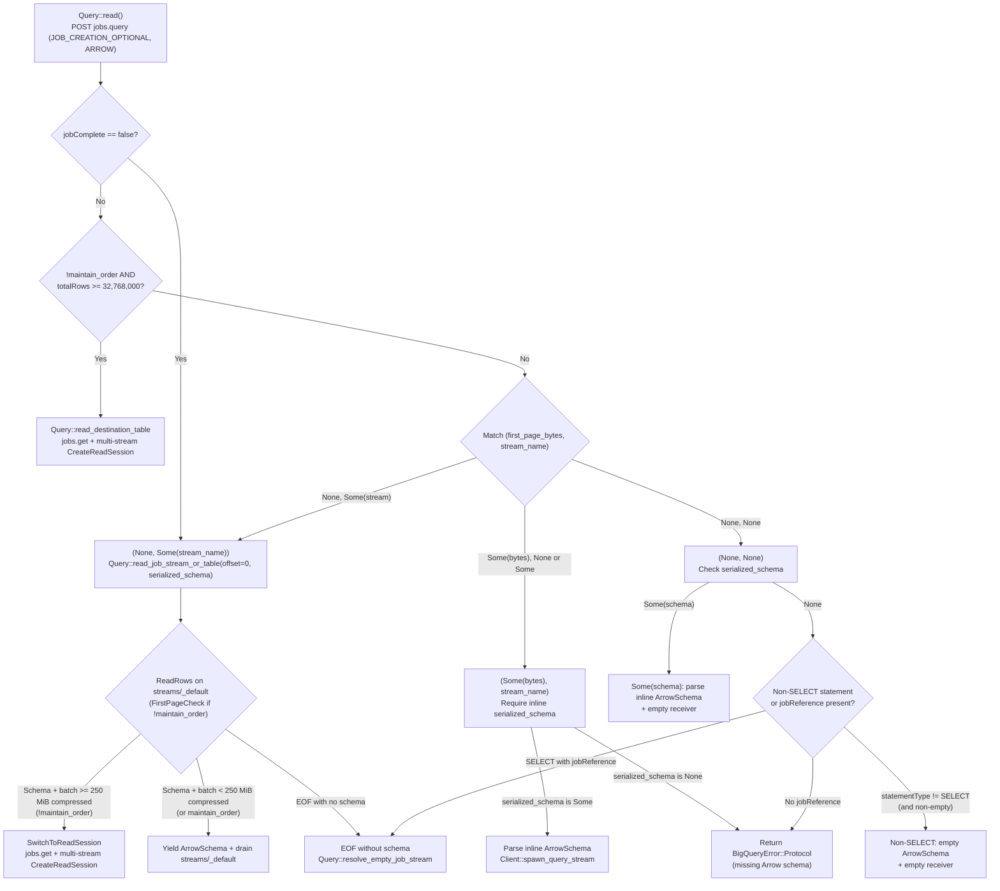

# Handling Completed Large-Result Queries Without Inline Arrow Schemas

*   **Author:** @tswast
*   **Status:** Draft
*   **Date:** 2026-11-02

--------------------------------------------------------------------------------

## Overview

The `arrow-bigquery` Rust crate (and its Python bindings `py-arrow-bigquery` and `polars-bigquery`) executes GoogleSQL queries via Google BigQuery's `jobs.query` REST API and streams results as Apache Arrow Inter-Process Communication (IPC) record batches over the BigQuery Storage Read API (gRPC) and the Arrow C Stream Interface (`ArrowArrayStream`). To avoid job creation overhead on small, fast queries, `arrow-bigquery` submits every query with `jobCreationMode = JOB_CREATION_OPTIONAL`, `queryResultsFormat = ARROW`, and a 200-second initial wait window (`timeoutMs = 200000`).

When a query finishes within that 200-second window (`jobComplete = true`) but its serialized output exceeds BigQuery's inline response limit (~1 MB compressed), BigQuery falls back to creating a job (`jobCreationReason.code = "LARGE_RESULTS"`) and returns zero inline rows (`pageRowCount = 0`, non-empty `pageToken`) while omitting both the inline `arrowRecordBatch` and the inline `arrowSchema`. Today, `arrow-bigquery` treats the missing `arrowSchema` in `QueryResponse` as a fatal protocol error unless an unordered read crosses the existing `32,768,000`-row early exit. This design removes that false protocol failure by resolving missing Arrow schemas lazily from the job's Storage Read API result stream—or from the job's destination table when a completed job produces zero rows—while keeping existing multi-stream cutover thresholds unchanged.

## The Problem

Analytical workloads run queries spanning kilobytes to tens of gigabytes through a single `read_query` entry point. After `arrow-bigquery` switched `jobs.query` to `JOB_CREATION_OPTIONAL` and raised the initial `jobs.query` timeout from BigQuery's 10-second default to 200 seconds, almost all interactive and cached queries complete synchronously inside the initial `jobs.query` call (`jobComplete = true`). That exposed four gaps in how `arrow-bigquery` handles completed query responses:

1.  **Unordered medium-to-large queries fail between ~1 MB compressed and 32.7M rows**: In Python (`polars_bigquery.Client.read_query` and `arrow_bigquery.Client.read_query`), `maintain_order` defaults to `False`. When a query returns more than ~1 MB compressed and fewer than `32,768,000` rows—for example, the 10 MB (~52K rows) through 5 GB (~26M rows) tiers on the New York City `tlc_yellow_trips_2018` dataset (~190.5 logical bytes/row)—`jobs.query` returns `jobComplete = true` with `jobCreationReason.code = "LARGE_RESULTS"` and omits `arrowSchema`. `arrow-bigquery` rejects the response with `BigQuery protocol error: QueryResponse is missing Arrow schema` instead of reading the schema from the job's default result stream (`streams/_default`).
2.  **Ordered queries fail for all result sizes above ~1 MB compressed**: In Rust (`Query::new`), `maintain_order` defaults to `true`, and Python callers executing `ORDER BY` queries pass `maintain_order=True`. Because ordered reads cannot partition a destination table across unsorted parallel streams, they never take the early `ReadSession` exit. As a result, *every* `LARGE_RESULTS` query finishing within 200 seconds—including 10 GB and larger outputs—currently fails when `maintain_order` is `true`.
3.  **Completed zero-row jobs without inline `arrowSchema` are not resolved**: When `jobComplete = true`, `arrow-bigquery` only permits a missing `arrowSchema` if `totalRows` is absent and `statementType != "SELECT"` (short Data Definition Language [DDL] or Data Manipulation Language [DML] statements). If BigQuery creates and completes a job within 200 seconds that yields zero rows and omits inline `arrowSchema`—such as a multi-statement `SCRIPT` or a job-backed empty `SELECT`—the client errors instead of inspecting the job metadata and destination table as it already does when `jobComplete = false`.
4.  **Unit and integration test suites mask live `LARGE_RESULTS` framing**: Unit tests in `arrow-bigquery` mocked zero-row first pages with inline `arrowSchema` populated alongside `pageRowCount = 0` (the inverse of live `LARGE_RESULTS` responses), while the 250,000-row integration test compressed small enough under Zstandard (ZSTD) to return inline without creating a job.

## Goals

*   **Preserve zero extra RPCs on inline `jobs.query` responses**: Keep the fast path for queries whose full result and `arrowSchema` fit inline in `QueryResponse` (`<= ~1 MB` compressed), returning the parsed schema immediately and decoding inline `arrowRecordBatch` payloads without opening any Storage Read API stream or issuing `jobs.get` / `CreateReadSession` calls.
*   **Succeed on all completed `LARGE_RESULTS` queries regardless of row count or ordering**: Allow completed `jobs.query` responses (`jobComplete = true`) that omit inline `arrowSchema` and inline rows to resolve the Arrow schema from `streams/_default` (or a multi-stream `ReadSession` when unordered and above threshold), covering both `maintain_order = false` and `maintain_order = true` from ~1 MB past 10 GB+.
*   **Consistent empty-stream and job-failure handling across sync and async completions**: Ensure completed-job responses routed to `streams/_default` (or returning zero rows with a `jobReference` and no inline `arrowSchema`) apply the same empty-stream schema resolution (`jobs.get` + destination-table `CreateReadSession` for `SELECT`, empty schema for DDL/DML) and `JobFailed` error mapping already used when `jobComplete = false`.
*   **Preserve protocol validation on malformed stateless responses**: Continue returning `BigQueryError::Protocol` when a stateless `SELECT` response (no `jobReference` and no remaining stream) omits `arrowSchema`, or when inline `arrowRecordBatch` bytes arrive without an accompanying inline `arrowSchema`.
*   **Align unit and integration test suites with real BigQuery `LARGE_RESULTS` framing**: Update unit test stubs for zero-row `QueryResponse` pages to omit inline `arrowSchema` and attach `arrowSchema` on the first `ReadRowsResponse`, and add live integration test coverage for `LARGE_RESULTS` queries finishing within `timeoutMs` under both `maintain_order = true` and `maintain_order = false`.

## Non-Goals

*   **Changing multi-stream cutover thresholds (`MULTI_STREAM_THRESHOLD_ROWS = 32,768,000` or `MULTI_STREAM_THRESHOLD_BYTES = 250 MiB`)**: Increasing the pre-connect assumed row width above `8` bytes/row risks unnecessary `jobs.get` + `CreateReadSession` setup (~1.85 s plus session-creation quota) on narrow projections (~50–90% latency regression on ~1 s queries), whereas keeping `32,768,000` rows bounds wide-row overhead to one `~0.90 s` `streams/_default` connection before `FirstPageCheck` switches to a parallel `ReadSession`.
*   **Modifying public Python or Rust API signatures**: No new parameters, methods, or configuration flags are added to `arrow_bigquery.Client`, `polars_bigquery.Client`, or `arrow_bigquery::query::Query`.
*   **Changing `INITIAL_WAIT_MS_DEFAULT` (200 seconds) or `JOB_CREATION_OPTIONAL`**: Request timeout and job creation mode behavior in `jobs.query` remain unchanged.

## Open Questions

None. Missing-schema fallback behavior and retention of the existing `32,768,000`-row pre-connect threshold are resolved.

## Critical User Journeys (CUJs)

### CUJ 1: Small Query Fitting Inline in `jobs.query` (`<= ~1 MB` Compressed)

*   **Given**: An initialized `polars_bigquery.Client`, `arrow_bigquery.Client`, or Rust `Client::query(sql)` (with either `maintain_order = false` or `maintain_order = true`) executing a `SELECT` query that finishes within `timeoutMs` (`jobComplete = true`) and whose full result fits inline in `QueryResponse` (`results_schema` populated, `pageToken == ""`, and `totalRows` absent or `<= pageRowCount`, including zero-row `SELECT ... LIMIT 0` queries).
*   **When**: The caller invokes `client.read_query(sql)` or `Query::read()`.
*   **Then**: `arrow-bigquery` parses the inline `arrowSchema` immediately, decodes the inline `arrowRecordBatch` (when `pageRowCount > 0`) on Rayon's CPU thread pool, and yields all rows without opening any BigQuery Storage Read API stream or calling `jobs.get` or `CreateReadSession`.

### CUJ 2: Unordered Medium-Size Query (`~1 MB` to `< 250 MiB` Compressed and `< 32,768,000` Rows)

*   **Given**: An initialized `polars_bigquery.Client` or `arrow_bigquery.Client` (default `maintain_order = False`) and a GoogleSQL `SELECT` query producing between ~1 MB and `250 MiB` compressed in fewer than `32,768,000` rows (such as the 10 MB–500 MB `tlc_yellow_trips_2018` tiers) that completes within `timeoutMs`.
*   **When**: The caller invokes `client.read_query(sql)` and BigQuery returns `jobComplete = true`, `jobCreationReason.code = "LARGE_RESULTS"`, `pageRowCount = 0`, non-empty `pageToken`, and `results_schema = None`.
*   **Then**: `arrow-bigquery` opens `ReadRows` on `projects/{project}/locations/{location}/jobs/{job_id}/streams/_default` at offset `0`, extracts the `ArrowSchema` from the first non-heartbeat `ReadRowsResponse`, verifies via `FirstPageCheck` that estimated remaining compressed bytes are below `250 MiB`, and drains all batches from that single stream without issuing `jobs.get` or `CreateReadSession` RPCs.

### CUJ 3: Unordered Large Query (`>= 250 MiB` Compressed Below `32,768,000` Rows, or `>= 32,768,000` Rows)

*   **Given**: An initialized client with `maintain_order = False` and a GoogleSQL `SELECT` query that completes within `timeoutMs` (`jobComplete = true`, `LARGE_RESULTS`, `results_schema = None`) with either (a) `totalRows < 32,768,000` and compressed size `>= 250 MiB` (such as the 1 GB–5 GB `tlc_yellow_trips_2018` tiers) or (b) `totalRows >= 32,768,000` (such as the 10 GB tier).
*   **When**: The caller invokes `client.read_query(sql)`.
*   **Then**: In case (a), `arrow-bigquery` obtains the `ArrowSchema` from the first `ReadRowsResponse` on `streams/_default`, detects `estimate_remaining_bytes >= 250 MiB` via `FirstPageCheck`, discards the first page before enqueuing it, and switches to a parallel `ReadSession` on the destination table without duplicating or dropping rows. In case (b), `arrow-bigquery` skips `streams/_default`, fetches the destination table via `jobs.get`, creates a multi-stream `ReadSession`, and reads batches in parallel.

### CUJ 4: Ordered Large Query (`maintain_order = true`, Any Size Above `~1 MB`)

*   **Given**: A Rust `Client::query(sql)` (default `maintain_order = true`) or Python `client.read_query(sql, maintain_order=True)` executing an `ORDER BY` query whose output exceeds ~1 MB compressed (from 10 MB past 10 GB+) and finishes within `timeoutMs` with `results_schema = None`.
*   **When**: The caller awaits `Query::read()` and consumes all batches.
*   **Then**: `arrow-bigquery` does not switch to `read_destination_table` regardless of `totalRows`; it opens `streams/_default` at offset `0`, resolves the `ArrowSchema` from the first schema-bearing `ReadRowsResponse`, decompresses batches through the ordered first-in, first-out (FIFO) decode queue, and yields every row in exact `ORDER BY` sequence.

### CUJ 5: Completed Zero-Row Job vs. Malformed Stateless `SELECT`

*   **Given**: A `jobs.query` call that completes within `timeoutMs` (`jobComplete = true`) with `pageRowCount = 0`, no remaining stream (`pageToken == ""`, no unread `totalRows`), and `results_schema = None`.
*   **When**: Either (a) BigQuery created a job (`jobReference` present, e.g., a procedural `SCRIPT`, DDL/DML statement, or job-backed empty `SELECT`), or (b) no job was created (`jobReference` absent) on a `SELECT` statement.
*   **Then**: In case (a), `arrow-bigquery` returns an empty `ArrowSchema` and empty receiver for non-`SELECT`/DDL statements or resolves the typed `ArrowSchema` from the job's destination table via `jobs.get` + `CreateReadSession` for empty `SELECT` jobs. In case (b), `arrow-bigquery` returns `Err(BigQueryError::Protocol("QueryResponse is missing Arrow schema"))`.

## Technical Plan (Architecture)

### Query Response Routing and Lazy Schema Resolution

All production code changes are confined to `Query::read`, `Query::read_job_stream_or_table`, and `Query::resolve_job_error` in `crates/arrow-bigquery/src/query.rs`. Neither `crates/arrow-bigquery/src/lib.rs` (`Client::read_streams_inner`), `crates/arrow-bigquery/src/bigquery_read_stream.rs` (`ReadStream`), nor the Python bindings (`py-arrow-bigquery`, `py-polars-bigquery`) require structural changes, because `Client::read_stream_with_first_page_check` already accepts `StreamOptions { schema: None, .. }`, extracts the Arrow IPC schema from the first non-heartbeat `ReadRowsResponse` on `streams/_default`, and evaluates `FirstPageCheck` before enqueuing the first batch.

Today, `Query::read` enforces `let Some(serialized_schema) = serialized_schema` across all completed (`jobComplete != false`) responses before matching on `(first_page_bytes, stream_name)`. The fix moves schema-presence validation into the `(first_page_bytes, stream_name)` match arms so inline Arrow schema bytes are required only when inline `arrowRecordBatch` bytes are present (`Some(first_page_bytes)`) or when a zero-row stateless `SELECT` has neither a stream nor a `jobReference`:

### Response State Matrix

The table below defines how `Query::read` handles every valid combination of fields in `QueryResponse`:

| `jobComplete` | `first_page_bytes` | `stream_name` (`has_remaining_rows`) | `serialized_schema` (`arrowSchema`) | Schema Source & Execution Path |
| :--- | :--- | :--- | :--- | :--- |
| `Some(false)` | `None` | `Some(streams/_default)` | `None` | Open `streams/_default` at `offset = 0`; extract `ArrowSchema` from first non-heartbeat `ReadRowsResponse` (or `resolve_empty_job_stream` on EOF without schema). |
| `!= Some(false)` | Any (`0` rows on `LARGE_RESULTS`) | Ignored (`!maintain_order` and `totalRows >= 32,768,000`) | `None` or `Some` | Skip `streams/_default`; call `read_destination_table` (`jobs.get` + multi-stream `CreateReadSession`), obtaining `ArrowSchema` from `ReadSession`. |
| `!= Some(false)` | `Some(bytes)` (`pageRowCount > 0`) | `None` or `Some(streams/_default)` | `Some(schema)` | Parse inline `ArrowSchema` immediately; decode first page on Rayon via `spawn_query_stream` and optionally stream remaining rows from `offset = pageRowCount`. |
| `!= Some(false)` | `Some(bytes)` (`pageRowCount > 0`) | `None` or `Some` | `None` | Return `Err(BigQueryError::Protocol)` because inline `ArrowRecordBatch` bytes cannot be decoded without an Arrow IPC schema header. |
| `!= Some(false)` | `None` (`pageRowCount == 0`) | `Some(streams/_default)` | `Some(schema)` | Parse inline `ArrowSchema` immediately; read `streams/_default` from `offset = 0` (applying `FirstPageCheck` when `!maintain_order`). |
| `!= Some(false)` | `None` (`pageRowCount == 0`) | `Some(streams/_default)` | `None` | **Fixed `LARGE_RESULTS` path**: open `streams/_default` at `offset = 0` with `schema = None`; extract `ArrowSchema` from first `ReadRowsResponse`, then either stay on `streams/_default` or switch via `FirstPageCheck` when `!maintain_order` and remaining compressed bytes `>= 250 MiB`. |
| `!= Some(false)` | `None` (`pageRowCount == 0`) | `None` | `Some(schema)` | Parse inline `ArrowSchema` immediately and return an empty `BigQueryRecordBatchReceiver` with zero extra RPCs (for example, stateless `SELECT 1 LIMIT 0`). |
| `!= Some(false)` | `None` (`pageRowCount == 0`) | `None` | `None` | If `!statement_type.is_empty() && statement_type != "SELECT"`, return empty `ArrowSchema` + empty receiver; else if `jobReference` has `project_id`, `job_id`, and `location`, call `resolve_empty_job_stream`; else return `Err(BigQueryError::Protocol)`. |

### Unified Job Stream Resolution (`Query::read_job_stream_or_table`)

Currently, `Query::read_job_stream_or_table` returns `Result<(Option<ArrowSchemaRef>, BigQueryRecordBatchReceiver), BigQueryError>`: the `job_complete == Some(false)` caller matches `Ok((Some(..), ..))`, `Ok((None, ..)) => resolve_empty_job_stream`, and `Err(..) => resolve_job_error`, while the `(None, Some(stream_name))` caller uses `.await?` and `.expect("schema_ref must be Some when serialized_schema is Some")`.

Consolidating that three-way resolution directly inside `Query::read_job_stream_or_table` changes its return type back to `Result<(ArrowSchemaRef, BigQueryRecordBatchReceiver), BigQueryError>` and unifies both call sites:

1.  **Schema-bearing stream (`Ok((Some(schema_ref), receiver))`)**: Returns `Ok((schema_ref, receiver))`. When `FirstPageCheck` triggers `TerminationReason::SwitchToReadSession` on the first `ReadRowsResponse` (for `!maintain_order` queries `>= 250 MiB` compressed), `ReadStream` has already sent `schema_ref` over the `oneshot` schema channel before terminating without enqueuing the first batch; the background task then runs `Client::switch_to_read_session` against the job's destination table using the same output channel, whose `ReadSession` produces batches with the identical Arrow schema.
2.  **Empty stream (`Ok((None, _receiver))`)**: Invokes `self.resolve_empty_job_stream(response).await`, which inspects `jobs.get`, surfaces `BigQueryError::JobFailed` if `status.error_result` is set, returns an empty `ArrowSchema` for DDL or non-`SELECT` statements, and calls `create_table_read_session` (`max_stream_count = 1`) on `destination_table` to recover the typed `ArrowSchema` when a `SELECT` job produced zero rows.
3.  **Stream error (`Err(err)`)**: Invokes `self.resolve_job_error(response, err).await`. `Query::resolve_job_error` is tightened to inspect `jobs.get` only when `matches!(err, BigQueryError::Grpc(_))`, avoiding an unnecessary `jobs.get` REST call if `parse_arrow_schema` fails locally on corrupt inline `serialized_schema` bytes while still mapping gRPC `ReadRows` failures caused by failed jobs into `BigQueryError::JobFailed`.

## Alternatives Considered

### Alternative A: Raising `MEDIAN_ROW_SIZE_BYTES` from `8` to `50` Bytes (`5,242,880`-Row Threshold)

*   **Pros**: Matches the ~50-byte compressed row width observed near the 80th percentile of analytical tables (including `tlc_yellow_trips_2018` at ~190.5 logical bytes/row and ~50–55 bytes/row LZ4-compressed), allowing wide unordered queries between `5,242,880` and `32,768,000` rows (such as the 1 GB–5 GB benchmark tiers) to skip the initial `~0.90 s` `streams/_default` probe and jump directly to `Query::read_destination_table`.
*   **Cons**: Penalizes narrow projections (such as `SELECT id` or `SELECT ts, metric` at `4–16` compressed bytes/row). Between `5.24M` and `32.7M` rows (`~21–200 MiB` compressed), draining `streams/_default` takes `~1.1–2.9 s` (`~0.90 s` setup + `96 MB/s` compressed transfer), whereas `read_destination_table` pays `jobs.get` (`~0.18 s`) + `CreateReadSession` (`~1.25–1.35 s`) + parallel `ReadRows` setup (`~0.35–0.40 s`) ≈ `1.85 s` up front—adding `~0.53–0.98 s` (`+50–90%` latency on `~1 s` queries) and consuming per-project `CreateReadSession` quota with no fallback back to `streams/_default`.
*   **Reason for Rejection**: Underestimating row width (`8` bytes/row = `32,768,000` rows, the width of a single non-null 64-bit scalar column) has a bounded worst case because `FirstPageCheck` (`250 MiB` compressed) measures actual first-batch byte density on `streams/_default` and switches wide queries to `CreateReadSession` after one `~0.90 s` probe (`+13–33%` on multi-second `>= 1 GB` queries), whereas overestimating row width permanently regresses fast narrow queries and session-creation quota.

### Alternative B: Routing All Unordered `LARGE_RESULTS` Queries Directly to `Query::read_destination_table`

*   **Pros**: Avoids opening `streams/_default` and running `FirstPageCheck` when `maintain_order = false` and `QueryResponse` omits inline `arrowSchema`, fetching both the `ArrowSchema` and parallel stream names via `jobs.get` + `CreateReadSession`.
*   **Cons**: Forces every unordered query between `~1 MB` and `250 MiB` compressed (including the 10 MB–200 MB benchmark tiers) to pay `~1.85 s` of `jobs.get` + `CreateReadSession` setup and consume `CreateReadSession` quota instead of opening `streams/_default` directly (`~0.90 s`), regressing 10–100 MB query latency by `~0.53–0.95 s`. Ordered reads (`maintain_order = true`) still require lazy schema extraction on `streams/_default`, so this approach does not eliminate the `streams/_default` code path.
*   **Reason for Rejection**: Opening `streams/_default` at `offset = 0` with `schema = None` resolves the `ArrowSchema` and starts streaming compressed batches in one gRPC call without `jobs.get` or `CreateReadSession` overhead, while retaining `FirstPageCheck` cutover for payloads `>= 250 MiB` compressed.

### Alternative C: Fetching Schema or Byte Size via `jobs.get` + `tables.get` Before Opening `streams/_default`

*   **Pros**: Discovers destination-table `numBytes` and schema via REST before opening `streams/_default`, allowing byte-accurate routing between `streams/_default` and `CreateReadSession` when `QueryResponse` omits `arrowSchema`.
*   **Cons**: Requesting `queryResultsFormat = ARROW` causes `jobs.query` to omit `QueryResponse.schema` (`TableSchema`) altogether, and `LARGE_RESULTS` omits `results_schema` (`arrowSchema`) as well. Inspecting table schema or byte size before opening `streams/_default` therefore requires two sequential REST round-trips (`jobs.get` for `configuration.query.destinationTable` followed by `tables.get` for `numBytes`/`schema`), adding `~0.30–0.40 s` of latency to every medium-size query (`10–500 MB`) that stays on `streams/_default`.
*   **Reason for Rejection**: The first non-heartbeat `ReadRowsResponse` on `streams/_default` already delivers the serialized `ArrowSchema` alongside the first compressed `ArrowRecordBatch` (whose byte length feeds `FirstPageCheck` directly). Extra REST metadata calls are justified only when `streams/_default` yields zero rows (`resolve_empty_job_stream`) or when `totalRows >= 32,768,000` (`read_destination_table`).

--------------------------------------------------------------------------------

## Non-Functional Requirements

*   **Latency & Quota Bounds**: Inline queries (`<= ~1 MB` compressed) issue zero RPCs beyond `jobs.query`. Unordered medium queries (`~1 MB` to `< 250 MiB` compressed and `< 32,768,000` rows) resolve schema and data in a single `ReadRows` stream on `streams/_default` with zero `jobs.get` or `CreateReadSession` calls. `CreateReadSession` quota is consumed only when unordered results exceed `32,768,000` rows, exceed `250 MiB` estimated compressed bytes on `FirstPageCheck`, or require empty-job `SELECT` schema recovery (`max_stream_count = 1`).
*   **Ordering & Protocol Integrity**: Ordered reads (`maintain_order = true`) never partition across `CreateReadSession` streams at any row count and preserve `ORDER BY` sequence through `OrderedDecodeQueue`. Malformed responses—inline `arrowRecordBatch` bytes without inline `arrowSchema`, or stateless `SELECT` responses lacking `arrowSchema`, a remaining stream, and a complete `jobReference`—fail immediately with `BigQueryError::Protocol`.

--------------------------------------------------------------------------------

### Additional Resources

*   [BigQuery REST API `jobs.query` Reference](https://cloud.google.com/bigquery/docs/reference/rest/v2/jobs/query) — Documents `jobCreationMode = JOB_CREATION_OPTIONAL`, `JobCreationReason` (`LARGE_RESULTS`), and `QueryResponse` pagination fields.
*   [`arrow-bigquery` `read_table` & Stream Reconnection Design](./arrow_bigquery_crate_read_table_reconnection.md) — Specifies the `ReadStream` state machine, `StreamOptions { schema: None, .. }` lazy schema extraction, and Rayon `DecodeQueue` pipeline reused by `Query::read`.

### Future Improvements

*   **Direct compressed-size routing if exposed on `QueryResponse`**: If BigQuery's `jobs.query` response adds destination-table logical or compressed byte totals alongside `totalRows` on `LARGE_RESULTS`, `Query::read` can route wide `>= 250 MiB` unordered queries directly to `read_destination_table` without either guessing row width or paying the `~0.90 s` `FirstPageCheck` probe on `streams/_default`.

--------------------------------------------------------------------------------

## Detailed Implementation Plan

### Target Files to Create/Modify

#### 1. `crates/arrow-bigquery/src/query.rs` (Modify)

*   **Type / Scope**: Rust Query Execution Routing and Unit Test Suite
*   **Rationale**: `Query::read` currently rejects any completed (`jobComplete != false`) `LARGE_RESULTS` response that omits inline `arrowSchema` unless `!maintain_order && totalRows >= 32,768,000`, and existing zero-first-page unit test stubs populate inline `arrowSchema` where live BigQuery omits it. Updating `Query::read`, `Query::read_job_stream_or_table`, `Query::resolve_job_error`, and the `query::tests` module fixes missing-schema resolution across all response states and aligns unit tests with live wire framing.
*   **Proposed Changes**:
    *   **`Query::read(&self) -> Result<(ArrowSchemaRef, BigQueryRecordBatchReceiver), BigQueryError>`**:
        *   In the `response.job_complete == Some(false)` branch, return `self.read_job_stream_or_table(&response, stream_name, 0, None).await` directly.
        *   Keep `MULTI_STREAM_THRESHOLD_BYTES`, `MEDIAN_ROW_SIZE_BYTES`, `MULTI_STREAM_THRESHOLD_ROWS`, and the `!self.maintain_order && total_rows >= MULTI_STREAM_THRESHOLD_ROWS` early exit to `self.read_destination_table(&response)` unchanged.
        *   Remove the unconditional `let Some(serialized_schema) = serialized_schema else { ... };` guard ahead of `match (first_page_bytes, stream_name)` and validate or resolve the schema inside each arm:
            *   `(None, None)`: If `serialized_schema` is `Some(bytes)`, parse `metadata` via `crate::decode::parse_arrow_schema(&bytes)?` and return `(Arc::new(metadata.schema), empty_receiver())`. Otherwise, if `!response.statement_type.is_empty() && response.statement_type != "SELECT"`, return `(Arc::new(ArrowSchema::default()), empty_receiver())` without calling `jobs.get`. Otherwise, if `extract_job_reference(&response)` yields `(Some(_), Some(_), Some(_))`, return `self.resolve_empty_job_stream(&response).await`. Otherwise, return `Err(BigQueryError::Protocol("QueryResponse is missing Arrow schema".into()))`.
            *   `(None, Some(stream_name))`: Delegate directly to `self.read_job_stream_or_table(&response, stream_name, response.page_row_count, serialized_schema).await`, removing the `.expect("schema_ref must be Some when serialized_schema is Some")` unwrap so `serialized_schema = None` resolves lazily from `streams/_default`.
            *   `(Some(first_page_bytes), stream_name)`: Require `serialized_schema` to be `Some(bytes)`—returning `Err(BigQueryError::Protocol("QueryResponse is missing Arrow schema".into()))` when `None`—parse `metadata` via `crate::decode::parse_arrow_schema(&bytes)?`, and spawn `self.client.spawn_query_stream(...)`.
    *   **`Query::read_job_stream_or_table(&self, response: &QueryResponse, stream_name: String, offset: i64, serialized_schema: Option<bytes::Bytes>) -> Result<(ArrowSchemaRef, BigQueryRecordBatchReceiver), BigQueryError>`**:
        *   Change the return type from `Option<ArrowSchemaRef>` to `ArrowSchemaRef` and fold the three-way match on `self.client.read_stream_with_first_page_check(...)` into this helper:
            *   `Ok((Some(schema_ref), receiver))` -> `Ok((schema_ref, receiver))`
            *   `Ok((None, _receiver))` -> `self.resolve_empty_job_stream(response).await`
            *   `Err(err)` -> `Err(self.resolve_job_error(response, err).await)`
    *   **`Query::resolve_job_error(&self, response: &QueryResponse, original_err: BigQueryError) -> BigQueryError`**:
        *   Return `original_err` immediately when `!matches!(original_err, BigQueryError::Grpc(_))` so local Arrow IPC schema parse errors (`BigQueryError::Arrow`) or protocol errors (`BigQueryError::Protocol`) do not trigger a `jobs.get` REST call.
    *   **Unit tests (`mod tests`)**:
        *   Update existing zero-first-page stubs to mirror live `LARGE_RESULTS` responses by omitting `arrow_schema` on `QueryResponse`, attaching `ArrowSchema` on the first `ReadRowsResponse` on `streams/_default` (or `ReadSession` when skipping `streams/_default`), and asserting the resolved `ArrowSchema` column names:
            *   `test_read_empty_first_page_with_remaining_rows_streams_from_read_rows`
            *   `test_read_maintain_order_false_switches_to_read_table_above_threshold`
            *   `test_read_maintain_order_false_empty_first_page_switches_to_read_table_above_threshold`
            *   `test_read_maintain_order_below_threshold_or_default_true_keeps_single_stream` (adding a sub-case with `maintain_order = true`, `results_schema = None`, and `total_rows >= MULTI_STREAM_THRESHOLD_ROWS` to verify ordered large queries stay on `streams/_default` without calling `get_job`)
        *   Add unit tests covering the remaining `QueryResponse` state-matrix edges:
            *   `test_read_empty_first_page_with_inline_schema_streams_from_read_rows`: verifies `(None, Some(stream_name))` with `Some(serialized_schema)` parses the upfront schema without requiring `ArrowSchema` on `ReadRowsResponse`, and verifies corrupt inline `serialized_schema` bytes return `BigQueryError::Arrow` without calling `get_job`.
            *   `test_read_inline_batch_missing_arrow_schema_error`: verifies `(Some(first_page_bytes), _)` with `results_schema = None` returns `Err(BigQueryError::Protocol)` even when `job_reference` and `page_token` are present.
            *   `test_read_completed_empty_job_without_inline_schema`: verifies `(None, None)` with `job_complete = true` and `results_schema = None` resolves the typed `ArrowSchema` via `get_job` + `create_read_session` (`max_stream_count = 1`) for an empty `SELECT` job while returning an empty `ArrowSchema` with zero `get_job` calls when `statement_type = "INSERT"` and `total_rows = Some(0)`.
            *   `test_read_completed_large_results_stream_eof_and_grpc_failure`: verifies `(None, Some(stream_name))` with `job_complete = true` and `results_schema = None` delegates clean `streams/_default` EOF to `resolve_empty_job_stream` and maps `ReadRows` gRPC errors on failed jobs into `BigQueryError::JobFailed` via `resolve_job_error`.

#### 2. `crates/arrow-bigquery/tests/integration_test.rs` (Modify)

*   **Type / Scope**: Rust Live BigQuery Integration Tests
*   **Rationale**: Existing `test_read_query` exercises a 250,000-row public table query under ZSTD that compresses below BigQuery's ~1 MB inline cap, never exercising `jobComplete = true` + `jobCreationReason.code = "LARGE_RESULTS"` (`results_schema = None`). Adding a deterministic >1 MB compressed synthetic query validates live `LARGE_RESULTS` schema resolution for both ordered and unordered reads while scanning zero table bytes.
*   **Proposed Changes**:
    *   Add `test_read_completed_large_results_query` executing a 50,000-row synthetic `UNNEST(GENERATE_ARRAY(1, 50000))` query projecting `id` and two concatenated `TO_HEX(SHA256(...))` strings (`128` hex bytes / `64` bytes of cryptographic entropy per row, guaranteeing `> 3 MiB` compressed output under both `Lz4Frame` and `Zstd` while scanning `0` table bytes and completing well within the 200-second `jobs.query` window):
        *   Run with `maintain_order = false`, asserting schema column names (`["id", "payload"]`) and total row count (`50_000`).
        *   Run with `ORDER BY id ASC` and default `maintain_order = true`, asserting schema column names, total row count (`50_000`), and strict monotonic `id` ordering `1..=50_000` across batches.

#### 3. `py-polars-bigquery/tests/system/test_read_bigquery_integration.py` (Modify)

*   **Type / Scope**: Python End-to-End Integration Tests (`polars-bigquery` + `py-arrow-bigquery`)
*   **Rationale**: Current Python system tests return `<= 250` rows inline and do not cover `LARGE_RESULTS` queries through `polars_bigquery.Client.read_query` and the Arrow C Stream FFI boundary (`ArrowArrayStream`) in Cloud Build CI (`mask test integration`).
*   **Proposed Changes**:
    *   Add `test_read_bigquery_large_results` running the zero-table-scan 50,000-row incompressible `SHA256` query through `client.read_query(...)` with both `maintain_order=False` (asserting `df.height == 50_000` and expected columns/dtypes) and `maintain_order=True` with `ORDER BY id ASC` (asserting `df.height == 50_000` and `df["id"].is_sorted()`).

### Verification Plan

*   **Compilation/Build**:
    *   Rust workspace, unit test, and benchmark targets: `cargo test --workspace --exclude py-arrow-bigquery --exclude py-polars-expressions-testing --lib --bins --benches --features testing --no-run`
    *   Python extension builds: `uv sync --project py-arrow-bigquery --group dev` and `uv sync --project py-polars-bigquery --group dev`
*   **Unit Tests**:
    *   Rust unit tests: `cargo test --workspace --exclude py-arrow-bigquery --exclude py-polars-expressions-testing --lib --bins --features testing`
    *   Python unit tests: `uv run pytest py-arrow-bigquery` and `uv run pytest py-polars-bigquery`
*   **Static Analysis & Linting**:
    *   Rust formatting and lints: `cargo fmt --all -- --check` and `cargo clippy --workspace --exclude py-arrow-bigquery --exclude py-polars-expressions-testing --all-targets --features testing -- -D warnings`
    *   Python formatting and lints: `uv run --project py-polars-bigquery --group dev ruff check --no-fix py-polars-bigquery/ py-arrow-bigquery/` and `uv run --project py-polars-bigquery --group dev ruff format --diff py-polars-bigquery/ py-arrow-bigquery/`
*   **Test Coverage Requirement**: Every row of the `QueryResponse` State Matrix in `crates/arrow-bigquery/src/query.rs` is exercised by deterministic stub-based unit tests without network access, including inline fast path, completed `LARGE_RESULTS` with `results_schema = None` (`maintain_order = false` below/above `FirstPageCheck` and `>= MULTI_STREAM_THRESHOLD_ROWS`, plus `maintain_order = true` above threshold), completed zero-row `SELECT` and non-`SELECT` jobs, `streams/_default` EOF/gRPC failure fallbacks, and `BigQueryError::Protocol` validation on malformed responses.
*   **E2E/Integration**: With Google Application Default Credentials and `GOOGLE_CLOUD_PROJECT` configured:
    *   Rust live BigQuery integration suite: `GOOGLE_CLOUD_PROJECT=<project-id> cargo test --package arrow-bigquery --test integration_test --features testing`
    *   Python live BigQuery system suite: `GOOGLE_CLOUD_PROJECT=<project-id> uv run --project py-polars-bigquery --group test pytest py-polars-bigquery/tests/system`

--------------------------------------------------------------------------------

<!-- Provenance: Indicates initial structural drafting via EGM. -->

*Drafted with EGM*
