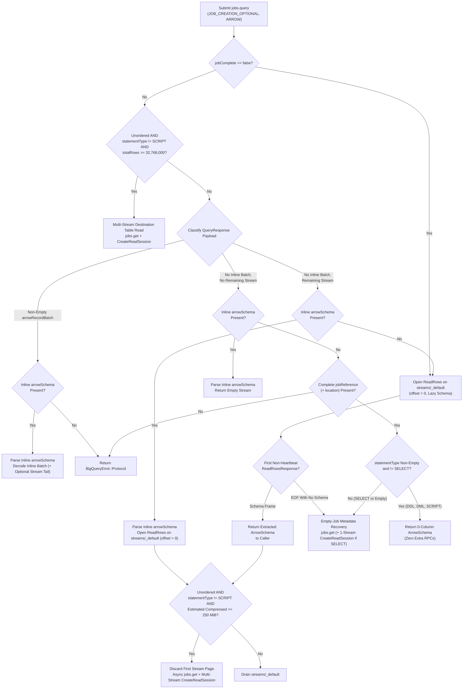

# Handling Completed Large-Result Queries Without Inline Arrow Schemas

*   **Author:** @tswast
*   **Status:** Approved
*   **Created:** 2026-11-02
*   **Last updated:** 2026-11-03

--------------------------------------------------------------------------------

## Overview

The `arrow-bigquery` Rust crate (and its Python workspace packages `py-arrow-bigquery` and `py-polars-bigquery`) executes GoogleSQL queries via Google BigQuery's `jobs.query` REST API and streams results as Apache Arrow Inter-Process Communication (IPC) record batches over the BigQuery Storage Read API (gRPC) and the Arrow C Stream Interface (`ArrowArrayStream`). To avoid job creation overhead on small, fast queries, `arrow-bigquery` submits every query with `jobCreationMode = JOB_CREATION_OPTIONAL`, `queryResultsFormat = ARROW`, and a 200-second initial wait window (`timeoutMs = 200000`).

When a query finishes within that 200-second window (`jobComplete = true`) and its serialized output exceeds BigQuery's inline response limit (~1 MB compressed), BigQuery falls back to creating a job (`jobCreationReason.code = "LARGE_RESULTS"`). In that response, BigQuery returns zero inline rows (`pageRowCount = 0`, non-empty `pageToken`) and omits both the inline `arrowRecordBatch` and the inline `arrowSchema`. Today, `arrow-bigquery` treats the missing `arrowSchema` in `QueryResponse` as a fatal protocol error unless an unordered read crosses the existing 32,768,000-row pre-connect cutover (250 MiB multi-stream target divided by an 8-byte assumed row width), which skips `streams/_default` and opens a parallel destination-table `ReadSession`.

This design removes that false protocol failure by resolving missing Arrow schemas lazily from the first non-heartbeat `ReadRowsResponse` on the job's Storage Read API stream (`streams/_default`), or from a destination-table `ReadSession` when a completed `SELECT` job produces zero rows, while keeping existing multi-stream cutover thresholds unchanged.

## The Problem

Analytical workloads run queries spanning kilobytes to tens of gigabytes through a single `read_query` entry point. After `arrow-bigquery` switched `jobs.query` to `JOB_CREATION_OPTIONAL` and raised the initial `jobs.query` timeout from BigQuery's 10-second default to 200 seconds, almost all interactive and cached queries complete within the initial `jobs.query` call (`jobComplete = true`). That exposed four gaps in how `arrow-bigquery` handles completed query responses:

1.  **Unordered medium-to-large queries fail between ~1 MB compressed and 32,768,000 rows**: In Python (`polars_bigquery.Client.read_query` and `arrow_bigquery.Client.read_query`), `maintain_order` defaults to `False`. When a query returns more than ~1 MB compressed and fewer than `32,768,000` rows, `jobs.query` returns `jobComplete = true` with `jobCreationReason.code = "LARGE_RESULTS"` and omits `arrowSchema`. `arrow-bigquery` rejects the response with `BigQueryError::Protocol("QueryResponse is missing Arrow schema")` instead of reading the schema from the job's default result stream (`streams/_default`).
2.  **Ordered queries and large unordered `SCRIPT` queries fail above ~1 MB compressed**: In Rust ([`Client::query`](../../crates/arrow-bigquery/src/lib.rs)), `maintain_order` defaults to `true`, and Python callers executing `ORDER BY` queries pass `maintain_order=True`. Because ordered reads cannot partition a destination table across unsorted parallel streams, they never take the early `ReadSession` exit, so every `LARGE_RESULTS` query finishing within 200 seconds fails when `maintain_order` is `true`. In addition, completed unordered multi-statement `SCRIPT` queries that trigger destination-table `ReadSession` creation fail with `BigQueryError::Protocol` because parent `SCRIPT` jobs have no `configuration.query.destinationTable`.
3.  **Completed zero-row jobs without inline `arrowSchema` are handled inconsistently, and empty `statementType` bypasses stateless validation**: When `jobComplete = true`, `arrow-bigquery` permits a missing `arrowSchema` whenever `totalRows` is absent and `statementType != "SELECT"`. Consequently, it rejects completed non-`SELECT` jobs (Data Definition Language (DDL), Data Manipulation Language (DML), or multi-statement `SCRIPT`) that populate `totalRows = 0`. It also rejects completed zero-row `SELECT` jobs instead of recovering their typed schema via `jobs.get` and the destination table, while accepting stateless responses with an empty `statementType` (`""`) without requiring a `jobReference`.
4.  **Unit and integration test suites mask live `LARGE_RESULTS` framing**: Unit tests in `arrow-bigquery` mocked zero-row first pages with inline `arrowSchema` populated alongside `pageRowCount = 0` (the inverse of live `LARGE_RESULTS` responses), while the 250,000-row integration test compressed small enough under Zstandard (ZSTD) to return inline without creating a job.

## Goals

*   **Preserve zero extra RPCs on inline `jobs.query` responses**: Keep the fast path for queries whose full result and `arrowSchema` fit inline in `QueryResponse` (<= ~1 MB compressed), returning the parsed schema immediately and decoding inline `arrowRecordBatch` payloads without opening any Storage Read API stream or issuing `jobs.get` or `CreateReadSession` calls.
*   **Succeed on completed `LARGE_RESULTS` queries across row counts and ordering modes**: Allow completed `jobs.query` responses (`jobComplete = true`) that omit inline `arrowSchema` and inline rows to resolve the Arrow schema from `streams/_default` (or a multi-stream `ReadSession` when unordered, non-`SCRIPT`, and above threshold), temporarily keeping completed `SCRIPT` queries on `streams/_default` so both `maintain_order = false` and `maintain_order = true` succeed.
*   **Handle empty results and job failures consistently across `jobComplete = true` and `jobComplete = false`**: Return a 0-column `ArrowSchema` with zero extra RPCs when a completed job-backed response (`jobReference` present) reports a non-`SELECT` `QueryResponse.statementType` (DDL, DML, `SCRIPT`). Inspect `jobs.get` (and destination-table `CreateReadSession` for `SELECT`) when a `SELECT` or unspecified-type job produces zero rows, and enrich pre-schema `ReadRows` gRPC errors into `BigQueryError::JobFailed` when the underlying job failed.
*   **Reject malformed stateless empty responses**: Return `BigQueryError::Protocol` whenever a zero-row response without a remaining stream lacks both inline `arrowSchema` and a complete `jobReference` (regardless of `statementType`).
*   **Align offline and live test coverage with real BigQuery `LARGE_RESULTS` framing**: Exercise schema-less zero-row `QueryResponse` pages followed by schema-bearing `ReadRowsResponse` frames in unit tests, and add live integration test coverage for `LARGE_RESULTS` queries finishing within `timeoutMs` under both `maintain_order = true` and `maintain_order = false`.

## Non-Goals

*   **Changing multi-stream cutover thresholds (`32,768,000` rows or 250 MiB compressed)**: Pre-connect row-count and first-batch byte-size thresholds remain unchanged (see [Alternative A](#alternative-a-raising-assumed-row-width-from-8-to-50-bytes-5242880-row-threshold) for the latency and quota trade-offs).
*   **Child-job destination-table lookup and parallel `ReadSession` support for `SCRIPT` queries**: Resolving child jobs via `jobs.list(parentJobId=...)` to read large multi-statement `SCRIPT` results across parallel `ReadSession` streams, handling incomplete (`jobComplete = false`) `SCRIPT` cutovers where `QueryResponse.statementType` is empty, and recovering trailing-`SELECT` column schemas on zero-row `SCRIPT` jobs are left to future work.
*   **Modifying public Python or Rust API signatures**: No new parameters, methods, or configuration flags are added to `arrow_bigquery.Client`, `polars_bigquery.Client`, or `arrow_bigquery::Client::query`.
*   **Changing the 200-second initial wait default or `JOB_CREATION_OPTIONAL`**: Request timeout and job creation mode behavior in `jobs.query` remain unchanged.

## Open Questions

None. Missing-schema fallback behavior, temporary `streams/_default` routing for completed `SCRIPT` jobs, and retention of the existing `32,768,000`-row pre-connect threshold are resolved.

## Critical User Journeys (CUJs)

### CUJ 1: Small Query Fitting Inline in `jobs.query` (<= ~1 MB Compressed)

*   **Given**: An initialized `polars_bigquery.Client`, `arrow_bigquery.Client`, or Rust `Client` (with `maintain_order` set to `false` or `true`), and a `SELECT` query that finishes within `timeoutMs` (`jobComplete = true`) whose full result fits inline in `QueryResponse` (inline `arrowSchema` present, `pageToken == ""`, and `totalRows` absent or `<= pageRowCount`, including stateless `SELECT ... LIMIT 0` queries).
*   **When**: The caller invokes `client.read_query(sql)` or `client.query(sql).read()`.
*   **Then**: The client parses the inline `arrowSchema` immediately, decodes any inline `arrowRecordBatch` off the async I/O runtime, and yields all rows without opening any BigQuery Storage Read API stream or calling `jobs.get` or `CreateReadSession`.

### CUJ 2: Unordered Medium-Size Query (~1 MB to < 250 MiB Compressed and < 32,768,000 Rows)

*   **Given**: An initialized `polars_bigquery.Client` or `arrow_bigquery.Client` (default `maintain_order = False`) and a GoogleSQL `SELECT` query producing between ~1 MB and 250 MiB compressed in fewer than `32,768,000` rows that completes within `timeoutMs`.
*   **When**: The caller invokes `client.read_query(sql)` and BigQuery returns `jobComplete = true`, `jobCreationReason.code = "LARGE_RESULTS"`, `pageRowCount = 0`, non-empty `pageToken`, and no inline `arrowSchema`.
*   **Then**: The client opens `ReadRows` on `projects/{project}/locations/{location}/jobs/{job_id}/streams/_default` at `offset = 0`, resolves the `ArrowSchema` from `ReadRowsResponse.arrow_schema` on the first non-heartbeat frame, confirms from the first batch's compressed byte density that estimated remaining output is below 250 MiB, and drains all batches from that single stream without issuing `jobs.get` or `CreateReadSession` RPCs.

### CUJ 3: Unordered Large `SELECT` Query (>= 250 MiB Compressed Below 32,768,000 Rows, or >= 32,768,000 Rows)

*   **Given**: An initialized client with `maintain_order = False` and a GoogleSQL `SELECT` query that completes within `timeoutMs` (`jobComplete = true`, `LARGE_RESULTS`, inline `arrowSchema` omitted) with either (a) `totalRows < 32,768,000` and compressed size >= 250 MiB or (b) `totalRows >= 32,768,000`.
*   **When**: The caller invokes `client.read_query(sql)`.
*   **Then**: In case (a), the client returns the `ArrowSchema` extracted from the first non-heartbeat `ReadRowsResponse` on `streams/_default` immediately to minimize latency, detects estimated remaining compressed output >= 250 MiB, discards that first stream page before emitting any rows, and switches asynchronously to a parallel `ReadSession` on the job's destination table (fetched via `jobs.get`) without duplicating or dropping rows (assuming BigQuery serves a matching schema on the destination table; any post-handoff `jobs.get` or `CreateReadSession` failure surfaces on `BigQueryRecordBatchReceiver::recv`, which `polars-bigquery` raises as `polars.exceptions.ComputeError`). In case (b), the client skips `streams/_default`, fetches the destination table via `jobs.get`, creates a multi-stream `ReadSession`, and streams batches concurrently.

### CUJ 4: Ordered Large Query (or Completed Large `SCRIPT` Query) Above ~1 MB Compressed

*   **Given**: A Rust `Client::query(sql)` (default `maintain_order = true`), Python `client.read_query(sql, maintain_order=True)` executing an `ORDER BY` query, or an unordered multi-statement `SCRIPT` query whose output exceeds ~1 MB compressed and finishes within `timeoutMs` with inline `arrowSchema` omitted.
*   **When**: The caller invokes `read()` / `read_query()` and consumes all batches.
*   **Then**: The client skips destination-table `ReadSession` creation regardless of `totalRows` or compressed size, opens `streams/_default` at `offset = 0`, resolves the `ArrowSchema` from the first schema-bearing `ReadRowsResponse`, and drains `streams/_default` (preserving exact `ORDER BY` sequence via sequential batch decoding when `maintain_order = true`).

### CUJ 5: Completed Zero-Row Job vs. Malformed Stateless Response

*   **Given**: A `jobs.query` call that completes within `timeoutMs` (`jobComplete = true`) with `pageRowCount = 0`, no remaining stream (`pageToken == ""`, no unread `totalRows`), and inline `arrowSchema` omitted.
*   **When**: Either (a) BigQuery created a job (a complete job reference with `jobReference.projectId`, `jobReference.jobId`, and a location in `jobReference.location` or `QueryResponse.location` is present—such as a DDL/DML statement, procedural `SCRIPT`, or job-backed empty `SELECT`), or (b) no complete job reference is present.
*   **Then**: In case (a), if `QueryResponse.statementType` identifies a non-`SELECT` statement, the client returns a 0-column `ArrowSchema` with zero extra RPCs. If `statementType` is `"SELECT"` or omitted, the client inspects `jobs.get`—returning `BigQueryError::JobFailed` on job error, a 0-column `ArrowSchema` if job metadata reports DDL or another non-`SELECT` statement, or the typed `ArrowSchema` from a single-stream destination-table `CreateReadSession` for empty `SELECT` jobs. In case (b), the client returns `Err(BigQueryError::Protocol)` regardless of `statementType`.

## Technical Plan (Architecture)

### Query Response Routing and Lazy Schema Resolution

All production changes are localized to the query execution router in [`crates/arrow-bigquery/src/query.rs`](../../crates/arrow-bigquery/src/query.rs). The Storage Read stream state machine ([`crates/arrow-bigquery/src/bigquery_read_stream.rs`](../../crates/arrow-bigquery/src/bigquery_read_stream.rs)), multi-stream coordinator ([`crates/arrow-bigquery/src/lib.rs`](../../crates/arrow-bigquery/src/lib.rs)), and Python packages (`py-arrow-bigquery`, `py-polars-bigquery`) require no structural changes, because the existing single-stream reader already extracts `ReadRowsResponse.arrow_schema` lazily from the first non-heartbeat frame on `streams/_default` and evaluates the 250 MiB compressed-size cutover before emitting the first batch. Throughout this specification, BigQuery REST v2 JSON fields use `camelCase` (`QueryResponse.arrowSchema`, `QueryResponse.totalRows`) and Storage Read API gRPC/protobuf and Rust identifiers use `snake_case` (`ReadRowsResponse.arrow_schema`, `ReadSession.arrow_schema`).

Previously, the query router required an inline `QueryResponse.arrowSchema` across almost all completed (`jobComplete != false`) responses before classifying the payload. Across BigQuery's REST and Storage Read APIs, the serialized Arrow schema can instead originate from three places depending on how BigQuery executes the query: inline on `jobs.query` (`QueryResponse.arrowSchema`), on the first non-heartbeat `ReadRowsResponse` from `streams/_default` (`ReadRowsResponse.arrow_schema`), or on `CreateReadSession` (`ReadSession.arrow_schema`) against the job's destination table. This design moves schema resolution into each payload classification branch (after the unordered non-`SCRIPT` `totalRows >= 32,768,000` destination-table bypass) while temporarily skipping `ReadSession` creation when `QueryResponse.statementType == "SCRIPT"`:

### Response State Matrix

The table below defines how the query router handles `QueryResponse` states, evaluated top-to-bottom (first matching row applies):

| `jobComplete` | Inline `arrowRecordBatch` | Remaining Stream (`pageToken` or Unread `totalRows`) | Inline `arrowSchema` | Schema Source & Execution Path |
| :--- | :--- | :--- | :--- | :--- |
| `false` | Absent | Present (`streams/_default`) | Absent | Open `streams/_default` at `offset = 0`; extract `ArrowSchema` from `ReadRowsResponse.arrow_schema` on the first non-heartbeat frame (or run empty-job metadata recovery on EOF without schema). |
| `true` or omitted | Ignored (`0` rows on `LARGE_RESULTS`) | Ignored (unordered, `statementType != "SCRIPT"`, and `totalRows >= 32,768,000`) | Absent or Present | Skip `streams/_default`; fetch destination table via `jobs.get` and open a multi-stream `CreateReadSession`, obtaining `ArrowSchema` from `ReadSession.arrow_schema`. |
| `true` or omitted | Present (non-empty bytes) | Absent or Present (`streams/_default`) | Present | Parse inline `arrowSchema` immediately; decode inline batch off the async runtime and optionally stream remaining rows from `offset = pageRowCount`. |
| `true` or omitted | Present (non-empty bytes) | Absent or Present | Absent | Return `Err(BigQueryError::Protocol)` because inline `arrowRecordBatch` bytes cannot be decoded without an Arrow IPC schema header. |
| `true` or omitted | Absent (`pageRowCount == 0`) | Present (`streams/_default`) | Present | Parse inline `arrowSchema` immediately; read `streams/_default` from `offset = 0` (evaluating the 250 MiB cutover check on the first batch when unordered and `statementType != "SCRIPT"`). |
| `true` or omitted | Absent (`pageRowCount == 0`) | Present (`streams/_default`) | Absent | Open `streams/_default` at `offset = 0` without an upfront schema; extract `ArrowSchema` from the first non-heartbeat `ReadRowsResponse`, then either drain `streams/_default` or switch to a parallel `ReadSession` when unordered, `statementType != "SCRIPT"`, and estimated remaining compressed bytes >= 250 MiB. |
| `true` or omitted | Absent (`pageRowCount == 0`) | Absent | Present | Parse inline `arrowSchema` immediately and return an empty stream with zero extra RPCs (for example, stateless `SELECT 1 LIMIT 0`). |
| `true` or omitted | Absent (`pageRowCount == 0`) | Absent | Absent | Require a complete job reference (`jobReference.projectId`, `jobReference.jobId`, and `jobReference.location` or `QueryResponse.location`), returning `Err(BigQueryError::Protocol)` if missing. When present, return a 0-column `ArrowSchema` with zero extra RPCs if `statementType` is non-empty and `!= "SELECT"`; otherwise, run empty-job metadata recovery (`jobs.get` + 1-stream `CreateReadSession` if `SELECT`). |

### Unified Job Stream and Error Resolution

Both incomplete jobs (`jobComplete = false`) and completed zero-inline-row queries with remaining rows (`LARGE_RESULTS`) share a single `streams/_default` resolution path governed by three invariants:

1.  **Low-latency schema handoff before session cutover**: When `streams/_default` delivers its first non-heartbeat `ReadRowsResponse`, the stream reader forwards the extracted `ArrowSchema` (`ReadRowsResponse.arrow_schema`) to the caller immediately before evaluating the 250 MiB compressed-size threshold. For unordered reads with `statementType != "SCRIPT"`, remaining compressed output is estimated from the first batch's byte density as `first_batch_bytes * (total_rows - first_batch_rows) / first_batch_rows`, using `ReadRowsResponse.total_estimated_row_count` (falling back to `QueryResponse.totalRows` when omitted). If that estimate is >= 250 MiB, the client discards the first stream page before decoding and switches asynchronously to a parallel `CreateReadSession` on the destination table from row `0`, trusting BigQuery to serve a matching `ReadSession.arrow_schema` on the same temporary destination table without adding client-side schema comparison latency.
2.  **Empty-stream metadata recovery**: If `streams/_default` reaches end-of-stream without a schema-bearing frame—or if a completed zero-row job omits inline `arrowSchema` without an upfront non-`SELECT` `statementType`—the client calls `jobs.get`. It returns `BigQueryError::JobFailed` if the job failed, a 0-column `ArrowSchema` for DDL/DML/`SCRIPT` jobs, or the typed `ArrowSchema` from a single-stream destination-table `CreateReadSession` for zero-row `SELECT` jobs.
3.  **Scoped pre-schema error enrichment**: During initial lazy schema resolution on `streams/_default`, the client inspects `jobs.get` to translate pre-schema `ReadRows` failures into `BigQueryError::JobFailed` only when `ReadRows` fails with a gRPC error (`BigQueryError::Grpc`), avoiding unnecessary `jobs.get` REST calls on local Arrow IPC parse or stream protocol errors.

## Alternatives Considered

### Alternative A: Raising Assumed Row Width from 8 to 50 Bytes (`5,242,880`-Row Threshold)

*   **Pros**: Matches ~50-byte compressed row widths common on multi-column analytical tables, allowing wide unordered queries between `5,242,880` and `32,768,000` rows to skip the initial ~1 s `streams/_default` probe and route directly to a destination-table `ReadSession`.
*   **Cons**: Penalizes narrow projections (such as single- or two-column scalar scans of a few compressed bytes per row). When total compressed output is below the ~120 MiB break-even point, draining `streams/_default` finishes in ~1–2 s, whereas opening a destination-table `ReadSession` pays ~2 s of `jobs.get` + `CreateReadSession` setup up front—adding sub-second latency to fast queries and consuming per-project `CreateReadSession` quota with no fallback to `streams/_default`.
*   **Reason for Rejection**: Underestimating row width (8 bytes/row = `32,768,000` rows, the width of a single 64-bit scalar column) has a bounded worst case because the 250 MiB first-batch compressed-size check measures actual byte density on `streams/_default` and switches wide queries to `CreateReadSession` after one ~1 s probe. Overestimating row width unconditionally adds setup latency and session-creation quota consumption on narrow queries.

### Alternative B: Routing All Unordered `LARGE_RESULTS` Queries Directly to a Destination-Table `ReadSession`

*   **Pros**: Avoids opening `streams/_default` and checking first-batch byte density when `maintain_order = false` and `QueryResponse` omits inline `arrowSchema`, fetching both the `ArrowSchema` and parallel stream names via `jobs.get` + `CreateReadSession`.
*   **Cons**: Forces every unordered query between ~1 MB and 250 MiB compressed to pay ~2 s of `jobs.get` + `CreateReadSession` setup and consume `CreateReadSession` quota instead of opening `streams/_default` directly (~1 s), adding up to ~1 s of setup overhead on medium-size queries. Ordered reads (`maintain_order = true`) still require lazy schema extraction on `streams/_default`, so this approach does not eliminate the `streams/_default` path.
*   **Reason for Rejection**: Opening `streams/_default` at `offset = 0` without an upfront schema resolves the `ArrowSchema` and starts streaming compressed batches in one gRPC call without `jobs.get` or `CreateReadSession` overhead, while retaining first-batch compressed-size cutover for payloads >= 250 MiB.

### Alternative C: Fetching Schema or Byte Size via `jobs.get` + `tables.get` Before Opening `streams/_default`

*   **Pros**: Discovers destination-table metadata (`numBytes` and JSON `TableSchema`) via REST before opening `streams/_default`.
*   **Cons**: Requesting `queryResultsFormat = ARROW` causes `jobs.query` to omit `QueryResponse.schema` (`TableSchema`), and `LARGE_RESULTS` also omits inline `arrowSchema`. Inspecting job and table metadata before opening `streams/_default` adds sequential REST round-trips (`jobs.get` for `configuration.query.destinationTable` followed by `tables.get`), while still returning only JSON `TableSchema` (not serialized Arrow IPC `StreamMetadata` bytes required by the Arrow IPC stream decoder) and uncompressed logical `numBytes` (not compressed Arrow wire bytes).
*   **Reason for Rejection**: The first non-heartbeat `ReadRowsResponse` on `streams/_default` already delivers the serialized `arrow_schema` alongside the first compressed `arrow_record_batch` (whose byte length feeds the 250 MiB cutover check directly). Extra REST metadata calls are justified only when `streams/_default` yields zero rows or when `totalRows >= 32,768,000`.

## Risks & Mitigations

*   **Baseline IAM Permissions for Destination-Table `ReadSession` Paths**: Inline `jobs.query` responses require `bigquery.jobs.create`, and `streams/_default` reads add `bigquery.readsessions.getData`, whereas destination-table `ReadSession` paths (unordered `SELECT` reads >= `32,768,000` rows or >= 250 MiB estimated compressed output, plus zero-row `SELECT` job schema recovery) also require `bigquery.jobs.get`, `bigquery.readsessions.create` on the quota project, and `bigquery.tables.getData` on temporary destination tables. Without a `PermissionDenied` fallback to `streams/_default`, missing session permissions remain hidden on small queries and surface only on large or zero-row job-backed `SELECT` queries (with post-handoff 250 MiB cutover errors arriving on `BigQueryRecordBatchReceiver::recv` / `polars.exceptions.ComputeError`). **Mitigation**: Treat `bigquery.jobs.create`, `bigquery.jobs.get`, `bigquery.readsessions.create`, `bigquery.readsessions.getData`, and `bigquery.tables.getData` as required baseline permissions for using `arrow-bigquery` and `polars-bigquery` without adding permission-fallback branches.
*   **`CreateReadSession` Quota and Retry Latency**: BigQuery enforces per-project `CreateReadSession` rate limits, and the client's session retry policy retries `ResourceExhausted` errors for up to 600 seconds. **Mitigation**: Avoid `CreateReadSession` on inline queries, ordered queries, completed `SCRIPT` queries, and unordered queries below `32,768,000` rows and 250 MiB estimated compressed bytes; pass `max_stream_count = 1` on empty-`SELECT` schema recovery sessions to minimize server-side partition-planning work (noting each recovery session still consumes one `CreateReadSession` RPC).
*   **Reliance on `Preview` Storage Read API Fields**: Per-stream `arrow_serialization_options` on `_default` streams and `ReadRowsResponse.total_estimated_row_count` are marked `Preview` in `google.cloud.bigquery.storage.v1`, and the client assumes `streams/_default` and `CreateReadSession` return matching schemas for the same destination table without client-side re-validation. **Mitigation**: Fall back to `QueryResponse.totalRows` when `total_estimated_row_count` is omitted; if neither is populated, estimated remaining bytes evaluate to `0` and the client drains `streams/_default` without error.
*   **Single-Stream Ordered Throughput and Temporary-Table TTL**: Ordered queries (`maintain_order = true`) read from a single `streams/_default` stream regardless of size to preserve `ORDER BY`, bounding throughput to one stream and BigQuery's 24-hour temporary result table lifetime. **Mitigation**: Callers that do not require deterministic row ordering can pass `maintain_order = false` (the Python default) to scale across parallel `ReadSession` streams.
*   **Multi-Statement `SCRIPT` Parent Jobs**: While `streams/_default` serves multi-statement `SCRIPT` results directly from the parent job, parent `SCRIPT` jobs omit `configuration.query.destinationTable` on `jobs.get` (destination tables live on child jobs). **Mitigation**: When `QueryResponse.statementType == "SCRIPT"`, [`query.rs`](../../crates/arrow-bigquery/src/query.rs) skips destination-table `ReadSession` creation on both pre-connect and first-page cutovers so completed `SCRIPT` queries of any size drain from `streams/_default`. Incomplete (`jobComplete = false`) unordered `SCRIPT` queries >= 250 MiB compressed (where `QueryResponse.statementType` is empty) still fail with `BigQueryError::Protocol` unless called with `maintain_order = true`, and zero-row `SCRIPT` queries ending in `SELECT` return a 0-column `ArrowSchema` until child-job lookup is implemented.

--------------------------------------------------------------------------------

## Non-Functional Requirements

*   **Latency & Quota Bounds**: Inline queries (<= ~1 MB compressed) issue zero RPCs beyond `jobs.query`. Unordered medium queries (~1 MB to < 250 MiB compressed and < `32,768,000` rows) resolve schema and data in a single `ReadRows` stream on `streams/_default` with zero `jobs.get` or `CreateReadSession` calls and zero cross-endpoint schema comparison overhead. `CreateReadSession` quota is consumed only when unordered non-`SCRIPT` results have `>= 32,768,000` rows, reach >= 250 MiB estimated compressed bytes on the first-batch size check, or require empty-job `SELECT` schema recovery (`max_stream_count = 1`).
*   **Ordering & Protocol Integrity**: Ordered reads (`maintain_order = true`) never partition across `CreateReadSession` streams and preserve `ORDER BY` sequence through sequential first-in, first-out (FIFO) batch decoding. Stateless zero-row responses without a remaining stream that lack both inline `arrowSchema` and a complete job reference fail immediately with `BigQueryError::Protocol`.

--------------------------------------------------------------------------------

## Additional Resources

*   [BigQuery REST API `jobs.query` Reference](https://cloud.google.com/bigquery/docs/reference/rest/v2/jobs/query) — Documents `jobCreationMode = JOB_CREATION_OPTIONAL`, `JobCreationReason` (`LARGE_RESULTS`), and `QueryResponse` pagination fields.
*   [`arrow-bigquery` `read_table` & Stream Reconnection Design](./arrow_bigquery_crate_read_table_reconnection.md) — Specifies the Storage Read stream reconnection state machine, lazy `ReadRowsResponse` schema extraction, and CPU thread-pool decode pipeline reused by query reads (excluding query-specific 250 MiB destination-table cutover, which is summarized in this document).
*   [Repository Task Runner (`maskfile.md`)](../../maskfile.md) — Defines the standard Cargo and `uv` build, lint, unit-test, and integration-test commands used by local development and CI.

## Future Improvements

*   **Multi-stream `ReadSession` support and child-job lookup for `SCRIPT` queries**: Inspect child jobs (`jobs.list(parentJobId=...)`) when a multi-statement `SCRIPT` job omits `configuration.query.destinationTable` so large unordered `SCRIPT` results (both `jobComplete = true` and `jobComplete = false`) can scale across parallel `ReadSession` streams and zero-row `SCRIPT` queries ending in `SELECT` can recover their typed column schema.
*   **Direct compressed-size routing if exposed on `QueryResponse`**: If BigQuery's `jobs.query` response adds destination-table compressed byte totals alongside `totalRows` on `LARGE_RESULTS`, the query router can route wide >= 250 MiB unordered queries directly to a destination-table `ReadSession` without assuming a fixed row width or probing the first batch on `streams/_default`.

--------------------------------------------------------------------------------

## Detailed Implementation Plan

### Phase 1: Core Rust Query Router and Offline Unit Tests

#### 1. `crates/arrow-bigquery/src/query.rs` (Modify)

*   **Type / Scope**: Rust Query Execution Routing and Unit Test Suite
*   **Rationale**: `Query::read` rejects completed (`job_complete != Some(false)`) `LARGE_RESULTS` responses that omit inline `QueryResponse.results_schema` unless `!maintain_order && total_rows >= MULTI_STREAM_THRESHOLD_ROWS`, routes completed large unordered `SCRIPT` responses into `get_destination_table` (where parent `SCRIPT` jobs have no `destination_table`), and accepts zero-row responses without a complete `job_reference` when `statement_type` is empty (`""`). `Query::resolve_job_error` also calls `fetch_job` on non-gRPC stream errors whenever `job_reference` is present, and `query::tests` populates `QueryResponse.results_schema` in zero-first-page stubs where live BigQuery omits it. Updating these functions and `query::tests` together resolves missing-schema handling across all response states offline.
*   **Proposed Changes**:
    *   **`extract_required_job_reference(response: &QueryResponse) -> Result<(&str, &str, &str), BigQueryError>`**:
        *   Generalize the three `BigQueryError::Protocol` error strings from `"QueryResponse has remaining rows, but ..."` to `"QueryResponse requires a job reference, but ..."` so both remaining-stream and completed zero-row callers share the same helper cleanly.
    *   **`Query::read(&self) -> Result<(ArrowSchemaRef, BigQueryRecordBatchReceiver), BigQueryError>`**:
        *   In the `response.job_complete == Some(false)` branch, return `self.read_job_stream_or_table(&response, stream_name, None).await` directly.
        *   Keep the existing statement order in `query.rs` (`lines 273–325`) intact: extract `serialized_schema: Option<bytes::Bytes>` from `response.results_schema` (`query_response::ResultsSchema::ArrowSchema`, mapping empty bytes to `None`), validate `page_row_count` and `first_page_bytes: Option<bytes::Bytes>` (`query_response::Results::ArrowRecordBatch` via `crate::decode::validate_non_empty_arrow_bytes`), evaluate the pre-connect destination-table bypass—adding `&& response.statement_type != "SCRIPT"` to `!self.maintain_order && response.statement_type != "SCRIPT" && response.total_rows.is_some_and(|total_rows| total_rows >= MULTI_STREAM_THRESHOLD_ROWS)` before `return self.read_destination_table(&response).await`—and compute `stream_name: Option<String>` (`Some(default_job_stream_path(&response)?)` when `total_rows > page_row_count` or `!response.page_token.is_empty()`).
        *   Replace `lines 327–377` by removing the upfront `let Some(serialized_schema) = serialized_schema else { ... };` guard ahead of `match (first_page_bytes, stream_name)` and resolving the schema inside each arm:
            *   `(None, None)`: If `serialized_schema` is `Some(bytes)`, parse `metadata` via `crate::decode::parse_arrow_schema(&bytes)?` and return `Ok((Arc::new(metadata.schema), empty_receiver()))`. Otherwise, validate a complete job reference via `extract_required_job_reference(&response)?` (returning `Err(BigQueryError::Protocol(_))` when missing or incomplete, regardless of `statement_type`). If `!response.statement_type.is_empty() && response.statement_type != "SELECT"`, return `Ok((Arc::new(ArrowSchema::default()), empty_receiver()))` without calling `fetch_job` (`jobs.get`); otherwise (`"SELECT"` or `""`), return `self.resolve_empty_job_stream(&response).await`.
            *   `(None, Some(stream_name))`: Delegate directly to `self.read_job_stream_or_table(&response, stream_name, serialized_schema).await`, removing the `.expect("schema_ref must be Some when serialized_schema is Some")` call so `serialized_schema = None` resolves lazily from `ReadRowsResponse.schema` (`read_rows_response::Schema::ArrowSchema`) on `streams/_default`.
            *   `(Some(first_page_bytes), stream_name)`: Require `serialized_schema` to be `Some(bytes)`—returning `Err(BigQueryError::Protocol("QueryResponse is missing Arrow schema".into()))` when `None`—parse `metadata` via `crate::decode::parse_arrow_schema(&bytes)?`, call `self.client.spawn_query_stream(...)` (defined in `crates/arrow-bigquery/src/lib.rs`), and return `Ok((schema_ref, receiver))`.
    *   **`Query::read_job_stream_or_table(&self, response: &QueryResponse, stream_name: String, serialized_schema: Option<bytes::Bytes>) -> Result<(ArrowSchemaRef, BigQueryRecordBatchReceiver), BigQueryError>`**:
        *   Remove the redundant `offset: i64` parameter and hardcode `offset: 0` inside `StreamOptions` (both `job_complete == Some(false)` and `(None, Some(stream_name))` callers have zero inline rows, and `bigquery_read_stream::FirstPageCheck` requires starting at row `0`).
        *   Gate `first_page_check` on `!self.maintain_order && response.statement_type != "SCRIPT"` so completed unordered `SCRIPT` responses temporarily skip `FallbackReadSession` / `CreateReadSession` and drain `streams/_default`.
        *   Change the return type from `Result<(Option<ArrowSchemaRef>, BigQueryRecordBatchReceiver), BigQueryError>` to `Result<(ArrowSchemaRef, BigQueryRecordBatchReceiver), BigQueryError>` and fold the three-way match on `self.client.read_stream_with_first_page_check(...)` (`crates/arrow-bigquery/src/lib.rs`) into this helper:
            *   `Ok((Some(schema_ref), receiver))` -> `Ok((schema_ref, receiver))`
            *   `Ok((None, _receiver))` -> `self.resolve_empty_job_stream(response).await`
            *   `Err(err)` -> `Err(self.resolve_job_error(response, err).await)`
    *   **`Query::resolve_job_error(&self, response: &QueryResponse, original_err: BigQueryError) -> BigQueryError`**:
        *   Return `original_err` immediately when `!matches!(original_err, BigQueryError::Grpc(_))` so local Arrow IPC schema parse errors (`BigQueryError::Arrow`) or stream protocol errors (`BigQueryError::Protocol`) do not trigger a `jobs.get` REST call.
    *   **Unit tests (`mod tests`)**:
        *   Update existing zero-first-page stubs (`EmptyFirstPageQueryStub`, `LargeQueryJobStub`, `EmptyFirstPageLargeJobStub`, `PanicOnGetJobStub`, and `MissingJobRefStub`) to match live `LARGE_RESULTS` responses: omit `.set_arrow_schema(...)` on `QueryResponse` (removing unused `schema_bytes: Vec<u8>` fields and `BqArrowSchema` imports so Clippy with `-D warnings` passes; replace `schema_bytes` on `PanicOnGetJobStub` with `total_rows: u64` and `statement_type: &'static str`, and import `google_cloud_bigquery::model::ArrowSchema as StorageArrowSchema` where needed). Attach `.set_arrow_schema(...)` on the first `ReadRowsResponse` from `streams/_default` (or `ReadSession` when skipping `streams/_default`) and assert resolved `ArrowSchema` column names in:
            *   `test_read_remaining_rows_missing_job_reference_error`
            *   `test_read_empty_first_page_with_remaining_rows_streams_from_read_rows`
            *   `test_read_maintain_order_false_switches_to_read_table_above_threshold`
            *   `test_read_maintain_order_false_empty_first_page_switches_to_read_table_above_threshold`
            *   `test_read_maintain_order_below_threshold_or_default_true_keeps_single_stream` (adding sub-cases for (1) `maintain_order = true`, `results_schema = None`, and `total_rows >= MULTI_STREAM_THRESHOLD_ROWS`, and (2) `maintain_order = false`, `statement_type = "SCRIPT"`, `results_schema = None`, and `total_rows >= MULTI_STREAM_THRESHOLD_ROWS` with large batch density, verifying both stay on `streams/_default` without calling `get_job`)
        *   Add unit tests covering the remaining `Response State Matrix` edges:
            *   `test_read_empty_first_page_with_inline_schema_streams_from_read_rows`: verifies `(None, Some(stream_name))` with `Some(serialized_schema)` parses the upfront schema without requiring `ReadRowsResponse.schema` on `streams/_default`, and verifies non-empty corrupt inline `serialized_schema` bytes (`vec![0x00, 0x01, 0x02, 0x03]`) return `Err(BigQueryError::Arrow(_))` without calling `get_job`.
            *   `test_read_inline_batch_missing_arrow_schema_error`: verifies `(Some(first_page_bytes), _)` with `results_schema = None` returns `Err(BigQueryError::Protocol(_))` even when `job_reference` and `page_token` are present.
            *   `test_read_completed_empty_job_without_inline_schema`: verifies `(None, None)` with `job_complete = Some(true)` and `results_schema = None`:
                *   Complete `job_reference` with `statement_type = "SELECT"` or `""`: resolves the typed `ArrowSchema` via `get_job` + `create_read_session` (`max_stream_count = 1`).
                *   Complete `job_reference` with `statement_type = "INSERT"` (or `"SCRIPT"`) and `total_rows = Some(0)`: returns a 0-column `ArrowSchema` with zero `get_job` calls.
                *   Absent or incomplete `job_reference` (even with `statement_type = ""` or `"INSERT"`): returns `Err(BigQueryError::Protocol(_))`.
            *   `test_read_completed_large_results_stream_eof_and_grpc_failure`: verifies `(None, Some(stream_name))` with `job_complete = Some(true)` and `results_schema = None`:
                *   Clean `streams/_default` EOF: delegates to `resolve_empty_job_stream` (`get_job` + 1-stream `create_read_session`) to recover the typed `ArrowSchema`.
                *   Non-retryable `ReadRows` gRPC error (`Code::InvalidArgument`) on a failed job: maps to `Err(BigQueryError::JobFailed(_))` via `resolve_job_error`.
                *   First `ReadRowsResponse` carrying batch rows with `schema = None`: returns `Err(BigQueryError::Protocol(_))` with zero `get_job` calls.
*   **Phase 1 Checkpoint** (matching [`maskfile.md`](../../maskfile.md), where `--exclude py-arrow-bigquery --exclude py-polars-expressions-testing` skips PyO3 extension crates during pure-Rust Cargo runs and `--features testing` enables stub test constructors):
    *   `cargo fmt --all -- --check`
    *   `cargo clippy --workspace --exclude py-arrow-bigquery --exclude py-polars-expressions-testing --all-targets --features testing -- -D warnings`
    *   `cargo test --workspace --exclude py-arrow-bigquery --exclude py-polars-expressions-testing --lib --bins --features testing`

### Phase 2: Live Integration Suites and Python Extension Verification

#### 2. `crates/arrow-bigquery/tests/integration_test.rs` (Modify)

*   **Type / Scope**: Rust Live BigQuery Integration Tests
*   **Rationale**: Existing `test_read_query` executes a 250,000-row public table query with `CompressionCodec::Zstd` that compresses below BigQuery's ~1 MB inline cap, never exercising `job_complete = Some(true)` on a `LARGE_RESULTS` job (`results_schema = None`). Adding a deterministic > 1 MB compressed synthetic query validates live `LARGE_RESULTS` schema resolution for ordered and unordered reads while scanning `0` table bytes.
*   **Proposed Changes**:
    *   Add `test_read_completed_large_results_query` executing a 50,000-row synthetic query with `.with_use_query_cache(false)` that projects `id` and two salted concatenated `SHA256` hex digests (`'a:'` and `'b:'` prefixes prevent LZ4/ZSTD from deduplicating halves of the 128-byte hex string, producing > 3 MiB compressed output under both `Lz4Frame` and `Zstd` within the 200-second `jobs.query` window):
        *   Unordered run (`maintain_order = false`): execute `SELECT id, CONCAT(TO_HEX(SHA256(CONCAT('a:', CAST(id AS STRING)))), TO_HEX(SHA256(CONCAT('b:', CAST(id AS STRING))))) AS payload FROM UNNEST(GENERATE_ARRAY(1, 50000)) AS id`, asserting schema column names (`["id", "payload"]`) and total row count (`50_000`).
        *   Ordered run (default `maintain_order = true`): execute the same query with `ORDER BY id ASC` appended, asserting schema column names (`["id", "payload"]`) and exact `id` values `1..=50_000` in arrival order across batches.

#### 3. `py-polars-bigquery/tests/system/test_read_bigquery_integration.py` (Modify)

*   **Type / Scope**: Python End-to-End Integration Smoke Test (`py-polars-bigquery` + `py-arrow-bigquery`)
*   **Rationale**: Current Python system tests return `<= 250` rows inline and do not exercise stream-resolved schemas through `polars_bigquery.Client.read_query` and the Arrow C Stream FFI boundary (`ArrowArrayStream`) in Cloud Build CI (`mask test integration` in [`maskfile.md`](../../maskfile.md)). Keeping Python coverage to a single default unordered query avoids duplicating the full ordered/unordered live matrix covered in `crates/arrow-bigquery/tests/integration_test.rs`.
*   **Proposed Changes**:
    *   Add `test_read_bigquery_large_results` calling `client.read_query(sql, use_query_cache=False)` (default `maintain_order=False`) with the unordered 50,000-row synthetic `SELECT` query from `test_read_completed_large_results_query`, asserting `df.height == 50_000` and `df.schema == pl.Schema({"id": pl.Int64, "payload": pl.String})`.

### Verification Plan

*   **Compilation/Build**:
    *   Rust workspace, unit test, integration test, and benchmark targets: `cargo test --workspace --exclude py-arrow-bigquery --exclude py-polars-expressions-testing --lib --bins --tests --benches --features testing --no-run`
    *   Python extension builds (rebuilding the `arrow-bigquery` Python wheel built by `py-arrow-bigquery/` from updated `crates/arrow-bigquery` sources in the shared `uv` workspace): `uv sync --reinstall-package arrow-bigquery --project py-arrow-bigquery --group dev` followed by `uv sync --project py-polars-bigquery --group dev`
*   **Unit Tests**:
    *   Rust unit tests: `cargo test --workspace --exclude py-arrow-bigquery --exclude py-polars-expressions-testing --lib --bins --features testing`
    *   Python unit tests (run after the `uv sync --reinstall-package arrow-bigquery` step above whenever `crates/arrow-bigquery` changes, since `py-arrow-bigquery/pyproject.toml` `cache-keys` only watches `py-arrow-bigquery/**/*.rs`): `uv run --project py-arrow-bigquery --group test pytest py-arrow-bigquery/tests/unit` and `uv run --project py-polars-bigquery --group test pytest py-polars-bigquery/tests/unit`
*   **Static Analysis & Linting**:
    *   Rust formatting and lints: `cargo fmt --all -- --check` and `cargo clippy --workspace --exclude py-arrow-bigquery --exclude py-polars-expressions-testing --all-targets --features testing -- -D warnings`
    *   Python formatting and lints: `uv run --project py-polars-bigquery --group dev ruff check --no-fix py-polars-bigquery/ py-arrow-bigquery/` and `uv run --project py-polars-bigquery --group dev ruff format --diff py-polars-bigquery/ py-arrow-bigquery/`
*   **Test Coverage Requirement**: Stub-based unit tests in `crates/arrow-bigquery/src/query.rs` exercise every row of the `Response State Matrix` offline: the inline fast path; completed `LARGE_RESULTS` with `results_schema = None` (`maintain_order = false` below/above `FirstPageCheck` and `>= MULTI_STREAM_THRESHOLD_ROWS`, plus `maintain_order = true` and `statement_type = "SCRIPT"` above threshold); completed zero-row `SELECT`, unspecified (`""`), and non-`SELECT` jobs; `streams/_default` EOF, gRPC failure, and missing-schema protocol error paths; and `BigQueryError::Protocol` validation on malformed stateless responses.
*   **E2E/Integration**: With Google Application Default Credentials and `GOOGLE_CLOUD_PROJECT` configured (after rebuilding the `arrow-bigquery` wheel via `uv sync --reinstall-package arrow-bigquery --project py-arrow-bigquery --group dev`):
    *   Rust live BigQuery integration suite: `GOOGLE_CLOUD_PROJECT=<project-id> cargo test --package arrow-bigquery --test integration_test --features testing`
    *   Python live BigQuery system suite: `GOOGLE_CLOUD_PROJECT=<project-id> uv run --project py-polars-bigquery --group test pytest py-polars-bigquery/tests/system`

--------------------------------------------------------------------------------

<!-- Provenance: Indicates initial structural drafting via the Elephant-Goldfish Model (EGM). -->

*Drafted with the Elephant-Goldfish Model (EGM)*
