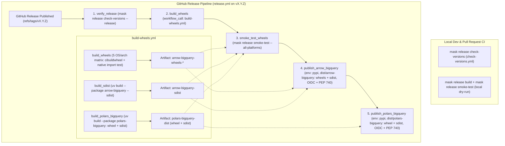

# Automated Dual-Package PyPI Trusted Publishing

*   **Author:** Tim Swast (`tswast`)
*   **Status:** Draft
*   **Date:** 2026-10-29

--------------------------------------------------------------------------------

## Overview

The `pola-rs/polars-bigquery-client` repository contains three Python packages:

1.  `arrow-bigquery` (`py-arrow-bigquery`): a compiled Rust extension (built with PyO3 and `maturin` around `crates/arrow-bigquery`) that streams Google BigQuery Storage Read API results as Apache Arrow data.
2.  `polars-bigquery` (`py-polars-bigquery`): a pure-Python I/O connector for Polars that depends on `arrow-bigquery` to interact with BigQuery.
3.  `polars-expressions-testing` (`py-polars-expressions-testing`): an internal Rust Polars plugin used only by repository unit tests and never distributed to external users.

This design automates the publishing of binary wheels (`.whl`) and source distributions (`sdist`, `.tar.gz` archives) for both `arrow-bigquery` and `polars-bigquery` to the Python Package Index (PyPI) whenever a maintainer publishes a GitHub Release (`vX.Y.Z`). Publishing uses GitHub Actions OpenID Connect (OIDC) Trusted Publishing—where GitHub mints a short-lived identity token for a designated workflow and environment instead of storing long-lived PyPI API secrets—together with [index hosted attestations](https://packaging.python.org/en/latest/specifications/index-hosted-attestations/#index-hosted-attestations) that link each published file to its source commit and build workflow. `polars-expressions-testing` and the underlying Rust crate (`crates/arrow-bigquery`) remain unpublished.

## The Problem

Maintainers currently build wheels in `.github/workflows/build-wheels.yml` and upload distributions to PyPI by hand, guided by a manual checklist in `release-procedure.md`. This design aims to address the following failure modes:

1.  **Out-of-order uploads and non-atomic partial failures**: PyPI accepts files one HTTP request at a time rather than as an atomic multi-package transaction, and PyPI permanently blocks re-uploading any `(package, version, filename)` tuple once accepted—even if that release is deleted or yanked (marked under [PEP 592](https://peps.python.org/pep-0592/) so installers skip it unless pinned with `==`). Merging both packages into a single `dist/` folder inside one publish job lets `polars-bigquery == X.Y.Z` appear on PyPI before `arrow-bigquery == X.Y.Z` finishes uploading. During that window—or longer if the upload fails midway—users running `pip install polars-bigquery` cannot resolve its dependency, and maintainers cannot re-run `polars-bigquery` alone without colliding with already-uploaded `arrow-bigquery` files.
2.  **Runtime breakage from unpinned cross-package dependencies**: `py-polars-bigquery/pyproject.toml` currently lists `"arrow-bigquery"` without a version constraint. When a user runs `pip install --upgrade polars-bigquery`, package installers leave an older installed `arrow-bigquery` wheel in place, breaking callers whenever a release changes the internal Rust/Python boundary between the two packages.
3.  **Silent version drift and wasted release builds**: Package versions are stored as static strings across multiple `pyproject.toml` manifests and `core/version.py` modules (which populate BigQuery API `User-Agent` headers). Nothing checks on pull requests that all Python version strings and `uv.lock` (the lockfile managed by `uv`, the repository's Python package manager) match, and nothing checks at release time that the GitHub Release tag (`vX.Y.Z`) and pre-release checkbox match the package version before spending multi-OS Rust compilation minutes.
4.  **Unverified binary wheels and workspace path shadowing**: Unit test workflows run inside the git checkout where local directories and `[tool.uv.workspace]` settings resolve editable source code rather than built wheels. Without testing built wheels outside the workspace checkout across target operating systems, packaging defects—such as missing dynamic libraries in the compiled Rust extension, missing Python submodules in wheel metadata, or missing `crates/arrow-bigquery` Rust sources in the `arrow-bigquery` source archive—are only discovered by end users after PyPI upload, when the version number can no longer be reused.

## Goals

*   **Automated OIDC publishing on GitHub Release**: Build and publish binary wheels and `sdist` archives for `arrow-bigquery` and `polars-bigquery` (and never `polars-expressions-testing`) to PyPI when a `release: [published]` event fires, using OIDC Trusted Publishing and PEP 740 build attestations with zero long-lived PyPI API tokens.
*   **Lockstep static version and tag enforcement**: Pin `"arrow-bigquery == <version>"` in `polars-bigquery` while keeping plain static version strings across all five Python version locations and `uv.lock` so future release automation (such as `release-please`) can update plain string literals directly. Verify lockstep consistency on pull requests and fail within seconds at the start of a release run if the `vX.Y.Z` tag or GitHub pre-release flag disagrees with the checked-out manifests.
*   **Ordered cross-package publishing and isolated retries**: Separate build artifacts by package and upload `arrow-bigquery` to completion before starting the `polars-bigquery` upload job, using a single shared `pypi` GitHub Environment restricted to `v*` tags without human approval gates. Ensure a transient error during `polars-bigquery` publishing can be recovered with GitHub Actions **"Re-run failed jobs"** without rebuilding wheels or re-uploading `arrow-bigquery`.
*   **Pre-publish wheel and archive verification**: Verify before any PyPI upload that every compiled `arrow-bigquery` wheel imports its native Rust module on its target OS/architecture runner via `cibuildwheel` (the Python Packaging Authority wheel builder), that built `arrow-bigquery` and `polars-bigquery` wheels install and import together from `site-packages` outside the workspace checkout with matching `__version__` values, and that wheel and `sdist` archives for both `arrow-bigquery` and `polars-bigquery` match expected file counts, include required package and `crates/arrow-bigquery` sources, declare pinned dependency metadata, and exclude `py-polars-expressions-testing`.
*   **CI security, cost control, and runbook accuracy**: Satisfy `.github/workflows/lint-actions.yml` (`actionlint` and `zizmor` security checks), align package build commands with `uv` per `AGENTS.md`, bound uploaded artifact retention to 7–14 days, serialize release workflow concurrency (`cancel-in-progress: false`), and document environment setup and manual yank-and-bump (`X.Y.(Z+1)`) partial-failure recovery in `release-procedure.md`.

## Non-Goals

*   Publishing or renaming `polars-expressions-testing` (`py-polars-expressions-testing`), or publishing `crates/arrow-bigquery` to `crates.io`.
*   Executing `pytest` unit or BigQuery integration test suites against built wheels, or compiling Rust code from source tarballs (`--no-binary :all:`), during the release workflow.
*   Replacing static `__version__` string literals in `core/version.py` with `importlib.metadata.version(...)` lookups, or configuring `release-please` in this change.
*   Supporting independent version schedules for `arrow-bigquery` and `polars-bigquery`.
*   Enabling `skip-existing: true` (which disables PEP 740 attestations) or building custom `workflow_dispatch` partial-upload recovery workflows.
*   Expanding Python classifiers or adding new OS/architecture targets beyond the existing five-runner `build-wheels.yml` matrix.

## Open Questions

None.

## Critical User Journeys (CUJs)

### CUJ 1: Standard Lockstep Release and Downstream Upgrade

*   **Given**: Both `arrow-bigquery` and `polars-bigquery` on PyPI trust `(pola-rs/polars-bigquery-client, release.yml, environment: pypi)`, the `pypi` GitHub Environment restricts deployments to `refs/tags/v*` with zero required reviewers, and a maintainer has merged a pull request updating all five Python version locations to `0.3.0` and refreshing `uv.lock`.
*   **When**: The maintainer publishes a non-prerelease GitHub Release for tag `v0.3.0`, and after the workflow finishes, an end user with `polars-bigquery == 0.2.0` and `arrow-bigquery == 0.2.0` runs `pip install --upgrade polars-bigquery`.
*   **Then**: `release.yml` verifies tag `v0.3.0` against all five Python declarations and `uv.lock`, builds wheels and `sdist` archives, passes cross-OS native import checks plus clean-room dual-package install/import and archive inventory checks, uploads `arrow-bigquery == 0.3.0` to PyPI with PEP 740 attestations, and only then uploads `polars-bigquery == 0.3.0` with PEP 740 attestations; the end user's upgrade installs both `polars-bigquery == 0.3.0` and `arrow-bigquery == 0.3.0`.

### CUJ 2: Fast-Fail Rejection on Version Drift or Tag Mismatch

*   **Given**: The repository manifests on `main` declare version `0.3.0` across all five Python locations.
*   **When**: Either (a) a contributor opens a pull request updating `py-polars-bigquery/pyproject.toml` to `0.4.0` while forgetting `py-arrow-bigquery/arrow_bigquery/core/version.py` or `uv.lock`, or (b) a maintainer publishes a GitHub Release tagged `v0.3.1` (or checks "Set as a pre-release" on final version `0.3.0`).
*   **Then**: In case (a), pull-request CI fails with an explicit diff of the mismatched version locations or stale `uv.lock` before merge; in case (b), the `verify_release` job in `release.yml` fails in under 30 seconds before `build-wheels.yml` launches any multi-OS Rust `cibuildwheel` jobs and before any PyPI OIDC token is minted.

### CUJ 3: Transient Second-Package Retry vs. Mid-Upload Partial Failure

*   **Given**: `release.yml` has passed all build and smoke-test gates for `v0.3.0`.
*   **When**: Either (a) `publish_arrow_bigquery` succeeds completely and `publish_polars_bigquery` fails on a transient PyPI HTTP 503 error, or (b) `publish_arrow_bigquery` fails after uploading two of its wheels to PyPI.
*   **Then**: In case (a), the maintainer clicks **"Re-run failed jobs"** in GitHub Actions, which re-runs only `publish_polars_bigquery` using the stored `polars-bigquery-dist` artifact and completes the `0.3.0` release without touching `arrow-bigquery`. In case (b), the maintainer follows `release-procedure.md`—never clicking **"Re-run all jobs"** or moving tag `v0.3.0`—yanks any uploaded `0.3.0` distributions on PyPI (yanking both packages if both were uploaded), bumps all five version locations to `0.3.1`, and publishes `v0.3.1`.

## Technical Plan (Architecture)

### 1. Pipeline Topology and Component Boundaries

The design splits validation and publishing across `maskfile.md` tasks (shared between local development and CI, matching existing repository workflows), two GitHub Actions workflows, and two zero-dependency Python 3.12 standard-library verification scripts:

*   **Local and CI task definitions (`maskfile.md`)**: Adds a `release` command group (`mask release check-versions`, `mask release build`, and `mask release smoke-test`, implemented in both Bash and PowerShell) and extends `mask lint` and `mask test unit` to cover `scripts/`. Developers can build host wheels and `sdist` archives for both packages and run archive and clean-room non-workspace install checks locally before opening a pull request, while CI invokes the same `mask` tasks.
*   **Pull-request and `main` gate (`.github/workflows/check-versions.yml`)**: Runs on every `pull_request` and `push` to `main`. Invokes `mask release check-versions` to execute unit tests for the release verification scripts, validate that all five Python version locations agree via `scripts/check_versions.py`, and verify lockfile synchronization via `uv lock --check`. Omitting `paths:` filters allows this ~10-second job to serve as a required branch-protection check without hanging pull requests that do not touch version files.
*   **Release pipeline (`.github/workflows/release.yml`)**: Triggered by `release: [published]` on `refs/tags/vX.Y.Z`. Runs five ordered stages:
    1.  `verify_release`: Executes `mask release check-versions --release` (`scripts/check_versions.py --release` + `uv lock --check`) before compiling any code.
    2.  `build_wheels`: Invokes `.github/workflows/build-wheels.yml` via `workflow_call` to build and import-test `arrow-bigquery` wheels across five OS/architecture runners, build the `arrow-bigquery` `sdist`, and build the `polars-bigquery` wheel and `sdist`, uploading artifacts into package-prefixed namespaces.
    3.  `smoke_test_wheels`: Downloads both artifact namespaces into `$RUNNER_TEMP` and runs `mask release smoke-test --out-dir "$RUNNER_TEMP/dist" --all-platforms` (`scripts/verify_dist.py --require-all-platforms` plus clean-room virtualenv installation and imports outside the repository checkout).
    4.  `publish_arrow_bigquery`: Downloads only `arrow-bigquery-*` artifacts (wheels and `sdist`) into `dist/arrow-bigquery` and uploads them to PyPI using the `pypi` GitHub Environment.
    5.  `publish_polars_bigquery`: Runs only after `publish_arrow_bigquery` succeeds (`needs: publish_arrow_bigquery`), downloads only `polars-bigquery-dist` (wheel and `sdist`) into `dist/polars-bigquery`, and uploads both distributions to PyPI using the same `pypi` GitHub Environment.

### 2. Lockstep Static Version Pinning and Release Tag Verification

`py-polars-bigquery/pyproject.toml` updates its runtime dependency from `"arrow-bigquery"` to `"arrow-bigquery == 0.3.0"`, and `uv lock` updates `uv.lock` accordingly. Plain static version string literals remain in all manifests and `version.py` files so future release automation (such as `release-please`) can update them without dynamic `importlib.metadata` indirection.

`scripts/check_versions.py` uses Python's standard-library `tomllib`, `ast`, and `re` modules (requiring zero third-party packages) to read and compare all five authoritative Python version declarations:

1.  `py-arrow-bigquery/pyproject.toml` (`[project].version`)
2.  `py-arrow-bigquery/arrow_bigquery/core/version.py` (`__version__` string literal, sent in BigQuery Storage Read API `User-Agent` headers)
3.  `py-polars-bigquery/pyproject.toml` (`[project].version`)
4.  `py-polars-bigquery/pyproject.toml` (`[project].dependencies` entry matching `^arrow-bigquery\s*==\s*(.+)$`; unpinned or range-pinned entries fail validation)
5.  `py-polars-bigquery/polars_bigquery/core/version.py` (`__version__` string literal, sent in BigQuery REST API `User-Agent` headers)

The script validates that the shared version matches canonical PEP 440 release or pre-release syntax (`^\d+\.\d+\.\d+(?:(?:a|b|rc)\d+)?$`) and intentionally ignores the five internal `0.1.0` manifests (`pyproject.toml`, `py-polars-expressions-testing/pyproject.toml`, `py-polars-expressions-testing/Cargo.toml`, `py-arrow-bigquery/Cargo.toml`, and `crates/arrow-bigquery/Cargo.toml`).

When invoked with `--release` inside `release.yml`, `scripts/check_versions.py` reads `RELEASE_TAG` (`github.ref_name`) and `RELEASE_PRERELEASE` (`github.event.release.prerelease`) from environment variables and enforces two additional invariants before `build_wheels` starts:

*   **Tag equality**: `RELEASE_TAG` must equal `f"v{version}"` (for example, `v0.3.0` for `0.3.0` or `v0.3.0rc1` for `0.3.0rc1`).
*   **Pre-release alignment**: `RELEASE_PRERELEASE == "true"` must hold if and only if `version` ends with a PEP 440 pre-release suffix (`aN`, `bN`, or `rcN`), preventing final versions from being published from GitHub pre-releases or pre-release wheels from being marked as stable GitHub releases.

### 3. Cross-OS Native Wheel Verification, `uv build`, and Artifact Isolation

`.github/workflows/build-wheels.yml` and `py-arrow-bigquery/pyproject.toml` are updated to enforce artifact separation, cross-OS native import testing, and `uv` build tooling:

*   **`cibuildwheel` native import check**: `py-arrow-bigquery/pyproject.toml` adds `test-command = "python -c \"import arrow_bigquery; assert arrow_bigquery._native is not None\""` under `[tool.cibuildwheel]`. Because all five matrix runners (`ubuntu-latest`, `ubuntu-24.04-arm`, `windows-latest`, `windows-11-arm`, and `macos-latest`) execute on native CPU architectures and `arrow-bigquery`'s runtime dependencies (`google-auth`, `requests`, `cachetools`) publish pure-Python wheels, `cibuildwheel` runs this import check inside a clean non-workspace virtual environment for every wheel it builds (`manylinux_2_28`, `musllinux`, Windows x64/ARM64, and macOS ARM64, across both `cp310-abi3` and free-threaded CPython targets) without compiling test-only dependencies such as `nanoarrow`.
*   **`uv build` alignment**: `build_sdist` replaces `pipx run build --sdist py-arrow-bigquery --outdir dist` with `uv build --package arrow-bigquery --sdist --out-dir dist --no-create-gitignore`. `build_polars_bigquery` replaces `pipx run build py-polars-bigquery --outdir dist` with `uv build --package polars-bigquery --out-dir dist --no-create-gitignore`, which builds `polars_bigquery-<version>.tar.gz` (`sdist`) from `py-polars-bigquery` first and then builds `polars_bigquery-<version>-py3-none-any.whl` from that `sdist` (validating that the `polars-bigquery` `sdist` itself builds cleanly into a wheel while never building the root `polars-bigquery-workspace` manifest or `polars-expressions-testing`). Before uploading `polars-bigquery-dist`, the job verifies that both `dist/*.whl` and `dist/*.tar.gz` exist on disk, because a single `actions/upload-artifact` step with multiple path globs only fails `if-no-files-found: error` when zero total files match.
*   **Isolated artifact names and bounded retention**: Every `actions/upload-artifact` step sets `if-no-files-found: error` and `retention-days: 7` (adequate for same-week "Re-run failed jobs" retries without 90-day binary storage accumulation across nightly `schedule` builds). `arrow-bigquery` artifacts rename from `cibw-wheels-*` / `cibw-sdist` to `arrow-bigquery-wheels-${{ matrix.os }}-${{ strategy.job-index }}` and `arrow-bigquery-sdist`, cleanly separated from `polars-bigquery-dist` (which bundles both the `polars-bigquery` wheel and `sdist`).

### 4. Pre-Publish Archive Inventory and Clean-Room Smoke Test

Both local packaging dry-runs (`mask release smoke-test`) and CI (`smoke_test_wheels` on `ubuntu-latest` with `contents: read` permissions, after downloading `arrow-bigquery-*` into `$RUNNER_TEMP/dist/arrow-bigquery` and `polars-bigquery-dist` into `$RUNNER_TEMP/dist/polars-bigquery`) execute the same two-step check:

1.  **Archive and metadata inspection (`scripts/verify_dist.py`)**: Using standard-library `tarfile`, `zipfile`, and `email.parser`, the script checks both wheels and `sdist` archives for both packages:
    *   `dist/arrow-bigquery` contains `arrow_bigquery-<version>.tar.gz`, zero non-`arrow_bigquery` files, and at least one `arrow_bigquery-<version>-*.whl` wheel in local mode; when `--require-all-platforms` is passed in CI, it additionally requires at least one wheel for each of the seven target platform families (`manylinux*_x86_64`, `musllinux*_x86_64`, `manylinux*_aarch64`, `musllinux*_aarch64`, `win_amd64`, `win_arm64`, and `macosx_*_arm64`). Checking platform family coverage rather than a fixed wheel count avoids false failures as CPython free-threaded wheels (`cp313t`/`cp314t`) transition into unified ABI wheels in CPython 3.15+, while omitting `--require-all-platforms` lets developers smoke-test single-host builds locally via `mask release build && mask release smoke-test`.
    *   `arrow_bigquery-<version>.tar.gz` (`sdist`) contains the Cargo workspace dependencies required to compile from source (`crates/arrow-bigquery/Cargo.toml`, `crates/arrow-bigquery/src/lib.rs`, and `py-arrow-bigquery/Cargo.toml`) and contains zero paths referencing `polars-expressions-testing`, `polars_expressions_testing`, or `py-polars-bigquery`.
    *   `dist/polars-bigquery` contains exact two-file output (`polars_bigquery-<version>-py3-none-any.whl` and `polars_bigquery-<version>.tar.gz`).
    *   `polars_bigquery-<version>.tar.gz` (`sdist`) contains `pyproject.toml`, `PKG-INFO` declaring `Requires-Dist: arrow-bigquery == <version>`, `polars_bigquery/__init__.py`, and `polars_bigquery/core/compiler.py`, and contains zero paths referencing `polars-expressions-testing`, `polars_expressions_testing`, `py-arrow-bigquery`, or `crates/`.
    *   `polars_bigquery-<version>-py3-none-any.whl` contains `polars_bigquery/__init__.py` and `polars_bigquery/core/compiler.py`, packages no top-level `tests/` directory, and declares `Requires-Dist: arrow-bigquery == <version>` in `.dist-info/METADATA`.
2.  **Non-workspace dual-package install and import**: Changing working directory into an OS temporary directory outside the repository checkout (so root `pyproject.toml` `[tool.uv.workspace]` and repository subdirectories cannot enter `sys.path`), `mask release smoke-test` creates a fresh `uv venv`, runs `uv pip install` with `--find-links` pointing to `<out-dir>/arrow-bigquery` and `<out-dir>/polars-bigquery` for `"polars-bigquery==$VERSION"`, and executes Python assertions verifying that `arrow_bigquery`, `arrow_bigquery._native`, `polars_bigquery`, and `polars_bigquery.core.compiler` import cleanly from that temporary `site-packages` directory and that `arrow_bigquery.__version__ == polars_bigquery.__version__ == VERSION`.

### 5. Ordered OIDC Trusted Publishing, Concurrency, and Linter Hardening

Both PyPI publish jobs remain directly inside top-level `.github/workflows/release.yml` so GitHub's OIDC `job_workflow_ref` claim matches `pola-rs/polars-bigquery-client/.github/workflows/release.yml@refs/tags/vX.Y.Z`:

*   **Shared `pypi` environment with directory isolation**: Both `publish_arrow_bigquery` (`url: https://pypi.org/p/arrow-bigquery`) and `publish_polars_bigquery` (`url: https://pypi.org/p/polars-bigquery`) bind to `environment: pypi` and set job-scoped `permissions: { id-token: write }`. On PyPI, both projects register `(Owner: pola-rs, Repository: polars-bigquery-client, Workflow: release.yml, Environment: pypi)` as a Trusted Publisher. On GitHub, the `pypi` environment configures **Deployment branches and tags** to allow only tags matching `v*` with zero required reviewers. Because a token minted for `environment: pypi` is trusted by both PyPI projects, `publish_arrow_bigquery` downloads only `pattern: arrow-bigquery-*` (`merge-multiple: true`) into `dist/arrow-bigquery` and passes `packages-dir: dist/arrow-bigquery` to `pypa/gh-action-pypi-publish` (uploading all `arrow-bigquery` wheels plus `arrow_bigquery-<version>.tar.gz`), while `publish_polars_bigquery` (`needs: publish_arrow_bigquery`) downloads only `name: polars-bigquery-dist` into `dist/polars-bigquery` and passes `packages-dir: dist/polars-bigquery` (uploading both `polars_bigquery-<version>-py3-none-any.whl` and `polars_bigquery-<version>.tar.gz`).
*   **Index-hosted attestations and immutability**: Both publish steps keep `pypa/gh-action-pypi-publish` defaults (`attestations: true` and `skip-existing: false`), generating and uploading PEP 740 cryptographic attestations via OIDC without extra repository permissions.
*   **Cross-tag concurrency serialization**: `.github/workflows/release.yml` defines a constant workflow-level concurrency group (`group: release-pypi`, `cancel-in-progress: false`). Omitting `${{ github.ref }}` from the group name ensures two release tags published in quick succession queue sequentially instead of running in parallel, and `cancel-in-progress: false` ensures an active PyPI upload is never terminated mid-flight.
*   **`actionlint` and `zizmor` compliance**: All workflow changes adhere to `.github/workflows/lint-actions.yml` (`actionlint` and `zizmor` `v0.6.2`): every third-party action uses the repository's existing 40-character commit SHA pins (`actions/checkout` `v4.1.1`, `actions/setup-python` `v7.0.0`, `taiki-e/install-action` `v2.87.20`, `actions/upload-artifact` `v7.0.1`, `actions/download-artifact` `v7.0.0`, `pypa/cibuildwheel` `v4.1.1`, `pypa/gh-action-pypi-publish` `v1.14.3`), every `actions/checkout` sets `persist-credentials: false`, and all GitHub event/ref expressions in `run:` blocks pass exclusively through `env:` bindings.
*   **Operational recovery model (`release-procedure.md`)**:
    *   If `publish_arrow_bigquery` succeeds and `publish_polars_bigquery` fails on a transient network/5xx error, clicking **"Re-run failed jobs"** retries only `publish_polars_bigquery` against the stored `polars-bigquery-dist` artifact.
    *   Maintainers must never click **"Re-run all jobs"** or re-tag an existing `vX.Y.Z` release once `publish_arrow_bigquery` starts, because rebuilt wheels have different SHA-256 digests that PyPI rejects as filename collisions.
    *   If `publish_arrow_bigquery` fails mid-upload—or a defect is found after any file reaches PyPI—recovery yanks all published `X.Y.Z` releases on PyPI (yanking both `arrow-bigquery` and `polars-bigquery` if both uploaded, since exact `==` pins bypass single-package PEP 592 yanks; and yanking an orphaned `arrow-bigquery` so historical unpinned `polars-bigquery` `0.1.0`/`0.2.0` installs do not pull it) and cuts a new patch release `X.Y.(Z+1)`.

## Alternatives Considered

### Alternative A: Single Publish Job with a Merged `dist/` Directory

*   **Pros**: Requires fewer lines of workflow YAML and performs a single OIDC token exchange per release.
*   **Cons**: File upload order within a merged directory is undefined (`polars-bigquery` can appear on PyPI before `arrow-bigquery` finishes uploading), and a transient failure while uploading `polars-bigquery` prevents using "Re-run failed jobs" without re-attempting already-uploaded `arrow-bigquery` files.
*   **Reason for Rejection**: Fails to guarantee cross-package dependency availability during upload and blocks isolated retries of the second package.

### Alternative B: Separate GitHub Environments per Package (`pypi-arrow-bigquery` and `pypi-polars-bigquery`)

*   **Pros**: Scopes each job's OIDC token to a distinct GitHub Environment so PyPI rejects cross-project uploads even if artifact directories are misconfigured.
*   **Cons**: Doubles the GitHub Environment configurations and tag deployment protection rules maintainers must set up and maintain.
*   **Reason for Rejection**: Sequential jobs (`publish_arrow_bigquery` followed by `publish_polars_bigquery`), separate download patterns (`arrow-bigquery-*` vs. `polars-bigquery-dist`), separate `packages-dir` paths, and `scripts/verify_dist.py` file-ownership assertions already prevent cross-package file mixing while reusing the single `pypi` environment.

### Alternative C: Enabling `skip-existing: true` or Custom `workflow_dispatch` Recovery Workflows

*   **Pros**: Lets a maintainer re-run a failed multi-file upload job so remaining wheels for the same `X.Y.Z` version finish uploading without bumping to `X.Y.(Z+1)`.
*   **Cons**: `pypa/gh-action-pypi-publish` disables PEP 740 index-hosted attestations when `skip-existing: true` is enabled, and skipping existing filenames can mask accidental version collisions or rebuilt artifacts whose SHA-256 digests no longer match earlier uploads.
*   **Reason for Rejection**: Keeping cryptographic attestations on every published distribution outweighs automating rare mid-package PyPI upload failures, which are handled by yanking `X.Y.Z` and releasing `X.Y.(Z+1)`.

### Alternative D: Dynamic `importlib.metadata.version(...)` Lookups in `core/version.py`

*   **Pros**: Reduces static version declarations from five locations to three by reading `__version__` from installed package metadata at import time.
*   **Cons**: Adds metadata lookup overhead during import, complicates editable/uninstalled execution contexts, and prevents plain-string version updaters (such as `release-please` `extra-files` entries) from updating `version.py` directly—while still requiring CI checks to keep both `pyproject.toml` files and the `"arrow-bigquery == <version>"` pin synchronized.
*   **Reason for Rejection**: `scripts/check_versions.py` eliminates drift across static string literals automatically while preserving compatibility with automated version-bump pull requests.

### Alternative E: Publishing `polars-expressions-testing` Wheels and Running Full `pytest` Suites Against Built Wheels

*   **Pros**: Runs the full Python unit test suite against built wheel artifacts during the release pipeline.
*   **Cons**: `py-polars-bigquery` unit tests require the internal Rust Polars plugin `py-polars-expressions-testing` (which compiles `polars = "0.53.0"` from source), and `py-arrow-bigquery` unit tests require `nanoarrow` (which lacks `win_arm64` wheels). Renaming and building `polars-expressions-testing` across the five-runner `cibuildwheel` matrix nearly doubles cold Rust compilation minutes to publish an internal test helper with no external consumers, duplicating unit tests that already run on pull requests and `main`.
*   **Reason for Rejection**: Cross-OS `cibuildwheel` native import checks combined with clean-room dual-package installation, import, and archive checks catch dynamic linking and packaging defects without publishing internal test crates or recompiling Polars in Rust.

### Alternative F: Leaving `"arrow-bigquery"` Unpinned in `py-polars-bigquery/pyproject.toml`

*   **Pros**: Avoids updating the dependency version constraint on every release.
*   **Cons**: Users running `pip install --upgrade polars-bigquery` retain older installed `arrow-bigquery` versions, causing runtime failures whenever internal Python/Rust interfaces change between releases.
*   **Reason for Rejection**: `polars-bigquery` and `arrow-bigquery` are developed and released in lockstep from one monorepo and depend on matching internal interfaces.

### Alternative G: Manual Reviewer Approval Gate on the `pypi` GitHub Environment

*   **Pros**: Introduces a manual confirmation pause in GitHub Actions between wheel smoke tests and PyPI upload.
*   **Cons**: Requires maintainers to monitor the ~15–20 minute multi-OS wheel build and manually approve a deployment they already initiated by publishing the GitHub Release.
*   **Reason for Rejection**: Restricting the `pypi` environment to `refs/tags/v*` and gating uploads behind `verify_release` and `smoke_test_wheels` prevents unauthorized or broken uploads without redundant manual pauses.

### Alternative H: Running Wheel Import Tests Inside the Repository Checkout

*   **Pros**: Avoids creating a temporary directory and virtual environment outside `$GITHUB_WORKSPACE`.
*   **Cons**: Python's default working-directory `sys.path` resolution and `[tool.uv.workspace]` (`workspace = true`) resolve local source folders instead of built wheels in `site-packages`, allowing wheels with missing modules or broken binary extensions to pass unnoticed.
*   **Reason for Rejection**: Executing `uv pip install` and imports from an OS temporary directory outside the repository checkout guarantees that Python loads only the built wheel artifacts from `site-packages`.

### Alternative I: Compiling and Installing from `sdist` (`--no-binary :all:`) During Release CI

*   **Pros**: Verifies end-to-end Rust Cargo compilation directly from `arrow_bigquery-<version>.tar.gz`.
*   **Cons**: Compiles the Rust workspace and its crate graph an extra time from cold state during release CI after `cibuildwheel` has already compiled the crate across five OS/architecture runners.
*   **Reason for Rejection**: `scripts/verify_dist.py` verifies in under one second that `arrow_bigquery-<version>.tar.gz` bundles `crates/arrow-bigquery` and `py-arrow-bigquery` while excluding `polars-expressions-testing`, and `uv build` already builds the pure-Python `polars-bigquery` wheel directly from `polars_bigquery-<version>.tar.gz`.

### Alternative J: Moving PyPI Publish Jobs into a Reusable `workflow_call` Workflow

*   **Pros**: Shares publish step definitions across packages via parameterized workflow inputs.
*   **Cons**: PyPI OIDC Trusted Publishing validates the `job_workflow_ref` token claim, requiring PyPI Trusted Publisher settings to track reusable workflow paths and complicating security auditing.
*   **Reason for Rejection**: Two concise publish jobs directly in top-level `.github/workflows/release.yml` keep the OIDC `job_workflow_ref` claim aligned with `release.yml`.

### Alternative K: Embedding Version Checks Only in Existing Path-Filtered Unit Test Workflows

*   **Pros**: Avoids adding a separate `.github/workflows/check-versions.yml` workflow file.
*   **Cons**: Existing unit test workflows (`.github/workflows/test-py-arrow-unit.yml` and `.github/workflows/test-py-polars-unit.yml`) use `paths:` filters that do not cover every combination of `uv.lock` and cross-package version edits, and path-filtered jobs cannot be marked as required branch-protection status checks without blocking unrelated pull requests.
*   **Reason for Rejection**: A dedicated unconditional `.github/workflows/check-versions.yml` workflow runs in ~10 seconds on every pull request with zero path-filter blind spots.

--------------------------------------------------------------------------------

## Non-Functional Requirements

*   **Security & Supply-Chain Integrity**: No long-lived PyPI API tokens are stored in GitHub Secrets. `id-token: write` permission is granted only to `publish_arrow_bigquery` and `publish_polars_bigquery` in `.github/workflows/release.yml`, gated by the `pypi` GitHub Environment's `refs/tags/v*` deployment tag rule. PEP 740 index-hosted attestations remain enabled on all uploaded wheels and `sdist` archives. Every workflow satisfies `actionlint` and `zizmor` (`v0.6.2`) with 40-character commit SHA pins, `persist-credentials: false`, and environment-variable indirection for untrusted context values.
*   **Performance, Latency, and Storage Footprint**: `.github/workflows/check-versions.yml` runs on a single `ubuntu-latest` runner in ~10 seconds without compiling Rust. `verify_release` rejects mismatched tags or pre-release flags in under 30 seconds before launching five-OS `cibuildwheel` jobs. `scripts/verify_dist.py` runs archive checks in under one second. Setting `retention-days: 7` on `actions/upload-artifact` reduces binary artifact retention from GitHub's 90-day default across both release and scheduled nightly wheel builds.
*   **Rollout & Partial-Failure Recovery**: Before publishing the first automated GitHub Release (`v0.3.0`), maintainers configure Trusted Publishers for `(pola-rs/polars-bigquery-client, release.yml, environment: pypi)` on both `arrow-bigquery` and `polars-bigquery` on PyPI and restrict the `pypi` GitHub Environment to `v*` tags with zero required reviewers. Workflow-level `concurrency` (`group: release-pypi`, `cancel-in-progress: false`) serializes overlapping release tags. Any mid-upload failure or post-upload defect follows the manual yank-and-bump (`X.Y.(Z+1)`) procedure documented in `release-procedure.md`.

--------------------------------------------------------------------------------

### Future Improvements

*   **Automated version-bump pull requests (`release-please`)**: Configure `release-please` with `extra-files` entries targeting the five static Python version declarations so Conventional Commits automatically maintain release pull requests and changelogs.
*   **Unified CPython 3.15+ ABI wheels**: Adopt unified stable ABI builds once CPython 3.15 unifies standard and free-threaded ABIs, reducing separate free-threaded wheel compilations in `cibuildwheel`.

--------------------------------------------------------------------------------

## Detailed Implementation Plan

### Target Files to Create/Modify

#### 1. `py-polars-bigquery/pyproject.toml` (Modify)

*   **Type / Scope**: Python Package Manifest (`setuptools`)
*   **Rationale**: Prevents version skew between `polars-bigquery` and `arrow-bigquery` during `pip install --upgrade polars-bigquery` and establishes the fourth static Python lockstep version declaration.
*   **Proposed Changes**: In `[project].dependencies`, replace `"arrow-bigquery"` with `"arrow-bigquery == 0.3.0"`. Leave `[tool.uv.sources]` (`arrow-bigquery = { workspace = true }`) unchanged so local editable workspace development continues to resolve the local package.

#### 2. `uv.lock` (Modify)

*   **Type / Scope**: Workspace Dependency Lockfile (`uv`)
*   **Rationale**: Keeps the workspace lockfile synchronized with the newly pinned `"arrow-bigquery == 0.3.0"` dependency in `py-polars-bigquery/pyproject.toml` so `uv lock --check` passes in pull-request and release CI.
*   **Proposed Changes**: Regenerate via `uv lock` so the `polars-bigquery` lock entry records the updated `arrow-bigquery` version constraint.

#### 3. `py-arrow-bigquery/pyproject.toml` (Modify)

*   **Type / Scope**: Python/Rust Package Manifest (`maturin` and `cibuildwheel`)
*   **Rationale**: Validates that every compiled `arrow-bigquery` wheel dynamically links and loads its Rust `_native` extension inside a clean virtual environment on its target OS, libc, and CPU architecture before artifacts are uploaded.
*   **Proposed Changes**: Under `[tool.cibuildwheel]`, add `test-command = "python -c \"import arrow_bigquery; assert arrow_bigquery._native is not None\""`. Do not set `test-groups` or `test-requires`, ensuring `cibuildwheel` installs only runtime pure-Python dependencies (`google-auth`, `requests`, `cachetools`) and avoids test-only native dependencies such as `nanoarrow` on `win_arm64`.

#### 4. `scripts/check_versions.py` (Create)

*   **Type / Scope**: Python 3.12+ Release Verification CLI (Standard Library Only)
*   **Rationale**: Enforces lockstep version equality across all five Python version locations on pull requests and enforces `vX.Y.Z` tag and PEP 440 pre-release flag alignment in `verify_release` before multi-OS wheel builds start.
*   **Proposed Changes**: Implement a zero-dependency script using `argparse`, `ast`, `os`, `pathlib`, `re`, `sys`, and `tomllib` with CLI interface `check_versions.py [--repo-root PATH] [--release] [--print-version]`:
    *   `read_python_versions(repo_root: Path) -> dict[str, str]`: Reads `[project].version` from `py-arrow-bigquery/pyproject.toml` and `py-polars-bigquery/pyproject.toml` via `tomllib.loads`; extracts the `arrow-bigquery` entry from `py-polars-bigquery/pyproject.toml` `[project].dependencies` requiring exact `^arrow-bigquery\s*==\s*([^\s;]+)$` syntax (failing if missing, unpinned, or using any operator other than `==`); extracts the `__version__` string constant from `py-arrow-bigquery/arrow_bigquery/core/version.py` and `py-polars-bigquery/polars_bigquery/core/version.py` via `ast.parse` without importing the packages; and ignores the five internal `0.1.0` manifests (`pyproject.toml`, `py-polars-expressions-testing/pyproject.toml`, `py-polars-expressions-testing/Cargo.toml`, `py-arrow-bigquery/Cargo.toml`, and `crates/arrow-bigquery/Cargo.toml`).
    *   `validate_versions(versions: dict[str, str], *, release: bool, release_tag: str | None, release_prerelease: str | None) -> str`: Verifies all five values are equal (printing a per-file breakdown to `stderr` and exiting `1` on mismatch) and match `^\d+\.\d+\.\d+(?:(?:a|b|rc)\d+)?$`. When `release=True`, reads `RELEASE_TAG` and `RELEASE_PRERELEASE` from environment variables, requires `release_tag == f"v{version}"`, requires `release_prerelease` in `{"true", "false"}`, and requires `(release_prerelease == "true") == bool(re.search(r"(?:a|b|rc)\d+$", version))`.
    *   When `--print-version` is set, prints only the validated version string to `stdout` so local and CI scripts can capture it cleanly.

#### 5. `scripts/verify_dist.py` (Create)

*   **Type / Scope**: Python 3.12+ Distribution Archive Verifier (Standard Library Only)
*   **Rationale**: Prevents incomplete wheel sets, cross-package file contamination, missing `crates/arrow-bigquery` Rust sources in `arrow-bigquery`'s `sdist`, missing `polars-bigquery` `sdist` or wheel files, unpinned wheel/`sdist` metadata, or leaked `polars-expressions-testing` files from reaching PyPI, while also supporting single-host local verification via `mask release smoke-test`.
*   **Proposed Changes**: Implement a zero-dependency script using `argparse`, `email.parser`, `fnmatch`, `pathlib`, `sys`, `tarfile`, and `zipfile` with CLI interface `verify_dist.py --version VERSION --arrow-dir PATH --polars-dir PATH [--require-all-platforms]`:
    *   `verify_arrow_dist(arrow_dir: Path, version: str, *, require_all_platforms: bool) -> None`: Verifies every file in `arrow_dir` is either `arrow_bigquery-{version}.tar.gz` or `arrow_bigquery-{version}-*.whl`; verifies `arrow_bigquery-{version}.tar.gz` and at least one `arrow_bigquery-{version}-*.whl` wheel exist; when `require_all_platforms=True`, additionally verifies at least one wheel matches each of the seven platform patterns (`*manylinux*x86_64*.whl`, `*musllinux*x86_64*.whl`, `*manylinux*aarch64*.whl`, `*musllinux*aarch64*.whl`, `*-win_amd64.whl`, `*-win_arm64.whl`, `*-macosx_*_arm64.whl`); and inspects `arrow_bigquery-{version}.tar.gz` member names via `tarfile` to assert `arrow_bigquery-{version}/Cargo.toml`, `arrow_bigquery-{version}/crates/arrow-bigquery/Cargo.toml`, `arrow_bigquery-{version}/crates/arrow-bigquery/src/lib.rs`, `arrow_bigquery-{version}/py-arrow-bigquery/Cargo.toml`, and `arrow_bigquery-{version}/py-arrow-bigquery/pyproject.toml` exist while zero member paths contain `polars-expressions-testing`, `polars_expressions_testing`, or `py-polars-bigquery`.
    *   `verify_polars_dist(polars_dir: Path, version: str) -> None`: Verifies `polars_dir` contains the exact two filenames `polars_bigquery-{version}-py3-none-any.whl` and `polars_bigquery-{version}.tar.gz`; inspects `polars_bigquery-{version}.tar.gz` via `tarfile` to assert `polars_bigquery-{version}/pyproject.toml`, `polars_bigquery-{version}/PKG-INFO`, `polars_bigquery-{version}/polars_bigquery/__init__.py`, and `polars_bigquery-{version}/polars_bigquery/core/compiler.py` exist, parses `PKG-INFO` via `email.parser.Parser` to assert `Requires-Dist` contains `arrow-bigquery == {version}`, and confirms zero member paths contain `polars-expressions-testing`, `polars_expressions_testing`, `py-arrow-bigquery`, or `crates/`; and inspects `polars_bigquery-{version}-py3-none-any.whl` via `zipfile` to assert `polars_bigquery/__init__.py`, `polars_bigquery/core/compiler.py`, and `polars_bigquery-{version}.dist-info/METADATA` exist, confirms zero entries start with `tests/`, `polars_expressions_testing`, or `arrow_bigquery`, and parses `METADATA` to assert `Requires-Dist` contains `arrow-bigquery == {version}`.

#### 6. `scripts/test_release_checks.py` (Create)

*   **Type / Scope**: Python Unit Test Suite (`unittest`)
*   **Rationale**: Tests every acceptance and rejection branch of `scripts/check_versions.py` and `scripts/verify_dist.py` on pull requests and in `mask test unit` without requiring live GitHub Release events or multi-OS wheel builds.
*   **Proposed Changes**: Create synthetic temporary fixtures (`tempfile.TemporaryDirectory`) covering: valid stable (`0.3.0`) and pre-release (`0.3.0rc1`) trees; single-file drift in each of the five Python version declarations; unpinned `"arrow-bigquery"` and range-pinned `"arrow-bigquery >= 0.3.0"`; presence of `0.1.0` in the five ignored manifests; `--release` failures on tag mismatch (`v0.3.1`, missing `v` prefix) and pre-release boolean mismatch in both directions; valid single-host (`require_all_platforms=False`) and seven-platform (`require_all_platforms=True`) `arrow-bigquery` and `polars-bigquery` artifact directories; missing platform wheel family under `--require-all-platforms`; foreign file in `dist/arrow-bigquery`; missing `crates/arrow-bigquery/src/lib.rs` in `arrow-bigquery` `sdist`; leaked `py-polars-expressions-testing` path in either `sdist`; missing `polars_bigquery-<version>.tar.gz`; missing `Requires-Dist: arrow-bigquery == <version>` in `PKG-INFO` or wheel `METADATA`; and leaked top-level `tests/` in `polars-bigquery` wheel.

#### 7. `maskfile.md` (Modify)

*   **Type / Scope**: Developer & CI Task Runner Specification (`mask`, Bash + PowerShell)
*   **Rationale**: Exposes local commands for checking versions, building wheels and `sdist` archives for both packages, and running archive + clean-room non-workspace install/import checks, while allowing CI workflows (`check-versions.yml` and `release.yml`) to call the same task definitions without duplicating shell logic. Note that `docs/source/development/contributing/maskfile.md` is a symlink to `maskfile.md` and updates automatically.
*   **Proposed Changes**: Provide matching `bash` (`set -euo pipefail`) and `powershell` (`$ErrorActionPreference = "Stop"`) blocks for every new and modified task:
    *   Add top-level `## release` section with three subcommands:
        1.  `### check-versions` (boolean flag `-r --release`): runs `uv run --no-project python -m unittest discover -s scripts -p "test_*.py"`, runs `uv run --no-project python scripts/check_versions.py` (appending `--release` when `-r` is set), and runs `uv lock --check`.
        2.  `### build` (string option `-o --out-dir`, defaulting to `dist`): builds the host wheel and `sdist` for `arrow-bigquery` via `uv build --package arrow-bigquery --out-dir "<out-dir>/arrow-bigquery" --clear --no-create-gitignore` and builds the wheel and `sdist` for `polars-bigquery` via `uv build --package polars-bigquery --out-dir "<out-dir>/polars-bigquery" --clear --no-create-gitignore` (`--clear` removes stale files from prior version builds).
        3.  `### smoke-test` (string option `-o --out-dir` defaulting to `dist`, boolean flag `-a --all-platforms`): resolves `<version>` from `scripts/check_versions.py --print-version`, runs `uv run --no-project python scripts/verify_dist.py --version "$VERSION" --arrow-dir "<out-dir>/arrow-bigquery" --polars-dir "<out-dir>/polars-bigquery"` (passing `--require-all-platforms` when `--all-platforms` is set), creates and cleans up an OS temporary directory outside the repository root, creates a clean `uv venv` inside it, installs `"polars-bigquery==$VERSION"` via `uv pip install` with `--find-links` pointing to the absolute paths of `<out-dir>/arrow-bigquery` and `<out-dir>/polars-bigquery`, and executes Python assertions verifying `arrow_bigquery`, `arrow_bigquery._native`, `polars_bigquery`, and `polars_bigquery.core.compiler` load from that temporary `site-packages` with `__version__ == VERSION`.
    *   Update `## lint`: pass `scripts/` alongside `docs/source/` to `ruff check --no-fix` and `ruff format --diff`.
    *   Update `## test` -> `### unit`: add `uv run --no-project python -m unittest discover -s scripts -p "test_*.py"` alongside the existing Rust and Python package unit test calls.

#### 8. `.github/workflows/docs-global.yml` (Modify)

*   **Type / Scope**: GitHub Actions Documentation & Lint Workflow
*   **Rationale**: Ensures pull requests and `main` pushes that modify `scripts/**` trigger the `lint` job (`mask lint`) so `ruff check` and `ruff format --diff` run automatically on the verification scripts.
*   **Proposed Changes**: Add `- scripts/**` to both `on.pull_request.paths` and `on.push.paths`.

#### 9. `.github/workflows/check-versions.yml` (Create)

*   **Type / Scope**: GitHub Actions CI Workflow
*   **Rationale**: Shifts version-lockstep, `uv.lock`, and verification-script unit testing left to every pull request and `main` push without path-filter blind spots.
*   **Proposed Changes**: Create workflow triggered on `push` to `branches: ["main"]` and unconditional `pull_request`, with top-level `permissions: { contents: read }` and `concurrency: { group: "${{ github.workflow }}-${{ github.ref }}", cancel-in-progress: true }`. Define job `check_versions` on `ubuntu-latest` that checks out with `actions/checkout@b4ffde65f46336ab88eb53be808477a3936bae11` (`persist-credentials: false`), sets up Python `3.12` via `actions/setup-python@5fda3b95a4ea91299a34e894583c3862153e4b97`, installs `mask` via `taiki-e/install-action@9983c65e42da123ff25d1f78505eb6de315aa172` (`tool: mask`), installs `uv` (`pip install uv`), and runs `mask release check-versions`.

#### 10. `.github/workflows/build-wheels.yml` (Modify)

*   **Type / Scope**: GitHub Actions Reusable & Scheduled Build Workflow
*   **Rationale**: Separates `arrow-bigquery` and `polars-bigquery` uploaded artifact namespaces, switches package builds from unpinned `pipx run build` to `uv build` per `AGENTS.md`, fails immediately if expected build outputs are empty, and caps binary artifact storage retention at 7 days.
*   **Proposed Changes**:
    *   In `build_wheels`: update `actions/upload-artifact@043fb46d1a93c77aae656e7c1c64a875d1fc6a0a` `name` to `arrow-bigquery-wheels-${{ matrix.os }}-${{ strategy.job-index }}` and add `if-no-files-found: error` and `retention-days: 7`.
    *   In `build_sdist`: add `actions/setup-python@5fda3b95a4ea91299a34e894583c3862153e4b97` (`python-version: '3.12'`) and `pip install uv`; replace `pipx run build --sdist py-arrow-bigquery --outdir dist` with `uv build --package arrow-bigquery --sdist --out-dir dist --no-create-gitignore`; rename uploaded artifact to `arrow-bigquery-sdist`; and add `if-no-files-found: error` and `retention-days: 7`.
    *   In `build_polars_bigquery`: add `actions/setup-python@5fda3b95a4ea91299a34e894583c3862153e4b97` (`python-version: '3.12'`) and `pip install uv`; replace `pipx run build py-polars-bigquery --outdir dist` with `uv build --package polars-bigquery --out-dir dist --no-create-gitignore` followed by a shell glob check asserting both `dist/*.whl` and `dist/*.tar.gz` exist; and add `if-no-files-found: error` and `retention-days: 7` on `polars-bigquery-dist`.

#### 11. `.github/workflows/release.yml` (Modify)

*   **Type / Scope**: GitHub Actions Release & PyPI Trusted Publishing Workflow
*   **Rationale**: Enforces tag/version fast-fail gating before wheel compilation, clean-room dual-package smoke testing and archive verification before PyPI upload, concurrency serialization across release tags, and sequential isolated PyPI uploads (`arrow-bigquery` then `polars-bigquery`) with PEP 740 attestations.
*   **Proposed Changes**: Keep `on: release: types: [published]` and top-level `permissions: { contents: read }`. Add top-level `concurrency: { group: release-pypi, cancel-in-progress: false }`. Replace the two-job draft with five sequential jobs using pinned action commit SHAs:
    1.  `verify_release` (`runs-on: ubuntu-latest`): checks out (`persist-credentials: false`), sets up Python `3.12`, `mask` (`taiki-e/install-action@9983c65e42da123ff25d1f78505eb6de315aa172`), and `uv` (`pip install uv`), binds `RELEASE_TAG: ${{ github.ref_name }}` and `RELEASE_PRERELEASE: ${{ github.event.release.prerelease }}` via `env:`, and runs `mask release check-versions --release`.
    2.  `build_wheels` (`needs: verify_release`, `uses: ./.github/workflows/build-wheels.yml` with the existing `# zizmor: ignore[self-repository]` annotation, `permissions: { contents: read }`).
    3.  `smoke_test_wheels` (`needs: [verify_release, build_wheels]`, `runs-on: ubuntu-latest`, `permissions: { contents: read }`): checks out (`persist-credentials: false`), sets up Python `3.12`, `mask`, and `uv`, downloads `pattern: arrow-bigquery-*` (`merge-multiple: true`) to `${{ runner.temp }}/dist/arrow-bigquery` and `name: polars-bigquery-dist` to `${{ runner.temp }}/dist/polars-bigquery` via `actions/download-artifact@37930b1c2abaa49bbe596cd826c3c89aef350131`, and runs `mask release smoke-test --out-dir "$RUNNER_TEMP/dist" --all-platforms`.
    4.  `publish_arrow_bigquery` (`needs: smoke_test_wheels`, `runs-on: ubuntu-latest`, `environment: { name: pypi, url: https://pypi.org/p/arrow-bigquery }`, `permissions: { id-token: write }`): downloads `pattern: arrow-bigquery-*` (`merge-multiple: true`) to `dist/arrow-bigquery` and runs `pypa/gh-action-pypi-publish@7245906fb61fa33a13554f9d5fb856fe61758086` with `packages-dir: dist/arrow-bigquery`.
    5.  `publish_polars_bigquery` (`needs: publish_arrow_bigquery`, `runs-on: ubuntu-latest`, `environment: { name: pypi, url: https://pypi.org/p/polars-bigquery }`, `permissions: { id-token: write }`): downloads `name: polars-bigquery-dist` to `dist/polars-bigquery` and runs `pypa/gh-action-pypi-publish@7245906fb61fa33a13554f9d5fb856fe61758086` with `packages-dir: dist/polars-bigquery`.

#### 12. `release-procedure.md` (Modify)

*   **Type / Scope**: Maintainer Operational Runbook
*   **Rationale**: Aligns maintainer instructions with automated Trusted Publishing and `mask release` local dry-run tasks, documents one-time PyPI and GitHub Environment prerequisites, lists all five static version locations, removes obsolete manual steps, and specifies safe partial-failure recovery.
*   **Proposed Changes**: Rewrite into three sections:
    1.  **One-Time Setup**: Configuring Trusted Publishers `(pola-rs/polars-bigquery-client, release.yml, environment: pypi)` on both `arrow-bigquery` and `polars-bigquery` PyPI projects, and restricting the `pypi` GitHub Environment deployment rule to `v*` tags with zero required reviewers.
    2.  **Release Steps**: Updating all five Python version locations (`py-arrow-bigquery/pyproject.toml`, `py-arrow-bigquery/arrow_bigquery/core/version.py`, `py-polars-bigquery/pyproject.toml` `version` + `"arrow-bigquery == <version>"`, `py-polars-bigquery/polars_bigquery/core/version.py`), running `uv lock` and `mask release check-versions` (plus optional local wheel/`sdist` verification via `mask release build && mask release smoke-test`), merging the PR to `main`, and publishing a GitHub Release tagged `vX.Y.Z` with GitHub Release notes (checking "Set as a pre-release" if and only if `X.Y.Z` has an `aN`, `bN`, or `rcN` suffix).
    3.  **Failure Recovery**: Using **"Re-run failed jobs"** when `publish_polars_bigquery` fails transiently after `publish_arrow_bigquery` succeeds; prohibiting **"Re-run all jobs"** and tag mutation once `publish_arrow_bigquery` starts; and yanking partially uploaded `X.Y.Z` releases on PyPI (yanking both packages when both uploaded due to PEP 592 `==` pin behavior, or yanking orphaned `arrow-bigquery` to protect unpinned `0.1.0`/`0.2.0` `polars-bigquery` installs) before bumping to `X.Y.(Z+1)`.

### Verification Plan

*   **Compilation/Build**:
    *   `mask release build`
    *   `mask docs build` (verifies `mkdocs build --strict` against updated `maskfile.md` symlink `docs/source/development/contributing/maskfile.md`)
*   **Unit Tests**:
    *   `mask release check-versions`
    *   `mask release smoke-test`
    *   `uv run pytest py-arrow-bigquery`
    *   `uv run pytest py-polars-bigquery`
    *   `cargo test`
*   **Static Analysis & Linting**:
    *   `mask lint` (`ruff check --no-fix` and `ruff format --diff` across `docs/source/` and `scripts/`)
    *   `actionlint` and `zizmor` (`v0.6.2`, matching `.github/workflows/lint-actions.yml`) against `.github/workflows/check-versions.yml`, `.github/workflows/docs-global.yml`, `.github/workflows/build-wheels.yml`, and `.github/workflows/release.yml`.
*   **Test Coverage Requirement**: 100% branch coverage of validation and error-reporting paths in `scripts/check_versions.py` and `scripts/verify_dist.py` via `scripts/test_release_checks.py`.
*   **E2E/Integration**: Trigger `.github/workflows/build-wheels.yml` via `workflow_dispatch` on GitHub Actions prior to cutting `v0.3.0` to confirm all five OS/architecture `cibuildwheel` native import checks pass and `arrow-bigquery-wheels-*`, `arrow-bigquery-sdist`, and `polars-bigquery-dist` (`wheel` + `sdist`) upload cleanly.

--------------------------------------------------------------------------------

<!-- Provenance: Indicates initial structural drafting via EGM. -->

*Drafted with EGM*
