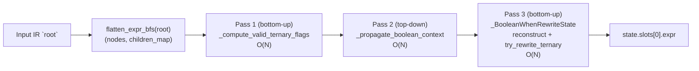

# Linear `rewrite_boolean_when`: BFS State, Expansion Budget & Tautology Suppression

*   **Status:** Implemented
*   **Created:** 2026-11-23
*   **Last updated:** 2026-11-23
*   **Related design docs:** [Row Predicate Pushdown](./polars_bigquery_scan_table_row_predicate_pushdown.md), [`Client.scan_query()`](./polars_bigquery_scan_query.md)

--------------------------------------------------------------------------------

## Overview

In the predicate compiler (`polars_bigquery.core.compiler`), Polars `.when(p).then(t).otherwise(f)` expressions deserialize into nested immutable `Ternary` IR nodes. When a `Ternary` sits in a **boolean filter context**, `rewrite_boolean_when` lowers it into boolean primitives (`BoolLiteral`, `And`, `Or`, `Not(Coalesce(..., False))`, or `Unsupported`) so subsequent passes and the SQL emitter can drop unsupported branches and push partial predicates down to BigQuery.

This document explains the iterative 3-pass $O(N)$ algorithm in [`rewriter/boolean.py`](../../py-polars-bigquery/polars_bigquery/core/compiler/rewriter/boolean.py), the shared [`flatten_expr_bfs`](../../py-polars-bigquery/polars_bigquery/core/compiler/_traversal.py) traversal helper, and the design trade-offs behind `_RewriteSlot` and `_BooleanWhenRewriteState`.

## The Problem

The original `rewrite_boolean_when` implementation had three scalability and correctness hazards, plus a literal-`NULL` edge case in SQL conjunct flattening:

1. **Quadratic $O(N^2)$ subtree re-walks**: On every `Ternary` node in a chained conditional (`.when(...).then(...).when(...).then(...)`), it repeatedly ran whole-subtree walks via `_is_valid_boolean_ternary(node)` and `node.has_descendant(Unsupported)`. Deep chains (e.g., 1,600 nested `Ternary` nodes) took over a second instead of tens of milliseconds (~27 ms).
2. **Exponential AST blowup on `Unsupported` descendants**: Lowering `Ternary(p, t, f)` to `(p AND t) OR (NOT COALESCE(p, FALSE) AND f)` duplicates `p` at each nesting level. Without a cumulative expansion cap that also accounts for `ListLiteral` fanout (`1 + len(values)`), deep chains or `is_in([...])` predicates could grow exponentially in memory, CPU time, and generated SQL length.
3. **Wasteful tautological filters**: Lowering `Ternary(p, True, Unsupported())` emitted `p OR NOT COALESCE(p, FALSE)`, causing BigQuery to evaluate `p` twice while pruning zero rows.
4. **Bare `NullLiteral` conjuncts in SQL flattening**: `compile_ir_conjuncts_to_sql` forwarded literal `NULL` conjuncts instead of skipping them with `all_exact = False` (`is_exact=False`).

## Goals & Non-Goals

### Goals

* Run `rewrite_boolean_when` in **linear $O(N)$ time** with zero Python recursion (safe against deep IR trees beyond `sys.getrecursionlimit()`).
* Share a single iterative BFS traversal helper (`flatten_expr_bfs`) between `rewriter/boolean.py`, `sql/__init__.py`, and future compiler passes (e.g., typing/lowering).
* Bound cumulative AST growth to `MAX_BOOLEAN_WHEN_REWRITE_NODES = 20_000` weighted by `ListLiteral` fanout (`1 + len(values)`), degrading overflowing subtrees safely to `Unsupported()`.
* Suppress tautological `p OR NOT COALESCE(p, FALSE)` pushdown when both `Ternary` branches impose no SQL row restriction, without losing partial pushdown for De Morgan-splittable expressions (`Not(Or(...))` / `Not(Coalesce((Or(...), False)))`).
* Preserve **3-valued logic (3VL) soundness and `is_exact` accuracy**: never drop a row that matches Polars' `.filter()`, and never claim `is_exact=True` when an `Unsupported` descendant was dropped.
* Keep `rewrite_boolean_when_node` (the single-node helper used by direct callers/tests) behaviorally identical to `rewrite_boolean_when`.

### Non-Goals

* General boolean SAT solving or symbolic equivalence checking (for example, detecting `(a > 5) OR (a <= 5)`).
* Rewriting scalar `Ternary` nodes inside non-boolean contexts (such as `when(p).then(10).otherwise(20) == 10`).
* Budget refunding when an unrelated subtree shrinks (see [Alternatives Considered](#alternatives-considered)).

## Architecture

### Shared BFS Flattening (`_traversal.py`)

[`flatten_expr_bfs(root)`](../../py-polars-bigquery/polars_bigquery/core/compiler/_traversal.py) walks an IR tree iteratively using a FIFO queue and produces `(nodes, children_map)`:

* `nodes[0]` is always `root`.
* Every edge `(parent_idx, child_idx)` satisfies **`parent_idx < child_idx`**.
* Iterating `0 .. len(nodes) - 1` visits parents before children (**top-down**).
* Iterating `len(nodes) - 1 .. 0` visits children before parents (**bottom-up post-order**).

*(Note: `flatten_expr_bfs` unrolls DAG-shared Python `Expr` instances by cloning each parent-child edge into its own slot index, so `len(nodes)` reflects the true expanded tree size rather than deduplicated object count.)*

### Three-Pass `rewrite_boolean_when` Pipeline



| Pass | Direction | Function | Purpose |
| --- | --- | --- | --- |
| 0 | Top-down BFS | `flatten_expr_bfs` | Index the tree so `parent < child` without recursion. |
| 1 | Bottom-up (`n-1 -> 0`) | `_compute_valid_ternary_flags` | Precompute `_is_valid_boolean_ternary` in $O(1)$ per node across the *original* tree (`no NullLiteral predicate` and `at least one non-NullLiteral branch leaf`). |
| 2 | Top-down (`0 -> n-1`) | `_propagate_boolean_context` | Mark which nodes are evaluated in a boolean filter context. `And`/`Or` inherit when boolean; `Ternary` always marks its predicate boolean, and marks `truthy`/`falsy` boolean iff the `Ternary` is both boolean-context and valid per Pass 1. |
| 3 | Bottom-up (`n-1 -> 0`) | `_BooleanWhenRewriteState` | Rebuild each interior node from its finalized children (`reconstruct`), then lower boolean-context valid `Ternary` nodes (`try_rewrite_ternary`) under `MAX_BOOLEAN_WHEN_REWRITE_NODES`. |

## `_RewriteSlot` and `_BooleanWhenRewriteState`

Each `Expr` node in the compiler IR is a **frozen dataclass** shared across passes. Rather than embedding pass-local mutable fields onto `Expr` or maintaining six parallel lists inside `rewrite_boolean_when`, Pass 3 pairs each BFS node index with an immutable `_RewriteSlot`:

```python
@dataclasses.dataclass(frozen=True, slots=True)
class _RewriteSlot:
    expr: Expr               # Current (original, rebuilt, or rewritten) IR node
    weight: int              # Subtree weight (ListLiteral = 1 + len(values))
    has_unsup: bool          # Any Unsupported descendant (or Unsupported itself)
    unconstrained: bool      # True iff SQL emission imposes no row restriction
    is_ok: bool = True       # No NullLiteral predicate inside a Ternary branch chain
    has_non_null_leaf: bool = True  # At least one non-NullLiteral leaf in branch chain
```

`_BooleanWhenRewriteState` holds just two mutable fields:

* `slots: list[_RewriteSlot]` — initialized from the BFS `nodes` list with leaf-level attributes.
* `remaining_budget: int` — initialized to `max(0, MAX_BOOLEAN_WHEN_REWRITE_NODES - sum(slot.weight for slot in slots))`.

When an expansion overflows the budget (or degrades as a tautology), the slot is atomically replaced by the shared singleton `_UNSUPPORTED_SLOT = _RewriteSlot(expr=Unsupported(), weight=1, has_unsup=True, unconstrained=True)`.

### Lowering & Weight-Accounting Rules

For a validated boolean-context `Ternary(p, t, f)` with initial weight `orig_w = 1 + w(p) + w(t) + w(f)`, `_rewrite_boolean_ternary_step` produces one of six outcomes:

| Condition | Rewritten IR | New `weight` | Extra budget charge | `has_unsup` | `unconstrained` |
| --- | --- | --- | --- | --- | --- |
| `t` falsy and `f` falsy (`False` or `Null`) | `BoolLiteral(False)` | `1` | `0` (shrinks) | `False` | `False` |
| `f` falsy (`False` or `Null`) | `And(p, t)` | `1 + w(p) + w(t)` | `0` (shrinks by 1) | `p.has_unsup or t.has_unsup` | `p.unconstrained and t.unconstrained` |
| `t` falsy (`False` or `Null`) | `And(Not(Coalesce(p, False)), f)` | `4 + w(p) + w(f)` | **`2`** (`Not`, `Coalesce`, `False` minus removed `t`) | `p.has_unsup or f.has_unsup` | `(p.has_unsup and not isinstance(p, Or)) and f.unconstrained` |
| `t == True` and `f == True` and `not p.has_unsup` | `BoolLiteral(True)` | `1` | `0` (shrinks) | `False` | `True` |
| `has_unsup` and `t.unconstrained` and `f.unconstrained` | `Unsupported()` | `1` | `0` (shrinks) | `True` | `True` |
| `has_unsup` (general) | `Or(And(p, t), And(neg_p, f))` | `3 + w(p) + w(t) + neg_w + w(f)` | `max(0, new_w - orig_w)` | `True` | `(p.unc and t.unc) or (p.has_unsup and f.unc)` |
| Otherwise (`not has_unsup`) | Unchanged (`Ternary`) | `orig_w` | `0` | `False` | `False` |

Where `neg_p` and `neg_w` in the general `has_unsup` row are:

* If `p.has_unsup` is `True`: `neg_p = Unsupported()`, `neg_w = 1` (`extra_w = 3`).
* If `p.has_unsup` is `False`: `neg_p = Not(Coalesce((p, BoolLiteral(False))))`, `neg_w = w(p) + 3` (`extra_w = 5 + w(p)`).

Any rewrite requiring budget checks **both**:

1. `new_w <= MAX_BOOLEAN_WHEN_REWRITE_NODES` (subtree cap), and
2. `extra_w <= remaining_budget` (global cumulative growth cap).

If either check fails, the slot degrades to `_UNSUPPORTED_SLOT` (`Unsupported()`), which leaves filtering of that branch to Polars locally with `is_exact = False`.

### The `unconstrained` Lattice & 3-Valued-Logic Soundness

In `_is_node_unconstrained(node, child_unconstrained, *, has_unsup)`, a `bool` flag tracks whether evaluating `node` in a SQL filter can drop **zero rows** (i.e., emits `None` or `TRUE` after `rewrite_boolean_literals` and `rewrite_de_morgan`):

* `And(l, r)` → `l and r` (dropping `None` on one side still pushes down the other).
* `Or(l, r)` → `l or r` (`emit_or_sql` drops the entire `Or` when either child is `None`, and `rewrite_boolean_literals` folds `Or(True, x)` to `True`).
* `Not(expr)` → `has_unsup and not _is_de_morgan_not(node)`.
  * `_is_de_morgan_not` returns `True` for `Not(Or(...))` and `Not(Coalesce((Or(...), BoolLiteral(False))))`. Those are split by `rewrite_de_morgan` into an `And` of negations, so any supported branch inside the `Or` still restricts rows!
  * All other `Not(...)` nodes with an `Unsupported` descendant emit `(None, False)` in SQL and are therefore unconstrained.
* All other operators (`Eq`, `NotEq`, `Gt`, `IsIn`, `Coalesce`, `Ternary`, etc.) call non-monotone SQL emission, which returns `(None, False)` if any child is `None` or inexact (`has_unsup=True`). So they are unconstrained iff `has_unsup or node == BoolLiteral(True)`.

**Why the `unconstrained` approximation is unconditionally sound:** Tautology suppression always degrades to **`Unsupported()`** (`is_exact = False`), never to `BoolLiteral(True)` (`is_exact = True`).

* A **false negative** (`False` instead of `True`) skips tautology suppression and emits extra SQL, which is still logically exact/superset.
* A **false positive** (`True` instead of `False`) degrades a branch to `Unsupported()`, meaning BigQuery skips that pushdown and Polars filters the full row set locally — never dropping a matching row.

The same `is_exact` guard applies to `Ternary(p, True, True)`: it only collapses to `BoolLiteral(True)` (`is_exact = True`) when `not p.has_unsup`. If `p` contains an `Unsupported` descendant (e.g., `pl.col("flag").drop_nulls()` which may raise `ShapeError` in Polars), it falls through to `Unsupported()` (`is_exact = False`) so `scan_query` does not push a downstream `LIMIT`/`OFFSET` past it.

### Worked Example: Nested Tautology Suppression

```python
pl.when(pl.col("good") == 1)
  .then(True)
  .when(pl.col("i") * 2 == 4)
  .then(True)
  .otherwise(False)
```

1. **Parse (`json_to_ir`)**: `Ternary(Eq(good, 1), True, Ternary(Eq(Unsupported(), 4), True, False))`.
2. **Pass 1 & Pass 2**: Both `Ternary` nodes are valid boolean conditionals in boolean context.
3. **Pass 3 (inner `Ternary`)**:
   * `Eq(Unsupported(), 4)` has `has_unsup=True` → `unconstrained=True` (non-monotone operator with `Unsupported` descendant).
   * Inner `falsy` is `False` → rewrites to `And(Eq(Unsupported(), 4), BoolLiteral(True))`.
   * Synthesized `unconstrained = True and True = True`; `has_unsup = True`.
4. **Pass 3 (outer `Ternary`)**:
   * `truthy` (`BoolLiteral(True)`) has `unconstrained=True`.
   * `falsy` (rewritten inner `And`) has `unconstrained=True`.
   * `has_unsup=True` → collapses directly to **`Unsupported()`** instead of emitting the tautology ``((`good` = 1) OR (NOT COALESCE((`good` = 1), FALSE)))``.
5. **SQL result**: `CompiledPredicate(conjuncts=(), is_exact=False)`.

Compare against a De Morgan-splittable `otherwise` branch:

```python
pl.when(pl.col("good") == 1)
  .then(True)
  .when((pl.col("a") == 2) | (pl.col("i") * 2 == 4))
  .then(False)
  .otherwise(True)
```

Because the inner `predicate` is an `Or`, `_apply_falsy_truthy_rewrite` sets `neg_unconstrained = False`, so the inner `Ternary` keeps `unconstrained = False`. The outer `Ternary` expands to `Or`, `rewrite_de_morgan` splits `Not(Coalesce(Or(...), False))`, and the emitted SQL preserves partial pushdown:

```sql
((`good` = 1) OR ((NOT COALESCE((`good` = 1), FALSE)) AND (NOT COALESCE((`a` = 2), FALSE))))
```

## Key Design Decisions & Alternatives Considered

| Choice | What we did | Alternative | Trade-off |
| --- | --- | --- | --- |
| **Per-node state storage** | Single `list[_RewriteSlot]` (frozen `slots=True` dataclass per BFS node) | Six parallel lists (`nodes`, `weights`, `has_unsup`, `unconstrained`, `post_ok`, `post_leaf`) or mutating `Expr` | Avoids bloated `Expr` dataclasses and eliminates silent desync between parallel arrays at the cost of one lightweight slotted record per node (~27 ms for 1,600 nested `Ternary` nodes, vs. ~1.45 s quadratic). |
| **Separate Pass 1 vs. Pass 3 validity** | Precompute original validity in Pass 1; recompute `is_ok`/`has_non_null_leaf` dynamically in Pass 3 | Single validity array copied from Pass 1 | Pass 2 needs *pre-rewrite* validity to propagate boolean context top-down; Pass 3 needs *post-rewrite* validity because inner `Ternary` nodes collapse to `BoolLiteral`/`And`/`Or`/`Unsupported`. |
| **Budget accounting on shrinkage** | Monotonic (do **not** refund `remaining_budget` when a node shrinks) | Refund `orig_w - new_w` back into `remaining_budget` | Simpler and deterministic invariant (`total_input_weight + sum(extra_w) <= max(input, MAX)`). Minor downside: a huge static sibling (e.g., 20,000-element `ListLiteral`) leaves `remaining_budget = 0`, degrading small expanding `Ternary` siblings to `Unsupported()`. |
| **Single-node API parity** | Keep `rewrite_boolean_when_node` calling `_rewrite_boolean_ternary_step` and `_is_node_unconstrained` | Remove `rewrite_boolean_when_node` or duplicate logic | Retains existing unit-test ergonomics while guaranteeing a single source of truth for lowering rules. |
| **Bare `NullLiteral` conjuncts** | Skip bare top-level `NullLiteral` in `compile_ir_conjuncts_to_sql` with `all_exact = False` | Push `WHERE NULL` or rely only on root check | Handles `pl.lit(None)`, `pl.lit(True) & pl.lit(None)`, and `(pl.col("a") == 1) & pl.lit(None)` consistently without emitting untyped `NULL` to BigQuery. |

## Complexity

Let $N$ be the number of IR nodes returned by `flatten_expr_bfs(root)` (edge-unrolled tree size):

* **`flatten_expr_bfs`**: $O(N)$ time and space.
* **Pass 1 (`_compute_valid_ternary_flags`)**: $O(N)$ time and space.
* **Pass 2 (`_propagate_boolean_context`)**: $O(N)$ time and space.
* **Pass 3 (`_BooleanWhenRewriteState`)**: $O(N)$ time and space; total node weight is bounded by `max(total_input_weight, MAX_BOOLEAN_WHEN_REWRITE_NODES)`.
* **`rewrite_boolean_when_node`**: $O(S)$ on a single `Ternary` subtree of size $S$ (intended for direct single-node callers; whole trees should call `rewrite_boolean_when`).

## Testing & Verification

Tests live in [`py-polars-bigquery/tests/unit/core/test_predicates.py`](../../py-polars-bigquery/tests/unit/core/test_predicates.py):

* `test_flatten_expr_bfs_maintains_parent_before_child_invariant`: Verifies `parent < child` on a 1,200-deep chain without hitting Python's recursion limit.
* `test_rewrite_boolean_when_expansion_cap_degrades_to_unsupported`: Checks budget degradation for both general predicate duplication and the `truthy`-falsy (`extra_weight = 2`) rewrite boundary.
* `test_rewrite_boolean_when_weights_list_literals_against_budget`: Confirms `ListLiteral` fanout (`1 + len(values)`) counts against `MAX_BOOLEAN_WHEN_REWRITE_NODES`.
* `test_rewrite_boolean_when_suppresses_tautology_and_scales_linearly`: Covers tautology suppression (both `Unsupported()` and `Eq(Unsupported(), 4)`), `pred_unsup` exactness on `when(p).then(True).otherwise(True)`, De Morgan pushdown preservation, `rewrite_boolean_when_node` parity, and `< 0.5s` linear runtime on a 1,600-deep `Ternary` chain.
* `test_compile_ir_conjuncts_to_sql_skips_null_literal`: Covers top-level `NullLiteral` omission with `is_exact=False`.
