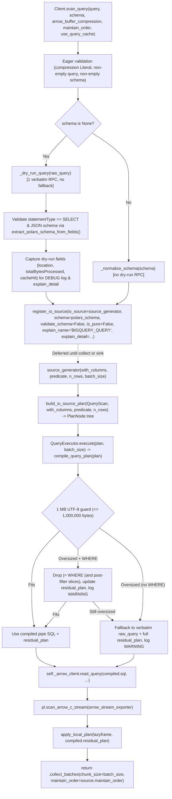

# `Client.scan_query()`: Lazy GoogleSQL Query Scans in `polars-bigquery`

*   **Author:** `@tswast`
*   **Status:** Proposed
*   **Date:** 2026-11-19

--------------------------------------------------------------------------------

## Overview

`polars_bigquery` currently exposes `Client.read_table` (eager table read), `Client.scan_table` (lazy table scan with projection and predicate pushdown), and `Client.read_query` (eager GoogleSQL query execution). It has no lazy entry point for GoogleSQL `SELECT` queries.

This design adds `Client.scan_query()`, using Polars' I/O plugin interface (`polars.io.plugins.register_io_source`) to delay query execution until the caller collects or sinks the returned `polars.LazyFrame`. Execution delegates to `arrow_bigquery.Client.read_query`, streaming results up to BigQuery's ~10 GB compressed anonymous destination table limit.

By default (`maintain_order=True`), `scan_query()` executes the SQL verbatim and downloads results sequentially over a single stream so `ORDER BY` clauses and exact-string BigQuery query cache keys are preserved. When callers pass `maintain_order=False`, results may download in parallel across streams and `scan_query()` appends GoogleSQL pipe operators (`|> WHERE`, `|> SELECT`, `|> LIMIT`) to push down compiled row predicates, column projections, and `LIMIT` (`n_rows`).

## The Problem

1.  **`Client.read_query()` materializes the full result in memory**: Because `read_query()` returns an eager `pl.DataFrame`, callers cannot stream results larger than available RAM (for example, 1–10 GB compressed) to `sink_parquet()` or `collect_batches()`, nor can downstream Polars code attach runtime `.filter()`, `.select()`, or `.limit()` operations before execution.
2.  **The existing lazy workaround requires an extra client library and Storage Read session setup**: [docs/source/guides/large-query-results.md](../source/guides/large-query-results.md) directs callers to install `google-cloud-bigquery`, execute the query eagerly into a temporary table, scan `job.destination` via `Client.scan_table`, and manage dataset/table cleanup. On small and medium queries, that forces job creation and `CreateReadSession` startup instead of using `jobs.query` inline Arrow responses, and Storage Read API filters only prune bytes transferred from the materialized result table rather than base-table scans during query execution.
3.  **Edge cases and constraints a lazy SQL scan must handle**:
    *   **Query cache and error-position fidelity**: BigQuery keys its 24-hour query cache on the exact top-level SQL string, and error coordinates reference the submitted line and column numbers. Altering whitespace or trailing semicolons on verbatim queries, prepending wrapper lines, or changing projected column order across equivalent selections causes avoidable cache misses and shifted error locations.
    *   **Ordering and upstream Polars stream semantics**: Pushing filters onto a query does not guarantee preservation of an inner `ORDER BY`, so pushdown is restricted to `maintain_order=False`. Locally, Polars' Arrow C stream reader currently has two upstream pushdown issues on `polars 2.1.0`: evaluating filters before limits ([pola-rs/polars#30916](https://github.com/pola-rs/polars/issues/30916), affecting `maintain_order=True` with `limit().filter()`) and collapsing zero-column `.drop(pl.all())` batches to zero rows under default `projection_pushdown`.
    *   **SQL rewrite limits and column projections**: Pushdown rewrites must stay below BigQuery's 1 MB unresolved query length limit (which large `is_in` filters can cross), support top-level GoogleSQL constructs such as `WITH RECURSIVE`, and handle zero-column projections without fetching every column from BigQuery.
    *   **Validation, diagnostics, and documentation alignment**: Invalid parameters and malformed dry-run schema responses should fail at scan construction rather than late during collection; query plans and logs need to show whether server-side pushdown is active without exposing raw SQL literals; and existing documentation, IAM prerequisites (`roles/bigquery.jobUser`), and workspace Polars dependency bounds need alignment.

## Goals

*   **Add `Client.scan_query()`**: Expose `Client.scan_query(query, *, schema=None, arrow_buffer_compression="lz4frame", maintain_order=True, use_query_cache=None) -> pl.LazyFrame` backed by `jobs.query` (`JOB_CREATION_OPTIONAL`) for results up to BigQuery's ~10 GB compressed anonymous table cap.
*   **Verbatim sequential default execution (`maintain_order=True`)**: Send `raw_query` unmodified (preserving leading/trailing whitespace and semicolons) sequentially over a single stream with pushdown disabled, matching `Client.read_query()` defaults and preserving `ORDER BY` and exact-string query cache keys.
*   **Shared logical plan tree and backend executors**: Model scan operations as an immutable `PlanNode` tree (`QueryScan`, `TableScan`, `Filter`, `Slice(offset, length)`, `Project`) executed by separate `QueryExecutor` and `ReadApiExecutor` backends that share one local Polars residual evaluator. This decouples logical operator ordering from Polars' current `register_io_source` callback signature in anticipation of newer Polars I/O plugin APIs (such as `FileReader` / `LazyFrameResolver` in [pola-rs/polars#30583](https://github.com/pola-rs/polars/pull/30583)).
*   **GoogleSQL pipe pushdown when `maintain_order=False`**: Allow parallel multi-stream reads and append GoogleSQL pipe operators (`|> WHERE`, `|> SELECT`, `|> LIMIT [OFFSET]`) to `inner_query` when filtering, pruning, or slicing, keeping user SQL starting on line 1 (no `+1` error line shift) without subquery wrapper parentheses or aliases:
    *   **Predicate pushdown**: Reuse `core/compiler/` expression compilation with no `f[0-9]+_` regex or `casefold()` exclusion heuristics, exposing existing `_compile_ir_to_sql`'s `(sql, is_exact)` pair via `compile_predicate()` so `QueryExecutor` knows when a `Filter` is exact vs. partial. Treat trivial `"TRUE"` as no filter. Emit `|> WHERE {sql}` before `|> SELECT` so filters see all columns of the inner query.
    *   **Projection pushdown**: Emit projected columns via `|> SELECT ...` in `polars_schema` declaration order so `lf.select(["a", "b"])` and `lf.select(["b", "a"])` produce the same SQL string and share BigQuery's query cache. Omit `|> SELECT` when all columns are required so anonymous computed columns (`f0_`, `f1_`) flow through on all-column filtered or sliced scans.
    *   **`Slice(offset, length)` / `LIMIT` pushdown**: Validate `0 <= offset, length <= (1 << 63) - 1`. For `Slice(0, n)` followed by `Filter(p)` under `maintain_order=False` (Polars' current `register_io_source` contract for `lf.limit(n).filter(p)`), push `|> WHERE {p_sql}` and `|> LIMIT {n}` together: because `maintain_order=False` disclaims row order and `p => p_sql`, every row set produced by `|> WHERE p_sql` + `|> LIMIT n` followed by local exact `filter(p)` is achievable by slicing `n` rows from some permutation and then filtering by `p`. For general `PlanNode` trees, `Filter(p) -> Slice(offset, length)` pushes `|> LIMIT length [OFFSET offset]` only when all preceding filters compiled with `is_exact=True`, and pushed `offset > 0` slices clear `offset` in the residual local plan so local Polars never double-skips rows.
*   **Single verbatim dry run (`schema=None`)**: Execute one dry run against unmodified `raw_query` with no rewritten-first probe and no second dry run on errors. This preserves exact `[line:col]` error coordinates, rejects non-`SELECT` statements with `ValueError`, and rejects exact duplicate column names with `ValueError`.
*   **1,000,000-byte UTF-8 guard on rewritten SQL**: Keep rewritten SQL below BigQuery's 1,024,000-character / 1,048,576-byte unresolved query limit by stepping down in tiers: drop `|> WHERE` first (keeping `|> SELECT` and `|> LIMIT` pushdown), and fall back to verbatim `raw_query` only if projection/limit pipe clauses alone exceed the ceiling. Log a `WARNING` on degradation.
*   **Zero-column projection SQL pruning (`with_columns == []`)**: Append `|> SELECT 1 AS <dummy>` (collision-safe alias) when no output or predicate columns are needed, or `|> SELECT <predicate_columns>` when filtering, and drop all columns locally via `.drop(pl.all())` instead of `.select([])`.
*   **Eager input validation and Polars defaults**: Validate `arrow_buffer_compression` (`Literal["lz4frame", "zstd", "unspecified"]`), empty `query`, empty `schema={}`, and `bigquerySchema` JSON parsing (`BigQueryError`). Keep Polars defaults (`validate_schema=False`, `is_pure=False`, and default `collect_batches()` optimizations without custom `QueryOptFlags` workarounds).
*   **Diagnostics without raw SQL leakage**: Add `logging.getLogger(__name__)` (`DEBUG` dry-run and execution summaries, `WARNING` on 1 MB step-down) and pass single-line, metadata-only `explain_name` and `explain_detail` strings (no raw SQL or literals) to `register_io_source` in both `scan_query` and `scan_table`.
*   **Synchronized dependency floors**: Raise the Polars dependency in both `py-polars-bigquery/pyproject.toml` and `py-polars-expressions-testing/pyproject.toml` to `polars >= 2.0.0, < 3.0.0` (updating `uv.lock` to `2.1.0`), and add a minimum bound on `arrow-bigquery` (`>= 0.3.2`) in `py-polars-bigquery/pyproject.toml`.
*   **Documentation and verification coverage**:
    *   Update docs and docstrings (`index.md` IAM roles adding `roles/bigquery.jobUser`, runnable quickstart table, `predicate-pushdown.md`, `Client` docstrings removing `"purely an optimization"` and raw MkDocs `!!! note` syntax, documenting construction vs. `.collect()` `ComputeError` behavior, upstream known issues, and the ~10 GB limit). Keep `docs/source/guides/large-query-results.md` filename unchanged to preserve published URLs, renaming only its `def scan_query` helper.
    *   Verify SQL pushdown planning, real Arrow C stream execution, and live BigQuery GoogleSQL pipe-syntax compatibility (`WITH` and `WITH RECURSIVE` CTEs, unparenthesized `UNION ALL` / set operations precedence with `|> WHERE`, `CREATE TEMP FUNCTION ...; SELECT ...` + `|>`, trailing `ORDER BY ... LIMIT ...` + `|>`, user pipe queries, value tables `SELECT AS STRUCT` / `SELECT AS VALUE`, `SELECT 1 AS a, 2 AS A` on inline and `LARGE_RESULTS` queries, and partition/column pruning `totalBytesProcessed` parity with `FROM (...)`).

## Non-Goals

*   **Working around upstream Polars `pl.scan_arrow_c_stream` pushdown bugs (known upstream issues)**: Rather than disabling Polars optimizer flags locally in `scan_query` or `scan_table`, both upstream `polars/io/arrow_c_stream.py` bugs on `polars 2.1.0` are documented as known upstream issues to be fixed in Polars:
    *   [pola-rs/polars#30916](https://github.com/pola-rs/polars/issues/30916): `pl.scan_arrow_c_stream` evaluates `filter` before `limit` when both are pushed down, affecting ordered `maintain_order=True` scans with `lf.limit(n).filter(p)` (returns `[3, 4, 5]` instead of `[3]` on `[1..6].limit(3).filter(a > 2)`).
    *   Zero-column `projection_pushdown` bug: `pl.scan_arrow_c_stream(...).drop(pl.all()).collect_batches()` pushes `PROJECT 0/1 COLUMNS` (`with_columns=[]`) into `arrow_c_stream.py`, which runs `df.select([])` and returns `[]` instead of `[(N, 0)]` (file a companion upstream Polars issue).
*   **Fixing `core/schema.py` type mappings and schema-unaware compiler crashes**: Shared with `scan_table` and tracked separately. Known issues:
    *   `BIGNUMERIC` maps to `Decimal(precision=76, scale=38)`, which raises `InvalidOperationError: precision must be between 1 and 38` inside `register_io_source` (verified live on `polars 2.1.0`).
    *   `JSON` and `GEOGRAPHY` map to `pl.String`; pushing string predicates (`=`, `STARTS_WITH`, `REGEXP_CONTAINS`) fails in BigQuery with `No matching signature`.
    *   `IS_NAN`/`IS_INF` on non-`FLOAT64` columns and `BOOL.fill_null(strategy="zero"|"one")` (`IFNULL(bool, 0)`) produce GoogleSQL type errors.
    *   `TIMESTAMP` uses lowercase `time_zone="utc"` instead of Arrow's `"UTC"` (`pl.Datetime("us", "utc") != pl.Datetime("us", "UTC")` in Python equality, though Rust canonicalizes under `validate_schema=True`).
    *   Parameterized `NUMERIC(P, S)` Arrow serialization is unverified against live `jobs.query` (`schema.py` hardcodes `(38, 9)`).
    *   `REPEATED` drops type parameters during recursion; `INTERVAL` maps to `Duration("us")`; `RANGE<T>` raises `TypeError`; unnamed `STRUCT` subfields produce duplicate empty `Field("", ...)`; picosecond `TIMESTAMP` is unhandled.
*   **Speculative dry-run fallback, column-name heuristics, or SQL parsing**: No rewritten-first dry-run probe, no second dry-run RPC on error paths, no `f[0-9]+_` / `casefold()` exclusion logic in `core/compiler`, and no custom GoogleSQL parser.
*   **Client-side result caching or multi-collect deduplication**: `is_pure` stays `False`; self-joins (`lf.join(lf, ...)`) and repeated `.collect()` calls execute BigQuery per scan. *(Server-side `use_query_cache` pass-through is in scope.)*
*   **Cost guardrails**: No `maximum_bytes_billed` parameter or dry-run byte threshold enforcement.
*   **Results exceeding ~10 GB compressed**: Subject to BigQuery's anonymous destination table limit; larger results require an explicit destination table as documented in [docs/source/guides/large-query-results.md](../source/guides/large-query-results.md).
*   **Multi-statement scripts, DDL, and DML**: Rejected during dry run (`statementType != "SELECT"`).
*   **Rust `arrow-bigquery` changes**: `jobs.cancel` on drop/abort, `py.check_signals()` polling during the 200-second `jobs.query` wait, `BigQueryJobService` retry/backoff/throttler attachment, Rust `tracing` spans, and narrow-row inline first-page multi-stream cutover are deferred to Future Improvements.
*   **Additional `jobs.query` parameters and `scan_table` parity**: `location`, `default_dataset`, `query_parameters`, `maximum_bytes_billed`, `timeout_ms`, `labels`, `destination_table` (requires `jobs.insert`), `arrow_buffer_compression` on `scan_table`/`read_table`, `maintain_order` on `scan_table`, and early-stop `n_rows` in `scan_table` are deferred to Future Improvements.

## Open Questions

None. GoogleSQL pipe syntax (`|>`), the shared `PlanNode` tree (`Slice(offset, length)`, `Filter`, `Project`) with separate `QueryExecutor` and `ReadApiExecutor` backends, Polars default `collect_batches()` optimizations with documented upstream known issues, and Polars `>= 2.0.0` workspace alignment are resolved.

## Critical User Journeys (CUJs)

### CUJ 1: Ordered Lazy Query Streaming (Default `maintain_order=True`)

*   **Given**: A GoogleSQL query with `ORDER BY` whose output exceeds RAM but fits within BigQuery's ~10 GB compressed anonymous table cap (for example, 4 GB compressed), and a caller holding `roles/bigquery.readSessionUser` and `roles/bigquery.jobUser`.
*   **When**: The caller runs `lf = client.scan_query(sql)` (`maintain_order=True`, `schema=None`), optionally appends `.filter(...)` or `.select(...)`, inspects `lf.explain()`, and streams via `lf.sink_parquet("out.parquet")` or `lf.collect_batches()`.
*   **Then**:
    *   `scan_query()` runs one verbatim dry run (`dry_run=True`) on `raw_query`, checks `statementType == "SELECT"` and unique column names, extracts `polars_schema`, and returns a `pl.LazyFrame`.
    *   `lf.explain()` displays `PYTHON[BIGQUERY_QUERY] SCAN` with single-line metadata containing `maintain_order=True, pushdown=disabled` and no raw SQL.
    *   Execution sends `raw_query` verbatim and downloads results sequentially over a single stream, preserving `ORDER BY` order and matching BigQuery's exact-string query cache key (`use_query_cache` default). Filters and projections execute locally as batches stream to disk. *(Known upstream issue [pola-rs/polars#30916](https://github.com/pola-rs/polars/issues/30916) affects ordered `lf.limit(n).filter(p)` until fixed in Polars.)*

### CUJ 2: Unordered Dynamic Pushdown (`maintain_order=False`)

*   **Given**: A base `SELECT` query (including `WITH` / `WITH RECURSIVE` CTEs, `UNION ALL`, or pipe syntax) where row order does not matter and downstream Polars code supplies filters and column lists at runtime.
*   **When**: The caller runs `lf = client.scan_query(sql, maintain_order=False)`, collects `lf.filter(pl.col("state") == "WA").select(["name", "year"]).collect()`, and later collects with `.select(["year", "name"])` and the same filter.
*   **Then**:
    *   `scan_query()` runs one verbatim dry run to extract `polars_schema`.
    *   `lf.explain()` displays `PYTHON[BIGQUERY_QUERY] SCAN` with `maintain_order=False, pushdown=enabled` and no raw SQL literals.
    *   `source_generator` appends pipe operators ``{inner_query}\n|> WHERE (`state` = 'WA')\n|> SELECT `name`, `year`, `state` `` using `polars_schema` column order, so both column orders emit the same SQL string and hit the same BigQuery query cache entry, and user SQL stays on line 1.
    *   `arrow-bigquery` runs with `maintain_order=False`, allowing parallel multi-stream reads when result size crosses its internal cutover thresholds. Polars re-applies `.filter(predicate)` and `.select(output_columns)` locally.
    *   If all columns are needed and no filter or limit is pushed, `raw_query` runs verbatim. If all columns are needed and a filter is pushed, `|> SELECT` is omitted so anonymous computed columns (`f0_`) flow through without being referenced by name.

### CUJ 3: Skipping Dry Run With Explicit `schema`

*   **Given**: A caller that already knows the full result schema of a valid `SELECT` query and wants to avoid the construction-time dry-run RPC.
*   **When**: The caller runs `lf = client.scan_query(sql, schema={"name": pl.String, "year": pl.Int64}, maintain_order=False)` and collects `lf.select("name").collect()`.
*   **Then**:
    *   `scan_query()` issues no network requests at construction time, validates non-empty `query`, non-empty `schema`, and valid `arrow_buffer_compression`, and leaves `validate_schema=False`.
    *   `lf.explain()` includes `schema=explicit`.
    *   Projection, predicate, and `LIMIT` pipe pushdown operate on `.collect()`. Non-`SELECT` statements are not blocked eagerly, duplicate-column validation is skipped, and SQL syntax errors raise `pl.exceptions.ComputeError` at `.collect()` with unshifted user `[line:col]` positions.

### CUJ 4: `LIMIT` Pushdown and `limit().filter()` Under `maintain_order=False`

*   **Given**: A query scanned with `maintain_order=False` using `lf.limit(n)`, `lf.limit(n).filter(p)`, or `lf.filter(p).limit(n)`.
*   **When**: Each plan is collected against a real Arrow C stream.
*   **Then**:
    *   `lf.limit(10).collect()` emits `{inner_query}\n|> LIMIT 10` (reducing bytes transferred and output table size; BigQuery on-demand scan billing is unchanged).
    *   `lf.limit(3).filter(pl.col("a") > 2).collect()` emits ``{inner_query}\n|> WHERE (`a` > 2)\n|> LIMIT 3`` (valid because row order is undefined under `maintain_order=False`) and re-applies exact filtering locally.
    *   `lf.filter(pl.col("a") > 2).limit(3).collect()` receives `n_rows=None` from Polars; BigQuery receives ``{inner_query}\n|> WHERE (`a` > 2)`` with no SQL `LIMIT`, and Polars stops pulling batches once 3 matching rows arrive.

### CUJ 5: Zero-Column Projection and Oversized Predicate (> 1 MB SQL Guard)

*   **Given**: A zero-column scan (`with_columns=[]`) or an `is_in()` predicate whose rewritten SQL exceeds 1,000,000 UTF-8 bytes.
*   **When**: `source_generator` builds the query plan under `maintain_order=False`.
*   **Then**:
    *   For `with_columns=[]` and `predicate=None`, `scan_query` emits ``{inner_query}\n|> SELECT 1 AS `_polars_bigquery_empty` `` so BigQuery prunes all base-table columns, and chains `.drop(pl.all())` locally. *(End-to-end `(N, 0)` height preservation on `pl.scan_arrow_c_stream` awaits the upstream Polars 0-column `projection_pushdown` fix.)*
    *   For rewritten SQL exceeding 1,000,000 UTF-8 bytes, `scan_query` drops `|> WHERE` first while keeping `|> SELECT` and `|> LIMIT` pushdown and logs a `WARNING`. If projection/limit pipe clauses alone still exceed 1,000,000 UTF-8 bytes, it sends `raw_query` verbatim and logs a `WARNING`.

### CUJ 6: Error Handling and Diagnostics

*   **Given**: Invalid parameters, invalid SQL, a non-`SELECT` statement, duplicate column names, an explicit reference to an anonymous `f0_` column under `maintain_order=False`, or output exceeding ~10 GB compressed.
*   **When**: The caller constructs or collects the `LazyFrame`.
*   **Then**:
    *   Invalid `arrow_buffer_compression`, empty `query`, empty `schema={}`, non-`SELECT` `statementType`, and exact duplicate column names raise `ValueError` during `scan_query()`.
    *   Invalid SQL during dry run raises `BigQueryError` with unshifted `[line:col]` positions. Malformed or missing `bigquerySchema` JSON raises `BigQueryError`.
    *   Failures inside `.collect()` (including BigQuery `Unrecognized name: f0_`, ambiguous case-insensitive columns `a`/`A`, disallowed column identifier `ValueError`, or ~10 GB `responseTooLarge`) raise `pl.exceptions.ComputeError`, with user SQL line numbers unshifted (pipe operators appear after the user's SQL). Python `DEBUG`/`WARNING` logs under `polars_bigquery` (`_read_bigquery` and `core.executors.query`) record pushdown state without including raw SQL literals in `INFO`/`WARNING` output or `lf.explain()`.

## Technical Plan (Architecture)

### High-Level Data Flow

`Client.scan_query()` separates construction-time validation and dry-run schema discovery from collection-time planning and execution. Both `scan_query` and `scan_table` translate Polars' `register_io_source` callback arguments into a shared immutable logical plan tree (`PlanNode` in `polars_bigquery/core/plan.py`) composed of leaf scans (`QueryScan`, `TableScan`) and relational operators (`Filter`, `Slice`, `Project`) in explicit application order. Separate backend executors under `polars_bigquery/core/executors/` (`QueryExecutor` for GoogleSQL pipe syntax via `arrow_bigquery.Client.read_query`, and `ReadApiExecutor` for Storage Read API `selected_fields`/`row_restriction` via `arrow_bigquery.Client.read_table`) compile each `PlanNode` tree into a backend-specific server request plus a residual local `PlanNode` tree, then run one shared local evaluator (`apply_local_plan`) over `pl.scan_arrow_c_stream(...)`. Separating logical plan construction from backend executors prepares `polars-bigquery` for newer Polars I/O plugin APIs (such as `FileReader` and `LazyFrameResolver` in [pola-rs/polars#30583](https://github.com/pola-rs/polars/pull/30583)) where `Slice(offset, length)` and `Filter` can arrive in arbitrary order.



### Component Architecture & Module Boundaries

| Component | Status | Responsibility |
| :--- | :--- | :--- |
| `polars_bigquery/core/plan.py` | **Create** | Immutable logical plan IR (`PlanNode` ABC, `QueryScan`, `TableScan`, `Filter`, `Slice(offset, length)`, `Project`) mirroring `core/compiler/ir/base.py`, plus `build_io_source_plan(...)` translating current `register_io_source` callback arguments into a `PlanNode` tree. |
| `polars_bigquery/core/executors/__init__.py` | **Create** | Package exports exposing `PlanExecutor`, `apply_local_plan`, `QueryExecutor`, `CompiledQueryPlan`, `compile_query_plan`, `ReadApiExecutor`, `CompiledReadApiPlan`, and `compile_read_api_plan`. |
| `polars_bigquery/core/executors/base.py` | **Create** | `PlanExecutor` ABC (`execute(plan, *, batch_size=None) -> Iterator[pl.DataFrame]`) and shared `apply_local_plan(lazyframe, plan) -> pl.LazyFrame` walking any `PlanNode` tree bottom-up onto `pl.scan_arrow_c_stream(...)`. |
| `polars_bigquery/core/executors/query.py` | **Create** | Stateless GoogleSQL pipe compiler (`compile_query_plan`, `CompiledQueryPlan`, `MAX_UNRESOLVED_SQL_BYTES = 1_000_000`, `MAX_BIGQUERY_LIMIT = (1 << 63) - 1`, collision-safe dummy alias generator) plus `QueryExecutor(arrow_client)` executing `arrow_client.read_query(...)`, structured `DEBUG`/`WARNING` logging, and `apply_local_plan(...)`. |
| `polars_bigquery/core/executors/read_api.py` | **Create** | Stateless Storage Read API compiler (`compile_read_api_plan`, `CompiledReadApiPlan`) enforcing `Slice` pushdown barriers and computing `selected_fields` + `row_restriction`, plus `ReadApiExecutor(arrow_client)` executing `arrow_client.read_table(...)` and shared `apply_local_plan(...)`. |
| `polars_bigquery/core/compiler/__init__.py`, `polars_bigquery/core/compiler/sql/__init__.py` | **Modify** | Expose existing `_compile_ir_to_sql`'s `(sql, is_exact)` pair via `CompiledPredicate` / `compile_predicate(predicate)` and `compile_ir_to_sql(root)`. `predicate_to_row_restriction()` delegates to `compile_predicate().sql`; all expression IR, parser, rewriter, and SQL formatting logic stays unchanged. |
| `polars_bigquery/core/schema.py` | **Modify** | Extract `extract_polars_schema_from_fields(fields: list[dict]) -> pl.Schema` (including exact duplicate column check) so `scan_query` does not synthesize a `{"schema": ...}` table dict; `extract_polars_schema(table_metadata)` delegates to it and appends ingestion-time `_PARTITIONDATE` / `_PARTITIONTIME` pseudo-columns. |
| `polars_bigquery/_read_bigquery.py` | **Modify** | Add `Client.scan_query()`, `_normalize_schema`, `_validate_compression`, `Client._dry_run_query()`, `logging.getLogger(__name__)`, and `explain_name`/`explain_detail` registration on both `scan_query` and `scan_table`. Construct `QueryScan` / `TableScan` plans via `build_io_source_plan(...)` and delegate execution to `QueryExecutor` (`scan_query`) and `ReadApiExecutor` (`scan_table`). Group `Client` methods in mode order (`read_table`, `read_query`, `scan_table`, `scan_query`) for `mkdocstrings` (`members_order: source`). |
| `py-polars-bigquery/pyproject.toml`, `py-polars-expressions-testing/pyproject.toml`, `uv.lock` | **Modify** | Synchronize Polars floor to `polars >= 2.0.0, < 3.0.0`, update `uv.lock` from `2.0.0rc1` to `2.1.0`, and pin `arrow-bigquery >= 0.3.2` in `py-polars-bigquery/pyproject.toml`. |
| `docs/source/` | **Modify** | Update `index.md` (add `roles/bigquery.jobUser`, runnable quickstart table, `scan_query` references), `api/index.md`, `api/predicate-pushdown.md`, and `guides/large-query-results.md` (keep filename unchanged, rename `def scan_query` helper). |

### Public API Signature & Eager Validation

```python
ArrowBufferCompression = Literal["lz4frame", "zstd", "unspecified"]

class Client:
    def scan_query(
        self,
        query: str,
        *,
        schema: pl.Schema | Mapping[str, DataType | DataTypeClass] | None = None,
        arrow_buffer_compression: ArrowBufferCompression = "lz4frame",
        maintain_order: bool = True,
        use_query_cache: bool | None = None,
    ) -> pl.LazyFrame: ...
```

**Eager validation executed synchronously inside `scan_query()`:**

| Check | Order | Failure Condition | Exception Raised |
| :--- | :--- | :--- | :--- |
| `arrow_buffer_compression` | 1 | Not in `{"lz4frame", "zstd", "unspecified"}` | `ValueError` |
| `query` non-empty | 2 | `not raw_query.strip().removesuffix(";").strip()` (rejects `""`, `"   "`, `" ; "`) | `ValueError` |
| Explicit `schema` | 3 (if provided) | Empty mapping/schema (`len(polars_schema) == 0`) or invalid Polars dtype spec | `ValueError` / `TypeError` (from `pl.Schema`) |
| Dry run RPC (`schema=None`) | 4 (if `schema is None`) | Network, auth, quota, or SQL syntax error in BigQuery | `BigQueryError` (unshifted `[line:col]` on `raw_query`) |
| Dry run row / `statementType` | 5 | Empty metadata frame (`height == 0`) or `statementType not in (None, "SELECT")` | `BigQueryError` (empty frame) / `ValueError` (non-`SELECT`) |
| `bigquerySchema` presence & JSON | 6 | `schema_json is None`, invalid JSON (`JSONDecodeError`), non-`dict` root, or non-`list` `"fields"` | `BigQueryError` |
| Schema fields extraction | 7 | Exact duplicate column names (`SELECT 1 AS a, 2 AS a`) or unknown BigQuery type | `ValueError` (duplicates) / `TypeError` (unknown type) |

**Dry-run isolation (`_dry_run_query`):** Calls `self._arrow_client.read_query(raw_query, arrow_buffer_compression=arrow_buffer_compression, dry_run=True, maintain_order=True, use_query_cache=None)` directly instead of calling public `self.read_query()`, avoiding coupling to subclass overrides or mocks on `read_query()`. In Rust (`crates/arrow-bigquery/src/query.rs:330-340`), `dry_run()` sends `QueryRequest::new().set_dry_run(true)` without `use_query_cache` or compression options on the wire.

**Behavioral delta between `schema=None` and explicit `schema={...}`** (the existing branch docstring calls `schema` `"purely an optimization"`, which omits the behavioral changes below):

| Aspect | `schema=None` (Dry-Run Discovery) | `schema={...}` (Explicit Caller Schema) |
| :--- | :--- | :--- |
| Construction-time network RPC | 1 verbatim `jobs.query` dry-run call (`dry_run=True`) | 0 RPCs |
| Non-`SELECT` guard (DDL/DML/scripts) | Blocked eagerly with `ValueError` | Skipped; non-`SELECT` runs at `.collect()` (mutating statements execute) |
| Exact duplicate column check | Blocked eagerly with `ValueError` | Skipped (relies on caller's unique mapping keys) |
| Invalid SQL error timing & type | Construction time (`BigQueryError`, exact `[line:col]`) | Collection time (`pl.exceptions.ComputeError`, unshifted user `[line:col]`) |
| Dtype validation at `.collect()` | `validate_schema=False` (Polars default) | `validate_schema=False` (caller must match full result schema) |
| Partial schema risk | Not possible (BigQuery returns full schema) | Partial `schema` makes `set(needed) < all_columns` false, disabling `|> SELECT` projection pushdown |
| Dry-run metadata in `explain_detail` | Includes `schema=dry_run` and `location=<loc>` | `schema=explicit` (`location` omitted) |

### Shared Logical Plan Tree (`core/plan.py`)

Both `scan_query` and `scan_table` represent the operations requested by Polars as an immutable tree of frozen dataclasses (`PlanNode`, mirroring `core/compiler/ir/base.py`):

```python
@dataclass(frozen=True, slots=True)
class PlanNode(abc.ABC):
    @abc.abstractmethod
    def children(self) -> tuple[PlanNode, ...]: ...

@dataclass(frozen=True, slots=True)
class QueryScan(PlanNode):
    raw_query: str
    columns: tuple[str, ...]                          # polars_schema declaration order
    maintain_order: bool = True
    arrow_buffer_compression: ArrowBufferCompression = "lz4frame"
    use_query_cache: bool | None = None

    def children(self) -> tuple[PlanNode, ...]:
        return ()

@dataclass(frozen=True, slots=True)
class TableScan(PlanNode):
    table_ref: arrow_bigquery.BigQueryTableId
    columns: tuple[str, ...]                          # polars_schema declaration order
    maintain_order: bool = False

    def children(self) -> tuple[PlanNode, ...]:
        return ()

@dataclass(frozen=True, slots=True)
class Filter(PlanNode):
    input: PlanNode
    predicate: pl.Expr

    def children(self) -> tuple[PlanNode, ...]:
        return (self.input,)

@dataclass(frozen=True, slots=True)
class Slice(PlanNode):
    input: PlanNode
    offset: int                                       # >= 0 (validated in __post_init__)
    length: int                                       # >= 0 (validated in __post_init__)

    def children(self) -> tuple[PlanNode, ...]:
        return (self.input,)

@dataclass(frozen=True, slots=True)
class Project(PlanNode):
    input: PlanNode
    columns: tuple[str, ...]                          # () represents 0-column projection

    def children(self) -> tuple[PlanNode, ...]:
        return (self.input,)
```

`build_io_source_plan(source, *, with_columns, predicate, n_rows) -> PlanNode` adapts Polars' current `register_io_source` callback arguments into a `PlanNode` tree: `source` -> `Slice(0, n_rows)` (when `n_rows is not None`, never `if n_rows:`) -> `Filter(predicate)` (when `predicate is not None`) -> `Project(output_columns)`. When future Polars I/O plugin APIs pass arbitrary operator sequences (such as `Filter -> Slice(offset, length)` or `Slice(offset, length) -> Filter`), callers construct the corresponding `PlanNode` tree directly without changing either executor.

### GoogleSQL Pipe Query Executor (`core/executors/query.py`)

```python
MAX_UNRESOLVED_SQL_BYTES = 1_000_000   # Below BigQuery's 1,024,000-char / 1,048,576-byte limit
MAX_BIGQUERY_LIMIT = (1 << 63) - 1     # Signed INT64 upper bound for SQL LIMIT / OFFSET

@dataclass(frozen=True, slots=True)
class CompiledQueryPlan:
    sql: str                                   # Final SQL string passed to arrow_client.read_query
    rewritten: bool                            # True if GoogleSQL pipe operators were appended
    residual_plan: PlanNode                    # Local PlanNode tree applied to pl.scan_arrow_c_stream
    projected_columns: tuple[str, ...] | None  # None = no |> SELECT (all cols/verbatim); () = dummy 0-col constant
    where_clauses: tuple[str, ...]             # Effective |> WHERE clauses pushed
    pushed_slices: tuple[tuple[int, int], ...] # Effective (offset, length) slices pushed
    dummy_column: str | None                   # Collision-safe alias when |> SELECT 1 AS ... is used
    degraded_reason: Literal["sql_length_dropped_where", "sql_length_skipped_pushdown"] | None
```

#### Compilation Algorithm (`compile_query_plan`)

Inputs: `plan: PlanNode` (rooted above a `QueryScan` leaf), `max_sql_bytes: int = MAX_UNRESOLVED_SQL_BYTES`.

1.  **Decompose tree & validate bounds:** Walk `plan` to its `QueryScan` leaf (`TypeError` if leaf is not `QueryScan`), collecting `ops` bottom-to-top (`Filter | Slice | Project`). For every `Slice(offset, length)`, validate `0 <= offset <= MAX_BIGQUERY_LIMIT` and `0 <= length <= MAX_BIGQUERY_LIMIT` (`ValueError` otherwise).
2.  **Ordered bypass (`source.maintain_order=True`):** Return `CompiledQueryPlan(sql=source.raw_query, rewritten=False, residual_plan=plan, projected_columns=None, where_clauses=(), pushed_slices=(), dummy_column=None, degraded_reason=None)`. Leaving `raw_query` untouched preserves `ORDER BY` and BigQuery's exact-string query cache key.
3.  **Compute `inner_query`:** `source.raw_query.strip().removesuffix(";").strip()`, used only when appending pipe operators (`raw_query` stays verbatim when `rewritten=False`). Stripping at most one trailing `;` ensures `"SELECT 1;;"` still fails in BigQuery with a syntax error instead of silently executing, and the leading `\n` before `|>` terminates trailing `--` / `#` line comments on the last line of `inner_query`.
4.  **Live-column analysis & canonical `|> SELECT`:** Compute `final_output_cols` (columns of the topmost `Project`, or `source.columns` if no `Project` is present) and `all_filter_cols` (union of `op.predicate.meta.root_names()` across all `Filter` ops). Let `needed_set = set(final_output_cols) | all_filter_cols`, ordered in `source.columns` declaration order (`[c for c in source.columns if c in needed_set]`, appending any unmatched names deterministically).
    *   *Why:* `lf.select(["a", "b"])` and `lf.select(["b", "a"])` emit the same SQL (``|> SELECT `a`, `b` ``) and hit the same BigQuery query cache entry; retaining all `Filter` columns keeps local residual `.filter(...)` valid.
    *   **0-column constant mode** (`needed_columns == []`): pick `dummy_col` via `_choose_dummy_column_name(source.columns)` (`"_polars_bigquery_empty"`, suffixed `_1`, `_2`, ... until `dummy_col.casefold()` is absent from `{c.casefold() for c in source.columns}`). Set ``select_op = f"|> SELECT 1 AS `{dummy_col}`"``.
    *   **Column-pruning mode** (`0 < len(needed_columns) < len(source.columns)`): quote each name via `compiler.sql.column_to_sql_identifier(col)` (`ValueError` on disallowed characters such as `` ` ``, `\`, `.`, `$`, `!`). Set `select_op = "|> SELECT " + ", ".join(quoted_cols)`.
    *   **All-column mode** (`needed_set >= set(source.columns)`): set `select_op = ""` (omit `|> SELECT`). Anonymous computed columns (`f0_`, `f1_`) flow through `|> WHERE` and `|> LIMIT` without being referenced by name.
5.  **Lower ordered `Filter` and `Slice` stages:** Walk `ops` bottom-to-top using `compiler.compile_predicate(op.predicate) -> CompiledPredicate(sql, is_exact)` (normalizing `"TRUE"` to `""`):
    *   **Unordered `Slice(0, n)` before `Filter(p)` (`register_io_source` pattern):** Under `maintain_order=False`, when a `Slice(0, n)` precedes one or more `Filter` ops (with no earlier partial filter), emit those `|> WHERE` clauses *before* `|> LIMIT {n}`. Because row order is undefined and `p => p_sql`, any output of `|> WHERE p_sql` + `|> LIMIT n` followed by local exact `filter(p)` is achievable by slicing `n` rows from some permutation and then filtering by `p`.
    *   **`Filter(p)` before `Slice(offset, length)` (general tree pattern):** Emit `|> WHERE {sql}` when `sql != ""`. If `is_exact` is `False` (partial or unpushable filter), set a `partial_filter_barrier` and stop pushing any subsequent `Slice` (and ops above it) onto SQL so BigQuery cannot truncate rows before local Polars evaluates the unpushed filter portion. When all filters below `Slice` are exact (`is_exact=True`), push `|> LIMIT {length}` (when `offset == 0`) or `|> LIMIT {length} OFFSET {offset}` (when `offset > 0`).
    *   **`Slice(offset > 0, length)` before `Filter(p)`:** Emit `|> LIMIT {length} OFFSET {offset}` in tree order before subsequent `|> WHERE {sql}` clauses.
    *   **Residual `offset > 0` clearing:** Whenever a `Slice(offset > 0, length)` is pushed into SQL (and survives the 1 MB guard), replace it with `Slice(0, length)` in `residual_plan` so local Polars does not skip `offset` rows a second time. `Slice(0, length)` stays in `residual_plan` as an idempotent bound.
6.  **Unrewritten bypass (`maintain_order=False`):** If no `|> WHERE` stage, no `|> LIMIT` stage, and `select_op == ""`, return verbatim `source.raw_query` (`rewritten=False`, `residual_plan=plan`).
7.  **Assemble GoogleSQL pipe query:** Start with `[inner_query]`, append ordered `|> WHERE` / `|> LIMIT [OFFSET]` stages, inserting `select_op` (when non-empty) immediately after the last `|> WHERE` stage (before any trailing `|> LIMIT` when no `|> WHERE` follows it, matching the SQL Emission Matrix and ensuring all `|> WHERE` clauses see every inner column), and join with `"\n"`.
    *   *Why pipe syntax (`|>`):* User SQL starts on line 1 (unshifted error `[line:col]` coordinates), no wrapper parentheses (no unbalanced-parentheses breakout), no subquery range-variable alias collisions, top-level constructs like `WITH RECURSIVE` remain valid, and all-column filter/slice scans require no `SELECT *` wrapper.
8.  **Tiered 1 MB UTF-8 length guard (`len(sql.encode("utf-8")) <= max_sql_bytes`):**
    *   Enforcing `<= 1_000_000` UTF-8 bytes leaves 24,000 characters below BigQuery's 1,024,000-character limit and 48,576 bytes below 1,048,576 bytes.
    *   **Tier 1:** If full piped SQL fits, return it with `degraded_reason=None` and the computed `residual_plan`.
    *   **Tier 2:** If oversized and at least one `|> WHERE` stage exists: drop all `|> WHERE` stages *and* any `Slice` stages positioned after a dropped `Filter` in `ops` (dropping a filter turns it unpushed, so post-filter SQL slices would truncate unfiltered rows), retaining `select_op` and any `Slice` stages logically before dropped filters, and keeping the original `offset` in `residual_plan` for any dropped `offset > 0` slice:
        *   If at least one pipe op remains and fits `<= max_sql_bytes`, return it with `degraded_reason="sql_length_dropped_where"`.
        *   If no pipe ops remain, return `source.raw_query` verbatim (`rewritten=False`, `residual_plan=plan`, `degraded_reason="sql_length_dropped_where"`).
    *   **Tier 3:** If the remaining `|> SELECT` / `|> LIMIT` SQL still exceeds `max_sql_bytes` (for example, `raw_query` itself is near 1 MB), return `source.raw_query` verbatim (`rewritten=False`, `residual_plan=plan`, `dummy_column=None`, `pushed_slices=()`, `degraded_reason="sql_length_skipped_pushdown"`).

`QueryExecutor(arrow_client).execute(plan, *, batch_size=None)` calls `compile_query_plan(plan)`, emits `WARNING` if `compiled.degraded_reason is not None` and `DEBUG` summary (without raw SQL literals), invokes `arrow_client.read_query(compiled.sql, arrow_buffer_compression=source.arrow_buffer_compression, dry_run=False, maintain_order=source.maintain_order, use_query_cache=source.use_query_cache)`, runs `apply_local_plan(pl.scan_arrow_c_stream(exporter), compiled.residual_plan)`, and returns `.collect_batches(chunk_size=batch_size, maintain_order=source.maintain_order)`.

#### SQL Emission Matrix (`register_io_source` Path, `maintain_order=False`, within 1 MB budget)

| User Operation | `with_columns` | `predicate` | `n_rows` | Emitted SQL | Residual Local Pipeline |
| :--- | :--- | :--- | :--- | :--- | :--- |
| `lf.collect()` | `None` | `None` | `None` | `raw_query` (verbatim) | `.select(all_columns)` |
| `lf.select(["b", "a"])` (all cols) | `["b", "a"]` | `None` | `None` | `raw_query` (verbatim) | `.select(["b", "a"])` |
| `lf.select(["a"])` (subset) | `["a"]` | `None` | `None` | ``{inner}\n\|> SELECT `a` `` | `.select(["a"])` |
| `lf.filter(p)` (all cols, pushable) | `None` | `p` | `None` | `{inner}\n\|> WHERE {sql(p)}` | `.filter(p).select(all_columns)` |
| `lf.filter(p)` (unpushable) | `None` | `p` | `None` | `raw_query` (verbatim) | `.filter(p).select(all_columns)` |
| `lf.filter(p).select(["a"])` | `["a"]` | `p` (uses `b`) | `None` | ``{inner}\n\|> WHERE {sql(p)}\n\|> SELECT `a`, `b` `` | `.filter(p).select(["a"])` |
| `lf.filter(p).limit(10)` | `None` | `p` | `None` *(Polars holds SLICE above scan)* | `{inner}\n\|> WHERE {sql(p)}` | `.filter(p).select(all_columns)` *(outer SLICE stops stream early)* |
| `lf.limit(10)` | `None` | `None` | `10` | `{inner}\n\|> LIMIT 10` | `.slice(0, 10).select(all_columns)` |
| `lf.limit(10).select(["a"])` | `["a"]` | `None` | `10` | ``{inner}\n\|> SELECT `a`\n\|> LIMIT 10`` | `.slice(0, 10).select(["a"])` |
| `lf.limit(10).filter(p)` (pushable) | `None` | `p` | `10` | `{inner}\n\|> WHERE {sql(p)}\n\|> LIMIT 10` | `.slice(0, 10).filter(p).select(all_columns)` |
| `lf.limit(10).filter(p).select(["a"])` | `["a"]` | `p` (uses `b`) | `10` | ``{inner}\n\|> WHERE {sql(p)}\n\|> SELECT `a`, `b`\n\|> LIMIT 10`` | `.slice(0, 10).filter(p).select(["a"])` |
| `lf.limit(10).filter(p)` (unpushable) | `None` | `p` | `10` | `{inner}\n\|> LIMIT 10` | `.slice(0, 10).filter(p).select(all_columns)` |
| Direct call `with_columns=[]`, no `p` | `[]` | `None` | `None` or `10` | ``{inner}\n\|> SELECT 1 AS `_polars_bigquery_empty` [\n\|> LIMIT 10]`` | `[.slice(0, 10)].drop(pl.all())` |
| Direct call `with_columns=[]`, with `p` | `[]` | `p` (uses `b`) | `None` | ``{inner}\n\|> WHERE {sql(p)}\n\|> SELECT `b` `` | `.filter(p).drop(pl.all())` |
| Any query with `maintain_order=True` | any | any | any | `raw_query` (verbatim) | `[.slice(0, n)][.filter(p)].select(...) / .drop(pl.all())` |

#### General `PlanNode` Tree Orderings (`maintain_order=False`, future I/O plugin APIs)

| Logical `PlanNode` Tree (bottom-to-top) | Emitted SQL | Residual Local Pipeline |
| :--- | :--- | :--- |
| `QueryScan -> Filter(p, exact) -> Slice(0, 10) -> Project(["a"])` | ``{inner}\n\|> WHERE {sql(p)}\n\|> SELECT `a`\n\|> LIMIT 10`` | `.filter(p).slice(0, 10).select(["a"])` |
| `QueryScan -> Filter(p, partial) -> Slice(0, 10) -> Project(["a"])` | ``{inner}\n\|> WHERE {sql(p)}\n\|> SELECT `a`, ...`` *(no SQL `LIMIT`)* | `.filter(p).slice(0, 10).select(["a"])` |
| `QueryScan -> Filter(p, exact) -> Slice(5, 10) -> Project(["a"])` | ``{inner}\n\|> WHERE {sql(p)}\n\|> SELECT `a`\n\|> LIMIT 10 OFFSET 5`` | `.filter(p).slice(0, 10).select(["a"])` *(offset cleared)* |
| `QueryScan -> Slice(5, 10) -> Filter(p) -> Project(["a"])` | ``{inner}\n\|> LIMIT 10 OFFSET 5\n\|> WHERE {sql(p)}\n\|> SELECT `a`, ...`` | `.slice(0, 10).filter(p).select(["a"])` *(offset cleared)* |

### Storage Read API Executor (`core/executors/read_api.py`)

```python
@dataclass(frozen=True, slots=True)
class CompiledReadApiPlan:
    selected_fields: tuple[str, ...]  # Deduplicated union of final Project columns + all Filter root columns
    row_restriction: str              # Compiled Storage Read API row_restriction SQL ("" if none)
    residual_plan: PlanNode           # Always the full input PlanNode tree (Read API applies no Slice)
```

`compile_read_api_plan(plan: PlanNode) -> CompiledReadApiPlan` walks `plan` bottom-to-top to its `TableScan` leaf (`TypeError` if leaf is not `TableScan`):
*   Computes `selected_fields = tuple(dict.fromkeys([*final_output_cols, *all_filter_cols]))`.
*   Collects compiled `Filter` predicates bottom-to-top into `restrictions`, ignoring `""` and `"TRUE"`:
    *   Stops collecting further `Filter` ops across a `Slice` barrier when `source.maintain_order=True` or when `Slice.offset > 0` (preventing filters from being pushed below an ordered or non-zero-offset slice).
    *   Allows collecting filters across `Slice(0, n)` when `source.maintain_order=False` (unordered multiset, preserving `scan_table`'s existing behavior for `lf.limit(n).filter(p)`).
    *   Joins multiple collected restrictions with `" AND "` (wrapping each clause in `(...)` when `len(restrictions) > 1`).
*   Sets `residual_plan = plan` because Storage Read API sessions never perform server-side slicing.

`ReadApiExecutor(arrow_client).execute(plan, *, batch_size=None)` calls `compile_read_api_plan(plan)`, invokes `arrow_client.read_table(source.table_ref, maintain_order=source.maintain_order, selected_fields=list(compiled.selected_fields), row_restriction=compiled.row_restriction)`, runs `apply_local_plan(pl.scan_arrow_c_stream(exporter), compiled.residual_plan)`, and returns `.collect_batches(chunk_size=batch_size, maintain_order=source.maintain_order)`.

*Behavioral alignment on `Client.scan_table`:* Existing `selected_fields`, `row_restriction`, and single-filter / unfiltered scans are unchanged. Building `TableScan` plans via `build_io_source_plan(...)` aligns `scan_table`'s local `Slice`/`Filter` order (`Slice` before `Filter`) and 0-column `.drop(pl.all())` with `scan_query` and Polars' `register_io_source` contract, so upstream fixes for [pola-rs/polars#30916](https://github.com/pola-rs/polars/issues/30916) and 0-column `projection_pushdown` apply automatically to both `scan_table` and `scan_query`.

### Shared Local Residual Evaluator (`core/executors/base.py`)

Both `QueryExecutor` and `ReadApiExecutor` share one local evaluator over `pl.scan_arrow_c_stream(arrow_stream_exporter)`:

```python
def apply_local_plan(lazyframe: pl.LazyFrame, plan: PlanNode) -> pl.LazyFrame:
    # Iterative bottom-up walk from leaf scan (QueryScan / TableScan) to root:
    #   Slice(offset, length) -> lazyframe.slice(offset, length)
    #   Filter(predicate)     -> lazyframe.filter(predicate)
    #   Project(columns)      -> lazyframe.select(list(columns)) if columns else lazyframe.drop(pl.all())
```

Design notes:
1.  **Exact tree-order local execution:** Walks `residual_plan` bottom-up so arbitrary sequences of `Slice`, `Filter`, and `Project` evaluate in their logical tree order, and uses `.drop(pl.all())` instead of `.select([])` for `Project(())`.
2.  **Polars default optimizations (known upstream issues):** `collect_batches(...)` uses Polars' default `QueryOptFlags` rather than overriding `predicate_pushdown` or `projection_pushdown`. On `polars 2.1.0`, two upstream bugs inside `polars/io/arrow_c_stream.py` remain documented as known issues until fixed upstream:
    *   [pola-rs/polars#30916](https://github.com/pola-rs/polars/issues/30916): `pl.scan_arrow_c_stream` applies `filter` before `limit`/`slice`, affecting ordered `maintain_order=True` scans with `lf.limit(n).filter(p)`.
    *   Zero-column `projection_pushdown`: `pl.scan_arrow_c_stream(...).drop(pl.all()).collect_batches()` pushes `with_columns=[]` into `arrow_c_stream.py`, which runs `df.select([])` and returns `[]` instead of `[(N, 0)]` (file a companion upstream Polars issue).
3.  **Direct `return` instead of `yield from`:** Returns `_CollectBatches` directly without retaining a suspended Python generator frame holding a reference to `arrow_stream_exporter` until GC/close.
4.  **`maintain_order=source.maintain_order`:** Propagates the ordering flag to `collect_batches(...)` instead of defaulting to `maintain_order=True` inside Polars' inner streaming engine when `maintain_order=False`.

### Observability, Logging & Error Contracts

#### `lf.explain()` Format
`register_io_source` displays `explain_name` as `PYTHON[<explain_name>] SCAN ...` and `explain_detail` as a static, single-line string captured at construction time. Raw SQL text and predicate literals are omitted from `explain_detail` to avoid leaking PII/secrets into logged plans and to obey the single-line format:

*   **`scan_query`:**
    *   `explain_name = "BIGQUERY_QUERY"`
    *   `explain_detail` (comma-separated key-value pairs):
        *   Ordered, dry-run: `maintain_order=True, pushdown=disabled, schema=dry_run, location=US` (omit `location` if null/absent)
        *   Unordered, dry-run: `maintain_order=False, pushdown=enabled, schema=dry_run, location=US`
        *   Explicit schema: `maintain_order=False, pushdown=enabled, schema=explicit`
*   **`scan_table`:**
    *   `explain_name = "BIGQUERY_TABLE"`
    *   `explain_detail = f"table={table_ref}, schema={'metadata' if schema is None else 'explicit'}"`

Because `explain_detail` is fixed at construction time, it cannot display dynamically generated `|> WHERE` clauses. Docs note that Polars prints `SELECTION:` and `PROJECT:` under the scan node even when `maintain_order=True` disables server-side pushdown.

#### Python Logging (`logging.getLogger(__name__)`)
*   **`DEBUG` on dry run (`polars_bigquery._read_bigquery`, `schema=None`):** Logs `statement_type`, `location`, `total_bytes_processed`, `cache_hit`, and column count (`len(polars_schema)`). No raw SQL.
*   **`DEBUG` on execution (`polars_bigquery.core.executors.query`):** Logs `maintain_order`, `rewritten`, `projected_cols` (`len/total`, or `0-col dummy`), `where_clauses` count and total byte length, `pushed_slices`, `sql_bytes`, and `degraded_reason`. Raw SQL strings are not emitted at `INFO` or `WARNING`.
*   **`WARNING` on 1 MB step-down guard (`polars_bigquery.core.executors.query`):** Emitted when `compiled.degraded_reason is not None` (`sql_length_dropped_where` or `sql_length_skipped_pushdown`), recording `sql_bytes` and `MAX_UNRESOLVED_SQL_BYTES` without raw SQL literals.

#### Exception Contract Matrix

| Phase | Trigger | Exception Type | Notes |
| :--- | :--- | :--- | :--- |
| Construction (`scan_query`) | Invalid `arrow_buffer_compression`, empty `query`, empty `schema={}`, non-`SELECT` `statementType`, exact duplicate column names | `ValueError` | Raised eagerly |
| Construction (`scan_query`) | Invalid SQL, auth/quota/network failure, missing/malformed `bigquerySchema` JSON, empty dry-run result | `polars_bigquery.exceptions.BigQueryError` | Unshifted `[line:col]` on `raw_query` |
| Construction (`scan_query`) | Unknown BigQuery field type in dry-run schema, unspecified `pl.Schema` dtype class (e.g. `pl.Datetime`) | `TypeError` | Raised eagerly |
| Execution (`.collect()` / `.sink_*()`) | Any failure inside `source_generator` or mid-stream Rust reader (BigQuery `Unrecognized name: f0_`, ambiguous `a`/`A`, ~10 GB `responseTooLarge`, disallowed column identifier `ValueError`, invalid `Slice` / `n_rows` range `ValueError`, network/auth error) | `pl.exceptions.ComputeError` | Polars wraps generator/stream exceptions into `ComputeError`. User SQL stays on line 1 (appended `|>` clauses follow the user's SQL). |

### Underlying `arrow-bigquery` Streaming & `Client` Lifecycle

*   **Sequential vs. parallel streaming:** Under `maintain_order=True`, `arrow-bigquery` downloads results sequentially over a single stream. Under `maintain_order=False`, `arrow-bigquery` may switch to parallel multi-stream reads when result size crosses its internal cutover thresholds (narrow-row inline-first-page queries stay on the single default stream while decoding batches in parallel). Docs describe `maintain_order=False` as enabling adaptive parallel reads rather than unconditional multi-stream sessions.
*   **Query cache and re-execution:** Under `maintain_order=False`, distinct filter/projection/limit combinations emit distinct top-level SQL strings and miss BigQuery's 24-hour query cache (under `maintain_order=True`, repeated `.collect()` hits the cached query). With `is_pure=False`, self-joins (`lf.join(lf, ...)`) and multi-branch plans execute and bill BigQuery once per scan branch.
*   **`Client` context-manager lifetime:** `source_generator` closes over `self`, retaining `Client`, its HTTP session, and its Rust gRPC channel. `Client.close()` currently closes only `_rest_client`, not `_arrow_client`, so collecting a `LazyFrame` outside a `with Client(...) as client:` block works today; docstrings will advise collecting inside the `with` block in case `_arrow_client` adds explicit shutdown later.
*   **Dependency floors:** Raise both `py-polars-bigquery/pyproject.toml` and `py-polars-expressions-testing/pyproject.toml` to `polars >= 2.0.0, < 3.0.0` (updating `uv.lock` from `2.0.0rc1` to `2.1.0`), ensuring `explain_name` and `explain_detail` exist without signature-detection shims, and pin `arrow-bigquery >= 0.3.2` in `py-polars-bigquery/pyproject.toml`.

## Alternatives Considered

### Alternative A: Keep `read_query()` and the `google-cloud-bigquery` Destination-Table Guide (No `scan_query`)

*   **Pros**: No new API surface or SQL pushdown code in `polars-bigquery`. Supports results > ~10 GB compressed via explicit destination tables.
*   **Cons**: Forces callers to install `google-cloud-bigquery`, run queries eagerly to a destination table before constructing a `LazyFrame`, incur `CreateReadSession` startup overhead on small/medium queries, and manage table/dataset cleanup. Leaves 1–10 GB out-of-core streaming unavailable through `polars-bigquery` alone.
*   **Reason for Rejection**: Does not satisfy lazy composition or dynamic Polars pushdown for `<= ~10 GB` queries without an extra client library.

### Alternative B: Lazy Streaming `scan_query` Without SQL Pushdown (No-Rewrite v1)

*   **Pros**: Small implementation (~30 lines wrapping `arrow_client.read_query()`), preserves 100% of BigQuery query cache keys and exact error line numbers, and avoids all SQL rewrite edge cases.
*   **Cons**: Transfers every column and row produced by the base query across the network and evaluates all Polars `.select()`, `.filter()`, and `.limit()` operations locally.
*   **Reason for Rejection**: Dynamic Polars-driven projection and filter pushdown to reduce network transfer size is a core requirement of the feature.

### Alternative C: Decouple `maintain_order` From SQL Pushdown, or Default `maintain_order=False`

*   **Pros**:
    *   *Decoupled `pushdown` flag*: Would allow `(maintain_order=False, pushdown=False)` for two edge cases: (1) reusing BigQuery's 24-hour query cache across multiple local `.filter()` calls while still allowing parallel multi-stream reads on a large result, and (2) running parallel multi-stream reads when explicitly selecting or filtering anonymous `f0_` columns.
    *   *Default `maintain_order=False`*: Matches `scan_table` and enables pushdown by default without an extra argument.
*   **Cons**:
    *   *Decoupled `pushdown` flag*: Creates an invalid flag combination (`maintain_order=True, pushdown=True`), because `|> WHERE` does not guarantee preservation of an inner `ORDER BY`. The remaining non-redundant combination (`maintain_order=False, pushdown=False`) adds API surface and divergence from `read_query()` for narrow edge cases.
    *   *Default `maintain_order=False`*: Silently breaks `ORDER BY` queries by default and diverges from `Client.read_query(maintain_order=True)`.
*   **Reason for Rejection**: Because `maintain_order=True` + pushdown is invalid, coupling pushdown to `maintain_order` keeps a single flag matching `read_query()` without invalid states. Defaulting to `maintain_order=True` prevents silent `ORDER BY` regressions; callers opt into `maintain_order=False` when order does not matter.

### Alternative D: Rewritten-First Dry-Run Probe With Verbatim Fallback

*   **Pros**: Detects SQL constructs incompatible with pushdown rewriting during construction with one RPC on the normal path and disables pushdown instead of failing at `.collect()`.
*   **Cons**:
    *   Breaks parity between `schema=None` and explicit `schema={...}`: incompatible queries succeed via fallback when `schema=None`, but fail at `.collect()` when explicit `schema` skips the dry-run probe.
    *   Because `arrow_bigquery.exceptions.BigQueryError` exposes no structured status code or reason (and `BigQueryJobService` has no retry throttler), catching `BigQueryError` fires two dry-run RPCs on every `401`, `403`, `404`, `429`, `5xx`, timeout, or syntax error, and can silently disable pushdown if a transient `503` hits only the first call.
    *   Chains synthetic rewrite tracebacks unless suppressed.
*   **Reason for Rejection**: A single verbatim dry run on `raw_query` avoids duplicate error-path RPCs, preserves exact `[line:col]` errors, and keeps behavior consistent with explicit `schema`.

### Alternative E: Client-Side Column Heuristics (`f[0-9]+_` and `casefold()`) via `compiler` `excluded_columns`

*   **Pros**: Avoids runtime `Unrecognized name` and `Ambiguous column` BigQuery errors when a caller explicitly projects or filters on unaliased (`f0_`) or case-insensitively colliding (`a`, `A`) columns under `maintain_order=False`.
*   **Cons**: False-positives on legitimate explicitly named columns matching `f[0-9]+_`, silently disabling pushdown; leaks query-pushdown heuristics into the shared `core/compiler` module used by `scan_table`.
*   **Reason for Rejection**: Omitting `|> SELECT` for all-column filtered/limited scans covers common unaliased queries without heuristics; explicit references to anonymous or case-colliding columns are left to BigQuery's server-side errors and documented with `AS` aliasing guidance.

### Alternative F: Standard SQL Subquery Wrapping (`SELECT ... FROM (\n{inner_query}\n)`) Instead of GoogleSQL Pipe Syntax (`|>`)

*   **Pros**: Uses SQL-92 subquery syntax understood by generic SQL proxies or third-party emulators, with familiar scoping rules across `UNION ALL` and `ORDER BY`.
*   **Cons**:
    *   Fails on top-level-only GoogleSQL constructs (`WITH RECURSIVE`, `CREATE TEMP FUNCTION ...; SELECT ...`).
    *   Prepends `SELECT ... FROM (\n` before user SQL, shifting all BigQuery runtime error `[line:col]` positions by `+1`.
    *   Allows unbalanced-parentheses breakout when explicit `schema` skips dry run (`SELECT 1 AS a) AS x UNION ALL SELECT 2 AS a FROM (SELECT 3` becomes syntactically valid inside `FROM (...)`).
    *   Requires `SELECT *` wrapping on filter-only and limit-only scans (and risks range-variable shadowing if an `AS` alias is attached).
*   **Reason for Rejection**: BigQuery has no official local emulator requiring SQL-92-only syntax, and GoogleSQL pipe syntax (`|>`) keeps user SQL on line 1 (exact error coordinates), supports `WITH RECURSIVE` and user pipe queries, eliminates wrapper parentheses and aliases, and omits `SELECT *` on filter/limit-only scans. Live BigQuery system tests will verify `UNION ALL` precedence, `CREATE TEMP FUNCTION`, trailing `LIMIT`, value tables, and pruning parity.

### Alternative G: Always Materialize to a Destination Table and Push Down via Storage Read API

*   **Pros**: Pushes `selected_fields` and `row_restriction` without rewriting user SQL, works with anonymous `f0_` columns, and supports > ~10 GB results if an explicit destination table is created.
*   **Cons**: Disables `JOB_CREATION_OPTIONAL` inline Arrow responses (adding job creation and `CreateReadSession` startup latency), cannot prune base-table storage bytes during query execution, and cannot shrink results below the ~10 GB anonymous table cap.
*   **Reason for Rejection**: Preserving `jobs.query` inline execution and allowing BigQuery's optimizer to push filters/projections into base-table scans is preferred for `<= ~10 GB` queries; destination-table scanning remains documented in [docs/source/guides/large-query-results.md](../source/guides/large-query-results.md).

### Alternative H: Different `LIMIT` Pushdown Strategies (No SQL `LIMIT`, Drop `WHERE` When `n_rows` Set, or Double-Wrap)

*   **Pros**:
    *   *No SQL `LIMIT` pushdown*: Preserves query cache keys across `lf.head(5)` and `lf.collect()`, and relies on stream cancellation.
    *   *Omit SQL `WHERE` when `n_rows` is set (or double-wrap)*: Enforces strict slice-before-filter ordering in SQL even under `maintain_order=False`.
*   **Cons**:
    *   *No SQL `LIMIT`*: Transfers full query output until client-side stop and cannot keep large queries under the ~10 GB anonymous table cap via `.limit(n)`.
    *   *Omit `WHERE` or double-wrap*: Unnecessary under `maintain_order=False`, because row order is explicitly undefined; for an unordered multiset, `|> WHERE p_sql` + `|> LIMIT n` followed by local exact `filter(p)` always produces a subset achievable by slicing `n` rows from some permutation and then filtering, while transferring fewer rows when `p` is selective.
*   **Reason for Rejection**: Pushing both `|> WHERE` and `|> LIMIT` together under `maintain_order=False` reduces transfer size while remaining sound for unordered scans; ordered `maintain_order=True` executes verbatim.

### Alternative I: Local Workarounds for Upstream `pl.scan_arrow_c_stream` Bugs (`QueryOptFlags` or Direct Per-Batch Loop)

*   **Pros**:
    *   *`QueryOptFlags(predicate_pushdown=False, projection_pushdown=False)`*: Works around both [pola-rs/polars#30916](https://github.com/pola-rs/polars/issues/30916) and the 0-column `projection_pushdown` bug immediately on `polars 2.1.0` while keeping `slice_pushdown=True` and streaming batch coalescing.
    *   *Direct per-batch Python loop*: Independent of `pl.scan_arrow_c_stream` optimizer flags across future Polars releases.
*   **Cons**:
    *   *`QueryOptFlags`*: Carries a Polars-internal optimizer workaround in `polars-bigquery` for bugs that belong upstream in `polars/io/arrow_c_stream.py`.
    *   *Direct per-batch Python loop*: Drops Polars' streaming `chunk_size` coalescing after selective local filters unless manual buffering is added, reintroduces a suspended generator frame holding `arrow_stream_exporter` until GC/close, and requires rewriting `polars.scan_arrow_c_stream` unit test mocks.
*   **Reason for Rejection**: Rely on Polars' default `collect_batches()` optimizations without connector-side workarounds, and document both upstream `arrow_c_stream.py` bugs as known issues so upstream fixes apply automatically.

### Alternative J: Enable `validate_schema=True` or `is_pure=True` on `register_io_source`

*   **Pros**:
    *   `validate_schema=True`: Checks batch dtypes against declared `schema` in memory with no extra RPCs.
    *   `is_pure=True`: Lets Polars common subplan elimination run BigQuery once for self-joins (`lf.join(lf, ...)`).
*   **Cons**:
    *   `validate_schema=True`: Risks rejecting valid queries due to pre-existing `core/schema.py` mismatches (such as `INTERVAL` or unverified parameterized `NUMERIC(P, S)`), and adds per-batch checks contrary to trusting caller-supplied `schema`.
    *   `is_pure=True`: Changes semantics for non-deterministic SQL (`RAND()`, `CURRENT_TIMESTAMP()`). BigQuery's `jobs.query(dryRun=True)` response (`QueryResponse` / `JobStatistics2`) does not expose a determinism or cacheability flag, so `is_pure` cannot be inferred from dry run and would require an explicit caller argument.
*   **Reason for Rejection**: Keep Polars defaults (`validate_schema=False`, `is_pure=False`), matching `Client.scan_table`, and defer an opt-in `is_pure` parameter to Future Improvements.

### Alternative K: Keep `polars >= 1.43.2` With an `inspect.signature` Shim

*   **Pros**: Avoids dropping `polars 1.x` environments.
*   **Cons**: Leaves `polars 1.x` callers without `explain_name`/`explain_detail` output if unsupported on `1.43.x`, adds runtime signature-inspection boilerplate, and requires maintaining CI coverage across both Polars `1.x` and `2.x` expression JSON formats.
*   **Reason for Rejection**: Polars `2.0.0` is GA (latest `2.1.0`); bumping both workspace packages (`py-polars-bigquery` and `py-polars-expressions-testing`) to `polars >= 2.0.0, < 3.0.0` keeps dependencies aligned without shims.

### Alternative L: Flat Per-Backend Plans (or Inline Helpers), All-or-Nothing 1 MB Fallback, and `lazyframe.select([])`

*   **Pros**: Fewer dataclasses and no `core/plan.py` / `core/executors/` split; matches `register_io_source`'s fixed 4-argument signature directly.
*   **Cons**:
    *   Flat per-backend plans (`QueryPushdownPlan` / `ReadApiPushdownPlan`) cannot represent arbitrary orderings of `Filter` and `Slice(offset, length)` without redesign when adopting Polars' newer I/O plugin APIs (`FileReader` / `LazyFrameResolver` in [pola-rs/polars#30583](https://github.com/pola-rs/polars/pull/30583)), and keeping execution inline in `_read_bigquery.py` duplicates local `pl.scan_arrow_c_stream` post-processing across `scan_query` and `scan_table`.
    *   Dropping all pushdown above 1 MB unnecessarily discards `|> SELECT` and pre-filter `|> LIMIT` when only an oversized `is_in` `|> WHERE` clause caused the overflow.
    *   `lazyframe.select([])` produces `(0, 0)` (dropping row height), whereas `|> SELECT 1 AS <dummy>` + `.drop(pl.all())` expresses column dropping without discarding row count once upstream Polars fixes 0-column `projection_pushdown`.
*   **Reason for Rejection**: A shared `PlanNode` tree (`QueryScan`, `TableScan`, `Filter`, `Slice(offset, length)`, `Project`) with separate `QueryExecutor` and `ReadApiExecutor` backends separates logical operator order from backend pushdown capabilities, shares one local residual evaluator, and pairs with tiered 1 MB step-down and `.drop(pl.all())`.

--------------------------------------------------------------------------------

## Non-Functional Requirements

*   **Security & Privacy**:
    *   `explain_detail` and `INFO`/`WARNING` logs must never emit raw user SQL text or inline predicate literals (which frequently contain PII, email addresses, customer IDs, or tokens).
    *   Column identifiers in `|> SELECT` clauses continue to pass through `compiler.sql.column_to_sql_identifier()`, which raises `ValueError` on disallowed characters (`` ` ``, `\`, `.`, `$`, `!`, control characters).
    *   Documentation explicitly warns that supplying `schema` skips the dry-run `statementType == "SELECT"` check, so DDL/DML statements passed alongside explicit `schema` execute on `.collect()`.
    *   Getting-started IAM docs list both `roles/bigquery.readSessionUser` and `roles/bigquery.jobUser` (`bigquery.jobs.create`).
*   **Performance & Latency**:
    *   `schema=None` performs one synchronous dry-run RPC at `scan_query()` construction time; `schema={...}` performs zero RPCs at construction time.
    *   Verbatim `raw_query` preservation (`maintain_order=True`) and canonical `polars_schema` column ordering (`maintain_order=False`) avoid unnecessary BigQuery query cache misses.
    *   Rewritten SQL varies per filter/projection/slice combination and misses BigQuery's cache across distinct plans; `is_pure=False` executes once per scan node in multi-branch plans; `|> LIMIT` reduces transfer and output table size without reducing BigQuery on-demand scan billing.
*   **Rollout & Rollback**:
    *   `Client.scan_query()` is additive in Python and uses the existing `arrow_bigquery.Client.read_query()` binding (no Rust ABI or wire-format change).
    *   Routing `Client.scan_table()` through `TableScan` -> `ReadApiExecutor` preserves existing `selected_fields` and `row_restriction` pushdown while aligning local `Slice`/`Filter` order and 0-column `.drop(pl.all())` with `Client.scan_query()`.
    *   Raising the Polars floor to `polars >= 2.0.0, < 3.0.0` is a breaking dependency requirement for `polars 1.x` callers and must be highlighted in release notes. Rollback requires reverting Python package changes only.

--------------------------------------------------------------------------------

### Additional Resources

*   [polars\_bigquery\_scan\_table\_row\_predicate\_pushdown.md](./polars_bigquery_scan_table_row_predicate_pushdown.md) — expression compiler IR and `row_restriction` design shared by `scan_table` and `scan_query`
*   [arrow\_bigquery\_crate\_completed\_large\_results\_schema.md](./arrow_bigquery_crate_completed_large_results_schema.md) — underlying `arrow-bigquery` `jobs.query` and `LARGE_RESULTS` streaming behavior
*   [docs/source/guides/large-query-results.md](../source/guides/large-query-results.md) — destination-table scanning guide for results > ~10 GB compressed
*   [docs/source/api/predicate-pushdown.md](../source/api/predicate-pushdown.md) — supported Polars expressions and BigQuery SQL translations
*   [pola-rs/polars#30916](https://github.com/pola-rs/polars/issues/30916) — upstream Polars bug report for `pl.scan_arrow_c_stream` applying `filter` before `limit`
*   [pola-rs/polars#30583](https://github.com/pola-rs/polars/pull/30583) — upstream Polars unstable `FileReader` and `LazyFrameResolver` I/O plugin APIs

### Future Improvements

*   **Migrate to Polars' `LazyFrameResolver` / `FileReader` I/O plugin APIs ([pola-rs/polars#30583](https://github.com/pola-rs/polars/pull/30583))**: Once Polars stabilizes these APIs and supports post-filter `Slice`/`limit` (paired with per-filter `applied_filters` / `applied_post_slice` confirmation) and optional `n_rows_in_file() -> int | None` (since BigQuery queries, views, external tables, streaming buffers, and RLS tables lack cheap exact metadata row counts), plug them directly into `core/plan.py` and `core/executors/` to push down `lf.filter(p).limit(n)` as `|> WHERE ... |> LIMIT n`, expose `explain_properties()`, handle 0-column projections without `scan_arrow_c_stream`, and trigger `on_drop()` cleanup.
*   **Query cancellation and signal handling (`crates/arrow-bigquery`, `py-arrow-bigquery`)**: Poll `py.check_signals()` during the 200-second `jobs.query` initial wait so `Ctrl+C` responds promptly, and issue best-effort `jobs.cancel` when an incomplete query stream is aborted or dropped early.
*   **Query retries and throttling (`crates/arrow-bigquery`)**: Attach `retry_policy`, `backoff_policy`, and the shared `AdaptiveThrottler` to `BigQueryJobService::builder()` in `crates/arrow-bigquery/src/client_builder.rs` (matching `Read::builder()`).
*   **Rust `tracing` telemetry and cutover improvements (`crates/arrow-bigquery`)**: Emit `tracing` spans carrying `request_id`, `job_id`, and `location`; attach `request_id` to synchronous errors; enable mid-flight multi-stream cutover for narrow-row `LARGE_RESULTS` jobs that include an inline first page.
*   **Additional `jobs.query` options (`py-polars-bigquery`, `py-arrow-bigquery`, `crates/arrow-bigquery`)**: Expose `location`, `default_dataset`, `query_parameters`, `maximum_bytes_billed`, `timeout_ms`, `labels`, and optionally an explicit `is_pure` opt-in parameter for deterministic queries (leaning toward flat keyword arguments matching existing `read_query` parameters).
*   **Destination-table support for > ~10 GB results**: Add an explicit destination-table path backed by `jobs.insert` (because `jobs.query` does not accept `destinationTable`).
*   **`scan_table` and `read_table` option parity**: Expose `arrow_buffer_compression` on `scan_table` and `read_table`, evaluate `maintain_order` on `scan_table`, and add early-stop `n_rows` stream cancellation in `scan_table`.
*   **Shared `core/schema.py` and schema-aware compiler fixes**: Fix `BIGNUMERIC` (`Decimal(76, 38)` crash), block invalid SQL pushdown on `JSON`/`GEOGRAPHY`/`BOOL.fill_null`/`IS_NAN`, align `TIMESTAMP` `"utc"` vs. `"UTC"`, verify parameterized `NUMERIC(P, S)` live Arrow serialization, and add support for `INTERVAL`, `RANGE<T>`, unnamed `STRUCT` subfields, and picosecond `TIMESTAMP`.

--------------------------------------------------------------------------------

## Detailed Implementation Plan

All changes live in the Python packages, dependency metadata, documentation, and test suites. No Rust crate (`crates/arrow-bigquery`, `py-arrow-bigquery`) files are modified.

### Target Files to Create/Modify

#### 1. [`py-polars-bigquery/polars_bigquery/core/plan.py`](../../py-polars-bigquery/polars_bigquery/core/plan.py) (Create)

*   **Type / Scope**: Python immutable logical plan IR module (no network or Polars I/O).
*   **Rationale**: Decouples logical scan operations (`Filter`, `Slice(offset, length)`, `Project` in arbitrary order) from Polars' current `register_io_source` callback signature so both `QueryExecutor` and `ReadApiExecutor` share one plan representation ready for newer Polars I/O plugin APIs ([pola-rs/polars#30583](https://github.com/pola-rs/polars/pull/30583)).
*   **Proposed Changes**:
    *   Define type alias `ArrowBufferCompression = Literal["lz4frame", "zstd", "unspecified"]`.
    *   Define frozen `@dataclass(frozen=True, slots=True)` hierarchy mirroring `core/compiler/ir/base.py`:
        *   `PlanNode(abc.ABC)` with abstract `children(self) -> tuple[PlanNode, ...]`.
        *   Leaf scans `QueryScan(raw_query, columns, maintain_order=True, arrow_buffer_compression="lz4frame", use_query_cache=None)` and `TableScan(table_ref, columns, maintain_order=False)` (`children() -> ()`).
        *   Unary operators `Filter(input, predicate)`, `Slice(input, offset, length)` (validating `offset >= 0` and `length >= 0` in `__post_init__`, raising `ValueError` otherwise), and `Project(input, columns)` (`()` for 0-column projection).
    *   Implement `decompose_linear_plan(plan: PlanNode) -> tuple[QueryScan | TableScan, tuple[Filter | Slice | Project, ...]]` returning the leaf scan and bottom-to-top operator tuple.
    *   Implement `build_io_source_plan(source: QueryScan | TableScan, *, with_columns: Sequence[str] | None, predicate: pl.Expr | None, n_rows: int | None) -> PlanNode` building `source` -> `Slice(0, n_rows)` (when `n_rows is not None`) -> `Filter(predicate)` (when `predicate is not None`) -> `Project(output_columns)`.

#### 2. [`py-polars-bigquery/polars_bigquery/core/compiler/sql/__init__.py`](../../py-polars-bigquery/polars_bigquery/core/compiler/sql/__init__.py) (Modify)

*   **Type / Scope**: Python expression-to-SQL compiler export.
*   **Rationale**: `_compile_ir_to_sql(root)` already computes `(sql, is_exact)` internally (line 34) and discards `_is_exact` in `ir_to_sql(root)`. Exposing a public `compile_ir_to_sql(root)` lets `QueryExecutor` tell whether a `Filter` was translated completely (`is_exact=True`) before pushing a downstream `Slice`, without touching any IR, parser, rewriter, or SQL formatting rules.
*   **Proposed Changes**: Export `compile_ir_to_sql(root: Expr) -> tuple[str | None, bool]` (delegating to `_compile_ir_to_sql`) in `__all__`; keep `ir_to_sql(root)` unchanged.

#### 3. [`py-polars-bigquery/polars_bigquery/core/compiler/__init__.py`](../../py-polars-bigquery/polars_bigquery/core/compiler/__init__.py) (Modify)

*   **Type / Scope**: Python expression compiler public wrapper.
*   **Rationale**: Provides a single typed entry point returning both the compiled SQL string and exactness flag for `core/executors/`, while keeping `predicate_to_row_restriction()` backward-compatible.
*   **Proposed Changes**:
    *   Define `@dataclass(frozen=True, slots=True) class CompiledPredicate` with fields `sql: str` and `is_exact: bool`.
    *   Add `compile_predicate(predicate: pl.Expr) -> CompiledPredicate` using `json_to_ir` -> `rewrite_ir` -> `sql.compile_ir_to_sql` (returning `CompiledPredicate(sql="", is_exact=False)` on `None`, `RecursionError`, or `JSONDecodeError`).
    *   Delegate `predicate_to_row_restriction(predicate)` to `compile_predicate(predicate).sql` and add `CompiledPredicate` / `compile_predicate` to `__all__`.

#### 4. [`py-polars-bigquery/polars_bigquery/core/executors/__init__.py`](../../py-polars-bigquery/polars_bigquery/core/executors/__init__.py) (Create)

*   **Type / Scope**: Python package initializer.
*   **Rationale**: Exposes the shared executor interface, local evaluator, and both backend executors (`query` and `read_api`).
*   **Proposed Changes**: Re-export `PlanExecutor`, `apply_local_plan`, `CompiledQueryPlan`, `compile_query_plan`, `QueryExecutor`, `CompiledReadApiPlan`, `compile_read_api_plan`, and `ReadApiExecutor` in `__all__`.

#### 5. [`py-polars-bigquery/polars_bigquery/core/executors/base.py`](../../py-polars-bigquery/polars_bigquery/core/executors/base.py) (Create)

*   **Type / Scope**: Python executor interface and shared local residual evaluator.
*   **Rationale**: Centralizes local Polars post-processing over `pl.scan_arrow_c_stream(...)` so both `QueryExecutor` and `ReadApiExecutor` apply residual `Slice`, `Filter`, and `Project` operators in exact tree order without duplicating stream wiring.
*   **Proposed Changes**:
    *   Define `class PlanExecutor(abc.ABC)` with abstract `execute(self, plan: PlanNode, *, batch_size: int | None = None) -> Iterator[pl.DataFrame]`.
    *   Implement `apply_local_plan(lazyframe: pl.LazyFrame, plan: PlanNode) -> pl.LazyFrame` walking `decompose_linear_plan(plan)` bottom-to-top: `Slice(offset, length)` -> `.slice(offset, length)`; `Filter(predicate)` -> `.filter(predicate)`; `Project(columns)` -> `.select(list(columns))` if `columns` else `.drop(pl.all())`.

#### 6. [`py-polars-bigquery/polars_bigquery/core/executors/query.py`](../../py-polars-bigquery/polars_bigquery/core/executors/query.py) (Create)

*   **Type / Scope**: Python GoogleSQL pipe compiler and query executor.
*   **Rationale**: Replaces the inline `_wrap_query_for_pushdown` helper in `_read_bigquery.py` with a testable compiler over arbitrary `PlanNode` trees and an executor handling GoogleSQL pipe pushdown, the 1 MB UTF-8 guard, `DEBUG`/`WARNING` logging, `arrow_client.read_query(...)`, and shared local residual execution.
*   **Proposed Changes**:
    *   Add module logger `logger = logging.getLogger(__name__)` and constants `MAX_UNRESOLVED_SQL_BYTES = 1_000_000`, `MAX_BIGQUERY_LIMIT = (1 << 63) - 1`.
    *   Define `@dataclass(frozen=True, slots=True) class CompiledQueryPlan` with `sql`, `rewritten`, `residual_plan`, `projected_columns`, `where_clauses`, `pushed_slices`, `dummy_column`, and `degraded_reason`.
    *   Implement `_choose_dummy_column_name(all_columns: Sequence[str]) -> str` (`"_polars_bigquery_empty"`, suffixed `_1`, `_2`, ... using `.casefold()`).
    *   Implement `compile_query_plan(plan: PlanNode, *, max_sql_bytes: int = MAX_UNRESOLVED_SQL_BYTES) -> CompiledQueryPlan` following the 8-step algorithm in the Technical Plan:
        *   Validate `QueryScan` leaf (`TypeError` otherwise) and `0 <= offset, length <= MAX_BIGQUERY_LIMIT` (`ValueError`).
        *   Bypass verbatim when `source.maintain_order=True`.
        *   Compute live columns across root `Project` and all `Filter` ops in `source.columns` declaration order; emit 0-column ``|> SELECT 1 AS `{dummy_col}` ``, subset `|> SELECT` (fail-closed via `column_to_sql_identifier`), or omit `|> SELECT` when all columns are needed.
        *   Lower ordered `Filter`/`Slice` ops using `compiler.compile_predicate()`: normalize `"TRUE"` -> `""`; commute `|> WHERE` before `|> LIMIT n` for unordered `Slice(0, n) -> Filter`; gate post-filter `Slice(offset, length)` on `is_exact=True` for all preceding filters; emit `|> LIMIT length OFFSET offset` in tree order for `offset > 0` and clear `offset` to `0` in `residual_plan` when pushed.
        *   Apply the 3-tier `len(sql.encode("utf-8")) <= max_sql_bytes` guard: full piped SQL -> drop `|> WHERE` stages plus any `Slice` stages positioned after a dropped `Filter` (keeping original `offset` in `residual_plan` for dropped slices, `degraded_reason="sql_length_dropped_where"`) -> verbatim `raw_query` with full `residual_plan=plan` (`degraded_reason="sql_length_skipped_pushdown"`).
    *   Implement `class QueryExecutor(PlanExecutor)` holding `arrow_client`: calls `compile_query_plan(plan)`, logs `WARNING` on `degraded_reason` and `DEBUG` summary without raw SQL literals, invokes `arrow_client.read_query(compiled.sql, arrow_buffer_compression=source.arrow_buffer_compression, dry_run=False, maintain_order=source.maintain_order, use_query_cache=source.use_query_cache)`, runs `apply_local_plan(pl.scan_arrow_c_stream(exporter), compiled.residual_plan)`, and returns `.collect_batches(chunk_size=batch_size, maintain_order=source.maintain_order)`.

#### 7. [`py-polars-bigquery/polars_bigquery/core/executors/read_api.py`](../../py-polars-bigquery/polars_bigquery/core/executors/read_api.py) (Create)

*   **Type / Scope**: Python Storage Read API compiler and table-scan executor.
*   **Rationale**: Implements the peer backend executor for `TableScan` plans, separating flat Storage Read API pushdown (`selected_fields`, `row_restriction`, `Slice` pushdown barriers) from GoogleSQL pipe pushdown while sharing `PlanNode` and `apply_local_plan`.
*   **Proposed Changes**:
    *   Define `@dataclass(frozen=True, slots=True) class CompiledReadApiPlan` with fields `selected_fields: tuple[str, ...]`, `row_restriction: str`, and `residual_plan: PlanNode`.
    *   Implement `compile_read_api_plan(plan: PlanNode) -> CompiledReadApiPlan`: validate `TableScan` leaf (`TypeError` otherwise); compute `selected_fields` as the deduplicated union of final `Project` columns and all `Filter` root columns; collect compiled `Filter` predicates bottom-to-top (stopping at any `Slice` barrier when `source.maintain_order=True` or `Slice.offset > 0`, while allowing pushdown across unordered `Slice(0, n)`), ignoring `""` / `"TRUE"` and joining multiple clauses with `" AND "`; set `residual_plan=plan`.
    *   Implement `class ReadApiExecutor(PlanExecutor)` holding `arrow_client`: calls `compile_read_api_plan(plan)`, invokes `arrow_client.read_table(source.table_ref, maintain_order=source.maintain_order, selected_fields=list(compiled.selected_fields), row_restriction=compiled.row_restriction)`, runs `apply_local_plan(pl.scan_arrow_c_stream(exporter), compiled.residual_plan)`, and returns `.collect_batches(chunk_size=batch_size, maintain_order=source.maintain_order)`.

#### 8. [`py-polars-bigquery/polars_bigquery/core/schema.py`](../../py-polars-bigquery/polars_bigquery/core/schema.py) (Modify)

*   **Type / Scope**: Python schema conversion module.
*   **Rationale**: Dry-run `bigquerySchema` JSON returns a `TableSchema` (`{"fields": [...]}`) rather than a full `Table` metadata response. Extracting `extract_polars_schema_from_fields` avoids fabricating a fake `{"schema": ...}` table dict inside `scan_query` while sharing exact duplicate column validation and BigQuery-to-Polars type mapping with `scan_table`.
*   **Proposed Changes**:
    *   Add `extract_polars_schema_from_fields(fields: Sequence[dict[str, Any]]) -> pl.Schema` containing the field iteration, exact duplicate column name check (`ValueError`), and `_extract_data_type` conversion currently inside `extract_polars_schema`.
    *   Update `extract_polars_schema(table_metadata: dict) -> pl.Schema` to call `extract_polars_schema_from_fields(table_metadata.get("schema", {}).get("fields", []))` and then append `_PARTITIONDATE` / `_PARTITIONTIME` for ingestion-time partitioned tables (behavior unchanged for `scan_table`).

#### 9. [`py-polars-bigquery/polars_bigquery/_read_bigquery.py`](../../py-polars-bigquery/polars_bigquery/_read_bigquery.py) (Modify)

*   **Type / Scope**: Python client and Polars I/O plugin module.
*   **Rationale**: Implements `Client.scan_query()` construction, eager validation, dry-run isolation, PII-safe `lf.explain()` metadata, and API docstrings, while keeping `_read_bigquery.py` thin by delegating execution of both `scan_query` and `scan_table` to `QueryExecutor` and `ReadApiExecutor`.
*   **Proposed Changes**:
    *   Add module logger `logger = logging.getLogger(__name__)`, re-import `ArrowBufferCompression` from `polars_bigquery.core.plan`, and define `_VALID_ARROW_BUFFER_COMPRESSIONS = frozenset({"lz4frame", "zstd", "unspecified"})`.
    *   Remove `_wrap_query_for_pushdown`.
    *   Add private helpers:
        *   `_validate_compression(arrow_buffer_compression: str) -> None`: raises `ValueError` if not in `_VALID_ARROW_BUFFER_COMPRESSIONS`.
        *   `_normalize_schema(schema: pl.Schema | Mapping[str, DataType | DataTypeClass], *, require_non_empty: bool = False) -> pl.Schema`: converts mapping to `pl.Schema`, optionally raising `ValueError` when `len(polars_schema) == 0`.
    *   Initialize `self._query_executor = QueryExecutor(self._arrow_client)` and `self._read_api_executor = ReadApiExecutor(self._arrow_client)` in `Client.__init__` (or construct per scan around `self._arrow_client`).
    *   Add internal method `Client._dry_run_query(self, query: str, *, arrow_buffer_compression: ArrowBufferCompression) -> pl.DataFrame` calling `self._arrow_client.read_query(query, arrow_buffer_compression=arrow_buffer_compression, dry_run=True, maintain_order=True, use_query_cache=None)` and returning `pl.DataFrame(arrow_stream_exporter)`.
    *   Update `Client.read_query()` parameter annotation to `arrow_buffer_compression: ArrowBufferCompression = "lz4frame"` and update its docstring to cross-link `Client.scan_query` (lazy streaming `<= ~10 GB` compressed) alongside `guides/large-query-results.md` (`> ~10 GB` compressed).
    *   Reorder `Client` methods to `read_table`, `read_query`, `scan_table`, `scan_query` so `mkdocstrings` (`members_order: source`) groups eager and lazy methods by execution mode.
    *   Update `Client.scan_table()`:
        *   Build `TableScan(table_ref=table_ref, columns=tuple(polars_schema.keys()), maintain_order=False)` and inside `source_generator` call `self._read_api_executor.execute(build_io_source_plan(source, with_columns=with_columns, predicate=predicate, n_rows=n_rows), batch_size=batch_size)`.
        *   Pass `explain_name="BIGQUERY_TABLE"` and `explain_detail=f"table={table_ref}, schema={'metadata' if schema is None else 'explicit'}"` to `polars.io.plugins.register_io_source(...)`.
    *   Update `Client.scan_query()`:
        *   Run eager validation in the exact order specified in the Technical Plan: `_validate_compression`, non-empty `query` (`raw_query.strip().removesuffix(";").strip()`), explicit `_normalize_schema(..., require_non_empty=True)` or `_dry_run_query(raw_query, ...)` with guarded empty-frame check (`BigQueryError`), `statementType` check (`ValueError`), guarded `json.loads(schema_json)` + `isinstance(..., dict)` + `isinstance(fields, list)` checks (`BigQueryError`), and `extract_polars_schema_from_fields(fields)` (`ValueError` on exact duplicates / `TypeError` on unknown BigQuery types).
        *   Emit `DEBUG` log after dry run with `statement_type`, `location`, `total_bytes_processed`, `cache_hit`, and column count (no raw SQL).
        *   Build PII-safe single-line `explain_detail`: `maintain_order={maintain_order}, pushdown={'disabled' if maintain_order else 'enabled'}, schema={'dry_run' if schema is None else 'explicit'}` plus `, location={location}` when dry-run `location` is non-empty.
        *   Build `QueryScan(raw_query=raw_query, columns=tuple(polars_schema.keys()), maintain_order=maintain_order, arrow_buffer_compression=arrow_buffer_compression, use_query_cache=use_query_cache)` and inside `source_generator` return `self._query_executor.execute(build_io_source_plan(source, with_columns=with_columns, predicate=predicate, n_rows=n_rows), batch_size=batch_size)`.
        *   Call `polars.io.plugins.register_io_source(io_source=source_generator, schema=polars_schema, explain_name="BIGQUERY_QUERY", explain_detail=explain_detail)` (leaving `validate_schema=False` and `is_pure=False` at Polars defaults).
        *   Rewrite `Client.scan_query()` docstring: remove `"purely an optimization"` and raw MkDocs `!!! note` syntax; document dry-run vs. explicit-`schema` behavioral differences (including non-`SELECT` DDL/DML skip and full-schema requirement), GoogleSQL pipe pushdown under `maintain_order=False`, adaptive parallel reads, the ~10 GB compressed anonymous-table limit with link to `guides/large-query-results.md`, `pl.exceptions.ComputeError` wrapping on `.collect()`, collecting inside the `with Client(...)` block, known upstream Polars `scan_arrow_c_stream` issues ([pola-rs/polars#30916](https://github.com/pola-rs/polars/issues/30916) and 0-column `projection_pushdown`), and `Examples`.

#### 10. [`py-polars-bigquery/pyproject.toml`](../../py-polars-bigquery/pyproject.toml) (Modify)

*   **Type / Scope**: Python package dependency specification.
*   **Rationale**: Polars `2.0.0` is GA (and `1.43.0`–`1.43.1` were yanked); raising the floor to `polars >= 2.0.0, < 3.0.0` guarantees `register_io_source(..., explain_name=..., explain_detail=...)` exists without runtime shims. Pinning `arrow-bigquery >= 0.3.2` ensures `read_query()` dry-run `bigquerySchema` support and `BigQueryError` unification are present when installed outside the monorepo workspace.
*   **Proposed Changes**:
    *   Change `"arrow-bigquery"` to `"arrow-bigquery >= 0.3.2"`.
    *   Change `"polars >= 1.43.0, < 3.0.0"` to `"polars >= 2.0.0, < 3.0.0"`.

#### 11. [`py-polars-expressions-testing/pyproject.toml`](../../py-polars-expressions-testing/pyproject.toml) (Modify)

*   **Type / Scope**: Workspace test-helper package dependency specification.
*   **Rationale**: Keeps the workspace Polars dependency floor synchronized with `py-polars-bigquery` so `--resolution lowest` CI runs resolve the same Polars floor across both packages.
*   **Proposed Changes**: Change `"polars >= 1.43.0, < 3.0.0"` to `"polars >= 2.0.0, < 3.0.0"`.

#### 12. [`uv.lock`](../../uv.lock) (Modify)

*   **Type / Scope**: Workspace dependency lockfile.
*   **Rationale**: Currently pins `polars = "2.0.0rc1"`; must reflect the updated `polars >= 2.0.0, < 3.0.0` constraint and current GA Polars (`2.1.0+`).
*   **Proposed Changes**: Regenerate via `uv lock` after updating both `pyproject.toml` files.

#### 13. [`docs/source/index.md`](../source/index.md) (Modify)

*   **Type / Scope**: Documentation landing page.
*   **Rationale**: Fixes missing IAM role for query jobs, replaces a non-existent table name in the `scan_query` quickstart with a runnable public dataset, aligns Key Features and Documentation links, and removes the stray blank line in the Documentation bullet list.
*   **Proposed Changes**:
    *   Update Authentication IAM prerequisites (line 40) to list both `roles/bigquery.readSessionUser` (for Storage Read API sessions) and `roles/bigquery.jobUser` (`bigquery.jobs.create`, for query jobs and dry runs).
    *   Include `Client.scan_query` in Key Features and the Documentation bullet list (removing the blank line at line 102).
    *   Replace `` `project.dataset.sales` `` in the `scan_query` quickstart example with `bigquery-public-data.usa_names.usa_1910_2013` and align the phrasing introducing `Client.read_query` below it.
    *   Distinguish `Client.scan_query` (lazy streaming `<= ~10 GB` compressed) from `guides/large-query-results.md` (`> ~10 GB` compressed or multi-collect reuse).

#### 14. [`docs/source/api/index.md`](../source/api/index.md) (Modify)

*   **Type / Scope**: API Reference overview page.
*   **Rationale**: Directs API readers to predicate pushdown details for both `Client.scan_table` and `Client.scan_query`.
*   **Proposed Changes**: Mention that `Client.scan_query` (with `maintain_order=False`) uses GoogleSQL pipe syntax (`|> WHERE`, `|> SELECT`, `|> LIMIT`) alongside `Client.scan_table`'s Storage Read API `row_restriction`.

#### 15. [`docs/source/api/predicate-pushdown.md`](../source/api/predicate-pushdown.md) (Modify)

*   **Type / Scope**: Pushdown reference documentation.
*   **Rationale**: Aligns the pushdown reference with GoogleSQL pipe syntax, includes `scan_query` in schema mapping documentation, corrects existing documentation drift (`NaN`/`±Inf` float literal formatting and `_PARTITIONDATE`/`_PARTITIONTIME` scoping), and documents `scan_query`-specific pushdown caveats.
*   **Proposed Changes**:
    *   Update line 3 to describe `Client.scan_query(..., maintain_order=False)` pushing filters via GoogleSQL pipe `|> WHERE` rather than an outer `WHERE` subquery.
    *   Update line 14 and lines 97–124 so the BigQuery-to-Polars schema mapping section covers both `Client.scan_table` and `Client.scan_query`, while explicitly scoping `_PARTITIONDATE` and `_PARTITIONTIME` pseudo-columns to `Client.scan_table` only.
    *   Update line 90 (`Float32`/`Float64`) to accurately reflect `core/compiler/sql/numeric.py:25-32`: finite floats and `±Inf` (`CAST('inf' AS FLOAT64)` / `CAST('-inf' AS FLOAT64)`) compile in comparisons and `is_in`, scalar `NaN` compiles to `CAST('nan' AS FLOAT64)` (while `is_in` rejects `NaN`), and `.is_nan()` / `.is_not_nan()` / `.is_infinite()` / `.is_finite()` should be used for IEEE `NaN`/`±Inf` predicates.
    *   Add a concise `scan_query` notes subsection covering anonymous `f0_` columns (alias with `AS` when selecting/filtering), case-colliding column names, `ORDER BY` behavior under `maintain_order=False`, `lf.filter(p).limit(n)` vs. `lf.limit(n)`, cache key differences per distinct plan, and BigQuery `|> LIMIT` billing behavior.

#### 16. [`docs/source/guides/large-query-results.md`](../source/guides/large-query-results.md) (Modify — keep filename unchanged)

*   **Type / Scope**: User guide documentation.
*   **Rationale**: Preserves published URLs and four internal cross-links (`mkdocs build --strict`), removes the name collision between the guide's `@contextmanager def scan_query(...)` helper and `Client.scan_query`, and clearly distinguishes when to use `Client.scan_query` vs. explicit destination tables.
*   **Proposed Changes**:
    *   Rename the guide's `@contextmanager def scan_query(...)` helper and call site (lines 64, 88) to `scan_large_query`.
    *   Update the introduction (lines 3–6) and line 45 to direct users to `Client.scan_query` for lazy/out-of-core streaming up to ~10 GB compressed (including ordered scans via `maintain_order=True`), and to this guide's explicit destination-table pattern for results over ~10 GB compressed or materialized results scanned multiple times.
    *   Update line 102 (`Row order is not preserved`) to mention `Client.scan_query(..., maintain_order=True)` for ordered out-of-core results `<= ~10 GB` alongside `Client.read_query(..., maintain_order=True)` for in-memory results.

#### 17. [`py-polars-bigquery/tests/unit/core/test_plan.py`](../../py-polars-bigquery/tests/unit/core/test_plan.py) (Create)

*   **Type / Scope**: Pure unit test suite for `core/plan.py` and `core/executors/base.py`.
*   **Rationale**: Verifies `PlanNode` immutability, `Slice` bounds validation, `decompose_linear_plan`, `build_io_source_plan`, and `apply_local_plan` across arbitrary operator orderings.
*   **Proposed Changes**: Add unit tests covering:
    *   `Slice` rejecting `offset < 0` or `length < 0` (`ValueError`), and accepting `offset=0, length=0`.
    *   `build_io_source_plan` mapping `(with_columns, predicate, n_rows)` (including `n_rows=0` and `with_columns=[]`) to `Source -> [Slice(0, n_rows)] -> [Filter] -> Project`.
    *   `apply_local_plan` over `pl.LazyFrame` verifying exact order sensitivity for `Filter -> Slice(offset, length)` vs. `Slice(offset, length) -> Filter`, multi-stage `Filter -> Slice -> Filter`, column reordering via `Project`, and `Project(())` using `.drop(pl.all())`.

#### 18. [`py-polars-bigquery/tests/unit/core/test_query_executor.py`](../../py-polars-bigquery/tests/unit/core/test_query_executor.py) (Create)

*   **Type / Scope**: Unit test suite for `core/executors/query.py`.
*   **Rationale**: Exercises `compile_query_plan` across all SQL emission cases, general `PlanNode` operator orderings, residual `offset` clearing, bounds checks, length-guard tiers, and `QueryExecutor.execute()` logging and stream wiring.
*   **Proposed Changes**: Add unit tests covering:
    *   All 15 rows of the `register_io_source` SQL Emission Matrix (including `maintain_order=True` bypass, canonical `source.columns` ordering, all-column omission of `|> SELECT`, `|> LIMIT 0`, 0-column constant ``|> SELECT 1 AS `_polars_bigquery_empty` ``, and 0-column with predicate).
    *   General `PlanNode` tree orderings: `Filter(exact) -> Slice(0, 10)` pushing `|> WHERE ... |> LIMIT 10`; `Filter(partial) -> Slice(0, 10)` withholding SQL `|> LIMIT`; `Filter(exact) -> Slice(5, 10)` emitting `|> WHERE ... |> LIMIT 10 OFFSET 5` and clearing residual `offset` to `0`; `Slice(5, 10) -> Filter(p)` emitting `|> LIMIT 10 OFFSET 5 |> WHERE ...` and clearing residual `offset` to `0`.
    *   Non-`QueryScan` leaf raising `TypeError`, `Slice.offset` / `Slice.length > (1 << 63) - 1` raising `ValueError`, `"TRUE"` normalized to `""`, verbatim trailing whitespace / `;` / `;;` preservation, collision-safe dummy alias suffixing (case-insensitive), and disallowed column identifier raising `ValueError`.
    *   Tiered UTF-8 byte length guard (with small `max_sql_bytes` and multi-byte UTF-8 characters): Tier 1 within budget; Tier 2 dropping `|> WHERE` and any post-filter `Slice` while keeping pre-filter `Slice` and `|> SELECT` (preserving original `offset` in `residual_plan` for dropped `offset > 0` slices); Tier 2 filter-only reverting to verbatim; Tier 3 oversized query reverting to verbatim with full `residual_plan=plan`.
    *   `QueryExecutor.execute()` asserting `arrow_client.read_query` arguments, `DEBUG`/`WARNING` `caplog` output without raw SQL literals, and `maintain_order` forwarded to `collect_batches`.

#### 19. [`py-polars-bigquery/tests/unit/core/test_read_api_executor.py`](../../py-polars-bigquery/tests/unit/core/test_read_api_executor.py) (Create)

*   **Type / Scope**: Unit test suite for `core/executors/read_api.py`.
*   **Rationale**: Verifies `compile_read_api_plan` pushdown rules (`selected_fields`, `row_restriction`, `Slice` barriers) and `ReadApiExecutor.execute()` wiring.
*   **Proposed Changes**: Add unit tests covering non-`TableScan` leaf raising `TypeError`, `selected_fields` deduplicated union of final `Project` + all `Filter` root columns, multiple `Filter` ops joined with `" AND "`, `"TRUE"` normalization, `Slice` barrier blocking filter pushdown when `maintain_order=True` or `Slice.offset > 0` while allowing pushdown across unordered `Slice(0, n)`, and `ReadApiExecutor.execute()` passing arguments to `arrow_client.read_table` and running `apply_local_plan`.

#### 20. [`py-polars-bigquery/tests/unit/core/test_predicates.py`](../../py-polars-bigquery/tests/unit/core/test_predicates.py) (Modify)

*   **Type / Scope**: Unit tests for `core/compiler/`.
*   **Rationale**: Verifies `compile_predicate()` returns accurate `is_exact` flags (`True` for fully compiled expressions, `False` for partial conjunctive `&` pushdown and unsupported expressions) while `predicate_to_row_restriction()` retains existing behavior.
*   **Proposed Changes**: Add targeted tests for `compile_predicate()` covering exact comparison/boolean expressions (`is_exact=True`), partially pushable `supported & unsupported` (`sql != ""` and `is_exact=False`), and completely unpushable expressions (`sql == ""` and `is_exact=False`).

#### 21. [`py-polars-bigquery/tests/unit/core/test_schema.py`](../../py-polars-bigquery/tests/unit/core/test_schema.py) (Modify)

*   **Type / Scope**: Unit tests for `core/schema.py`.
*   **Rationale**: Directly tests `extract_polars_schema_from_fields` while verifying `extract_polars_schema` preserves ingestion-time `_PARTITIONDATE` / `_PARTITIONTIME` behavior.
*   **Proposed Changes**: Add tests for `extract_polars_schema_from_fields` covering standard/nested types, exact duplicate column names (`ValueError`), case-differing names (`a`, `A` accepted), empty field list, and absence of `_PARTITIONDATE` / `_PARTITIONTIME`. Retain existing `extract_polars_schema` tests.

#### 22. [`py-polars-bigquery/tests/unit/test_read_bigquery.py`](../../py-polars-bigquery/tests/unit/test_read_bigquery.py) (Modify)

*   **Type / Scope**: Unit tests for `Client` (`scan_query`, `scan_table`, `read_query`).
*   **Rationale**: Migrates existing `scan-query` branch unit tests from subquery wrapping to GoogleSQL pipe syntax, removes the `_wrap_query_for_pushdown` import, and adds coverage for eager validation, malformed dry-run responses, `lf.explain()`, logging, and real Arrow C stream execution/drop lifetime.
*   **Proposed Changes**:
    *   Remove `_wrap_query_for_pushdown` import and inline wrapper tests (superseded by `test_query_executor.py`).
    *   Update `scan_query` unit tests to assert GoogleSQL pipe SQL (`|> WHERE`, `|> SELECT`, `|> LIMIT`) passed to `mock_arrow_client.read_query`.
    *   Add unit tests for:
        *   Eager validation failures: invalid `arrow_buffer_compression` (`ValueError`), empty / whitespace / semicolon-only `query` (`ValueError`), empty `schema={}` (`ValueError`), non-`SELECT` `statementType` (`ValueError`), exact duplicate columns (`ValueError`).
        *   Dry-run error handling: empty dry-run DataFrame (`BigQueryError`), `bigquerySchema=None` (`BigQueryError`), invalid JSON in `bigquerySchema` (`BigQueryError`), non-`dict` JSON root or non-`list` `"fields"` (`BigQueryError`).
        *   Dry-run isolation: patching `Client.read_query` does not intercept `Client.scan_query`'s internal `_dry_run_query` call to `self._arrow_client.read_query`.
        *   `lf.explain()` assertions for both `scan_query` (`BIGQUERY_QUERY`, PII-safe key-value `explain_detail`, confirming raw SQL and filter literals are absent) and `scan_table` (`BIGQUERY_TABLE`, `table=...`, `schema=metadata|explicit`).
        *   `caplog` assertions: `DEBUG` logs emitted on dry run (`_read_bigquery`) and execution (`core.executors.query`) without raw SQL literals; `WARNING` emitted when the 1 MB guard triggers `degraded_reason`.
        *   Real Arrow C stream tests (without mocking `pl.scan_arrow_c_stream`), using `pl.DataFrame` stream exporters and `arrow_bigquery._native._create_test_exporter()` / `_test_create_exporter_with_drop_flag()` to verify end-to-end filtering, projection reordering, slicing, and prompt Rust `ArrowStreamExporter` drop after `.collect()` / early stop.

#### 23. [`py-polars-bigquery/tests/system/test_read_bigquery_integration.py`](../../py-polars-bigquery/tests/system/test_read_bigquery_integration.py) (Modify)

*   **Type / Scope**: Live BigQuery integration/system test suite (`GOOGLE_CLOUD_PROJECT`).
*   **Rationale**: Validates GoogleSQL pipe syntax behavior, edge-case query shapes, `LARGE_RESULTS` streaming, and query-optimizer pruning directly against live BigQuery, replacing theoretical assumptions about GoogleSQL grammar with automated regression checks.
*   **Proposed Changes**: Retain existing `scan_query` integration tests and add live BigQuery tests covering:
    *   `WITH` CTE and `WITH RECURSIVE` CTE with `|> WHERE` / `|> SELECT` / `|> LIMIT` (`maintain_order=False`).
    *   Unparenthesized `UNION ALL` (and `INTERSECT DISTINCT` / `EXCEPT DISTINCT`) with `|> WHERE` verifying predicate applies to the full set-operation result rather than only the last branch.
    *   `CREATE TEMP FUNCTION ...; SELECT ...` with pipe pushdown (confirming whether BigQuery accepts or rejects pipe operators after temp function declarations, and pinning expected behavior).
    *   Trailing `ORDER BY ... LIMIT ...` in user SQL with appended `|> WHERE` / `|> SELECT` / `|> LIMIT`.
    *   User query already written in GoogleSQL pipe syntax (`FROM ... |> WHERE ...`) composed with additional `scan_query` pushdown pipe operators.
    *   Value tables (`SELECT AS STRUCT ...` / `SELECT AS VALUE ...`) with `maintain_order=False` pushdown.
    *   Case-colliding columns (`SELECT 1 AS a, 2 AS A`) on both inline and `LARGE_RESULTS` paths.
    *   Anonymous `f0_` columns: all-column filtered scan (`maintain_order=False`) succeeds; explicit `lf.select("f0_").collect()` raises `pl.exceptions.ComputeError`.
    *   `lf.limit(n)` and `lf.limit(n).filter(p)` under `maintain_order=False`, plus direct `QueryExecutor` test verifying GoogleSQL `|> LIMIT length OFFSET offset` against live BigQuery.
    *   `LARGE_RESULTS` (> 1 MB compressed) streaming via `scan_query(...).filter(...).sink_parquet(...)` under both `maintain_order=True` and `maintain_order=False`.
    *   Dry-run `totalBytesProcessed` comparison on a partitioned/clustered or multi-column public table confirming GoogleSQL pipe syntax (`|> WHERE` + `|> SELECT`) achieves equivalent partition and column pruning to `SELECT ... FROM (...) WHERE ...`.

### Verification Plan

*   **Dependency Sync & Build**:
    *   Regenerate `uv.lock` with `uv lock`, then sync development environments:
        *   `uv sync --project py-polars-bigquery --group dev`
        *   `uv sync --project py-polars-expressions-testing --group dev`
*   **Unit Tests**:
    *   Run `py-polars-bigquery` unit tests with both locked/highest and lowest Polars (`2.0.0`) resolutions (matching `.github/workflows/test-py-polars-unit.yml`):
        *   `uv run --project py-polars-bigquery --group test pytest -n auto py-polars-bigquery/tests/unit`
        *   `uv run --resolution lowest --project py-polars-bigquery --group test pytest -n auto py-polars-bigquery/tests/unit`
        *   `uv run --resolution highest --upgrade --project py-polars-bigquery --group test pytest -n auto py-polars-bigquery/tests/unit`
    *   Run `py-polars-expressions-testing` unit tests across locked and `--resolution lowest`:
        *   `uv run --project py-polars-expressions-testing --group test pytest -n auto py-polars-expressions-testing/tests/unit`
        *   `uv run --resolution lowest --project py-polars-expressions-testing --group test pytest -n auto py-polars-expressions-testing/tests/unit`
    *   Run `py-arrow-bigquery` and Rust unit tests to confirm zero regressions:
        *   `uv run --project py-arrow-bigquery --group test pytest -n auto py-arrow-bigquery/tests/unit`
        *   `cargo test --workspace --exclude py-arrow-bigquery --exclude py-polars-expressions-testing --lib --bins --features testing`
*   **Static Analysis & Linting**:
    *   `uv run --project py-polars-bigquery --group dev ruff check --no-fix py-polars-bigquery docs/source/`
    *   `uv run --project py-polars-bigquery --group dev ruff format --diff py-polars-bigquery docs/source/`
*   **Documentation Build**:
    *   `uv run --with-requirements docs/source/requirements.txt mkdocs build --strict` (verifies zero broken cross-references, `mkdocstrings` rendering of `Client.scan_query` and `Client` method order, and valid links to `guides/large-query-results.md`).
*   **Test Coverage Requirement**:
    *   100% branch coverage on `polars_bigquery/core/plan.py` and `polars_bigquery/core/executors/{base,query,read_api}.py` (all 15 `register_io_source` SQL emission rows, all general `PlanNode` tree orderings, `is_exact` barriers, residual `offset` clearing, all 3 length-guard tiers, dummy-alias collision loop, and all error paths).
    *   Every eager validation failure and dry-run error contract row in `_read_bigquery.py` and `core/schema.py` covered by at least one unit test.
*   **E2E / Integration (Live BigQuery)**:
    *   With `GOOGLE_CLOUD_PROJECT` configured and ADC authenticated:
        *   `uv run --project py-polars-bigquery --group test pytest py-polars-bigquery/tests/system`
    *   Verify all GoogleSQL pipe syntax edge cases (`WITH RECURSIVE`, `UNION ALL`, `CREATE TEMP FUNCTION`, trailing `ORDER BY ... LIMIT`, user pipe queries, value tables, `f0_`, `|> LIMIT ... OFFSET ...`, `LARGE_RESULTS` `sink_parquet()`, and `totalBytesProcessed` pruning parity) pass against live BigQuery.
*   **Upstream Issue Tracking**:
    *   File a companion upstream Polars issue for `pl.scan_arrow_c_stream(...).drop(pl.all()).collect_batches()` returning `[]` under default `projection_pushdown=True` (alongside [pola-rs/polars#30916](https://github.com/pola-rs/polars/issues/30916)) and link both issues in the `Client.scan_query()` docstring.

--------------------------------------------------------------------------------

<!-- Provenance: Indicates initial structural drafting via EGM. -->

*Drafted with EGM*
