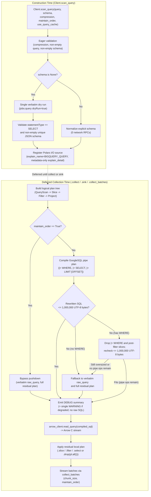

# `Client.scan_query()`: Lazy GoogleSQL Query Scans in `polars-bigquery`

*   **Author:** @tswast
*   **Status:** Proposed
*   **Created:** 2026-11-19
*   **Last updated:** 2026-11-19

--------------------------------------------------------------------------------

## Overview

`polars_bigquery` currently exposes `Client.read_table` (eager table read), `Client.scan_table` (lazy table scan with projection and predicate pushdown), and `Client.read_query` (eager GoogleSQL query execution). It has no lazy entry point for GoogleSQL `SELECT` queries.

This design adds `Client.scan_query()`, using Polars' I/O plugin interface (`polars.io.plugins.register_io_source`) to delay query execution until the caller collects or sinks the returned `polars.LazyFrame`. Execution delegates to `arrow_bigquery.Client.read_query`, streaming results up to BigQuery's ~10 GB compressed anonymous destination table limit.

By default (`maintain_order=True`), `scan_query()` executes the SQL verbatim and downloads results sequentially over a single stream so `ORDER BY` clauses and exact-string BigQuery query cache keys are preserved. When callers pass `maintain_order=False`, results may download in parallel across streams and `scan_query()` appends GoogleSQL pipe operators (`|> WHERE`, `|> SELECT`, `|> LIMIT`) to push down compiled row predicates, column projections, and `LIMIT` (`n_rows`).

## The Problem

1.  **`Client.read_query()` materializes the full result in memory**: Because `read_query()` returns an eager `pl.DataFrame`, callers cannot stream results larger than available RAM (for example, 1–10 GB compressed) to `sink_parquet()` or `collect_batches()`, nor can downstream Polars code attach runtime `.filter()`, `.select()`, or `.limit()` operations before execution.
2.  **The existing lazy workaround requires an extra client library and Storage Read session setup**: [Scanning Large Query Results](../source/guides/large-query-results.md) directs callers to install `google-cloud-bigquery`, execute the query eagerly into a temporary table, scan `job.destination` via `Client.scan_table`, and manage dataset/table cleanup. On small and medium queries, that forces job creation and `CreateReadSession` startup instead of using `jobs.query` inline Arrow responses, and Storage Read API filters only prune bytes transferred from the materialized result table rather than base-table scans during query execution.
3.  **Lazy SQL pushdown introduces correctness, cache, and usability hazards if handled naively**:
    *   **Query cache misses and shifted error coordinates**: BigQuery keys its 24-hour query cache on the exact top-level SQL string, and error `[line:col]` coordinates reference the submitted text. Altering whitespace or trailing semicolons on verbatim queries, prepending `SELECT ... FROM (\n` wrapper lines, stripping leading newlines, or emitting projected columns in caller-dependent order causes avoidable cache misses and misreported error locations.
    *   **Ordering guarantees and SQL syntax boundaries**: Pushing filters onto a query does not guarantee preservation of an inner `ORDER BY`, standard subquery wrapping breaks on top-level-only GoogleSQL constructs such as `WITH RECURSIVE` and `CREATE TEMP FUNCTION ...; SELECT ...`, and large `is_in()` filters can exceed BigQuery's 1 MB unresolved query length limit.
    *   **Late error detection and opaque query plans**: Without eager parameter and dry-run schema validation, malformed queries or non-`SELECT` statements fail late inside `.collect()` (wrapped in `ComputeError`); without structured plan metadata, `lf.explain()` cannot show whether server-side pushdown is active without risking raw SQL or literal leakage into logs.

## Goals

*   **Add `Client.scan_query()`**: Expose `Client.scan_query(query, *, schema=None, arrow_buffer_compression="lz4frame", maintain_order=True, use_query_cache=None) -> pl.LazyFrame` backed by `jobs.query` (`JOB_CREATION_OPTIONAL`) for results up to BigQuery's ~10 GB compressed anonymous table cap.
*   **Verbatim sequential default execution (`maintain_order=True`)**: Send `raw_query` unmodified (preserving leading/trailing whitespace and semicolons) sequentially over a single stream with pushdown disabled, matching `Client.read_query()` defaults and preserving `ORDER BY` and exact-string query cache keys.
*   **Shared logical plan tree and backend executors**: Model scan operations as an immutable logical plan tree (`QueryScan`, `TableScan`, `Filter`, `Slice(offset, length)`, `Project`) executed by separate query and Storage Read API backends sharing one local Polars residual evaluator. This decouples logical operator ordering from Polars' current `register_io_source` callback signature in preparation for newer Polars I/O plugin APIs (such as `FileReader` / `LazyFrameResolver` in [pola-rs/polars#30583](https://github.com/pola-rs/polars/pull/30583)).
*   **GoogleSQL pipe pushdown when `maintain_order=False`**: Allow adaptive parallel multi-stream reads and append GoogleSQL pipe operators (`|> WHERE`, `|> SELECT`, `|> LIMIT [OFFSET]`) after the right-trimmed user query (preserving leading whitespace/newlines so `[line:col]` error coordinates stay unshifted) without subquery wrapper parentheses or aliases:
    *   **Predicate pushdown**: Reuse `core/compiler/` expression compilation with no column-name heuristics (`f[0-9]+_` regex or `casefold()` exclusions), exposing compiler exactness (`is_exact`) to gate post-filter `Slice` pushdown on general logical plans. Treat trivial `"TRUE"` as no filter and emit `|> WHERE` before `|> SELECT` so filters see all inner columns.
    *   **Projection pushdown**: Emit projected columns via `|> SELECT ...` in schema declaration order so equivalent selections (`lf.select(["a", "b"])` vs. `lf.select(["b", "a"])`) produce identical SQL strings and share BigQuery's query cache. Omit `|> SELECT` when all columns are required so anonymous computed columns (`f0_`, `f1_`) flow through on all-column filtered or sliced scans.
    *   **`Slice(offset, length)` / `LIMIT` pushdown**: For unordered `Slice(0, n)` followed by `Filter(p)` (`register_io_source`'s contract for `lf.limit(n).filter(p)`), push `|> WHERE {p_sql}` and `|> LIMIT {n}` together (sound because `maintain_order=False` disclaims row order and `p => p_sql`). For general logical plans, push `Filter(p) -> Slice(offset, length)` only when all preceding filters compiled with `is_exact=True`, clear `offset` in the residual local plan whenever `OFFSET` is pushed, and keep out-of-range slices (`> (1 << 63) - 1`) local rather than failing.
*   **Single verbatim dry run (`schema=None`)**: Execute one dry run against unmodified `raw_query` with no rewritten-first probe and no second dry run on errors, preserving exact `[line:col]` error coordinates while rejecting non-`SELECT` statements, malformed/empty schema metadata, and exact duplicate column names at construction time.
*   **1,000,000-byte UTF-8 guard on rewritten SQL**: Stay below BigQuery's 1,024,000-character / 1,048,576-byte unresolved query limit by stepping down in tiers: drop `|> WHERE` (and post-filter slices) first while retaining `|> SELECT` and pre-filter `|> LIMIT`, falling back to verbatim `raw_query` only if remaining pipe clauses still exceed the ceiling, and emitting a single `WARNING` on degradation.
*   **Zero-column projection pruning across both scan APIs**: For `scan_query`, emit `|> SELECT 1 AS <dummy>` (collision-safe alias, verified live to scan `0` bytes) when no output or predicate columns are needed, or `|> SELECT <predicate_columns>` when filtering, and drop columns locally via `.drop(pl.all())`. For `scan_table`, select a single column rather than an empty `selected_fields` list (which tells Storage Read API to read every column) and drop locally via `.drop(pl.all())`.
*   **Eager input validation and Polars defaults**: Validate compression codec, non-empty `query`, non-empty `schema`, and dry-run schema JSON eagerly; keep Polars defaults (`validate_schema=False`, `is_pure=False`, and default `collect_batches()` optimizer flags).
*   **PII-safe diagnostics and synchronized documentation**: Emit structured `DEBUG`/`WARNING` logs and single-line metadata-only `explain_name`/`explain_detail` strings (never exposing raw SQL or predicate literals) for both `scan_query` and `scan_table`. Document IAM prerequisites (`roles/bigquery.jobUser` alongside `roles/bigquery.readSessionUser`), explicit-`schema` behavioral trade-offs, `ComputeError` wrapping on `.collect()`, the ~10 GB anonymous table cap, and Polars `>= 2.0.0, < 3.0.0` / `arrow-bigquery >= 0.3.2` requirements while preserving the published URL of [Scanning Large Query Results](../source/guides/large-query-results.md).

## Non-Goals

*   **Connector-side workarounds for upstream Polars `pl.scan_arrow_c_stream` pushdown bugs**: Rather than overriding Polars' `QueryOptFlags` locally in `scan_query` or `scan_table`, this design relies on Polars' default `collect_batches()` optimizations and tracks both upstream `polars/io/arrow_c_stream.py` bugs as accepted risks until fixed in Polars (see [Risks & Mitigations](#risks--mitigations)).
*   **Fixing shared `core/schema.py` type mappings and schema-unaware compiler gaps**: Pre-existing issues shared with `scan_table` are tracked separately—`BIGNUMERIC` (`Decimal(76, 38)` raising `InvalidOperationError` in `register_io_source`), `JSON`/`GEOGRAPHY` string-predicate errors, `IS_NAN`/`IS_INF` on non-`FLOAT64` and `BOOL.fill_null` type errors, `TIMESTAMP` `"utc"` vs. `"UTC"` Python equality, unverified parameterized `NUMERIC(P, S)` Arrow serialization, `REPEATED` parameter drops, `INTERVAL`→`Duration("us")`, `RANGE<T>`, unnamed `STRUCT` subfields, and picosecond `TIMESTAMP`.
*   **Speculative dry-run fallback, column-name heuristics, or custom SQL parsing**: No rewritten-first dry-run probe, no second dry-run RPC on error paths, no `f[0-9]+_` / `casefold()` exclusion heuristics in `core/compiler`, and no custom GoogleSQL parser.
*   **Client-side result caching or multi-collect deduplication**: `is_pure` stays `False`; self-joins (`lf.join(lf, ...)`) and repeated `.collect()` calls execute BigQuery per scan. *(Server-side `use_query_cache` pass-through is in scope.)*
*   **Cost guardrails**: No `maximum_bytes_billed` parameter or dry-run byte threshold enforcement.
*   **Results exceeding ~10 GB compressed**: Subject to BigQuery's anonymous destination table limit; larger results require an explicit destination table as documented in [Scanning Large Query Results](../source/guides/large-query-results.md).
*   **Multi-statement scripts, DDL, and DML**: Rejected during dry run (`statementType != "SELECT"`).
*   **Rust `arrow-bigquery` changes**: `jobs.cancel` on drop/abort, `py.check_signals()` polling during the 200-second `jobs.query` wait, `BigQueryJobService` retry/backoff/throttler attachment, Rust `tracing` spans, and narrow-row inline first-page multi-stream cutover are deferred to [Future Improvements](#future-improvements).
*   **Additional `jobs.query` parameters and `scan_table` option parity**: `location`, `default_dataset`, `query_parameters`, `maximum_bytes_billed`, `timeout_ms`, `labels`, `destination_table` (requires `jobs.insert`), `arrow_buffer_compression` on `scan_table`/`read_table`, `maintain_order` on `scan_table`, and early-stop `n_rows` in `scan_table` are deferred to [Future Improvements](#future-improvements).

## Open Questions

None. GoogleSQL pipe syntax compatibility (`WITH`, `WITH RECURSIVE`, unparenthesized `UNION ALL` / `INTERSECT DISTINCT` / `EXCEPT DISTINCT` precedence, `CREATE TEMP FUNCTION ...; SELECT ...`, trailing `ORDER BY ... LIMIT ...`, user pipe queries, struct value tables, `|> LIMIT ... OFFSET ...`, anonymous `f0_` columns, and case-colliding columns) and byte-for-byte `totalBytesProcessed` column/partition/zero-column pruning parity with `FROM (...)` subqueries have been verified directly against live BigQuery (summarized in [GoogleSQL Pipe Pushdown Rules](#googlesql-pipe-pushdown-rules)). Shared logical-plan architecture, reliance on Polars default `collect_batches()` optimizations, retention of `is_exact` post-filter `Slice` gating alongside ongoing compiler semantic-parity fixes, and Polars `>= 2.0.0` alignment are resolved.

## Critical User Journeys (CUJs)

### CUJ 1: Ordered Lazy Query Streaming (Default `maintain_order=True`)

*   **Given**: A GoogleSQL query with `ORDER BY` whose output exceeds RAM but fits within BigQuery's ~10 GB compressed anonymous table cap (for example, 4 GB compressed), and a caller holding `roles/bigquery.readSessionUser` and `roles/bigquery.jobUser`.
*   **When**: The caller runs `lf = client.scan_query(sql)` (`maintain_order=True`, `schema=None`), optionally appends `.filter(...)` or `.select(...)`, inspects `lf.explain()`, and streams via `lf.sink_parquet("out.parquet")` or `lf.collect_batches()`.
*   **Then**:
    *   `scan_query()` runs one verbatim dry run (`dry_run=True`) on `raw_query`, checks `statementType == "SELECT"` and non-empty unique column names, extracts the Polars schema, and returns a `pl.LazyFrame`.
    *   `lf.explain()` displays `PYTHON[BIGQUERY_QUERY] SCAN` with single-line metadata containing `maintain_order=True, pushdown=disabled` and no raw SQL.
    *   Execution sends `raw_query` verbatim and downloads results sequentially over a single stream, preserving `ORDER BY` order and matching BigQuery's exact-string query cache key (`use_query_cache` default). Filters and projections execute locally as batches stream to disk. *(See [Risks & Mitigations](#risks--mitigations) for upstream Polars `#30916` on ordered `lf.limit(n).filter(p)`.)*

### CUJ 2: Unordered Dynamic Pushdown (`maintain_order=False`)

*   **Given**: A base `SELECT` query (including `WITH` / `WITH RECURSIVE` CTEs, `UNION ALL`, `CREATE TEMP FUNCTION`, or pipe syntax) where row order does not matter and downstream Polars code supplies filters and column lists at runtime.
*   **When**: The caller runs `lf = client.scan_query(sql, maintain_order=False)`, collects `lf.filter(pl.col("state") == "WA").select(["name", "year"]).collect()`, and later collects with `.select(["year", "name"])` and the same filter.
*   **Then**:
    *   `scan_query()` runs one verbatim dry run to discover the schema.
    *   `lf.explain()` displays `PYTHON[BIGQUERY_QUERY] SCAN` with `maintain_order=False, pushdown=enabled` and no raw SQL literals.
    *   Execution appends pipe operators ``{inner_query}\n|> WHERE (`state` = 'WA')\n|> SELECT `name`, `year`, `state` `` in schema declaration order, so both column orders emit the same SQL string and hit the same BigQuery query cache entry while preserving user `[line:col]` positions.
    *   `arrow-bigquery` runs with `maintain_order=False`, enabling adaptive parallel multi-stream reads when result size crosses its internal cutover thresholds. Polars re-applies `.filter(predicate)` and `.select(output_columns)` locally.
    *   If all columns are needed and no filter or limit is pushed, `raw_query` runs verbatim. If all columns are needed and a filter is pushed, `|> SELECT` is omitted so anonymous computed columns (`f0_`) flow through without being referenced by name.

### CUJ 3: Skipping Dry Run With Explicit `schema`

*   **Given**: A caller that already knows the full result schema of a valid `SELECT` query and wants to avoid the construction-time dry-run RPC.
*   **When**: The caller runs `lf = client.scan_query(sql, schema={"name": pl.String, "year": pl.Int64}, maintain_order=False)` and collects `lf.select("name").collect()`.
*   **Then**:
    *   `scan_query()` issues zero network requests at construction time, validates non-empty `query`, non-empty `schema`, and valid `arrow_buffer_compression`, and leaves `validate_schema=False`.
    *   `lf.explain()` includes `schema=explicit`.
    *   Projection, predicate, and `LIMIT` pipe pushdown operate on `.collect()`. Non-`SELECT` statements are not blocked eagerly, duplicate-column validation is skipped, and SQL syntax errors raise `pl.exceptions.ComputeError` at `.collect()` with unshifted user `[line:col]` positions.

### CUJ 4: `LIMIT` Pushdown and `limit().filter()` Under `maintain_order=False`

*   **Given**: A query scanned with `maintain_order=False` using `lf.limit(n)`, `lf.limit(n).filter(p)`, or `lf.filter(p).limit(n)`.
*   **When**: Each plan is collected.
*   **Then**:
    *   `lf.limit(10).collect()` emits `{inner_query}\n|> LIMIT 10` (reducing bytes transferred and output table size; BigQuery on-demand scan billing is unchanged).
    *   `lf.limit(3).filter(pl.col("a") > 2).collect()` emits ``{inner_query}\n|> WHERE (`a` > 2)\n|> LIMIT 3`` (sound because row order is undefined under `maintain_order=False`) and re-applies exact filtering locally.
    *   `lf.filter(pl.col("a") > 2).limit(3).collect()` receives `n_rows=None` under Polars' current `register_io_source` contract: BigQuery executes ``{inner_query}\n|> WHERE (`a` > 2)`` with **no SQL `LIMIT`** (meaning BigQuery materializes the full filtered result up to the ~10 GB anonymous table cap, bills the full filtered query, and waits up to 200 seconds for completion before Polars stops pulling batches once 3 matching rows arrive).

### CUJ 5: Zero-Column Projection (`lf.drop(pl.all())`)

*   **Given**: A caller scanning a wide table query under `maintain_order=False` and dropping all columns (`lf.drop(pl.all())`, or `lf.filter(p).drop(pl.all())`).
*   **When**: The plan executes against BigQuery.
*   **Then**:
    *   For `lf.drop(pl.all())` with no predicate, `scan_query` emits ``{inner_query}\n|> SELECT 1 AS `_polars_bigquery_empty` `` (with a collision-safe alias), pruning all base-table column bytes in BigQuery (`0` bytes processed on live public tables), and drops the dummy column locally via `.drop(pl.all())`. With a predicate `p`, it projects only `p`'s referenced columns and drops them after local filtering.
    *   *(Note: `lf.select(pl.len()).collect()` requests one column from Polars rather than zero columns and already returns the exact row count; end-to-end `(N, 0)` height preservation for `lf.drop(pl.all()).collect()` awaits the upstream Polars 0-column `projection_pushdown` fix documented in [Risks & Mitigations](#risks--mitigations).)*

### CUJ 6: Oversized Predicate (> 1 MB SQL Guard)

*   **Given**: A caller attaching a large `.filter(pl.col("id").is_in(...))` expression under `maintain_order=False` whose rewritten SQL exceeds 1,000,000 UTF-8 bytes.
*   **When**: The caller collects the `LazyFrame`.
*   **Then**:
    *   Instead of failing with BigQuery's unresolved query length error, `scan_query` drops `|> WHERE` (and any post-filter slices) first while retaining `|> SELECT` and pre-filter `|> LIMIT` pushdown, evaluates the filter locally in Polars, and emits a single `WARNING` log without raw SQL literals.
    *   If remaining `|> SELECT` / `|> LIMIT` clauses alone still exceed 1,000,000 UTF-8 bytes (for example, a user query near 1 MB), `scan_query` falls back to verbatim `raw_query`, evaluates all operations locally, and emits a single `WARNING` log.

### CUJ 7: Error Handling and Diagnostics

*   **Given**: Invalid parameters, invalid SQL, a non-`SELECT` statement, duplicate column names, an explicit reference to an anonymous `f0_` column or ambiguous case-colliding column under `maintain_order=False`, or query output exceeding ~10 GB compressed.
*   **When**: The caller constructs or collects the `LazyFrame`.
*   **Then**:
    *   Invalid `arrow_buffer_compression`, empty `query`, empty `schema={}`, non-`SELECT` `statementType`, and exact duplicate column names raise `ValueError` eagerly during `scan_query()`.
    *   Invalid SQL during dry run raises `BigQueryError` with unshifted `[line:col]` positions. Missing, empty, or malformed `bigquerySchema` JSON raises `BigQueryError`.
    *   Failures during `.collect()` or `.sink_*()` (including BigQuery `Unrecognized name: f0_`, ambiguous case-insensitive columns `a`/`A`, disallowed column identifier `ValueError`, or ~10 GB `responseTooLarge`) raise `pl.exceptions.ComputeError`, with user SQL line and column coordinates unshifted. Python `DEBUG` and `WARNING` logs under the `polars_bigquery` logger hierarchy record pushdown state without exposing raw SQL literals in `INFO`/`WARNING` logs or `lf.explain()`.

## Technical Plan (Architecture)

### High-Level Data Flow

`Client.scan_query()` separates construction-time validation and dry-run schema discovery from collection-time planning and execution. Both `scan_query` and `scan_table` translate Polars' `register_io_source` callback arguments into a shared immutable logical plan tree composed of leaf scans (`QueryScan`, `TableScan`) and relational operators (`Filter`, `Slice`, `Project`) in explicit application order. Separate query and Storage Read API backend executors compile each logical plan into a backend-specific BigQuery request plus a residual local plan, then run one shared local residual evaluator over `pl.scan_arrow_c_stream(...)`.

The diagram below illustrates the end-to-end `Client.scan_query()` flow (`Client.scan_table()` follows the same logical-plan and local-evaluation stages through its Storage Read API backend):



### Component Responsibilities

| Component | Package Location | Responsibility |
| :--- | :--- | :--- |
| Client API & Dry-Run Entry Point | `py-polars-bigquery/polars_bigquery/_read_bigquery.py` | Exposes `Client.scan_query()` alongside `read_table`, `read_query`, and `scan_table`; performs eager validation, isolated dry-run schema discovery, PII-safe `explain_name`/`explain_detail` registration, and executor dispatch. |
| Logical Plan Model | `py-polars-bigquery/polars_bigquery/core/plan.py` | Defines the immutable logical scan plan tree (`QueryScan`, `TableScan`, `Filter`, `Slice(offset, length)`, `Project`) and adapts Polars' `register_io_source` callback arguments into a plan tree. |
| Expression Compiler Interface | `py-polars-bigquery/polars_bigquery/core/compiler/` | Compiles Polars filter expressions into BigQuery SQL plus a structural exactness flag (`is_exact`) while keeping existing `predicate_to_row_restriction()` behavior unchanged. |
| Query Executor (GoogleSQL Pipe) | `py-polars-bigquery/polars_bigquery/core/executors/query.py` | Compiles `QueryScan` plans into GoogleSQL pipe queries (`|> WHERE`, `|> SELECT`, `|> LIMIT [OFFSET]`) with the 1,000,000-byte UTF-8 tiered guard, emits structured `DEBUG`/`WARNING` logs, invokes `arrow_client.read_query(...)`, and runs local residual evaluation. |
| Storage Read API Executor | `py-polars-bigquery/polars_bigquery/core/executors/read_api.py` | Compiles `TableScan` plans into Storage Read API `selected_fields` (with single-column fallback for 0-column scans) and `row_restriction` (with `Slice` pushdown barriers), invokes `arrow_client.read_table(...)`, and runs local residual evaluation. |
| Shared Local Residual Evaluator | `py-polars-bigquery/polars_bigquery/core/executors/base.py` | Defines the backend executor interface and walks any residual logical plan tree bottom-up over `pl.scan_arrow_c_stream(...)`. |
| Schema Field Extractor | `py-polars-bigquery/polars_bigquery/core/schema.py` | Converts BigQuery `TableSchema` field lists into `pl.Schema` with exact duplicate column detection, shared by `scan_query` dry-run JSON and `scan_table` REST metadata (which additionally appends ingestion-time `_PARTITIONDATE` / `_PARTITIONTIME` pseudo-columns). |

### Public API Signature & Eager Validation

```python
ArrowBufferCompression = Literal["lz4frame", "zstd", "unspecified"]


class Client:
    def scan_query(
        self,
        query: str,
        *,
        schema: pl.Schema | Mapping[str, DataType | DataTypeClass] | None = None,
        arrow_buffer_compression: ArrowBufferCompression = "lz4frame",
        maintain_order: bool = True,
        use_query_cache: bool | None = None,
    ) -> pl.LazyFrame: ...
```

**Eager validation executed synchronously inside `scan_query()`**:

| Order | Check | Scope | Failure Condition | Exception Raised |
| :---: | :--- | :--- | :--- | :--- |
| 1 | `arrow_buffer_compression` | Always | Not in `{"lz4frame", "zstd", "unspecified"}` | `ValueError` |
| 2 | `query` non-empty | Always | Right-trimmed query without single trailing `;` is empty (`""`, `"   "`, `" ; "`) | `ValueError` |
| 3 | Explicit `schema` | `schema is not None` | Empty mapping/schema (`len == 0`) or invalid Polars dtype spec | `ValueError` / `TypeError` |
| 4 | Dry-run RPC | Dry run (`schema is None`) | Network, auth, quota, or SQL syntax error in BigQuery | `BigQueryError` (unshifted `[line:col]` on `raw_query`) |
| 5 | Dry-run row & `statementType` | Dry run (`schema is None`) | Empty metadata frame (`height == 0`) or `statementType not in (None, "SELECT")` | `BigQueryError` (empty frame) / `ValueError` (non-`SELECT`) |
| 6 | `bigquerySchema` JSON structure | Dry run (`schema is None`) | `bigquerySchema` missing/null, invalid JSON, non-`dict` root, missing/non-`list` `"fields"`, empty `"fields"`, non-`dict` field entry, or empty field `"name"` | `BigQueryError` |
| 7 | Schema fields conversion | Dry run (`schema is None`) | Exact duplicate column names (`SELECT 1 AS a, 2 AS a`) or unknown BigQuery type | `ValueError` (duplicates) / `TypeError` (unknown type) |

**Dry-run isolation**: Construction-time dry runs invoke the underlying `arrow_bigquery.Client.read_query(..., dry_run=True, maintain_order=True, use_query_cache=None)` directly rather than calling public `Client.read_query()`, avoiding coupling to subclass overrides or test mocks on `read_query()`. In Rust ([`crates/arrow-bigquery/src/query.rs`](../../crates/arrow-bigquery/src/query.rs#L330-L340)), `dry_run()` sends `QueryRequest::new().set_dry_run(true)` without compression or cache options on the wire.

**Behavioral differences between `schema=None` and explicit `schema={...}`**: Providing an explicit `schema` changes construction-time and execution-time semantics rather than acting merely as a latency optimization:

| Aspect | `schema=None` (Dry-Run Discovery) | `schema={...}` (Explicit Caller Schema) |
| :--- | :--- | :--- |
| Construction-time network RPC | 1 verbatim `jobs.query` dry-run call (`dry_run=True`) | 0 RPCs |
| Non-`SELECT` guard (DDL/DML/scripts) | Blocked eagerly with `ValueError` | Skipped; non-`SELECT` runs at `.collect()` (mutating statements execute) |
| Exact duplicate column check | Blocked eagerly with `ValueError` | Skipped (relies on caller's unique mapping keys) |
| Invalid SQL error timing & type | Construction time (`BigQueryError`, exact `[line:col]`) | Collection time (`pl.exceptions.ComputeError`, unshifted user `[line:col]`) |
| Dtype validation at `.collect()` | `validate_schema=False` (Polars default) | `validate_schema=False` (caller must match full result schema) |
| Partial schema risk | Not possible (BigQuery returns full schema) | Partial `schema` makes `needed_set >= all_columns` true, silently disabling `|> SELECT` projection pushdown |
| Dry-run metadata in `explain_detail` | Includes `schema=dry_run` and `location=<loc>` | `schema=explicit` (`location` omitted) |

### Shared Logical Plan & Backend Executors

#### Logical Plan Model

Both `scan_query` and `scan_table` model requested operations as an immutable linear tree of relational operators above a leaf scan:

*   **Leaf scans**: `QueryScan` (holding verbatim `raw_query`, non-empty schema `columns` in declaration order, `maintain_order`, `arrow_buffer_compression`, and `use_query_cache`) and `TableScan` (holding `table_ref`, non-empty schema `columns`, and `maintain_order`). Both require at least one column.
*   **Unary operators**: `Filter(predicate)`, `Slice(offset, length)` (validating non-negative `int` bounds and rejecting `bool`), and `Project(columns)` (where an empty tuple represents a 0-column projection).

Polars' current `register_io_source` callback (`with_columns`, `predicate`, `n_rows`) lowers into `Source -> [Slice(0, n_rows)] -> [Filter(predicate)] -> Project(output_columns)` (preserving `n_rows=0` and `with_columns=[]`). When future Polars I/O plugin APIs (such as `FileReader` / `LazyFrameResolver` in [pola-rs/polars#30583](https://github.com/pola-rs/polars/pull/30583)) expose arbitrary operator sequences such as `Filter -> Slice(offset, length)` or `Slice(offset, length) -> Filter`, callers construct the corresponding logical plan tree directly without changing either backend executor.

#### GoogleSQL Pipe Pushdown Rules

Given a `QueryScan` logical plan, the query compiler produces a compiled SQL string, a residual local logical plan, pushdown metadata, and an optional length-guard degradation reason:

1.  **Ordered bypass (`maintain_order=True`)**: Return `raw_query` verbatim with pushdown disabled and the full input plan as the residual local plan. Leaving `raw_query` completely unmodified preserves `ORDER BY` and BigQuery's exact-string query cache key.
2.  **Right-trimmed inner query (`maintain_order=False`)**: When appending pipe operators, compute `inner_query` by stripping only trailing whitespace and at most one trailing semicolon (`.rstrip().removesuffix(";").rstrip()`) while leaving leading whitespace and newlines intact. Preserving leading newlines and indentation keeps BigQuery `[line:col]` error coordinates identical to `raw_query` on multi-line triple-quoted SQL; stripping at most one `;` ensures invalid double-semicolon queries (`"SELECT 1;;"`) still fail in BigQuery; and starting appended clauses on `\n|>` terminates trailing `--` / `#` line comments on the last line.
3.  **Canonical `|> SELECT` projection (mutually exclusive 3-way partition)**: Compute `needed_set` as the union of the topmost `Project` columns (or all scan columns if no `Project` is present) and all `Filter` root column names, ordered in schema declaration order (so `lf.select(["a", "b"])` and `lf.select(["b", "a"])` emit identical SQL and share BigQuery's query cache; any unmatched names are appended deterministically):
    *   **0-column constant mode** (`needed_columns` is empty): Emit ``|> SELECT 1 AS `<dummy>` `` using a collision-safe alias (`_polars_bigquery_empty`, suffixed `_1`, `_2`, ... until absent case-insensitively from the scan schema).
    *   **All-column mode** (`needed_set >= set(scan_columns)`): Omit `|> SELECT` so anonymous computed columns (`f0_`, `f1_`) flow through `|> WHERE` and `|> LIMIT` without being referenced by name.
    *   **Column-pruning mode** (all remaining cases): Validate and backtick-quote each column identifier fail-closed (`ValueError` on disallowed characters such as `` ` ``, `\`, `.`, `$`, `!`) and emit `|> SELECT ...`.
4.  **Ordered `Filter` and `Slice` lowering**: Walk operators bottom-to-top, compiling each `Filter` via the expression compiler into `(sql, is_exact)` and normalizing trivial `"TRUE"` to `""` (while preserving `is_exact=True`):
    *   **Unordered `Slice(0, n)` before `Filter(p)` (`register_io_source` pattern)**: Under `maintain_order=False`, commute subsequent `Filter` clauses ahead of a pending `Slice(0, n)` so `|> WHERE ...` emits before `|> LIMIT n`. Because row order is undefined and `p => p_sql`, every row set produced by `|> WHERE p_sql |> LIMIT n` followed by local exact `.filter(p)` is achievable by slicing `n` rows from some permutation and then filtering by `p`. If a following `Filter` is unpushable or partial, the pending pre-filter `Slice(0, n)` still flushes `|> LIMIT n`.
    *   **`Filter(p)` before `Slice(offset, length)` (general plan pattern)**: Emit `|> WHERE {sql}` when non-empty. Push a subsequent `Slice(offset, length)` as `|> LIMIT {length}` (or `|> LIMIT {length} OFFSET {offset}` when `offset > 0`) only when every preceding `Filter` compiled with `is_exact=True`. If any preceding `Filter` has `is_exact=False`, activate a partial-filter barrier that withholds all subsequent `Slice` stages (and any operators above an unpushed `Slice`, while still allowing adjacent `Filter` stages with no intervening `Slice` to emit `|> WHERE`).
    *   **`Slice(offset > 0, length)` before `Filter(p)`**: Emit `|> LIMIT {length} OFFSET {offset}` in tree order before subsequent `|> WHERE` clauses.
    *   **Signed 64-bit SQL bounds & residual `offset` clearing**: Only push a `Slice(offset, length)` into SQL when both `offset` and `length` fit signed `INT64` (`<= (1 << 63) - 1`); if either exceeds BigQuery's signed `INT64` bound (for example, `u64::MAX` sentinel slices), withhold that slice and operators above it from SQL rather than raising an error, leaving them in the residual local plan. Whenever a `Slice(offset > 0, length)` is pushed into SQL and survives the length guard, clear its `offset` to `0` in the residual local plan so local Polars never double-skips rows.
5.  **Unrewritten bypass & pipe assembly**: If no `|> WHERE`, `|> LIMIT`, or `|> SELECT` clause is emitted, return `raw_query` verbatim with the full input plan as the residual plan. Otherwise assemble `[inner_query]` followed by ordered `|> WHERE` / `|> LIMIT [OFFSET]` clauses, inserting `|> SELECT` (when present) immediately after the last `|> WHERE` clause if any exist, or immediately after `inner_query` if no `|> WHERE` clauses exist, joined with `"\n"`.
6.  **Tiered 1,000,000-byte UTF-8 length guard**: Enforce `len(sql.encode("utf-8")) <= 1_000_000` (staying safely below BigQuery's 1,024,000-character / 1,048,576-byte unresolved query limit):
    *   **Tier 1**: Full piped SQL fits → execute as compiled with no warning.
    *   **Tier 2**: Oversized and at least one `|> WHERE` clause exists → drop all `|> WHERE` clauses and any `Slice` stages logically positioned after a dropped `Filter` (restoring original `offset` in the residual plan for any dropped `offset > 0` slice), keeping `|> SELECT` and pre-filter `Slice` stages. If at least one pipe clause remains and fits, execute it; if no pipe clauses remain, revert to verbatim `raw_query` with full residual plan. Emit one `WARNING`.
    *   **Tier 3**: Remaining `|> SELECT` / `|> LIMIT` clauses still exceed 1,000,000 UTF-8 bytes → revert to verbatim `raw_query` with full residual plan (no projected columns, `WHERE` clauses, or slices pushed) and emit one `WARNING`.

**Live BigQuery verification summary**: Direct testing against BigQuery confirmed GoogleSQL pipe compatibility for `WITH` and `WITH RECURSIVE` CTEs, unparenthesized `UNION ALL` / `INTERSECT DISTINCT` / `EXCEPT DISTINCT` (pipe operators bind looser than set operations and filter the full result), `CREATE TEMP FUNCTION ...; SELECT ...`, trailing `ORDER BY ... LIMIT ...`, user pipe queries (`FROM ... |> WHERE ...`), struct value tables (`SELECT AS STRUCT`, `SELECT AS VALUE STRUCT(...)`), `|> LIMIT ... OFFSET ...` (including followed by `|> WHERE`), all-column `f0_` preservation, and unshifted `[line:col]` coordinates under `.rstrip()` (`[3:5]` verbatim vs. `[3:5]` right-trimmed, vs. `[2:5]` if left-trimmed). Dry-run `totalBytesProcessed` checks confirmed exact byte-for-byte pruning parity with `FROM (...)` subqueries on `bigquery-public-data.usa_names.usa_1910_2013` (full `171,432,506` B → single-column `22,209,808` B = `|> SELECT` `22,209,808` B; `|> SELECT 1 AS _polars_bigquery_empty` = `0` B) and partitioned `bigquery-public-data.pypi.file_downloads` (full `263,712,429,047,128` B → 1-day partition filter + projection `13,450,936,282` B = pipe `13,450,936,282` B; 0-column dummy = `0` B). Live tests also confirmed that case-colliding columns (`SELECT 1 AS a, 2 AS A`) deduplicate to `a` and `A_1` in BigQuery's result schema (allowing `|> LIMIT`, while `|> WHERE (\`a\` = 1)` fails with `Column name a is ambiguous`), and that trailing `; -- comment` fails with `Statement not supported: SubpipelineStatement` (see [Risks & Mitigations](#risks--mitigations)).

#### SQL Emission Matrix (`register_io_source` Path, `maintain_order=False`, Within 1 MB Budget)

*(When `maintain_order=True`, all operations bypass pushdown and execute `raw_query` verbatim with the full local residual pipeline.)*

| Polars Operation | `with_columns` | `predicate` | `n_rows` | Emitted SQL | Residual Local Pipeline |
| :--- | :--- | :--- | :--- | :--- | :--- |
| `lf.collect()` | `None` | `None` | `None` | `raw_query` (verbatim) | `.select(all_columns)` |
| `lf.select(["b", "a"])` (all cols) | `["b", "a"]` | `None` | `None` | `raw_query` (verbatim) | `.select(["b", "a"])` |
| `lf.select(["a"])` (subset) | `["a"]` | `None` | `None` | ``{inner}\n\|> SELECT `a` `` | `.select(["a"])` |
| `lf.filter(p)` (all cols, pushable) | `None` | `p` | `None` | `{inner}\n\|> WHERE {sql(p)}` | `.filter(p).select(all_columns)` |
| `lf.filter(p)` (unpushable) | `None` | `p` | `None` | `raw_query` (verbatim) | `.filter(p).select(all_columns)` |
| `lf.filter(p).select(["a"])` | `["a"]` | `p` (uses `b`) | `None` | ``{inner}\n\|> WHERE {sql(p)}\n\|> SELECT `a`, `b` `` | `.filter(p).select(["a"])` |
| `lf.filter(p).limit(10)` | `None` | `p` | `None` *(Polars holds SLICE above scan)* | `{inner}\n\|> WHERE {sql(p)}` | `.filter(p).select(all_columns)` *(outer SLICE stops stream early)* |
| `lf.limit(10)` | `None` | `None` | `10` | `{inner}\n\|> LIMIT 10` | `.slice(0, 10).select(all_columns)` |
| `lf.limit(10).select(["a"])` | `["a"]` | `None` | `10` | ``{inner}\n\|> SELECT `a`\n\|> LIMIT 10`` | `.slice(0, 10).select(["a"])` |
| `lf.limit(10).filter(p)` (pushable) | `None` | `p` | `10` | `{inner}\n\|> WHERE {sql(p)}\n\|> LIMIT 10` | `.slice(0, 10).filter(p).select(all_columns)` |
| `lf.limit(10).filter(p).select(["a"])` | `["a"]` | `p` (uses `b`) | `10` | ``{inner}\n\|> WHERE {sql(p)}\n\|> SELECT `a`, `b`\n\|> LIMIT 10`` | `.slice(0, 10).filter(p).select(["a"])` |
| `lf.limit(10).filter(p)` (unpushable) | `None` | `p` | `10` | `{inner}\n\|> LIMIT 10` | `.slice(0, 10).filter(p).select(all_columns)` |
| `lf.drop(pl.all())` | `[]` | `None` | `None` | ``{inner}\n\|> SELECT 1 AS `_polars_bigquery_empty` `` | `.drop(pl.all())` |
| `lf.limit(10).drop(pl.all())` | `[]` | `None` | `10` | ``{inner}\n\|> SELECT 1 AS `_polars_bigquery_empty`\n\|> LIMIT 10`` | `.slice(0, 10).drop(pl.all())` |
| `lf.filter(p).drop(pl.all())` | `[]` | `p` (uses `b`) | `None` | ``{inner}\n\|> WHERE {sql(p)}\n\|> SELECT `b` `` | `.filter(p).drop(pl.all())` |

#### General Logical Plan Orderings (`maintain_order=False`, Future I/O Plugin APIs)

| Logical Plan Tree (bottom-to-top) | Emitted SQL | Residual Local Pipeline |
| :--- | :--- | :--- |
| `QueryScan -> Filter(p [uses b], exact) -> Slice(0, 10) -> Project(["a"])` | ``{inner}\n\|> WHERE {sql(p)}\n\|> SELECT `a`, `b`\n\|> LIMIT 10`` | `.filter(p).slice(0, 10).select(["a"])` |
| `QueryScan -> Filter(p [uses b], partial) -> Slice(0, 10) -> Project(["a"])` | ``{inner}\n\|> WHERE {sql(p)}\n\|> SELECT `a`, `b` `` *(no SQL `LIMIT`)* | `.filter(p).slice(0, 10).select(["a"])` |
| `QueryScan -> Filter(p [uses b], exact) -> Slice(5, 10) -> Project(["a"])` | ``{inner}\n\|> WHERE {sql(p)}\n\|> SELECT `a`, `b`\n\|> LIMIT 10 OFFSET 5`` | `.filter(p).slice(0, 10).select(["a"])` *(offset cleared)* |
| `QueryScan -> Slice(5, 10) -> Filter(p [uses b]) -> Project(["a"])` | ``{inner}\n\|> LIMIT 10 OFFSET 5\n\|> WHERE {sql(p)}\n\|> SELECT `a`, `b` `` | `.slice(0, 10).filter(p).select(["a"])` *(offset cleared)* |

#### Storage Read API Pushdown Rules (`scan_table` Alignment)

For `TableScan` plans, the Storage Read API backend compiles `selected_fields` and `row_restriction` while keeping the entire input plan as the residual local plan (because Storage Read API sessions never perform server-side slicing):

*   **Column selection & 0-column billing guard**: Compute `selected_fields` as the deduplicated union of final `Project` columns and all `Filter` root columns. If that union is empty (for example, `lf.drop(pl.all())` with no predicate), select the single first schema column (`(scan_columns[0],)`) rather than passing an empty `selected_fields` list—which [`crates/arrow-bigquery/src/lib.rs`](../../crates/arrow-bigquery/src/lib.rs#L148-L152) forwards to BigQuery Storage Read API as "read all columns of the table"—and drop it locally via `.drop(pl.all())`.
*   **Filter pushdown & `Slice` barriers**: Collect compiled `Filter` clauses bottom-to-top, ignoring `""` and `"TRUE"`, and join multiple clauses with `" AND "` (parenthesizing each clause when more than one is present). Stop collecting filters across a `Slice` barrier when `maintain_order=True` or `Slice.offset > 0`, while allowing filter pushdown across unordered `Slice(0, n)` (preserving `scan_table`'s existing behavior).
*   **Behavioral alignment**: Routing `Client.scan_table()` through the shared logical plan aligns its local `Slice`-before-`Filter` order and `.drop(pl.all())` handling with `Client.scan_query()` while preserving existing `selected_fields` and `row_restriction` behavior on single-filter and unfiltered scans.

#### Shared Local Residual Evaluation

Both backend executors run one shared local residual evaluator over `pl.scan_arrow_c_stream(arrow_stream_exporter)`:

1.  **Exact tree-order execution**: Walks the residual logical plan bottom-up, applying `.slice(offset, length)` for `Slice`, `.filter(predicate)` for `Filter`, and `.select(columns)` for non-empty `Project` or `.drop(pl.all())` for empty `Project(())`.
2.  **Streaming batch collection with Polars defaults**: Calls `.collect_batches(chunk_size=batch_size, maintain_order=source.maintain_order)` using Polars' default `QueryOptFlags` (avoiding connector-side optimizer overrides; see [Risks & Mitigations](#risks--mitigations) for the two upstream `polars 2.0.0–2.1.0` `arrow_c_stream.py` issues) and returns the batch iterator directly.

### Observability, Logging & Error Contracts

#### `LazyFrame.explain()` Format

`register_io_source` renders `explain_name` as `PYTHON[<explain_name>] SCAN ...` and `explain_detail` as a static, single-line string captured at construction time. Raw SQL text and predicate literals are never placed in `explain_detail` to avoid leaking PII/secrets into logged plans and to preserve single-line formatting:

*   **`scan_query`**:
    *   `explain_name = "BIGQUERY_QUERY"`
    *   `explain_detail` (comma-separated key-value pairs):
        *   Ordered, dry-run: `maintain_order=True, pushdown=disabled, schema=dry_run, location=US` (omit `location` if null/absent)
        *   Unordered, dry-run: `maintain_order=False, pushdown=enabled, schema=dry_run, location=US`
        *   Explicit schema: `maintain_order=False, pushdown=enabled, schema=explicit`
*   **`scan_table`**:
    *   `explain_name = "BIGQUERY_TABLE"`
    *   `explain_detail = f"table={table_ref}, schema={'metadata' if schema is None else 'explicit'}"`

Because `explain_detail` is fixed at construction time, it cannot display dynamically generated `|> WHERE` clauses. Documentation notes that Polars prints `SELECTION:` and `PROJECT:` under the scan node even when `maintain_order=True` disables server-side pushdown.

#### Structured Python Logging

*   **`DEBUG` on dry run (`schema=None`)**: Records `statement_type`, `location`, `total_bytes_processed`, `cache_hit`, and column count. No raw SQL.
*   **`DEBUG` on query execution**: Records `maintain_order`, `rewritten`, projected column count (`projected/total` or `0-col dummy`), `where_clauses` count and total byte length, `pushed_slices`, `sql_bytes`, and `degraded_reason`. Raw SQL strings and predicate literals are never emitted at `INFO` or `WARNING`.
*   **`WARNING` on 1 MB step-down guard**: Emitted once per degraded execution when the 1,000,000-byte UTF-8 ceiling triggers Tier 2 or Tier 3 fallback, recording `degraded_reason`, `sql_bytes`, and the 1,000,000-byte ceiling without raw SQL literals.

#### Exception Contract Matrix

| Phase | Trigger | Exception Type | Notes |
| :--- | :--- | :--- | :--- |
| Construction (`scan_query`) | Invalid `arrow_buffer_compression`, empty `query`, empty `schema={}`, non-`SELECT` `statementType`, exact duplicate column names | `ValueError` | Raised eagerly |
| Construction (`scan_query`) | Invalid SQL, auth/quota/network failure, missing/empty/malformed `bigquerySchema` JSON or field entries, empty dry-run result | `polars_bigquery.exceptions.BigQueryError` | Unshifted `[line:col]` on `raw_query` |
| Construction (`scan_query`) | Unknown BigQuery field type in dry-run schema, unspecified `pl.Schema` dtype class (e.g. `pl.Datetime`) | `TypeError` | Raised eagerly |
| Execution (`.collect()` / `.sink_*()`) | Any failure inside execution or mid-stream Rust reader (BigQuery `Unrecognized name: f0_`, ambiguous `a`/`A`, ~10 GB `responseTooLarge`, disallowed column identifier `ValueError`, trailing `; -- comment` syntax error, network/auth error) | `pl.exceptions.ComputeError` | Polars wraps generator/stream exceptions into `ComputeError`. Leading whitespace preservation keeps user SQL `[line:col]` coordinates unshifted. |

### Underlying `arrow-bigquery` Streaming & `Client` Lifecycle

*   **Sequential vs. adaptive parallel streaming**: Under `maintain_order=True`, `arrow-bigquery` downloads results sequentially over a single stream. Under `maintain_order=False`, `arrow-bigquery` may switch to parallel multi-stream reads when result size crosses its internal cutover thresholds (narrow-row inline-first-page queries stay on the single default stream while decoding batches in parallel). Documentation describes `maintain_order=False` as enabling adaptive parallel reads rather than unconditional multi-stream sessions.
*   **Query cache and re-execution**: Under `maintain_order=True`, repeated `.collect()` calls emit identical verbatim SQL and hit BigQuery's 24-hour query cache. Under `maintain_order=False`, distinct filter/projection/limit combinations emit distinct top-level SQL strings and miss BigQuery's cache; with `is_pure=False`, self-joins (`lf.join(lf, ...)`) and multi-branch plans execute and bill BigQuery once per scan branch.
*   **`Client` context-manager lifetime**: The registered I/O source closure captures only the backend executor (which holds `_arrow_client`), not `self`, avoiding unnecessary retention of `Client` and its REST HTTP session pool (`_rest_client`) for the lifetime of the `LazyFrame`. `Client.close()` currently closes only `_rest_client`, not `_arrow_client`, so collecting outside a `with Client(...) as client:` block works today; docstrings advise collecting inside the `with` block in case `_arrow_client` adds explicit shutdown later.

## Alternatives Considered

### Alternative A: Keep `read_query()` and the `google-cloud-bigquery` Destination-Table Guide (No `scan_query`)

*   **Pros**: No new API surface or SQL pushdown code in `polars-bigquery`. Supports results > ~10 GB compressed via explicit destination tables.
*   **Cons**: Forces callers to install `google-cloud-bigquery`, run queries eagerly to a destination table before constructing a `LazyFrame`, incur `CreateReadSession` startup overhead on small/medium queries, and manage table/dataset cleanup. Leaves 1–10 GB out-of-core streaming unavailable through `polars-bigquery` alone.
*   **Reason for Rejection**: Does not satisfy lazy composition or dynamic Polars pushdown for `<= ~10 GB` queries without an extra client library.

### Alternative B: Lazy Streaming `scan_query` Without SQL Pushdown (No-Rewrite v1)

*   **Pros**: Small implementation wrapping `arrow_client.read_query()`, preserves 100% of BigQuery query cache keys and exact error line numbers, and avoids all SQL rewrite edge cases.
*   **Cons**: Transfers every column and row produced by the base query across the network and evaluates all Polars `.select()`, `.filter()`, and `.limit()` operations locally.
*   **Reason for Rejection**: Dynamic Polars-driven projection and filter pushdown to reduce bytes scanned and transferred is a core requirement of the feature.

### Alternative C: Decouple `maintain_order` From SQL Pushdown, or Default `maintain_order=False`

*   **Pros**:
    *   *Decoupled `pushdown` flag*: Enables `(maintain_order=False, pushdown=False)` so callers can reuse BigQuery's 24-hour query cache across local filters—or select/filter anonymous `f0_` columns—while still allowing adaptive parallel multi-stream reads.
    *   *Default `maintain_order=False`*: Matches `scan_table` and enables pushdown by default without an extra keyword argument.
*   **Cons**:
    *   *Decoupled `pushdown` flag*: Introduces an invalid flag combination (`maintain_order=True, pushdown=True`), because `|> WHERE` does not guarantee preservation of an inner `ORDER BY`, adding API surface and divergence from `read_query()` for narrow edge cases.
    *   *Default `maintain_order=False`*: Silently breaks `ORDER BY` queries by default and diverges from `Client.read_query(maintain_order=True)`.
*   **Reason for Rejection**: Coupling pushdown to `maintain_order` avoids invalid states while matching `read_query()`, and defaulting to `maintain_order=True` prevents silent `ORDER BY` regressions; callers opt into `maintain_order=False` when row order does not matter.

### Alternative D: Rewritten-First Dry-Run Probe With Verbatim Fallback

*   **Pros**: Detects SQL constructs incompatible with pushdown rewriting during construction with one RPC on the happy path and disables pushdown instead of failing at `.collect()`.
*   **Cons**: Breaks parity between `schema=None` and explicit `schema={...}` (incompatible queries fall back under `schema=None` but fail under explicit `schema`). Because `BigQueryError` exposes no structured HTTP status code and `BigQueryJobService` has no retry throttler, catching `BigQueryError` fires two dry-run RPCs on every `401`, `403`, `404`, `429`, `5xx`, timeout, or syntax error, and can silently disable pushdown on a transient `503`.
*   **Reason for Rejection**: A single verbatim dry run on `raw_query` avoids duplicate error-path RPCs, preserves exact `[line:col]` errors, and keeps behavior consistent with explicit `schema`.

### Alternative E: Client-Side Column Heuristics (`f[0-9]+_` and `casefold()`) in `core/compiler`

*   **Pros**: Avoids runtime `Unrecognized name` and `Ambiguous column` BigQuery errors when a caller explicitly projects or filters on unaliased (`f0_`) or case-colliding (`a`, `A`) columns under `maintain_order=False`.
*   **Cons**: False-positives on legitimate explicitly named columns matching `f[0-9]+_`, silently disabling pushdown; leaks query-pushdown heuristics into the shared `core/compiler` module used by `scan_table`.
*   **Reason for Rejection**: Omitting `|> SELECT` for all-column filtered/limited scans covers common unaliased queries without heuristics; explicit references to anonymous or case-colliding columns are left to BigQuery's server-side errors and documented with `AS` aliasing guidance.

### Alternative F: Standard SQL Subquery Wrapping (`SELECT ... FROM (\n{inner_query}\n)`) Instead of GoogleSQL Pipe Syntax (`|>`)

*   **Pros**: Uses SQL-92 subquery syntax understood by generic SQL proxies or third-party emulators, with familiar scoping rules across `UNION ALL` and `ORDER BY`.
*   **Cons**: Fails on top-level-only GoogleSQL constructs (`WITH RECURSIVE`, `CREATE TEMP FUNCTION ...; SELECT ...`), prepends `SELECT ... FROM (\n` before user SQL (shifting every BigQuery runtime error line by `+1`), allows unbalanced-parentheses breakout when explicit `schema` skips dry run, and requires `SELECT *` wrapping on filter-only and limit-only scans (risking range-variable alias collisions).
*   **Reason for Rejection**: Live BigQuery verification confirmed that GoogleSQL pipe syntax (`|>`) preserves exact `[line:col]` coordinates under right-trimming, supports `WITH RECURSIVE`, `CREATE TEMP FUNCTION ...; SELECT ...`, unparenthesized `UNION ALL` / `INTERSECT DISTINCT` / `EXCEPT DISTINCT`, trailing `ORDER BY ... LIMIT ...`, user pipe queries, and struct value tables, and achieves byte-for-byte identical `totalBytesProcessed` pruning parity with `FROM (...)` subqueries without wrapper parentheses or `SELECT *`.

### Alternative G: Always Materialize to a Destination Table and Push Down via Storage Read API

*   **Pros**: Pushes `selected_fields` and `row_restriction` without rewriting user SQL, works with anonymous `f0_` columns, and supports > ~10 GB results if an explicit destination table is created.
*   **Cons**: Disables `JOB_CREATION_OPTIONAL` inline Arrow responses (adding job creation and `CreateReadSession` startup latency), cannot prune base-table storage bytes during query execution, and cannot shrink results below the ~10 GB anonymous table cap.
*   **Reason for Rejection**: Preserving `jobs.query` inline execution and allowing BigQuery's optimizer to prune base-table partitions and columns is preferred for `<= ~10 GB` queries; destination-table scanning remains documented in [Scanning Large Query Results](../source/guides/large-query-results.md).

### Alternative H: Different `LIMIT` Pushdown Strategies (No SQL `LIMIT`, or Strict Slice-Before-Filter SQL)

*   **Pros**:
    *   *No SQL `LIMIT` pushdown*: Preserves BigQuery query cache keys across `lf.head(5)` and `lf.collect()` and relies on client-side stream cancellation.
    *   *Omit SQL `WHERE` when `n_rows` is set (or double-wrap)*: Enforces strict slice-before-filter ordering in SQL even under `maintain_order=False`.
*   **Cons**:
    *   *No SQL `LIMIT` pushdown*: Transfers full query output until client-side stop and cannot keep large queries under the ~10 GB anonymous table cap via `.limit(n)`.
    *   *Omit SQL `WHERE` when `n_rows` is set (or double-wrap)*: Unnecessary under `maintain_order=False`, because row order is explicitly undefined; for an unordered multiset, `|> WHERE p_sql` + `|> LIMIT n` followed by local exact `.filter(p)` always produces a subset achievable by slicing `n` rows from some permutation and then filtering, while transferring fewer rows when `p` is selective.
*   **Reason for Rejection**: Pushing both `|> WHERE` and `|> LIMIT` together under `maintain_order=False` reduces transfer size while remaining sound for unordered scans; ordered `maintain_order=True` executes verbatim.

### Alternative I: Local Workarounds for Upstream `pl.scan_arrow_c_stream` Bugs (`QueryOptFlags` or Direct Per-Batch Loop)

*   **Pros**:
    *   *`QueryOptFlags(predicate_pushdown=False, projection_pushdown=False)`*: Works around both [pola-rs/polars#30916](https://github.com/pola-rs/polars/issues/30916) and the 0-column `projection_pushdown` bug immediately on `polars 2.0.0–2.1.0` while keeping `slice_pushdown=True` and streaming batch coalescing.
    *   *Direct per-batch Python loop*: Independent of `pl.scan_arrow_c_stream` optimizer flags across future Polars releases.
*   **Cons**:
    *   *`QueryOptFlags(predicate_pushdown=False, projection_pushdown=False)`*: Introduces a connector-side Polars optimizer override for bugs that belong upstream in `polars/io/arrow_c_stream.py`.
    *   *Direct per-batch Python loop*: Drops Polars' streaming `chunk_size` coalescing after selective local filters unless manual buffering is added, complicates stream resource lifetime, and diverges from `pl.scan_arrow_c_stream` test patterns.
*   **Reason for Rejection**: Minimize connector-side workarounds for upstream Polars bugs during early connector maturity; rely on Polars' default `collect_batches()` optimizations and track both upstream fixes in [Risks & Mitigations](#risks--mitigations).

### Alternative J: Enable `validate_schema=True` or `is_pure=True` on `register_io_source`

*   **Pros**:
    *   *`validate_schema=True`*: Checks batch dtypes against declared `schema` in memory with zero extra RPCs.
    *   *`is_pure=True`*: Lets Polars common subplan elimination execute BigQuery once for self-joins (`lf.join(lf, ...)`).
*   **Cons**:
    *   *`validate_schema=True`*: Risks rejecting valid queries due to pre-existing `core/schema.py` mismatches (such as `INTERVAL` or unverified parameterized `NUMERIC(P, S)`), and adds per-batch checks contrary to trusting caller-supplied `schema`.
    *   *`is_pure=True`*: Breaks semantics for non-deterministic SQL (`RAND()`, `CURRENT_TIMESTAMP()`), and BigQuery dry runs do not expose a determinism or cacheability flag to infer purity automatically.
*   **Reason for Rejection**: Keep Polars defaults (`validate_schema=False`, `is_pure=False`), matching `Client.scan_table`, and defer an explicit opt-in `is_pure` parameter to [Future Improvements](#future-improvements).

### Alternative K: Keep `polars >= 1.43.0` With an `inspect.signature` Shim

*   **Pros**: Preserves compatibility with `polars 1.x` environments without a breaking minimum-version bump.
*   **Cons**: Leaves `polars 1.x` callers without `explain_name`/`explain_detail` output if unsupported on `1.43.x`, adds runtime signature-inspection boilerplate, and requires maintaining CI coverage across both Polars `1.x` and `2.x` expression JSON formats.
*   **Reason for Rejection**: Polars `2.0.0` is GA (latest `2.1.0`); bumping workspace packages to `polars >= 2.0.0, < 3.0.0` keeps dependencies clean and aligned without shims.

### Alternative L: Flat Per-Backend Pushdown Plans Instead of a Shared Logical Plan Tree

*   **Pros**: Fewer abstractions and a direct 1:1 mapping to `register_io_source`'s fixed four-argument callback signature without introducing `core/plan.py` or a separate `core/executors/` package.
*   **Cons**: Cannot represent arbitrary orderings of `Filter` and `Slice(offset, length)` without redesign when migrating to newer Polars I/O plugin APIs (`FileReader` / `LazyFrameResolver` in [pola-rs/polars#30583](https://github.com/pola-rs/polars/pull/30583)), and duplicates local `pl.scan_arrow_c_stream` residual execution across `scan_query` and `scan_table`.
*   **Reason for Rejection**: A shared immutable logical plan tree with separate query and Storage Read API executors decouples logical operator order from backend pushdown capabilities and shares one local residual evaluator across both scan APIs.

### Alternative M: All-or-Nothing 1 MB Fallback Instead of Tiered Degradation

*   **Pros**: Simpler length-guard branch with only two states (full rewrite vs. verbatim `raw_query`) and no post-filter slice rollback logic.
*   **Cons**: Unnecessarily discards `|> SELECT` column pruning and pre-filter `|> LIMIT` pushdown whenever an oversized `is_in()` predicate pushes `|> WHERE` past 1,000,000 bytes, forcing BigQuery to scan and transfer every column of the query.
*   **Reason for Rejection**: Dropping `|> WHERE` (and post-filter slices) first preserves column pruning and pre-filter limits on large `is_in()` queries while still guaranteeing fallback to verbatim `raw_query` if remaining pipe clauses exceed the ceiling.

## Risks & Mitigations

*   **Upstream Polars `pl.scan_arrow_c_stream` Pushdown Bugs on `polars 2.0.0–2.1.0` (Accepted Risk)**: Under Polars' default `QueryOptFlags`, two upstream bugs in `polars/io/arrow_c_stream.py` affect both `scan_query` and `scan_table`: (1) [pola-rs/polars#30916](https://github.com/pola-rs/polars/issues/30916) evaluates `filter` before `limit`/`slice`, producing wrong rows on ordered `maintain_order=True` queries using `lf.limit(n).filter(p)` (e.g., `[3, 4, 5]` instead of `[3]` on `[1..6].limit(3).filter(a > 2)`), and (2) zero-column `projection_pushdown` collapses `lf.drop(pl.all()).collect()` (`with_columns=[]`) to `(0, 0)` instead of `(N, 0)` (note that `lf.select(pl.len()).collect()` is unaffected because Polars requests one column). **Mitigation**: Intentionally avoid connector-side `QueryOptFlags` workarounds during early connector maturity so upstream Polars fixes apply automatically once released; document both known upstream issues clearly in `Client.scan_query()` docstrings and track a companion Polars issue for 0-column `projection_pushdown`.
*   **Structural vs. Semantic `is_exact` Parity for Future Post-Filter `Slice` Pushdown (Accepted Risk)**: In [`core/compiler/sql/__init__.py`](../../py-polars-bigquery/polars_bigquery/core/compiler/sql/__init__.py#L34-L65), `is_exact=True` currently indicates that no `Unsupported` IR node was dropped inside `AND`, rather than proving full BigQuery-vs-Polars row-set equivalence on edge cases (`FLOAT64` `NaN != NaN` evaluating `TRUE` in BigQuery vs. `FALSE` in Polars, `RE2` ASCII `\d`/`\w`/`\s` vs. Rust `regex` Unicode classes, and `DropNulls` inside `OR`). If BigQuery returns false positives before a pushed `|> LIMIT`/`OFFSET`, local Polars filtering could drop them after truncation. **Mitigation**: Polars' current `register_io_source` callback never emits `Filter -> Slice` (`n_rows` is always applied before `Filter`); ongoing semantic-parity fixes in `core/compiler/` are closing these edge cases before newer Polars I/O plugin APIs expose post-filter `Slice` pushdown.
*   **Missing Retry/Backoff/Throttler on Rust `BigQueryJobService`**: [`crates/arrow-bigquery/src/client_builder.rs`](../../crates/arrow-bigquery/src/client_builder.rs#L71-L76) constructs `BigQueryJobService` without retry/backoff policies or `AdaptiveThrottler` (unlike `Read::builder()` and `scan_table`'s `BigQueryRestClient`), so transient `429`/`503` responses during `scan_query` dry runs or execution fail immediately. **Mitigation**: Tracked for Rust client parity in [Future Improvements](#future-improvements); callers on latency- or retry-sensitive paths can supply explicit `schema` to avoid construction-time dry-run RPCs.
*   **`lf.filter(p).limit(n)` Full-Execution, ~10 GB Cap, and 200-Second Wait**: Under `register_io_source`, Polars retains `SLICE` above the scan node (`n_rows=None`), so BigQuery executes `{inner_query}\n|> WHERE ...` without SQL `LIMIT`—billing the full filtered scan, blocking uninterruptibly up to 200 seconds (no `py.check_signals()` or `jobs.cancel` yet), and failing with `responseTooLarge` if filtered output exceeds ~10 GB even when `.limit(3)` is requested. **Mitigation**: Document this distinction explicitly in user docs and docstrings; callers needing a server-side cap can place `LIMIT` in SQL or use `lf.limit(n)` until newer Polars I/O plugin APIs support post-filter `Slice` pushdown.
*   **Interactive Billing Amplification (`maintain_order=False` Cache Misses & `is_pure=False`)**: Under `maintain_order=False`, distinct filter/projection/limit plans emit distinct top-level SQL strings that miss BigQuery's 24-hour query cache, and `is_pure=False` executes BigQuery once per branch in self-joins (`lf.join(lf, ...)`). **Mitigation**: Default to `maintain_order=True` (verbatim cache hits), canonicalize `|> SELECT` columns in schema declaration order so equivalent projections share cache entries, and direct repeated-scan workloads to destination-table materialization in [Scanning Large Query Results](../source/guides/large-query-results.md).
*   **Trailing Semicolon Followed by Comment (`; -- comment`) and Anonymous/Ambiguous Columns**: Live BigQuery testing confirmed that comments placed *after* a trailing semicolon (e.g., `SELECT 1 AS a; -- note`) retain `;` under right-trimming and fail with `Statement not supported: SubpipelineStatement` when pipe operators are appended (comments without `;` succeed). Explicitly selecting or filtering anonymous `f0_` columns or case-colliding columns (`SELECT 1 AS a, 2 AS A`) raises BigQuery `Unrecognized name` or `Column name a is ambiguous` errors. **Mitigation**: Document omitting trailing `;` (or placing comments before `;`), aliasing computed/colliding columns with `AS`, or using `maintain_order=True` rather than introducing a custom SQL lexer.
*   **Explicit `schema` Bypassing Dry-Run Safety Checks**: Passing `schema` skips dry-run `statementType == "SELECT"` and duplicate-column checks, so DDL/DML statements execute on `.collect()` and partial schemas silently disable `|> SELECT` projection pushdown. **Mitigation**: Document both behavioral trade-offs prominently in `Client.scan_query()` docstrings.
*   **Pre-Existing `core/schema.py` and Schema-Unaware Compiler Gaps**: Shared with `scan_table` (for example, `BIGNUMERIC` raising `InvalidOperationError`, or string predicates pushed onto `JSON`/`GEOGRAPHY`). **Mitigation**: Tracked separately in [Future Improvements](#future-improvements); callers can keep `maintain_order=True` or cast affected columns in SQL.
*   **Breaking Minimum Polars Version Bump**: Raising the floor from `polars >= 1.43.0` to `polars >= 2.0.0, < 3.0.0` drops `polars 1.x` environments. **Mitigation**: Call out clearly in release notes; Polars `2.0.0` is GA and rollback is Python-only.

--------------------------------------------------------------------------------

## Non-Functional Requirements

*   **Streaming Memory Footprint**: Python memory usage during `.sink_parquet()` and `.collect_batches()` stays bounded at $O(\text{batch\_size})$ (independent of total query result size) across results up to BigQuery's ~10 GB compressed anonymous destination table limit.
*   **Pruning Parity & Scan Efficiency**: GoogleSQL pipe pushdown achieves `totalBytesProcessed` less than or equal to equivalent `SELECT ... FROM (...) WHERE ...` subquery wrapping (verified live byte-for-byte on `bigquery-public-data.usa_names.usa_1910_2013` and partitioned `bigquery-public-data.pypi.file_downloads`, including `0` bytes scanned for 0-column `|> SELECT 1 AS <dummy>`). Zero-column `scan_table` scans request at most one column (`selected_fields` of length `1`) rather than all table columns.
*   **Construction Latency & RPC Budget**: `schema=None` executes exactly `1` synchronous `jobs.query(dryRun=true)` RPC at construction time (zero speculative retries on error); explicit `schema` executes `0` construction-time RPCs.
*   **Security & Privacy**: Zero raw user SQL text or inline predicate literals appear in `lf.explain()` (`explain_detail`) or `INFO`/`WARNING` logs. Every `|> SELECT` column identifier passes fail-closed character validation (`ValueError` on disallowed characters). Documentation lists both `roles/bigquery.readSessionUser` and `roles/bigquery.jobUser` (`bigquery.jobs.create`) as required IAM roles and warns that explicit `schema` skips the `SELECT`-only dry-run guard.
*   **Compatibility, Dependencies & Rollback**: Requires `polars >= 2.0.0, < 3.0.0` (synchronized across workspace Python packages) and `arrow-bigquery >= 0.3.2`. `Client.scan_query()` is additive in Python using existing `arrow_bigquery.Client.read_query()` bindings (zero Rust ABI or wire-format changes). Routing `Client.scan_table()` through the shared logical plan preserves existing `selected_fields` and `row_restriction` pushdown while adding the 0-column single-column guard. Rollback requires reverting Python package changes only.

--------------------------------------------------------------------------------

## Additional Resources

*   [`Client.scan_table` Row Predicate Pushdown Design](./polars_bigquery_scan_table_row_predicate_pushdown.md) — Specifies the expression compiler IR, rewriter passes, and SQL formatting shared by `scan_table` and `scan_query`.
*   [Handling Completed Large-Result Queries Without Inline Arrow Schemas](./arrow_bigquery_crate_completed_large_results_schema.md) — Documents underlying `arrow-bigquery` `jobs.query` and `LARGE_RESULTS` streaming and multi-stream cutover behavior.
*   [Scanning Large Query Results Guide](../source/guides/large-query-results.md) — Documents explicit destination-table scanning for results exceeding ~10 GB compressed or materialized results scanned multiple times.
*   [Row Predicate Pushdown Reference](../source/api/predicate-pushdown.md) — Lists supported Polars expressions, BigQuery SQL translations, and type mappings.
*   [Polars Issue #30916](https://github.com/pola-rs/polars/issues/30916) — Upstream Polars bug report for `pl.scan_arrow_c_stream` applying `filter` before `limit`.
*   [Polars PR #30583](https://github.com/pola-rs/polars/pull/30583) — Upstream Polars unstable `FileReader` and `LazyFrameResolver` I/O plugin APIs.

## Future Improvements

*   **Migrate to Polars' `LazyFrameResolver` / `FileReader` I/O plugin APIs ([pola-rs/polars#30583](https://github.com/pola-rs/polars/pull/30583))**: Once Polars stabilizes these APIs and supports post-filter `Slice`/`limit` (paired with per-filter `applied_filters` / `applied_post_slice` confirmation) and optional `n_rows_in_file() -> int | None` (since BigQuery queries, views, external tables, streaming buffers, and RLS tables lack cheap exact metadata row counts), plug them directly into the shared logical plan and executors to push down `lf.filter(p).limit(n)` as `|> WHERE ... |> LIMIT n`, expose `explain_properties()`, handle 0-column projections without `scan_arrow_c_stream`, and trigger `on_drop()` cleanup.
*   **Query cancellation and signal handling (`crates/arrow-bigquery`, `py-arrow-bigquery`)**: Poll `py.check_signals()` during the 200-second `jobs.query` initial wait so `Ctrl+C` responds promptly, and issue best-effort `jobs.cancel` when an incomplete query stream is aborted or dropped early.
*   **Query retries and throttling (`crates/arrow-bigquery`)**: Attach `retry_policy`, `backoff_policy`, and the shared `AdaptiveThrottler` to `BigQueryJobService::builder()` in [`crates/arrow-bigquery/src/client_builder.rs`](../../crates/arrow-bigquery/src/client_builder.rs#L71-L76) (matching `Read::builder()`).
*   **Rust `tracing` telemetry and cutover improvements (`crates/arrow-bigquery`)**: Emit `tracing` spans carrying `request_id`, `job_id`, and `location`; attach `request_id` to synchronous errors; enable mid-flight multi-stream cutover for narrow-row `LARGE_RESULTS` jobs that include an inline first page.
*   **Additional `jobs.query` options (`py-polars-bigquery`, `py-arrow-bigquery`, `crates/arrow-bigquery`)**: Expose `location`, `default_dataset`, `query_parameters`, `maximum_bytes_billed`, `timeout_ms`, `labels`, and optionally an explicit `is_pure` opt-in parameter for deterministic queries (leaning toward flat keyword arguments matching existing `read_query` parameters).
*   **Destination-table support for > ~10 GB results**: Add an explicit destination-table path backed by `jobs.insert` (because `jobs.query` does not accept `destinationTable`).
*   **`scan_table` and `read_table` option parity**: Expose `arrow_buffer_compression` on `scan_table` and `read_table`, evaluate `maintain_order` on `scan_table`, and add early-stop `n_rows` stream cancellation in `scan_table`.
*   **Shared `core/schema.py` and schema-aware compiler fixes**: Complete compiler semantic-parity fixes (`FLOAT64` `NaN`, regex character classes, `DropNulls`), fix `BIGNUMERIC` (`Decimal(76, 38)` crash), block invalid SQL pushdown on `JSON`/`GEOGRAPHY`/`BOOL.fill_null`/`IS_NAN`, align `TIMESTAMP` `"utc"` vs. `"UTC"`, verify parameterized `NUMERIC(P, S)` live Arrow serialization, and add support for `INTERVAL`, `RANGE<T>`, unnamed `STRUCT` subfields, and picosecond `TIMESTAMP`.

--------------------------------------------------------------------------------

## Detailed Implementation Plan

All changes live in the Python packages, dependency metadata, documentation, and test suites. No Rust crate (`crates/arrow-bigquery`, `py-arrow-bigquery`) files are modified.

### Target Files to Create/Modify

#### 1. [`py-polars-bigquery/polars_bigquery/core/plan.py`](../../py-polars-bigquery/polars_bigquery/core/plan.py) (Create)

*   **Type / Scope**: Python immutable logical plan IR module (no network or Polars I/O).
*   **Rationale**: Decouples logical scan operations (`Filter`, `Slice(offset, length)`, `Project` in arbitrary order) from Polars' current `register_io_source` callback signature so both `QueryExecutor` and `ReadApiExecutor` share one plan representation ready for newer Polars I/O plugin APIs ([pola-rs/polars#30583](https://github.com/pola-rs/polars/pull/30583)).
*   **Proposed Changes**:
    *   Define type alias `ArrowBufferCompression = Literal["lz4frame", "zstd", "unspecified"]`.
    *   Define frozen `@dataclass(frozen=True, slots=True)` hierarchy mirroring `core/compiler/ir/base.py`:
        *   `PlanNode(abc.ABC)` with abstract `children(self) -> tuple[PlanNode, ...]`.
        *   Leaf scans `QueryScan(raw_query, columns, maintain_order=True, arrow_buffer_compression="lz4frame", use_query_cache=None)` and `TableScan(table_ref, columns, maintain_order=False)` (`children() -> ()`).
        *   Unary operators `Filter(input, predicate)`, `Slice(input, offset, length)` (validating `offset >= 0` and `length >= 0` in `__post_init__`, raising `ValueError` otherwise), and `Project(input, columns)` (`()` for 0-column projection).
    *   Implement `decompose_linear_plan(plan: PlanNode) -> tuple[QueryScan | TableScan, tuple[Filter | Slice | Project, ...]]` returning the leaf scan and bottom-to-top operator tuple.
    *   Implement `build_io_source_plan(source: QueryScan | TableScan, *, with_columns: Sequence[str] | None, predicate: pl.Expr | None, n_rows: int | None) -> PlanNode` building `source` -> `Slice(0, n_rows)` (when `n_rows is not None`) -> `Filter(predicate)` (when `predicate is not None`) -> `Project(output_columns)`.

#### 2. [`py-polars-bigquery/polars_bigquery/core/compiler/sql/__init__.py`](../../py-polars-bigquery/polars_bigquery/core/compiler/sql/__init__.py) (Modify)

*   **Type / Scope**: Python expression-to-SQL compiler export.
*   **Rationale**: `_compile_ir_to_sql(root)` already computes `(sql, is_exact)` internally (line 34) and discards `_is_exact` in `ir_to_sql(root)`. Exposing a public `compile_ir_to_sql(root)` lets `QueryExecutor` tell whether a `Filter` was translated completely (`is_exact=True`) before pushing a downstream `Slice`, without touching any IR, parser, rewriter, or SQL formatting rules.
*   **Proposed Changes**: Export `compile_ir_to_sql(root: Expr) -> tuple[str | None, bool]` (delegating to `_compile_ir_to_sql`) in `__all__`; keep `ir_to_sql(root)` unchanged.

#### 3. [`py-polars-bigquery/polars_bigquery/core/compiler/__init__.py`](../../py-polars-bigquery/polars_bigquery/core/compiler/__init__.py) (Modify)

*   **Type / Scope**: Python expression compiler public wrapper.
*   **Rationale**: Provides a single typed entry point returning both the compiled SQL string and exactness flag for `core/executors/`, while keeping `predicate_to_row_restriction()` backward-compatible.
*   **Proposed Changes**:
    *   Define `@dataclass(frozen=True, slots=True) class CompiledPredicate` with fields `sql: str` and `is_exact: bool`.
    *   Add `compile_predicate(predicate: pl.Expr) -> CompiledPredicate` using `json_to_ir` -> `rewrite_ir` -> `sql.compile_ir_to_sql` (returning `CompiledPredicate(sql="", is_exact=False)` on `None`, `RecursionError`, or `JSONDecodeError`).
    *   Delegate `predicate_to_row_restriction(predicate)` to `compile_predicate(predicate).sql` and add `CompiledPredicate` / `compile_predicate` to `__all__`.

#### 4. [`py-polars-bigquery/polars_bigquery/core/executors/__init__.py`](../../py-polars-bigquery/polars_bigquery/core/executors/__init__.py) (Create)

*   **Type / Scope**: Python package initializer.
*   **Rationale**: Exposes the shared executor interface, local evaluator, and both backend executors (`query` and `read_api`).
*   **Proposed Changes**: Re-export `PlanExecutor`, `apply_local_plan`, `CompiledQueryPlan`, `compile_query_plan`, `QueryExecutor`, `CompiledReadApiPlan`, `compile_read_api_plan`, and `ReadApiExecutor` in `__all__`.

#### 5. [`py-polars-bigquery/polars_bigquery/core/executors/base.py`](../../py-polars-bigquery/polars_bigquery/core/executors/base.py) (Create)

*   **Type / Scope**: Python executor interface and shared local residual evaluator.
*   **Rationale**: Centralizes local Polars post-processing over `pl.scan_arrow_c_stream(...)` so both `QueryExecutor` and `ReadApiExecutor` apply residual `Slice`, `Filter`, and `Project` operators in exact tree order without duplicating stream wiring.
*   **Proposed Changes**:
    *   Define `class PlanExecutor(abc.ABC)` with abstract `execute(self, plan: PlanNode, *, batch_size: int | None = None) -> Iterator[pl.DataFrame]`.
    *   Implement `apply_local_plan(lazyframe: pl.LazyFrame, plan: PlanNode) -> pl.LazyFrame` walking `decompose_linear_plan(plan)` bottom-to-top: `Slice(offset, length)` -> `.slice(offset, length)`; `Filter(predicate)` -> `.filter(predicate)`; `Project(columns)` -> `.select(list(columns))` if `columns` else `.drop(pl.all())`.

#### 6. [`py-polars-bigquery/polars_bigquery/core/executors/query.py`](../../py-polars-bigquery/polars_bigquery/core/executors/query.py) (Create)

*   **Type / Scope**: Python GoogleSQL pipe compiler and query executor.
*   **Rationale**: Replaces the inline `_wrap_query_for_pushdown` helper in `_read_bigquery.py` with a testable compiler over arbitrary `PlanNode` trees and an executor handling GoogleSQL pipe pushdown, the 1 MB UTF-8 guard, `DEBUG`/`WARNING` logging, `arrow_client.read_query(...)`, and shared local residual execution.
*   **Proposed Changes**:
    *   Add module logger `logger = logging.getLogger(__name__)` and constants `MAX_UNRESOLVED_SQL_BYTES = 1_000_000`, `MAX_BIGQUERY_LIMIT = (1 << 63) - 1`.
    *   Define `@dataclass(frozen=True, slots=True) class CompiledQueryPlan` with `sql`, `rewritten`, `residual_plan`, `projected_columns`, `where_clauses`, `pushed_slices`, `dummy_column`, and `degraded_reason`.
    *   Implement `_choose_dummy_column_name(all_columns: Sequence[str]) -> str` (`"_polars_bigquery_empty"`, suffixed `_1`, `_2`, ... using `.casefold()`).
    *   Implement `compile_query_plan(plan: PlanNode, *, max_sql_bytes: int = MAX_UNRESOLVED_SQL_BYTES) -> CompiledQueryPlan` following the 8-step algorithm in the Technical Plan:
        *   Validate `QueryScan` leaf (`TypeError` otherwise) and `0 <= offset, length <= MAX_BIGQUERY_LIMIT` (`ValueError`).
        *   Bypass verbatim when `source.maintain_order=True`.
        *   Compute live columns across root `Project` and all `Filter` ops in `source.columns` declaration order; emit 0-column ``|> SELECT 1 AS `{dummy_col}` ``, subset `|> SELECT` (fail-closed via `column_to_sql_identifier`), or omit `|> SELECT` when all columns are needed.
        *   Lower ordered `Filter`/`Slice` ops using `compiler.compile_predicate()`: normalize `"TRUE"` -> `""`; commute `|> WHERE` before `|> LIMIT n` for unordered `Slice(0, n) -> Filter`; gate post-filter `Slice(offset, length)` on `is_exact=True` for all preceding filters; emit `|> LIMIT length OFFSET offset` in tree order for `offset > 0` and clear `offset` to `0` in `residual_plan` when pushed.
        *   Apply the 3-tier `len(sql.encode("utf-8")) <= max_sql_bytes` guard: full piped SQL -> drop `|> WHERE` stages plus any `Slice` stages positioned after a dropped `Filter` (keeping original `offset` in `residual_plan` for dropped slices, `degraded_reason="sql_length_dropped_where"`) -> verbatim `raw_query` with full `residual_plan=plan` (`degraded_reason="sql_length_skipped_pushdown"`).
    *   Implement `class QueryExecutor(PlanExecutor)` holding `arrow_client`: calls `compile_query_plan(plan)`, logs `WARNING` on `degraded_reason` and `DEBUG` summary without raw SQL literals, invokes `arrow_client.read_query(compiled.sql, arrow_buffer_compression=source.arrow_buffer_compression, dry_run=False, maintain_order=source.maintain_order, use_query_cache=source.use_query_cache)`, runs `apply_local_plan(pl.scan_arrow_c_stream(exporter), compiled.residual_plan)`, and returns `.collect_batches(chunk_size=batch_size, maintain_order=source.maintain_order)`.

#### 7. [`py-polars-bigquery/polars_bigquery/core/executors/read_api.py`](../../py-polars-bigquery/polars_bigquery/core/executors/read_api.py) (Create)

*   **Type / Scope**: Python Storage Read API compiler and table-scan executor.
*   **Rationale**: Implements the peer backend executor for `TableScan` plans, separating flat Storage Read API pushdown (`selected_fields`, `row_restriction`, `Slice` pushdown barriers) from GoogleSQL pipe pushdown while sharing `PlanNode` and `apply_local_plan`.
*   **Proposed Changes**:
    *   Define `@dataclass(frozen=True, slots=True) class CompiledReadApiPlan` with fields `selected_fields: tuple[str, ...]`, `row_restriction: str`, and `residual_plan: PlanNode`.
    *   Implement `compile_read_api_plan(plan: PlanNode) -> CompiledReadApiPlan`: validate `TableScan` leaf (`TypeError` otherwise); compute `selected_fields` as the deduplicated union of final `Project` columns and all `Filter` root columns; collect compiled `Filter` predicates bottom-to-top (stopping at any `Slice` barrier when `source.maintain_order=True` or `Slice.offset > 0`, while allowing pushdown across unordered `Slice(0, n)`), ignoring `""` / `"TRUE"` and joining multiple clauses with `" AND "`; set `residual_plan=plan`.
    *   Implement `class ReadApiExecutor(PlanExecutor)` holding `arrow_client`: calls `compile_read_api_plan(plan)`, invokes `arrow_client.read_table(source.table_ref, maintain_order=source.maintain_order, selected_fields=list(compiled.selected_fields), row_restriction=compiled.row_restriction)`, runs `apply_local_plan(pl.scan_arrow_c_stream(exporter), compiled.residual_plan)`, and returns `.collect_batches(chunk_size=batch_size, maintain_order=source.maintain_order)`.

#### 8. [`py-polars-bigquery/polars_bigquery/core/schema.py`](../../py-polars-bigquery/polars_bigquery/core/schema.py) (Modify)

*   **Type / Scope**: Python schema conversion module.
*   **Rationale**: Dry-run `bigquerySchema` JSON returns a `TableSchema` (`{"fields": [...]}`) rather than a full `Table` metadata response. Extracting `extract_polars_schema_from_fields` avoids fabricating a fake `{"schema": ...}` table dict inside `scan_query` while sharing exact duplicate column validation and BigQuery-to-Polars type mapping with `scan_table`.
*   **Proposed Changes**:
    *   Add `extract_polars_schema_from_fields(fields: Sequence[dict[str, Any]]) -> pl.Schema` containing the field iteration, exact duplicate column name check (`ValueError`), and `_extract_data_type` conversion currently inside `extract_polars_schema`.
    *   Update `extract_polars_schema(table_metadata: dict) -> pl.Schema` to call `extract_polars_schema_from_fields(table_metadata.get("schema", {}).get("fields", []))` and then append `_PARTITIONDATE` / `_PARTITIONTIME` for ingestion-time partitioned tables (behavior unchanged for `scan_table`).

#### 9. [`py-polars-bigquery/polars_bigquery/_read_bigquery.py`](../../py-polars-bigquery/polars_bigquery/_read_bigquery.py) (Modify)

*   **Type / Scope**: Python client and Polars I/O plugin module.
*   **Rationale**: Implements `Client.scan_query()` construction, eager validation, dry-run isolation, PII-safe `lf.explain()` metadata, and API docstrings, while keeping `_read_bigquery.py` thin by delegating execution of both `scan_query` and `scan_table` to `QueryExecutor` and `ReadApiExecutor`.
*   **Proposed Changes**:
    *   Add module logger `logger = logging.getLogger(__name__)`, re-import `ArrowBufferCompression` from `polars_bigquery.core.plan`, and define `_VALID_ARROW_BUFFER_COMPRESSIONS = frozenset({"lz4frame", "zstd", "unspecified"})`.
    *   Remove `_wrap_query_for_pushdown`.
    *   Add private helpers:
        *   `_validate_compression(arrow_buffer_compression: str) -> None`: raises `ValueError` if not in `_VALID_ARROW_BUFFER_COMPRESSIONS`.
        *   `_normalize_schema(schema: pl.Schema | Mapping[str, DataType | DataTypeClass], *, require_non_empty: bool = False) -> pl.Schema`: converts mapping to `pl.Schema`, optionally raising `ValueError` when `len(polars_schema) == 0`.
    *   Initialize `self._query_executor = QueryExecutor(self._arrow_client)` and `self._read_api_executor = ReadApiExecutor(self._arrow_client)` in `Client.__init__` (or construct per scan around `self._arrow_client`).
    *   Add internal method `Client._dry_run_query(self, query: str, *, arrow_buffer_compression: ArrowBufferCompression) -> pl.DataFrame` calling `self._arrow_client.read_query(query, arrow_buffer_compression=arrow_buffer_compression, dry_run=True, maintain_order=True, use_query_cache=None)` and returning `pl.DataFrame(arrow_stream_exporter)`.
    *   Update `Client.read_query()` parameter annotation to `arrow_buffer_compression: ArrowBufferCompression = "lz4frame"` and update its docstring to cross-link `Client.scan_query` (lazy streaming `<= ~10 GB` compressed) alongside `guides/large-query-results.md` (`> ~10 GB` compressed).
    *   Reorder `Client` methods to `read_table`, `read_query`, `scan_table`, `scan_query` so `mkdocstrings` (`members_order: source`) groups eager and lazy methods by execution mode.
    *   Update `Client.scan_table()`:
        *   Build `TableScan(table_ref=table_ref, columns=tuple(polars_schema.keys()), maintain_order=False)` and inside `source_generator` call `self._read_api_executor.execute(build_io_source_plan(source, with_columns=with_columns, predicate=predicate, n_rows=n_rows), batch_size=batch_size)`.
        *   Pass `explain_name="BIGQUERY_TABLE"` and `explain_detail=f"table={table_ref}, schema={'metadata' if schema is None else 'explicit'}"` to `polars.io.plugins.register_io_source(...)`.
    *   Update `Client.scan_query()`:
        *   Run eager validation in the exact order specified in the Technical Plan: `_validate_compression`, non-empty `query` (`raw_query.strip().removesuffix(";").strip()`), explicit `_normalize_schema(..., require_non_empty=True)` or `_dry_run_query(raw_query, ...)` with guarded empty-frame check (`BigQueryError`), `statementType` check (`ValueError`), guarded `json.loads(schema_json)` + `isinstance(..., dict)` + `isinstance(fields, list)` checks (`BigQueryError`), and `extract_polars_schema_from_fields(fields)` (`ValueError` on exact duplicates / `TypeError` on unknown BigQuery types).
        *   Emit `DEBUG` log after dry run with `statement_type`, `location`, `total_bytes_processed`, `cache_hit`, and column count (no raw SQL).
        *   Build PII-safe single-line `explain_detail`: `maintain_order={maintain_order}, pushdown={'disabled' if maintain_order else 'enabled'}, schema={'dry_run' if schema is None else 'explicit'}` plus `, location={location}` when dry-run `location` is non-empty.
        *   Build `QueryScan(raw_query=raw_query, columns=tuple(polars_schema.keys()), maintain_order=maintain_order, arrow_buffer_compression=arrow_buffer_compression, use_query_cache=use_query_cache)` and inside `source_generator` return `self._query_executor.execute(build_io_source_plan(source, with_columns=with_columns, predicate=predicate, n_rows=n_rows), batch_size=batch_size)`.
        *   Call `polars.io.plugins.register_io_source(io_source=source_generator, schema=polars_schema, explain_name="BIGQUERY_QUERY", explain_detail=explain_detail)` (leaving `validate_schema=False` and `is_pure=False` at Polars defaults).
        *   Rewrite `Client.scan_query()` docstring: remove `"purely an optimization"` and raw MkDocs `!!! note` syntax; document dry-run vs. explicit-`schema` behavioral differences (including non-`SELECT` DDL/DML skip and full-schema requirement), GoogleSQL pipe pushdown under `maintain_order=False`, adaptive parallel reads, the ~10 GB compressed anonymous-table limit with link to `guides/large-query-results.md`, `pl.exceptions.ComputeError` wrapping on `.collect()`, collecting inside the `with Client(...)` block, known upstream Polars `scan_arrow_c_stream` issues ([pola-rs/polars#30916](https://github.com/pola-rs/polars/issues/30916) and 0-column `projection_pushdown`), and `Examples`.

#### 10. [`py-polars-bigquery/pyproject.toml`](../../py-polars-bigquery/pyproject.toml) (Modify)

*   **Type / Scope**: Python package dependency specification.
*   **Rationale**: Polars `2.0.0` is GA (and `1.43.0`–`1.43.1` were yanked); raising the floor to `polars >= 2.0.0, < 3.0.0` guarantees `register_io_source(..., explain_name=..., explain_detail=...)` exists without runtime shims. Pinning `arrow-bigquery >= 0.3.2` ensures `read_query()` dry-run `bigquerySchema` support and `BigQueryError` unification are present when installed outside the monorepo workspace.
*   **Proposed Changes**:
    *   Change `"arrow-bigquery"` to `"arrow-bigquery >= 0.3.2"`.
    *   Change `"polars >= 1.43.0, < 3.0.0"` to `"polars >= 2.0.0, < 3.0.0"`.

#### 11. [`py-polars-expressions-testing/pyproject.toml`](../../py-polars-expressions-testing/pyproject.toml) (Modify)

*   **Type / Scope**: Workspace test-helper package dependency specification.
*   **Rationale**: Keeps the workspace Polars dependency floor synchronized with `py-polars-bigquery` so `--resolution lowest` CI runs resolve the same Polars floor across both packages.
*   **Proposed Changes**: Change `"polars >= 1.43.0, < 3.0.0"` to `"polars >= 2.0.0, < 3.0.0"`.

#### 12. [`uv.lock`](../../uv.lock) (Modify)

*   **Type / Scope**: Workspace dependency lockfile.
*   **Rationale**: Currently pins `polars = "2.0.0rc1"`; must reflect the updated `polars >= 2.0.0, < 3.0.0` constraint and current GA Polars (`2.1.0+`).
*   **Proposed Changes**: Regenerate via `uv lock` after updating both `pyproject.toml` files.

#### 13. [`docs/source/index.md`](../source/index.md) (Modify)

*   **Type / Scope**: Documentation landing page.
*   **Rationale**: Fixes missing IAM role for query jobs, replaces a non-existent table name in the `scan_query` quickstart with a runnable public dataset, aligns Key Features and Documentation links, and removes the stray blank line in the Documentation bullet list.
*   **Proposed Changes**:
    *   Update Authentication IAM prerequisites (line 40) to list both `roles/bigquery.readSessionUser` (for Storage Read API sessions) and `roles/bigquery.jobUser` (`bigquery.jobs.create`, for query jobs and dry runs).
    *   Include `Client.scan_query` in Key Features and the Documentation bullet list (removing the blank line at line 102).
    *   Replace `` `project.dataset.sales` `` in the `scan_query` quickstart example with `bigquery-public-data.usa_names.usa_1910_2013` and align the phrasing introducing `Client.read_query` below it.
    *   Distinguish `Client.scan_query` (lazy streaming `<= ~10 GB` compressed) from `guides/large-query-results.md` (`> ~10 GB` compressed or multi-collect reuse).

#### 14. [`docs/source/api/index.md`](../source/api/index.md) (Modify)

*   **Type / Scope**: API Reference overview page.
*   **Rationale**: Directs API readers to predicate pushdown details for both `Client.scan_table` and `Client.scan_query`.
*   **Proposed Changes**: Mention that `Client.scan_query` (with `maintain_order=False`) uses GoogleSQL pipe syntax (`|> WHERE`, `|> SELECT`, `|> LIMIT`) alongside `Client.scan_table`'s Storage Read API `row_restriction`.

#### 15. [`docs/source/api/predicate-pushdown.md`](../source/api/predicate-pushdown.md) (Modify)

*   **Type / Scope**: Pushdown reference documentation.
*   **Rationale**: Aligns the pushdown reference with GoogleSQL pipe syntax, includes `scan_query` in schema mapping documentation, corrects existing documentation drift (`NaN`/`±Inf` float literal formatting and `_PARTITIONDATE`/`_PARTITIONTIME` scoping), and documents `scan_query`-specific pushdown caveats.
*   **Proposed Changes**:
    *   Update line 3 to describe `Client.scan_query(..., maintain_order=False)` pushing filters via GoogleSQL pipe `|> WHERE` rather than an outer `WHERE` subquery.
    *   Update line 14 and lines 97–124 so the BigQuery-to-Polars schema mapping section covers both `Client.scan_table` and `Client.scan_query`, while explicitly scoping `_PARTITIONDATE` and `_PARTITIONTIME` pseudo-columns to `Client.scan_table` only.
    *   Update line 90 (`Float32`/`Float64`) to accurately reflect `core/compiler/sql/numeric.py:25-32`: finite floats and `±Inf` (`CAST('inf' AS FLOAT64)` / `CAST('-inf' AS FLOAT64)`) compile in comparisons and `is_in`, scalar `NaN` compiles to `CAST('nan' AS FLOAT64)` (while `is_in` rejects `NaN`), and `.is_nan()` / `.is_not_nan()` / `.is_infinite()` / `.is_finite()` should be used for IEEE `NaN`/`±Inf` predicates.
    *   Add a concise `scan_query` notes subsection covering anonymous `f0_` columns (alias with `AS` when selecting/filtering), case-colliding column names, `ORDER BY` behavior under `maintain_order=False`, `lf.filter(p).limit(n)` vs. `lf.limit(n)`, cache key differences per distinct plan, and BigQuery `|> LIMIT` billing behavior.

#### 16. [`docs/source/guides/large-query-results.md`](../source/guides/large-query-results.md) (Modify — keep filename unchanged)

*   **Type / Scope**: User guide documentation.
*   **Rationale**: Preserves published URLs and four internal cross-links (`mkdocs build --strict`), removes the name collision between the guide's `@contextmanager def scan_query(...)` helper and `Client.scan_query`, and clearly distinguishes when to use `Client.scan_query` vs. explicit destination tables.
*   **Proposed Changes**:
    *   Rename the guide's `@contextmanager def scan_query(...)` helper and call site (lines 64, 88) to `scan_large_query`.
    *   Update the introduction (lines 3–6) and line 45 to direct users to `Client.scan_query` for lazy/out-of-core streaming up to ~10 GB compressed (including ordered scans via `maintain_order=True`), and to this guide's explicit destination-table pattern for results over ~10 GB compressed or materialized results scanned multiple times.
    *   Update line 102 (`Row order is not preserved`) to mention `Client.scan_query(..., maintain_order=True)` for ordered out-of-core results `<= ~10 GB` alongside `Client.read_query(..., maintain_order=True)` for in-memory results.

#### 17. [`py-polars-bigquery/tests/unit/core/test_plan.py`](../../py-polars-bigquery/tests/unit/core/test_plan.py) (Create)

*   **Type / Scope**: Pure unit test suite for `core/plan.py` and `core/executors/base.py`.
*   **Rationale**: Verifies `PlanNode` immutability, `Slice` bounds validation, `decompose_linear_plan`, `build_io_source_plan`, and `apply_local_plan` across arbitrary operator orderings.
*   **Proposed Changes**: Add unit tests covering:
    *   `Slice` rejecting `offset < 0` or `length < 0` (`ValueError`), and accepting `offset=0, length=0`.
    *   `build_io_source_plan` mapping `(with_columns, predicate, n_rows)` (including `n_rows=0` and `with_columns=[]`) to `Source -> [Slice(0, n_rows)] -> [Filter] -> Project`.
    *   `apply_local_plan` over `pl.LazyFrame` verifying exact order sensitivity for `Filter -> Slice(offset, length)` vs. `Slice(offset, length) -> Filter`, multi-stage `Filter -> Slice -> Filter`, column reordering via `Project`, and `Project(())` using `.drop(pl.all())`.

#### 18. [`py-polars-bigquery/tests/unit/core/test_query_executor.py`](../../py-polars-bigquery/tests/unit/core/test_query_executor.py) (Create)

*   **Type / Scope**: Unit test suite for `core/executors/query.py`.
*   **Rationale**: Exercises `compile_query_plan` across all SQL emission cases, general `PlanNode` operator orderings, residual `offset` clearing, bounds checks, length-guard tiers, and `QueryExecutor.execute()` logging and stream wiring.
*   **Proposed Changes**: Add unit tests covering:
    *   All 15 rows of the `register_io_source` SQL Emission Matrix (including `maintain_order=True` bypass, canonical `source.columns` ordering, all-column omission of `|> SELECT`, `|> LIMIT 0`, 0-column constant ``|> SELECT 1 AS `_polars_bigquery_empty` ``, and 0-column with predicate).
    *   General `PlanNode` tree orderings: `Filter(exact) -> Slice(0, 10)` pushing `|> WHERE ... |> LIMIT 10`; `Filter(partial) -> Slice(0, 10)` withholding SQL `|> LIMIT`; `Filter(exact) -> Slice(5, 10)` emitting `|> WHERE ... |> LIMIT 10 OFFSET 5` and clearing residual `offset` to `0`; `Slice(5, 10) -> Filter(p)` emitting `|> LIMIT 10 OFFSET 5 |> WHERE ...` and clearing residual `offset` to `0`.
    *   Non-`QueryScan` leaf raising `TypeError`, `Slice.offset` / `Slice.length > (1 << 63) - 1` raising `ValueError`, `"TRUE"` normalized to `""`, verbatim trailing whitespace / `;` / `;;` preservation, collision-safe dummy alias suffixing (case-insensitive), and disallowed column identifier raising `ValueError`.
    *   Tiered UTF-8 byte length guard (with small `max_sql_bytes` and multi-byte UTF-8 characters): Tier 1 within budget; Tier 2 dropping `|> WHERE` and any post-filter `Slice` while keeping pre-filter `Slice` and `|> SELECT` (preserving original `offset` in `residual_plan` for dropped `offset > 0` slices); Tier 2 filter-only reverting to verbatim; Tier 3 oversized query reverting to verbatim with full `residual_plan=plan`.
    *   `QueryExecutor.execute()` asserting `arrow_client.read_query` arguments, `DEBUG`/`WARNING` `caplog` output without raw SQL literals, and `maintain_order` forwarded to `collect_batches`.

#### 19. [`py-polars-bigquery/tests/unit/core/test_read_api_executor.py`](../../py-polars-bigquery/tests/unit/core/test_read_api_executor.py) (Create)

*   **Type / Scope**: Unit test suite for `core/executors/read_api.py`.
*   **Rationale**: Verifies `compile_read_api_plan` pushdown rules (`selected_fields`, `row_restriction`, `Slice` barriers) and `ReadApiExecutor.execute()` wiring.
*   **Proposed Changes**: Add unit tests covering non-`TableScan` leaf raising `TypeError`, `selected_fields` deduplicated union of final `Project` + all `Filter` root columns, multiple `Filter` ops joined with `" AND "`, `"TRUE"` normalization, `Slice` barrier blocking filter pushdown when `maintain_order=True` or `Slice.offset > 0` while allowing pushdown across unordered `Slice(0, n)`, and `ReadApiExecutor.execute()` passing arguments to `arrow_client.read_table` and running `apply_local_plan`.

#### 20. [`py-polars-bigquery/tests/unit/core/test_predicates.py`](../../py-polars-bigquery/tests/unit/core/test_predicates.py) (Modify)

*   **Type / Scope**: Unit tests for `core/compiler/`.
*   **Rationale**: Verifies `compile_predicate()` returns accurate `is_exact` flags (`True` for fully compiled expressions, `False` for partial conjunctive `&` pushdown and unsupported expressions) while `predicate_to_row_restriction()` retains existing behavior.
*   **Proposed Changes**: Add targeted tests for `compile_predicate()` covering exact comparison/boolean expressions (`is_exact=True`), partially pushable `supported & unsupported` (`sql != ""` and `is_exact=False`), and completely unpushable expressions (`sql == ""` and `is_exact=False`).

#### 21. [`py-polars-bigquery/tests/unit/core/test_schema.py`](../../py-polars-bigquery/tests/unit/core/test_schema.py) (Modify)

*   **Type / Scope**: Unit tests for `core/schema.py`.
*   **Rationale**: Directly tests `extract_polars_schema_from_fields` while verifying `extract_polars_schema` preserves ingestion-time `_PARTITIONDATE` / `_PARTITIONTIME` behavior.
*   **Proposed Changes**: Add tests for `extract_polars_schema_from_fields` covering standard/nested types, exact duplicate column names (`ValueError`), case-differing names (`a`, `A` accepted), empty field list, and absence of `_PARTITIONDATE` / `_PARTITIONTIME`. Retain existing `extract_polars_schema` tests.

#### 22. [`py-polars-bigquery/tests/unit/test_read_bigquery.py`](../../py-polars-bigquery/tests/unit/test_read_bigquery.py) (Modify)

*   **Type / Scope**: Unit tests for `Client` (`scan_query`, `scan_table`, `read_query`).
*   **Rationale**: Migrates existing `scan-query` branch unit tests from subquery wrapping to GoogleSQL pipe syntax, removes the `_wrap_query_for_pushdown` import, and adds coverage for eager validation, malformed dry-run responses, `lf.explain()`, logging, and real Arrow C stream execution/drop lifetime.
*   **Proposed Changes**:
    *   Remove `_wrap_query_for_pushdown` import and inline wrapper tests (superseded by `test_query_executor.py`).
    *   Update `scan_query` unit tests to assert GoogleSQL pipe SQL (`|> WHERE`, `|> SELECT`, `|> LIMIT`) passed to `mock_arrow_client.read_query`.
    *   Add unit tests for:
        *   Eager validation failures: invalid `arrow_buffer_compression` (`ValueError`), empty / whitespace / semicolon-only `query` (`ValueError`), empty `schema={}` (`ValueError`), non-`SELECT` `statementType` (`ValueError`), exact duplicate columns (`ValueError`).
        *   Dry-run error handling: empty dry-run DataFrame (`BigQueryError`), `bigquerySchema=None` (`BigQueryError`), invalid JSON in `bigquerySchema` (`BigQueryError`), non-`dict` JSON root or non-`list` `"fields"` (`BigQueryError`).
        *   Dry-run isolation: patching `Client.read_query` does not intercept `Client.scan_query`'s internal `_dry_run_query` call to `self._arrow_client.read_query`.
        *   `lf.explain()` assertions for both `scan_query` (`BIGQUERY_QUERY`, PII-safe key-value `explain_detail`, confirming raw SQL and filter literals are absent) and `scan_table` (`BIGQUERY_TABLE`, `table=...`, `schema=metadata|explicit`).
        *   `caplog` assertions: `DEBUG` logs emitted on dry run (`_read_bigquery`) and execution (`core.executors.query`) without raw SQL literals; `WARNING` emitted when the 1 MB guard triggers `degraded_reason`.
        *   Real Arrow C stream tests (without mocking `pl.scan_arrow_c_stream`), using `pl.DataFrame` stream exporters and `arrow_bigquery._native._create_test_exporter()` / `_test_create_exporter_with_drop_flag()` to verify end-to-end filtering, projection reordering, slicing, and prompt Rust `ArrowStreamExporter` drop after `.collect()` / early stop.

#### 23. [`py-polars-bigquery/tests/system/test_read_bigquery_integration.py`](../../py-polars-bigquery/tests/system/test_read_bigquery_integration.py) (Modify)

*   **Type / Scope**: Live BigQuery integration/system test suite (`GOOGLE_CLOUD_PROJECT`).
*   **Rationale**: Validates GoogleSQL pipe syntax behavior, edge-case query shapes, `LARGE_RESULTS` streaming, and query-optimizer pruning directly against live BigQuery, replacing theoretical assumptions about GoogleSQL grammar with automated regression checks.
*   **Proposed Changes**: Retain existing `scan_query` integration tests and add live BigQuery tests covering:
    *   `WITH` CTE and `WITH RECURSIVE` CTE with `|> WHERE` / `|> SELECT` / `|> LIMIT` (`maintain_order=False`).
    *   Unparenthesized `UNION ALL` (and `INTERSECT DISTINCT` / `EXCEPT DISTINCT`) with `|> WHERE` verifying predicate applies to the full set-operation result rather than only the last branch.
    *   `CREATE TEMP FUNCTION ...; SELECT ...` with pipe pushdown (confirming whether BigQuery accepts or rejects pipe operators after temp function declarations, and pinning expected behavior).
    *   Trailing `ORDER BY ... LIMIT ...` in user SQL with appended `|> WHERE` / `|> SELECT` / `|> LIMIT`.
    *   User query already written in GoogleSQL pipe syntax (`FROM ... |> WHERE ...`) composed with additional `scan_query` pushdown pipe operators.
    *   Value tables (`SELECT AS STRUCT ...` / `SELECT AS VALUE ...`) with `maintain_order=False` pushdown.
    *   Case-colliding columns (`SELECT 1 AS a, 2 AS A`) on both inline and `LARGE_RESULTS` paths.
    *   Anonymous `f0_` columns: all-column filtered scan (`maintain_order=False`) succeeds; explicit `lf.select("f0_").collect()` raises `pl.exceptions.ComputeError`.
    *   `lf.limit(n)` and `lf.limit(n).filter(p)` under `maintain_order=False`, plus direct `QueryExecutor` test verifying GoogleSQL `|> LIMIT length OFFSET offset` against live BigQuery.
    *   `LARGE_RESULTS` (> 1 MB compressed) streaming via `scan_query(...).filter(...).sink_parquet(...)` under both `maintain_order=True` and `maintain_order=False`.
    *   Dry-run `totalBytesProcessed` comparison on a partitioned/clustered or multi-column public table confirming GoogleSQL pipe syntax (`|> WHERE` + `|> SELECT`) achieves equivalent partition and column pruning to `SELECT ... FROM (...) WHERE ...`.

### Verification Plan

*   **Dependency Sync & Build**:
    *   Regenerate `uv.lock` with `uv lock`, then sync development environments:
        *   `uv sync --project py-polars-bigquery --group dev`
        *   `uv sync --project py-polars-expressions-testing --group dev`
*   **Unit Tests**:
    *   Run `py-polars-bigquery` unit tests with both locked/highest and lowest Polars (`2.0.0`) resolutions (matching `.github/workflows/test-py-polars-unit.yml`):
        *   `uv run --project py-polars-bigquery --group test pytest -n auto py-polars-bigquery/tests/unit`
        *   `uv run --resolution lowest --project py-polars-bigquery --group test pytest -n auto py-polars-bigquery/tests/unit`
        *   `uv run --resolution highest --upgrade --project py-polars-bigquery --group test pytest -n auto py-polars-bigquery/tests/unit`
    *   Run `py-polars-expressions-testing` unit tests across locked and `--resolution lowest`:
        *   `uv run --project py-polars-expressions-testing --group test pytest -n auto py-polars-expressions-testing/tests/unit`
        *   `uv run --resolution lowest --project py-polars-expressions-testing --group test pytest -n auto py-polars-expressions-testing/tests/unit`
    *   Run `py-arrow-bigquery` and Rust unit tests to confirm zero regressions:
        *   `uv run --project py-arrow-bigquery --group test pytest -n auto py-arrow-bigquery/tests/unit`
        *   `cargo test --workspace --exclude py-arrow-bigquery --exclude py-polars-expressions-testing --lib --bins --features testing`
*   **Static Analysis & Linting**:
    *   `uv run --project py-polars-bigquery --group dev ruff check --no-fix py-polars-bigquery docs/source/`
    *   `uv run --project py-polars-bigquery --group dev ruff format --diff py-polars-bigquery docs/source/`
*   **Documentation Build**:
    *   `uv run --with-requirements docs/source/requirements.txt mkdocs build --strict` (verifies zero broken cross-references, `mkdocstrings` rendering of `Client.scan_query` and `Client` method order, and valid links to `guides/large-query-results.md`).
*   **Test Coverage Requirement**:
    *   100% branch coverage on `polars_bigquery/core/plan.py` and `polars_bigquery/core/executors/{base,query,read_api}.py` (all 15 `register_io_source` SQL emission rows, all general `PlanNode` tree orderings, `is_exact` barriers, residual `offset` clearing, all 3 length-guard tiers, dummy-alias collision loop, and all error paths).
    *   Every eager validation failure and dry-run error contract row in `_read_bigquery.py` and `core/schema.py` covered by at least one unit test.
*   **E2E / Integration (Live BigQuery)**:
    *   With `GOOGLE_CLOUD_PROJECT` configured and ADC authenticated:
        *   `uv run --project py-polars-bigquery --group test pytest py-polars-bigquery/tests/system`
    *   Verify all GoogleSQL pipe syntax edge cases (`WITH RECURSIVE`, `UNION ALL`, `CREATE TEMP FUNCTION`, trailing `ORDER BY ... LIMIT`, user pipe queries, value tables, `f0_`, `|> LIMIT ... OFFSET ...`, `LARGE_RESULTS` `sink_parquet()`, and `totalBytesProcessed` pruning parity) pass against live BigQuery.
*   **Upstream Issue Tracking**:
    *   File a companion upstream Polars issue for `pl.scan_arrow_c_stream(...).drop(pl.all()).collect_batches()` returning `[]` under default `projection_pushdown=True` (alongside [pola-rs/polars#30916](https://github.com/pola-rs/polars/issues/30916)) and link both issues in the `Client.scan_query()` docstring.

--------------------------------------------------------------------------------

<!-- Provenance: Indicates initial structural drafting via EGM. -->

*Drafted with EGM*
