# `Client.scan_query()`: Lazy GoogleSQL Query Scans in `polars-bigquery`

*   **Author:** @tswast
*   **Status:** Proposed
*   **Created:** 2026-11-19
*   **Last updated:** 2026-11-19

--------------------------------------------------------------------------------

## Overview

In released `polars-bigquery` (`0.3.2` / `main`), `polars_bigquery` exposes `Client.read_table` (eager table read), `Client.scan_table` (lazy table scan with projection and predicate pushdown), and `Client.read_query` (eager GoogleSQL query execution), with no lazy entry point for GoogleSQL `SELECT` queries.

This design adds `Client.scan_query()`, using Polars' I/O plugin interface (`polars.io.plugins.register_io_source`) to delay query execution until the caller collects or sinks the returned `polars.LazyFrame`. Execution delegates to `arrow_bigquery.Client.read_query`, streaming results up to BigQuery's ~10 GB compressed anonymous destination table limit. It also introduces a shared logical scan plan and residual-evaluation layer that aligns `Client.scan_table()` with eager empty-schema validation, a zero-column Storage Read API billing guard, and structured `LazyFrame.explain()` metadata.

By default (`maintain_order=True`), `scan_query()` executes the SQL verbatim and downloads results sequentially over a single stream so `ORDER BY` clauses and exact-string BigQuery query cache keys are preserved. When callers pass `maintain_order=False`, results may download in parallel across streams and `scan_query()` appends GoogleSQL pipe operators (`|> WHERE`, `|> SELECT`, `|> LIMIT`) to push down compiled row predicates, column projections, and `LIMIT` (`n_rows`).

## The Problem

1.  **`Client.read_query()` materializes the full result in memory**: Because `read_query()` returns an eager `pl.DataFrame`, callers cannot stream results larger than available RAM (for example, 1–10 GB compressed) to `sink_parquet()` or `collect_batches()`, nor can downstream Polars code attach runtime `.filter()`, `.select()`, or `.limit()` operations before execution.
2.  **The existing lazy workaround requires an extra client library and Storage Read session setup**: [Scanning Large Query Results](../source/guides/large-query-results.md) directs callers to install `google-cloud-bigquery`, execute the query eagerly into a temporary table, scan `job.destination` via `Client.scan_table`, and manage dataset/table cleanup. On small and medium queries, that forces job creation and `CreateReadSession` startup instead of using `jobs.query` inline Arrow responses, and Storage Read API filters only prune bytes transferred from the materialized result table rather than base-table scans during query execution.
3.  **Lazy SQL pushdown and shared scan handling introduce correctness, cost, and usability hazards if handled naively**:
    *   **Query cache misses and shifted error coordinates**: BigQuery keys its 24-hour query cache on the exact top-level SQL string, and error `[line:col]` coordinates reference the submitted text. Altering whitespace or trailing semicolons on verbatim queries, prepending `SELECT ... FROM (\n` wrapper lines, stripping leading newlines, or emitting projected columns in caller-dependent order causes avoidable cache misses and misreported error locations.
    *   **Ordering guarantees, SQL syntax boundaries, and zero-column billing traps**: Pushing filters onto a query does not guarantee preservation of an inner `ORDER BY`; standard subquery wrapping breaks on top-level-only GoogleSQL constructs such as `WITH RECURSIVE` and `CREATE TEMP FUNCTION ...; SELECT ...`; large `is_in()` filters can exceed BigQuery's 1 MB unresolved query length limit; and zero-column scans on `Client.scan_table()` currently forward an empty `selected_fields` list to the Storage Read API, causing BigQuery to read every column of the table.
    *   **Late error detection and opaque query plans**: Without eager parameter and schema validation on both `scan_query()` and `scan_table()`, malformed inputs or empty schemas fail late inside `.collect()` (wrapped in `ComputeError`); without structured plan metadata, `lf.explain()` cannot show table/query scan configuration or whether server-side pushdown is active without risking raw SQL or literal leakage into logs.

## Goals

*   **Add `Client.scan_query()`**: Expose `Client.scan_query(query, *, schema=None, arrow_buffer_compression="lz4frame", maintain_order=True, use_query_cache=None) -> pl.LazyFrame` backed by `jobs.query` (`JOB_CREATION_OPTIONAL`) for results up to BigQuery's ~10 GB compressed anonymous table cap.
*   **Verbatim sequential default execution (`maintain_order=True`)**: Send `raw_query` unmodified (preserving leading/trailing whitespace and semicolons) sequentially over a single stream with pushdown disabled, matching `Client.read_query()` defaults and preserving `ORDER BY` and exact-string query cache keys.
*   **Shared logical plan tree and backend executors**: Model scan operations as an immutable logical plan tree (`QueryScan`, `TableScan`, `Filter`, `Slice(offset, length)`, `Project`) executed by separate query and Storage Read API backends sharing one local Polars residual evaluator. This decouples logical operator ordering from Polars' current `register_io_source` callback signature in preparation for newer Polars I/O plugin APIs (such as `FileReader` / `LazyFrameResolver` in [pola-rs/polars#30583](https://github.com/pola-rs/polars/pull/30583)).
*   **GoogleSQL pipe pushdown when `maintain_order=False`**: Allow adaptive parallel multi-stream reads and append GoogleSQL pipe operators (`|> WHERE`, `|> SELECT`, `|> LIMIT [OFFSET]`) after the right-trimmed user query (preserving leading whitespace/newlines so `[line:col]` error coordinates stay unshifted) without subquery wrapper parentheses or aliases:
    *   **Predicate pushdown**: Reuse `core/compiler/` expression compilation with no column-name heuristics (`f[0-9]+_` regex or `casefold()` exclusions), exposing structured top-level `AND` conjuncts plus compiler exactness (`is_exact`) to support conjunct-level length-guard pruning and post-filter `Slice` gating on general logical plans. Treat trivial `"TRUE"` as no filter and emit `|> WHERE` before `|> SELECT` so filters see all inner columns.
    *   **Projection pushdown**: Emit projected columns via `|> SELECT ...` in schema declaration order so equivalent selections (`lf.select(["a", "b"])` vs. `lf.select(["b", "a"])`) produce identical SQL strings and share BigQuery's query cache. For dry-run scans (`schema=None`), omit `|> SELECT` when all discovered columns are required so anonymous computed columns (`f0_`, `f1_`) flow through on all-column filtered or sliced scans. For explicit `schema` scans (`schema={...}`), always emit `|> SELECT ...` for the needed columns so callers supplying a **partial** `schema` still get full server-side column pruning (matching `Client.scan_table`).
    *   **`Slice(offset, length)` / `LIMIT` pushdown**: For unordered `Slice(0, n)` followed by `Filter(p)` (`register_io_source`'s contract for `lf.limit(n).filter(p)`), push `|> WHERE {sql(p)}` and `|> LIMIT {n}` together (sound because `maintain_order=False` disclaims row order and `p => {sql(p)}`). For general logical plans, push `Filter(p) -> Slice(offset, length)` only when all preceding filters compiled with `is_exact=True`, clear `offset` in the residual local plan whenever `OFFSET` is pushed, and keep out-of-range slices (`> (1 << 63) - 1`) local rather than failing.
*   **Single verbatim dry run (`schema=None`)**: Execute one dry run against unmodified `raw_query` with no rewritten-first probe and no second dry run on errors, preserving exact `[line:col]` error coordinates while rejecting non-`SELECT` statements, missing/empty dry-run schemas, and duplicate field names in `bigquerySchema` JSON at construction time (noting live BigQuery auto-suffixes duplicate SQL aliases to `<name>_1`).
*   **1,000,000-byte UTF-8 guard on rewritten SQL**: Stay below BigQuery's 1,024,000-character / 1,048,576-byte unresolved query limit by stepping down in tiers: prune the largest oversized top-level `AND` conjuncts first (preserving smaller sibling partition/cluster filters), clear remaining `|> WHERE` conjuncts next while retaining `|> SELECT` and pre-filter `|> LIMIT`, and fall back to verbatim `raw_query` only if remaining pipe clauses still exceed the ceiling, emitting a single `WARNING` on degradation.
*   **Zero-column projection pruning across both scan APIs**: For `scan_query`, emit `` |> SELECT 1 AS `<dummy>` `` (collision-safe alias, verified live to scan `0` bytes) when no output or predicate columns are needed, or `|> SELECT <predicate_columns>` when filtering, and drop columns locally via `.drop(pl.all())`. For `scan_table`, select the narrowest safe physical column (excluding ingestion-time pseudo-columns `_PARTITIONDATE` / `_PARTITIONTIME`) rather than an empty `selected_fields` list (which tells Storage Read API to read every column) and drop locally via `.drop(pl.all())`.
*   **Eager input validation and Polars defaults**: Validate compression codec, non-empty `query`, non-empty `schema` (on both `scan_query` and `scan_table`), and dry-run `statementType` / `bigquerySchema` presence eagerly (trusting valid BigQuery API wire payloads rather than defensively fuzz-checking response structure); keep Polars defaults (`validate_schema=False`, `is_pure=False`, and default `collect_batches()` optimizer flags).
*   **PII-safe diagnostics and synchronized documentation**: Emit structured `DEBUG`/`WARNING` logs and single-line metadata-only `explain_name`/`explain_detail` strings (never exposing raw SQL or predicate literals) for both `scan_query` and `scan_table`. Document IAM prerequisites (`roles/bigquery.jobUser` alongside `roles/bigquery.readSessionUser`, plus `roles/bigquery.dataViewer` / `bigquery.tables.getData` on referenced private source tables), explicit-`schema` behavioral trade-offs, `ComputeError` wrapping on `.collect()`, the ~10 GB anonymous table cap, and Polars `>= 2.0.0, < 3.0.0` / `arrow-bigquery >= 0.3.2` requirements while preserving the published URL of [Scanning Large Query Results](../source/guides/large-query-results.md).

## Non-Goals

*   **Connector-side workarounds for upstream Polars `pl.scan_arrow_c_stream` pushdown bugs**: Rather than overriding Polars' `QueryOptFlags` locally in `scan_query` or `scan_table`, this design relies on Polars' default `collect_batches()` optimizations and tracks both upstream `polars/io/arrow_c_stream.py` bugs as accepted risks until fixed in Polars (see [Risks & Mitigations](#risks--mitigations)).
*   **Fixing shared `core/schema.py` type mappings and schema-unaware compiler gaps**: Pre-existing issues shared with `scan_table` are tracked separately—`BIGNUMERIC` (`Decimal(76, 38)` raising `InvalidOperationError` in `register_io_source`), `JSON`/`GEOGRAPHY` string-predicate errors, `IS_NAN`/`IS_INF` on non-`FLOAT64` and `BOOL.fill_null` type errors, `TIMESTAMP` `"utc"` vs. `"UTC"` Python equality, unverified parameterized `NUMERIC(P, S)` Arrow serialization, `REPEATED` parameter drops, `INTERVAL`→`Duration("us")`, `RANGE<T>`, unnamed `STRUCT` subfields, and picosecond `TIMESTAMP`.
*   **Speculative dry-run fallback, column-name heuristics, or custom SQL parsing**: No rewritten-first dry-run probe, no second dry-run RPC on error paths, no `f[0-9]+_` / `casefold()` exclusion heuristics in `core/compiler`, and no custom GoogleSQL parser.
*   **Client-side result caching or multi-collect deduplication**: `is_pure` stays `False`; self-joins (`lf.join(lf, ...)`) and repeated `.collect()` calls execute BigQuery per scan. *(Server-side `use_query_cache` pass-through is in scope.)*
*   **Cost guardrails**: No `maximum_bytes_billed` parameter or dry-run byte threshold enforcement.
*   **Results exceeding ~10 GB compressed**: Subject to BigQuery's anonymous destination table limit; larger results require an explicit destination table as documented in [Scanning Large Query Results](../source/guides/large-query-results.md).
*   **Multi-statement scripts, DDL, and DML**: Rejected during dry run (`statementType not in (None, "SELECT")`).
*   **Rust `arrow-bigquery` changes**: `jobs.cancel` on drop/abort, `py.check_signals()` polling during the 200-second `jobs.query` wait, `BigQueryJobService` retry/backoff/throttler attachment, Rust `tracing` spans, and narrow-row inline first-page multi-stream cutover are deferred to [Future Improvements](#future-improvements).
*   **Additional `jobs.query` parameters and `scan_table` option parity**: `location`, `default_dataset`, `query_parameters`, `maximum_bytes_billed`, `timeout_ms`, `labels`, `destination_table` (requires `jobs.insert`), `arrow_buffer_compression` on `scan_table`/`read_table`, `maintain_order` on `scan_table`, and early-stop `n_rows` in `scan_table` are deferred to [Future Improvements](#future-improvements).

## Open Questions

None. GoogleSQL pipe syntax compatibility (`WITH`, `WITH RECURSIVE`, unparenthesized `UNION ALL` / `INTERSECT DISTINCT` / `EXCEPT DISTINCT` precedence, `CREATE TEMP FUNCTION ...; SELECT ...`, trailing `ORDER BY ... LIMIT ...`, user pipe queries, struct value tables, `|> LIMIT ... OFFSET ...`, anonymous `f0_` columns, and duplicate/case-colliding aliases) and byte-for-byte `totalBytesProcessed` column/partition/zero-column pruning parity with `FROM (...)` subqueries have been verified directly against live BigQuery (summarized in [GoogleSQL Pipe Pushdown Rules](#googlesql-pipe-pushdown-rules)). Shared logical-plan architecture, reliance on Polars default `collect_batches()` optimizations, retention of `is_exact` post-filter `Slice` gating alongside ongoing compiler semantic-parity fixes, and Polars `>= 2.0.0` alignment are resolved.

## Critical User Journeys (CUJs)

### CUJ 1: Ordered Lazy Query Streaming (Default `maintain_order=True`)

*   **Given**: A GoogleSQL query with `ORDER BY` whose output exceeds RAM but fits within BigQuery's ~10 GB compressed anonymous table cap (for example, 4 GB compressed), and a caller holding `roles/bigquery.readSessionUser`, `roles/bigquery.jobUser`, and `roles/bigquery.dataViewer` on referenced private source tables.
*   **When**: The caller runs `lf = client.scan_query(sql)` (`maintain_order=True`, `schema=None`), optionally appends `.filter(...)` or `.select(...)`, inspects `lf.explain()`, and streams via `lf.sink_parquet("out.parquet")` or `lf.collect_batches()`.
*   **Then**:
    *   `scan_query()` runs one verbatim dry run (`dry_run=True`) on `raw_query`, checks `statementType in (None, "SELECT")` and a non-empty schema with unique JSON field names, extracts the Polars schema, and returns a `pl.LazyFrame`.
    *   `lf.explain()` displays `PYTHON[BIGQUERY_QUERY] SCAN` with single-line metadata containing `maintain_order=True, pushdown=disabled` and no raw SQL.
    *   Execution sends `raw_query` verbatim and downloads results sequentially over a single stream, preserving `ORDER BY` order and matching BigQuery's exact-string query cache key (`use_query_cache` default). Filters and projections execute locally as batches stream to disk. *(See [Risks & Mitigations](#risks--mitigations) for upstream Polars `#30916` on ordered `lf.limit(n).filter(p)`.)*

### CUJ 2: Unordered Dynamic Pushdown (`maintain_order=False`)

*   **Given**: A base `SELECT` query (including `WITH` / `WITH RECURSIVE` CTEs, `UNION ALL`, `CREATE TEMP FUNCTION`, or pipe syntax) where row order does not matter and downstream Polars code supplies filters and column lists at runtime.
*   **When**: The caller runs `lf = client.scan_query(sql, maintain_order=False)`, collects `lf.filter(pl.col("state") == "WA").select(["name", "year"]).collect()`, and later collects with `.select(["year", "name"])` and the same filter.
*   **Then**:
    *   `scan_query()` runs one verbatim dry run to discover the schema.
    *   `lf.explain()` displays `PYTHON[BIGQUERY_QUERY] SCAN` with `maintain_order=False, pushdown=enabled` and no raw SQL literals.
    *   Execution appends pipe operators `` {inner_query}\n|> WHERE (`state` = 'WA')\n|> SELECT `name`, `year`, `state` `` in schema declaration order, so both column orders emit the same SQL string and hit the same BigQuery query cache entry while preserving user `[line:col]` positions.
    *   `arrow-bigquery` runs with `maintain_order=False`, enabling adaptive parallel multi-stream reads when result size crosses its internal cutover thresholds. Polars re-applies `.filter(predicate)` and `.select(output_columns)` locally.
    *   If all columns are needed and no filter or limit is pushed, `raw_query` runs verbatim. If all columns are needed and a filter is pushed, `|> SELECT` is omitted so anonymous computed columns (`f0_`) flow through without being referenced by name.

### CUJ 3: Skipping Dry Run With Explicit (Full or Partial) `schema`

*   **Given**: A caller that already knows the columns they need (either the full schema or a **partial subset** of a wide query such as `SELECT * FROM wide_table`) and wants to skip the construction-time dry-run RPC without sacrificing projection pushdown.
*   **When**: The caller runs `lf = client.scan_query("SELECT * FROM big_table", schema={"name": pl.String, "year": pl.Int64}, maintain_order=False)` and collects `lf.collect()` or `lf.select("name").collect()`.
*   **Then**:
    *   `scan_query()` issues **zero** network requests at construction time, validates non-empty `query`, non-empty `schema`, and valid `arrow_buffer_compression`, and leaves `validate_schema=False`.
    *   `lf.explain()` includes `schema=explicit`.
    *   Under `maintain_order=False`, `|> SELECT` projection pushdown **always** runs for explicit `schema` scans (`lf.collect()` emits `` |> SELECT `name`, `year` `` and `lf.select("name").collect()` emits `` |> SELECT `name` ``), so BigQuery prunes all unmentioned columns server-side (matching `scan_table`'s partial `schema` behavior). Predicate and `LIMIT` pipe pushdown also operate normally on `.collect()`.
    *   Under `maintain_order=True` (default), `raw_query` runs verbatim with no SQL rewriting, and `.select(output_columns)` drops any extra unrequested columns locally after streaming.
    *   Non-`SELECT` statements are not blocked eagerly, and SQL syntax errors raise `pl.exceptions.ComputeError` at `.collect()` with unshifted user `[line:col]` positions.

### CUJ 4: `LIMIT` Pushdown and `limit().filter()` Under `maintain_order=False`

*   **Given**: A query scanned with `maintain_order=False` using `lf.limit(n)`, `lf.limit(n).filter(p)`, or `lf.filter(p).limit(n)`.
*   **When**: Each plan is collected.
*   **Then**:
    *   `lf.limit(10).collect()` emits `{inner_query}\n|> LIMIT 10` (reducing bytes transferred and output table size; BigQuery on-demand scan billing is unchanged).
    *   `lf.limit(3).filter(pl.col("a") > 2).collect()` emits ``{inner_query}\n|> WHERE (`a` > 2)\n|> LIMIT 3`` (sound because row order is undefined under `maintain_order=False`) and re-applies exact filtering locally.
    *   `lf.filter(pl.col("a") > 2).limit(3).collect()` receives `n_rows=None` under Polars' current `register_io_source` contract: BigQuery executes ``{inner_query}\n|> WHERE (`a` > 2)`` with **no SQL `LIMIT`** (meaning BigQuery materializes the full filtered result up to the ~10 GB anonymous table cap, bills the full filtered query, and blocks uninterruptibly for up to 200 seconds during the initial `jobs.query` wait—continuing to wait on `streams/_default` if the job takes longer—before Polars stops pulling batches once 3 matching rows arrive).

### CUJ 5: Zero-Column Projection (`lf.drop(pl.all())` on `scan_query` and `scan_table`)

*   **Given**: A caller scanning a wide query via `client.scan_query(sql, maintain_order=False)` or a wide table via `client.scan_table(table)` and dropping all columns (`lf.drop(pl.all())` or `lf.filter(p).drop(pl.all())`).
*   **When**: The plan executes against BigQuery.
*   **Then**:
    *   On `scan_query` with no predicate, execution emits `` {inner_query}\n|> SELECT 1 AS `_polars_bigquery_empty` `` (collision-safe alias, verified live at `0` bytes processed on public tables) and drops the dummy column locally via `.drop(pl.all())`; with predicate `p`, it projects only `p`'s referenced columns and drops them after local filtering. *(Note: `lf.select(pl.len()).collect()` requests one column from Polars rather than zero columns and already returns the exact row count; the 0-column `projection_pushdown` fix has landed on the Polars `main` branch for the next release.)*
    *   On `scan_table` with no predicate, execution selects a single narrowest safe physical column (avoiding `_PARTITIONDATE` / `_PARTITIONTIME` pseudo-columns and avoiding Storage Read API's empty-`selected_fields` full-table scan) and drops it locally via `.drop(pl.all())`.

### CUJ 6: Oversized Predicate (> 1 MB SQL Guard)

*   **Given**: A caller attaching a conjunctive filter combining a partition filter with a large `.is_in(...)` expression (for example, `lf.filter((pl.col("timestamp") >= dt) & pl.col("id").is_in(large_list))`) under `maintain_order=False` whose rewritten SQL exceeds 1,000,000 UTF-8 bytes.
*   **When**: The caller collects the `LazyFrame`.
*   **Then**:
    *   Instead of failing with BigQuery's unresolved query length error or dropping the partition filter, `scan_query` prunes the largest oversized `AND` conjunct(s) first (dropping `id.is_in(...)` while keeping `timestamp >= dt`, `|> SELECT`, and pre-filter `|> LIMIT` pushed to BigQuery), evaluates the full predicate locally in Polars, and emits a single `WARNING` log without raw SQL literals.
    *   If no conjunct subset fits (for example, a single indivisible oversized `OR` predicate), `scan_query` clears remaining `|> WHERE` clauses (re-running lowering so post-filter slices are withheld) while retaining `|> SELECT` and pre-filter `|> LIMIT`, and falls back to verbatim `raw_query` only if remaining pipe clauses still exceed 1,000,000 UTF-8 bytes—emitting one `WARNING` log without raw SQL literals.

### CUJ 7: Eager Validation, Runtime Error Fidelity, and PII-Safe Diagnostics

*   **Given**: A caller passing invalid construction inputs (for example, a non-`SELECT` statement, empty `schema={}` on `scan_query` or `scan_table`, or invalid SQL with `schema=None`) or encountering a collection-time BigQuery error (for example, referencing an unaliased `f0_` column or exceeding ~10 GB compressed), while inspecting `lf.explain()` and structured logs.
*   **When**: The caller constructs the `LazyFrame`, inspects `lf.explain()`, or runs `.collect()` / `.sink_*()`.
*   **Then**:
    *   Construction-time validation failures raise `ValueError`, `polars_bigquery.exceptions.BigQueryError` (with unshifted `[line:col]` positions), or `TypeError` eagerly before returning a `LazyFrame` (see [Exception Contract Matrix](#exception-contract-matrix) for the complete trigger table).
    *   Collection-time failures wrap into `pl.exceptions.ComputeError` with user SQL `[line:col]` coordinates unshifted, while `lf.explain()` (`PYTHON[BIGQUERY_QUERY] SCAN` / `PYTHON[BIGQUERY_TABLE] SCAN`) and `DEBUG`/`WARNING` logs record scan configuration and pushdown state without exposing raw SQL text or predicate literals in `explain_detail` or `INFO`/`WARNING` logs.

## Technical Plan (Architecture)

### High-Level Data Flow

`Client.scan_query()` separates construction-time validation and dry-run schema discovery from collection-time planning and execution. Both `scan_query` and `scan_table` translate Polars' `register_io_source` callback arguments into a shared immutable logical plan tree composed of leaf scans (`QueryScan`, `TableScan`) and relational operators (`Filter`, `Slice`, `Project`) in explicit application order. Separate query and Storage Read API backend executors compile each logical plan into a backend-specific BigQuery request plus a residual local plan, then run one shared local residual evaluator over `pl.scan_arrow_c_stream(...)`.

The diagram below illustrates the end-to-end `Client.scan_query()` flow (`Client.scan_table()` follows the same logical-plan and local-evaluation stages through its Storage Read API backend):

```mermaid
flowchart TD
    subgraph Construction["Construction Time (Client.scan_query)"]
        Entry["Client.scan_query(query, schema,\narrow_buffer_compression, maintain_order, use_query_cache)"]
        Validate["Eager validation\n(arrow_buffer_compression, non-empty query, non-empty schema)"]
        HasSchema{"schema is None?"}
        DryRun["Single verbatim dry run\n(jobs.query dryRun=true)"]
        ValidateMeta["Validate statementType in (None, SELECT)\nand non-empty unique JSON schema"]
        NormalizeSchema["Normalize explicit schema\n(0 network RPCs)"]
        Register["Register Polars I/O source\n(explain_name=BIGQUERY_QUERY, metadata-only explain_detail)"]
    end

    subgraph Execution["Deferred Collection Time (.collect / .sink / .collect_batches)"]
        BuildPlan["Build & validate logical plan tree\n(QueryScan -> Slice -> Filter -> Project)"]
        CheckOrder{"maintain_order == True?"}
        OrderedBypass["Bypass pushdown\n(verbatim raw_query, normalized residual plan)"]
        CompilePipe["Compile GoogleSQL pipe plan\n(|> WHERE, |> SELECT, |> LIMIT [OFFSET])"]
        CheckRewritten{"Any pipe clauses\nemitted?"}
        CheckBudget{"Rewritten SQL\n<= 1,000,000 UTF-8 bytes?"}
        PruneConjuncts["Tier 2: Prune largest AND conjuncts\n(deterministic ties) & re-run Steps 4-5"]
        CheckTier2{"Fits <= 1,000,000 bytes\nand conjuncts remain?"}
        DropWhere["Tier 3: Clear non-empty Filter conjuncts\n& re-run Steps 4-5"]
        CheckTier3{"Fits <= 1,000,000 bytes\nand pipe ops remain?"}
        VerbatimFallback["Tier 4: Fallback to verbatim raw_query\nand normalized full residual plan"]
        EmitLogs["Emit DEBUG summary\n(+ single WARNING if degraded; no raw SQL)"]
        ReadQuery["arrow_client.read_query(compiled_sql)\n-> Arrow C stream"]
        ApplyLocal["Apply residual local plan\n(.slice / .filter / .select or .drop(pl.all()))"]
        CollectBatches["Stream batches via collect_batches\n(chunk_size, maintain_order)"]
    end

    Entry --> Validate --> HasSchema
    HasSchema -->|"Yes"| DryRun --> ValidateMeta --> Register
    HasSchema -->|"No"| NormalizeSchema --> Register
    Register -.->|"Deferred until collect or sink"| BuildPlan
    BuildPlan --> CheckOrder
    CheckOrder -->|"Yes"| OrderedBypass --> EmitLogs
    CheckOrder -->|"No"| CompilePipe --> CheckRewritten
    CheckRewritten -->|"No (verbatim)"| EmitLogs
    CheckRewritten -->|"Yes"| CheckBudget
    CheckBudget -->|"Yes"| EmitLogs
    CheckBudget -->|"No (has WHERE)"| PruneConjuncts --> CheckTier2
    CheckBudget -->|"No (no WHERE)"| VerbatimFallback
    CheckTier2 -->|"Yes"| EmitLogs
    CheckTier2 -->|"No"| DropWhere --> CheckTier3
    CheckTier3 -->|"Yes"| EmitLogs
    CheckTier3 -->|"No"| VerbatimFallback
    VerbatimFallback --> EmitLogs
    EmitLogs --> ReadQuery --> ApplyLocal --> CollectBatches
```



### Component Responsibilities

| Component | Module / Subsystem | Responsibility |
| :--- | :--- | :--- |
| Client API & Dry-Run Entry Point | [`py-polars-bigquery/polars_bigquery/_read_bigquery.py`](../../py-polars-bigquery/polars_bigquery/_read_bigquery.py) *(existing)* | Exposes `Client.scan_query()` alongside `read_table`, `read_query`, and `scan_table`; performs eager validation (including empty-schema validation on `scan_table`), isolated dry-run schema discovery, PII-safe `explain_name`/`explain_detail` registration, and executor dispatch. |
| Logical Plan Model | `py-polars-bigquery/polars_bigquery/core/plan.py` *(new)* | Defines the immutable logical scan plan tree (`QueryScan`, `TableScan`, `Filter`, `Slice(offset, length)`, `Project`), enforces uniform column-visibility invariants across all plans, and adapts Polars' `register_io_source` callback arguments into a plan tree. |
| Expression Compiler Interface | [`py-polars-bigquery/polars_bigquery/core/compiler/`](../../py-polars-bigquery/polars_bigquery/core/compiler/__init__.py) *(existing)* | Compiles Polars filter expressions into structured top-level `AND` conjuncts `(conjuncts: tuple[str, ...], is_exact: bool)` extracted from post-`rewrite_ir()` `ir.And` nodes without SQL parsing, exposing a shared left-fold `AND` join helper (`predicate_to_row_restriction()` delegates cleanly to `compile_predicate().sql`). |
| Query Executor (GoogleSQL Pipe) | `py-polars-bigquery/polars_bigquery/core/executors/query.py` *(new)* | Compiles `QueryScan` plans into GoogleSQL pipe queries (`\|> WHERE`, `\|> SELECT`, `\|> LIMIT [OFFSET]`) with the 1,000,000-byte UTF-8 tiered conjunct-aware guard, emits structured `DEBUG`/`WARNING` logs, invokes `arrow_client.read_query(...)`, and runs local residual evaluation. |
| Storage Read API Executor | `py-polars-bigquery/polars_bigquery/core/executors/read_api.py` *(new)* | Compiles `TableScan` plans into Storage Read API `selected_fields` (with narrowest-safe-physical-column fallback for 0-column scans) and `row_restriction` (with `Slice` pushdown barriers), invokes `arrow_client.read_table(...)`, and runs local residual evaluation. |
| Shared Local Residual Evaluator | `py-polars-bigquery/polars_bigquery/core/executors/base.py` *(new)* | Defines the backend executor interface and walks any normalized residual logical plan tree bottom-up over `pl.scan_arrow_c_stream(...)`. |
| Schema Field Extractor | [`py-polars-bigquery/polars_bigquery/core/schema.py`](../../py-polars-bigquery/polars_bigquery/core/schema.py) *(existing)* | Converts BigQuery `TableSchema` field lists into `pl.Schema` with exact duplicate field-name detection, shared by `scan_query` dry-run JSON and `scan_table` REST metadata (which additionally appends ingestion-time `_PARTITIONDATE` / `_PARTITIONTIME` pseudo-columns). |

### Public API Signature & Eager Validation

```python
ArrowBufferCompression = Literal["lz4frame", "zstd", "unspecified"]


class Client:
    def scan_query(
        self,
        query: str,
        *,
        schema: pl.Schema | Mapping[str, DataType | DataTypeClass] | None = None,
        arrow_buffer_compression: ArrowBufferCompression = "lz4frame",
        maintain_order: bool = True,
        use_query_cache: bool | None = None,
    ) -> pl.LazyFrame: ...
```

#### Eager Validation Order

Checks executed synchronously inside `Client.scan_query()`:

| Order | Check | Scope | Failure Condition | Exception Raised |
| :---: | :--- | :--- | :--- | :--- |
| 1 | `arrow_buffer_compression` | Always | Not in `{"lz4frame", "zstd", "unspecified"}` | `ValueError` |
| 2 | `query` non-empty | Always | Right-trimmed query without single trailing `;` is empty (`""`, `"   "`, `" ; "`) | `ValueError` |
| 3 | Explicit `schema` | `schema is not None` | Empty mapping/schema (`len == 0`) or invalid Polars dtype spec | `ValueError` / `TypeError` |
| 4 | Dry-run RPC | Dry run (`schema is None`) | Network, auth, quota, or SQL syntax error in BigQuery | `polars_bigquery.exceptions.BigQueryError` (unshifted `[line:col]` on `raw_query`) |
| 5 | Dry-run `statementType` | Dry run (`schema is None`) | `statementType not in (None, "SELECT")` | `ValueError` |
| 6 | Dry-run `bigquerySchema` | Dry run (`schema is None`) | `bigquerySchema` is `None` or `"fields"` is empty | `polars_bigquery.exceptions.BigQueryError` |
| 7 | Schema fields conversion | Dry run (`schema is None`) | Exact duplicate field names in `bigquerySchema` JSON (defensive guard; live BigQuery auto-suffixes duplicate SQL aliases like `SELECT 1 AS a, 2 AS a` to `a`, `a_1`) or unknown BigQuery type | `ValueError` (duplicates) / `TypeError` (unknown type) |

#### Dry-Run Isolation

Construction-time dry runs invoke the underlying `arrow_bigquery.Client.read_query(..., dry_run=True, maintain_order=True, use_query_cache=None)` directly rather than calling public `Client.read_query()`, avoiding coupling to subclass overrides or test mocks on `read_query()`. In Rust ([`crates/arrow-bigquery/src/query.rs`](../../crates/arrow-bigquery/src/query.rs#L330-L340)), `dry_run()` sends `QueryRequest::new().set_dry_run(true)` without compression or cache options on the wire.

#### Dry-Run vs. Explicit Schema Semantics

Providing an explicit `schema` changes construction-time and execution-time semantics rather than acting merely as a latency optimization:

| Aspect | `schema=None` (Dry-Run Discovery) | `schema={...}` (Explicit Caller Schema) |
| :--- | :--- | :--- |
| Construction-time network RPC | 1 verbatim `jobs.query` dry-run call (`dry_run=True`) | 0 RPCs |
| Non-`SELECT` guard (DDL/DML/scripts) | Blocked eagerly with `ValueError` | Skipped; non-`SELECT` runs at `.collect()` (mutating statements execute) |
| Defensive duplicate JSON field check | Blocked eagerly with `ValueError` if JSON contains duplicates (live BigQuery auto-suffixes SQL duplicates to `<name>_1`) | Skipped (relies on caller's unique mapping keys) |
| Invalid SQL error timing & type | Construction time (`polars_bigquery.exceptions.BigQueryError`, exact `[line:col]`) | Collection time (`pl.exceptions.ComputeError`, unshifted user `[line:col]`) |
| Dtype validation at `.collect()` | `validate_schema=False` (Polars default) | `validate_schema=False` (caller dtypes are trusted unchecked) |
| Projection pushdown (`maintain_order=False`) | Omits `\|> SELECT` when all discovered columns are needed (preserving anonymous `f0_` columns and verbatim query cache key on `lf.collect()`) | **Always emits `\|> SELECT`** for the needed declared columns so **partial** schemas prune unmentioned query columns server-side (matching `scan_table`) |
| Anonymous `f0_` column queries (`maintain_order=False`) | Works on unfiltered/all-column scans (`\|> SELECT` omitted) | Fails with `Unrecognized name: f0_` because `\|> SELECT` references declared names explicitly (alias columns with `AS`, omit `schema`, or use `maintain_order=True`) |
| Dry-run metadata in `explain_detail` | Includes `schema=dry_run` and `location=<loc>` | `schema=explicit` (`location` omitted) |

### Shared Logical Plan & Backend Executors

#### Logical Plan Model

Both `scan_query` and `scan_table` model requested operations as an immutable linear tree of relational operators above a leaf scan:

*   **Leaf scans**: `QueryScan` (holding verbatim `raw_query`, non-empty schema `columns` in declaration order, `maintain_order`, `arrow_buffer_compression`, `use_query_cache`, and `explicit_schema: bool = False` tracking whether `columns` came from an explicit caller `schema` rather than a full BigQuery dry run) and `TableScan` (holding `table_ref`, non-empty Polars `schema`—from which `columns` and the narrowest safe physical 0-column fallback column are derived—and `maintain_order`). Both require at least one column.
*   **Unary operators**: `Filter(predicate)`, `Slice(offset, length)` (validating non-negative `int` bounds and rejecting `bool`), and `Project(columns)` (rejecting duplicate column names within a single `Project`; an empty tuple represents a 0-column projection).
*   **Uniform visibility and residual projection invariants**: On **all** linear plans (regardless of `Project` count), the planner initializes `visible_columns = set(scan.columns)` at the leaf scan, validates bottom-to-top that every `Filter` root column and every `Project` column exists in `visible_columns` (`ValueError` otherwise), updates `visible_columns = set(op.columns)` at each `Project`, and collapses superseded intermediate `Project` nodes out of `residual_plan` so only the single final `Project` executes locally over the columns returned by BigQuery.

Polars' current `register_io_source` callback (`with_columns`, `predicate`, `n_rows`) lowers into `Source -> [Slice(0, n_rows)] -> [Filter(predicate)] -> Project(output_columns)` (preserving `n_rows=0` and `with_columns=[]`). When future Polars I/O plugin APIs (such as `FileReader` / `LazyFrameResolver` in [pola-rs/polars#30583](https://github.com/pola-rs/polars/pull/30583)) expose arbitrary operator sequences such as `Filter -> Slice(offset, length)` or `Slice(offset, length) -> Filter`, callers construct the corresponding logical plan tree directly without changing either backend executor.

#### GoogleSQL Pipe Pushdown Rules

Given a `QueryScan` logical plan, the query compiler validates uniform column visibility, normalizes superseded intermediate `Project` nodes out of `residual_plan`, and produces a compiled SQL string, a residual local logical plan, pushdown metadata, and an optional length-guard degradation reason:

1.  **Ordered bypass (`maintain_order=True`)**: Return `raw_query` verbatim with pushdown disabled and the normalized input plan as the residual local plan. Leaving `raw_query` completely unmodified preserves `ORDER BY` and BigQuery's exact-string query cache key.
2.  **Right-trimmed inner query (`maintain_order=False`)**: When appending pipe operators, compute `inner_query` by stripping only trailing whitespace and at most one trailing semicolon (`.rstrip().removesuffix(";").rstrip()`) while leaving leading whitespace and newlines intact. Preserving leading newlines and indentation keeps BigQuery `[line:col]` error coordinates identical to `raw_query` on multi-line triple-quoted SQL; stripping at most one `;` ensures invalid double-semicolon queries (`"SELECT 1;;"`) still fail in BigQuery; and starting appended clauses on `\n|>` terminates trailing `--` / `#` line comments on the last line.
3.  **Canonical `|> SELECT` projection (mutually exclusive 3-way partition)**: Compute `needed_set` as the union of the topmost `Project` columns (or all scan columns if no `Project` is present) and all `Filter` root column names (every name is guaranteed to belong to `scan.columns` by uniform visibility validation), ordered in schema declaration order so `lf.select(["a", "b"])` and `lf.select(["b", "a"])` emit identical SQL and share BigQuery's query cache:
    *   **0-column constant mode** (`needed_columns` is empty): Emit `` |> SELECT 1 AS `<dummy>` `` using a collision-safe alias (`_polars_bigquery_empty`, suffixed `_1`, `_2`, ... until absent case-insensitively from the scan schema).
    *   **All-column mode (discovered full schema only: `not scan.explicit_schema and needed_set == set(scan_columns)`)**: Omit `|> SELECT` because the dry run confirmed all query columns are accounted for, allowing anonymous computed columns (`f0_`, `f1_`) to flow through `|> WHERE` and `|> LIMIT` without being referenced by name and preserving verbatim cache hits on plain `lf.collect()`.
    *   **Column-pruning / explicit-schema mode** (`scan.explicit_schema` is `True` or `needed_set < set(scan_columns)`): Validate and backtick-quote each needed column identifier fail-closed (`ValueError` on disallowed characters such as `` ` ``, `\`, `.`, `$`, `!`) and emit `|> SELECT ...`. Emitting `|> SELECT` whenever `scan.explicit_schema=True` ensures that a **partial** caller-supplied `schema` (e.g., `schema={"id": pl.Int64}` on `SELECT * FROM wide_table`) **always** prunes unmentioned columns server-side under `maintain_order=False`, matching `Client.scan_table`'s `selected_fields` pushdown.
4.  **Structured `Filter` compilation & ordered `Filter`/`Slice` lowering (explicit state machine)**: Compile each `Filter` via `core/compiler/`'s structured interface into `(conjuncts: tuple[str, ...], is_exact: bool)` extracted from top-level `ir.And` nodes **after `rewrite_ir()`** (setting `is_exact=False` if any top-level branch compiles to `None` or is inexact, and dropping trivial `"TRUE"` conjuncts while preserving `is_exact=True`). Format each `Filter`'s non-empty conjunct list as `{sql(p)}` (single conjunct verbatim, or `" AND "`-joined parenthesized conjuncts). Then walk operators bottom-to-top, tracking `pending_zero_offset_slice` (`int | None`) and `partial_filter_barrier` (`bool`):
    *   **Flushing a pending `Slice(0, n)`**: Before handling *any* subsequent `Slice` node (whether `offset == 0`, `offset > 0`, or exceeding signed `INT64`)—and at end-of-plan—immediately flush any pending `Slice(0, n)` as `|> LIMIT n` so consecutive slices never commute past one another.
    *   **`Slice(0, n)` under `maintain_order=False` (unordered commuting)**: When no `partial_filter_barrier` is active and `n <= (1 << 63) - 1`, record `Slice(0, n)` as `pending_zero_offset_slice`. Because row order is undefined and `p => {sql(p)}`, commuting subsequent `|> WHERE` clauses before `|> LIMIT n` is sound (every output after local exact `.filter(p)` is achievable by slicing `n` rows from some permutation and then filtering by `p`).
    *   **`Filter(p)` transitions**:
        *   *Exact `Filter` (`is_exact=True`)*: Emit `|> WHERE {sql(p)}` (if non-empty) while leaving any `pending_zero_offset_slice` pending so adjacent exact filters also commute before `|> LIMIT n`.
        *   *Partial `Filter` (non-empty `{sql(p)}`, `is_exact=False`)*: Emit `|> WHERE {sql(p)}` first, then immediately flush any `pending_zero_offset_slice` as `|> LIMIT n` and activate `partial_filter_barrier`.
        *   *Unpushable `Filter` (empty `{sql(p)}`, `is_exact=False`)*: Immediately flush any `pending_zero_offset_slice` as `|> LIMIT n` and activate `partial_filter_barrier`.
        *   While `partial_filter_barrier` is active (and no unpushed `Slice` has been encountered), adjacent `Filter` stages may still emit `|> WHERE`, whereas any subsequent `Slice`—and all operators above an unpushed `Slice`—are withheld from SQL.
    *   **`Slice(offset > 0, length)` and signed 64-bit SQL bounds**: Only push a `Slice(offset, length)` into SQL when `partial_filter_barrier` is inactive and both `offset` and `length` fit signed `INT64` (`<= (1 << 63) - 1`). Emit `|> LIMIT {length} OFFSET {offset}` in tree order (after flushing any earlier pending `Slice(0, n)`). If either bound exceeds `(1 << 63) - 1` (for example, `u64::MAX` sentinel slices), withhold that slice and all operators above it from SQL rather than raising an error, leaving them in the residual local plan. Whenever a `Slice(offset > 0, length)` is pushed into SQL in the final selected tier, clear its `offset` to `0` in `residual_plan` so local Polars never double-skips rows.
5.  **Unrewritten bypass & pipe assembly**: If no `|> WHERE`, `|> LIMIT`, or `|> SELECT` clause is emitted, return `raw_query` verbatim with the normalized input plan as the residual plan (bypassing the 1,000,000-byte length guard with no warning). Otherwise assemble `[inner_query]` followed by ordered `|> WHERE` / `|> LIMIT [OFFSET]` clauses, inserting `|> SELECT` (when present) immediately after the last `|> WHERE` clause if any exist, or immediately after `inner_query` if no `|> WHERE` clauses exist, joined with `"\n"`.
6.  **Tiered 1,000,000-byte UTF-8 length guard (conjunct-aware, re-lowering via Steps 4–5)**: For rewritten queries, enforce `len(sql.encode("utf-8")) <= 1_000_000` (staying safely below BigQuery's 1,024,000-character / 1,048,576-byte unresolved query limit) by re-running Steps 4 and 5 on degraded per-`Filter` conjunct lists so all Step 4 state-machine invariants and residual `offset` rules stay 100% consistent across tiers:
    *   **Tier 1**: Full piped SQL fits → execute as compiled with no warning.
    *   **Tier 2 (Conjunct-level `WHERE` pruning)**: Oversized and at least one `|> WHERE` conjunct exists → rank surviving conjuncts across all `Filter` stages by UTF-8 byte length (`len(c.encode("utf-8"))`) with deterministic tie-breaking (drop the rightmost/later conjunct on ties so leftmost partition/cluster predicates survive), mark any `Filter` losing a conjunct as `is_exact=False`, and re-run Steps 4 and 5. Stop as soon as at least one `|> WHERE` conjunct remains and `len(sql.encode("utf-8")) <= 1_000_000`; execute and emit one `WARNING`.
    *   **Tier 3 (Drop all remaining `|> WHERE`)**: If no conjunct subset fits, clear conjuncts (and set `is_exact=False`) only on `Filter` stages that originally emitted non-empty SQL (preserving trivial `""` / `is_exact=True` filters), then re-run Steps 4 and 5. If at least one pipe clause (`|> SELECT` or pre-filter `|> LIMIT`) remains and fits `<= 1_000_000` UTF-8 bytes, execute it and emit one `WARNING`.
    *   **Tier 4 (Verbatim fallback)**: If remaining `|> SELECT` / `|> LIMIT` clauses still exceed 1,000,000 UTF-8 bytes (or no pipe clauses remain after Tier 3), revert to verbatim `raw_query` with the normalized full residual plan (no projected columns, `WHERE` clauses, or slices pushed) and emit one `WARNING`.

#### Live BigQuery Verification Summary

Direct testing against live BigQuery validated GoogleSQL pipe-syntax semantics and optimizer parity:

*   **Construct compatibility & error coordinates**: Confirmed live support for `WITH` and `WITH RECURSIVE` CTEs, unparenthesized `UNION ALL` / `INTERSECT DISTINCT` / `EXCEPT DISTINCT` (pipe operators bind looser than set operations and filter the full result), `CREATE TEMP FUNCTION ...; SELECT ...`, trailing `ORDER BY ... LIMIT ...`, user pipe queries (`FROM ... |> WHERE ...`), struct value tables (`SELECT AS STRUCT`, `SELECT AS VALUE STRUCT(...)`), `|> LIMIT ... OFFSET ...` (including followed by `|> WHERE`), all-column `f0_` preservation, and unshifted `[line:col]` coordinates under `.rstrip()` (`[3:5]` verbatim vs. `[3:5]` right-trimmed, compared to `[2:5]` if left-trimmed).
*   **Byte-for-byte `totalBytesProcessed` pruning parity**: Dry-run comparisons confirmed identical `totalBytesProcessed` vs. `FROM (...)` subqueries on `bigquery-public-data.usa_names.usa_1910_2013` (full `171,432,506` B → single-column `22,209,808` B = `|> SELECT` `22,209,808` B; `` |> SELECT 1 AS `_polars_bigquery_empty` `` = `0` B) and partitioned `bigquery-public-data.pypi.file_downloads` (full `263,712,429,047,128` B → 1-day partition filter + projection `13,450,936,282` B = pipe `13,450,936,282` B; 0-column dummy = `0` B).
*   **Edge-case error behavior**: Confirmed that both exact duplicate aliases (`SELECT 1 AS a, 2 AS a`) and case-colliding aliases (`SELECT 1 AS a, 2 AS A`) auto-suffix in BigQuery's dry-run schema to `a`/`a_1` and `a`/`A_1` (allowing `|> LIMIT 1`, while ``|> WHERE (`a` = 1)`` raises `Column name a is ambiguous` and `` |> SELECT `a_1` `` / `` |> SELECT `A_1` `` raise `Unrecognized name`), and that trailing `; -- comment` fails with `Statement not supported: SubpipelineStatement`.

#### Known GoogleSQL Pipe Syntax Limitations & Caveats (`maintain_order=False`)

All known query patterns where appending GoogleSQL pipe operators (`|> WHERE`, `|> SELECT`, `|> LIMIT`) fails, changes semantics, or carries extra considerations (verified against live BigQuery; **all** are avoided when using the default `maintain_order=True`, which sends `raw_query` verbatim):

| Query Pattern / Limitation | Observed BigQuery / Connector Behavior | Workaround / Resolution |
| :--- | :--- | :--- |
| Trailing comment *after* semicolon (`SELECT 1; -- note`, `; # note`, `; /* note */`) | Only bare trailing `;` is stripped by `.removesuffix(";")`; semicolon followed by a comment leaves `;` before `\n\|>`, raising BigQuery error `Statement not supported: SubpipelineStatement` at `.collect()`. *(Trailing comments **without** `;` succeed.)* | Remove trailing `;`, move the comment before `;`, or use `maintain_order=True`. |
| Multiple trailing semicolons (`SELECT 1;;`) | Only one trailing `;` is stripped; fails with BigQuery syntax error. | Pass valid SQL with at most one trailing `;`. |
| Anonymous / unaliased columns (`f0_`, `f1_`) | Dry-run (`schema=None`) all-column scans omit `\|> SELECT` so `f0_` flows through. Explicit `` \|> SELECT `f0_` `` (including explicit `schema={"f0_": ...}` under `maintain_order=False`) or `\|> WHERE` on `f0_` raises `Unrecognized name: f0_`. | Alias expressions explicitly with `AS`, omit `schema` (`schema=None`) for all-column scans, or use `maintain_order=True`. |
| Duplicate SQL aliases (`SELECT 1 AS a, 2 AS a`) | BigQuery dry run auto-suffixes duplicate outputs to `a`, `a_1`. `\|> LIMIT n` succeeds, `` \|> WHERE (`a` = 1) `` fails (`Column name a is ambiguous`), and `` \|> SELECT `a_1` `` fails (`Unrecognized name: a_1`). | Give every output column a unique `AS` alias, or use `maintain_order=True`. |
| Case-colliding SQL aliases (`SELECT 1 AS a, 2 AS A`) | GoogleSQL identifiers are case-insensitive; dry run auto-suffixes to `a`, `A_1`. `` \|> WHERE (`a` = 1) `` fails (`Column name a is ambiguous`) and `` \|> SELECT `A_1` `` fails (`Unrecognized name: A_1`). | Use distinct case-insensitive column aliases, or use `maintain_order=True`. |
| Trailing `ORDER BY` in user SQL | Parses validly with `\|>`, including `ORDER BY ... LIMIT ...`, **but** output row order is not preserved due to pipe rewriting and adaptive parallel multi-stream reads. | Use the default `maintain_order=True` when ordering must be preserved. |
| Non-struct value tables (`SELECT AS VALUE 1`) | Rejected by BigQuery itself (even without pipe rewriting). *Struct* value tables (`SELECT AS STRUCT`, `SELECT AS VALUE STRUCT(...)`) succeed with `\|>`. | Return regular columns or a `STRUCT` value table. |
| Multi-statement scripts (`DECLARE`/`BEGIN ... END`/multiple `SELECT`s) | Only `CREATE TEMP FUNCTION ...; SELECT ...` supports trailing `\|>`. Dry run (`schema=None`) rejects scripts (`statementType == "SCRIPT"`); explicit `schema` executes them and fails on appended `\|>`. | Use `Client.read_query()` or `maintain_order=True`, or extract a single `SELECT` statement. |
| Disallowed column characters (`` ` ``, `\`, `.`, `$`, `!`) | `column_to_sql_identifier` fails closed locally (`ValueError`, wrapped in `ComputeError` at `.collect()`) before calling BigQuery whenever `\|> SELECT` or `\|> WHERE` emits that identifier. | Rename/alias columns in SQL to standard identifiers, or use `maintain_order=True`. |
| Query cache key changes | Every distinct pushed combination (`\|> WHERE` / `\|> SELECT` / `\|> LIMIT`) changes the top-level SQL string and produces its own BigQuery query cache entry. *(Canonical schema-order `\|> SELECT` ensures column reordering reuses the same cache key.)* | Use `maintain_order=True` for verbatim exact-string cache reuse, or materialize to a destination table. |
| `\|> LIMIT` billing behavior | `\|> LIMIT n` caps transferred rows and anonymous output table size, **not** on-demand scanned bytes (`totalBytesProcessed` stays at the full underlying scan unless pruned via `\|> SELECT` / `\|> WHERE`). | Add partition/cluster filters via `lf.filter(...)` or explicit SQL `WHERE`. |
| Unresolved query size > 1 MB | Adding large `\|> WHERE` / `\|> SELECT` can approach BigQuery's 1,048,576-byte limit; handled automatically via 4-tier degradation (`WARNING` emitted; largest `AND` conjuncts pruned first, then all `WHERE`, then verbatim fallback). | Avoid huge inline `is_in(...)` literals or join against a temporary table. |

#### GoogleSQL Pipe SQL Emission Matrix (`register_io_source` Path, `maintain_order=False`, Within 1 MB Budget)

*(When `maintain_order=True`, all operations bypass pushdown and execute `raw_query` verbatim with the full local residual pipeline. The matrix below shows `schema=None` where the full schema is discovered via dry run; when an explicit **`schema={...}`** is supplied, `explicit_schema=True` causes the "all-column" rows (`lf.collect()`, `lf.select(["b", "a"])`, `lf.filter(p)`, `lf.limit(10)`, etc.) to **append `` \|> SELECT `a`, `b` ``** in declaration order so partial caller schemas still prune unlisted query columns server-side.)*

| Polars Operation | `with_columns` | `predicate` | `n_rows` | Emitted SQL | Residual Local Pipeline |
| :--- | :--- | :--- | :--- | :--- | :--- |
| `lf.collect()` | `None` | `None` | `None` | `raw_query` (verbatim) | `.select(all_columns)` |
| `lf.select(["b", "a"])` (all cols) | `["b", "a"]` | `None` | `None` | `raw_query` (verbatim) | `.select(["b", "a"])` |
| `lf.select(["a"])` (subset) | `["a"]` | `None` | `None` | `` {inner_query}\n\|> SELECT `a` `` | `.select(["a"])` |
| `lf.filter(p)` (all cols, pushable) | `None` | `p` | `None` | `{inner_query}\n\|> WHERE {sql(p)}` | `.filter(p).select(all_columns)` |
| `lf.filter(p)` (unpushable) | `None` | `p` | `None` | `raw_query` (verbatim) | `.filter(p).select(all_columns)` |
| `lf.filter(p).select(["a"])` | `["a"]` | `p` (uses `b`) | `None` | `` {inner_query}\n\|> WHERE {sql(p)}\n\|> SELECT `a`, `b` `` | `.filter(p).select(["a"])` |
| `lf.filter(p).limit(10)` | `None` | `p` | `None` *(Polars holds SLICE above scan)* | `{inner_query}\n\|> WHERE {sql(p)}` | `.filter(p).select(all_columns)` *(outer SLICE stops stream early)* |
| `lf.limit(10)` | `None` | `None` | `10` | `{inner_query}\n\|> LIMIT 10` | `.slice(0, 10).select(all_columns)` |
| `lf.limit(10).select(["a"])` | `["a"]` | `None` | `10` | ``{inner_query}\n\|> SELECT `a`\n\|> LIMIT 10`` | `.slice(0, 10).select(["a"])` |
| `lf.limit(10).filter(p)` (pushable) | `None` | `p` | `10` | `{inner_query}\n\|> WHERE {sql(p)}\n\|> LIMIT 10` | `.slice(0, 10).filter(p).select(all_columns)` |
| `lf.limit(10).filter(p).select(["a"])` | `["a"]` | `p` (uses `b`) | `10` | ``{inner_query}\n\|> WHERE {sql(p)}\n\|> SELECT `a`, `b`\n\|> LIMIT 10`` | `.slice(0, 10).filter(p).select(["a"])` |
| `lf.limit(10).filter(p)` (unpushable) | `None` | `p` | `10` | `{inner_query}\n\|> LIMIT 10` | `.slice(0, 10).filter(p).select(all_columns)` |
| `lf.drop(pl.all())` | `[]` | `None` | `None` | `` {inner_query}\n\|> SELECT 1 AS `_polars_bigquery_empty` `` | `.drop(pl.all())` |
| `lf.limit(10).drop(pl.all())` | `[]` | `None` | `10` | ``{inner_query}\n\|> SELECT 1 AS `_polars_bigquery_empty`\n\|> LIMIT 10`` | `.slice(0, 10).drop(pl.all())` |
| `lf.filter(p).drop(pl.all())` | `[]` | `p` (uses `b`) | `None` | `` {inner_query}\n\|> WHERE {sql(p)}\n\|> SELECT `b` `` | `.filter(p).drop(pl.all())` |

#### GoogleSQL Pipe SQL Emission Matrix (General Logical Plan Orderings, `maintain_order=False`, Future I/O Plugin APIs)

| Logical Plan Tree (bottom-to-top) | Emitted SQL | Residual Local Pipeline |
| :--- | :--- | :--- |
| `QueryScan -> Filter(p [uses b], exact) -> Slice(0, 10) -> Project(["a"])` | ``{inner_query}\n\|> WHERE {sql(p)}\n\|> SELECT `a`, `b`\n\|> LIMIT 10`` | `.filter(p).slice(0, 10).select(["a"])` |
| `QueryScan -> Filter(p [uses b], partial) -> Slice(0, 10) -> Project(["a"])` | `` {inner_query}\n\|> WHERE {sql(p)}\n\|> SELECT `a`, `b` `` *(no SQL `LIMIT`)* | `.filter(p).slice(0, 10).select(["a"])` |
| `QueryScan -> Filter(p [uses b], exact) -> Slice(5, 10) -> Project(["a"])` | ``{inner_query}\n\|> WHERE {sql(p)}\n\|> SELECT `a`, `b`\n\|> LIMIT 10 OFFSET 5`` | `.filter(p).slice(0, 10).select(["a"])` *(offset cleared)* |
| `QueryScan -> Slice(5, 10) -> Filter(p [uses b]) -> Project(["a"])` | `` {inner_query}\n\|> LIMIT 10 OFFSET 5\n\|> WHERE {sql(p)}\n\|> SELECT `a`, `b` `` | `.slice(0, 10).filter(p).select(["a"])` *(offset cleared)* |

#### Storage Read API Pushdown Rules (`scan_table` Alignment)

For `TableScan` plans, the Storage Read API backend validates uniform column visibility, collapses superseded intermediate `Project` nodes out of `residual_plan`, and compiles `selected_fields` and `row_restriction` while keeping all `Slice` and `Filter` operators plus the final `Project` in `residual_plan` (because Storage Read API sessions never perform server-side slicing):

*   **Column selection & 0-column billing guard**: Compute `selected_fields` as the deduplicated union of final `Project` columns and all `Filter` root columns. If that union is empty (for example, `lf.drop(pl.all())` with no predicate), pick the single narrowest safe **physical** column from the table schema—excluding ingestion-time pseudo-columns (`_PARTITIONDATE`, `_PARTITIONTIME`) unless no physical column exists (because `extract_polars_schema()` appends `_PARTITIONDATE` on all ingestion-time partitioned tables even though BigQuery only defines it on `DAY`-partitioned tables), preferring `Boolean` → `Date` → `Int64` / `Float64` / `Time` / `Datetime` → other safe scalar types (deprioritizing `Decimal(76, 38)` and `Duration`) → fallback `scan_columns[0]`—rather than passing an empty `selected_fields` list (which [`crates/arrow-bigquery/src/lib.rs`](../../crates/arrow-bigquery/src/lib.rs#L148-L152) forwards to BigQuery Storage Read API as "read all columns of the table"), and drop it locally via `.drop(pl.all())`.
*   **Filter pushdown & `Slice` barriers**: Compile each `Filter` via `compile_predicate()` (which drops trivial `"TRUE"`), flatten bottom-to-top non-empty SQL clauses, and join multiple clauses using the shared left-fold `AND` helper (`({acc} AND {clause})`, matching `emit_and_sql` precedence without redundant double-parenthesization). Stop collecting filters across a `Slice` barrier when `maintain_order=True` or `Slice.offset > 0`, while allowing filter pushdown across unordered `Slice(0, n)` (preserving `scan_table`'s existing behavior).
*   **Eager validation & behavioral alignment**: `Client.scan_table()` validates non-empty explicit `schema={}` (`ValueError`) and non-empty REST table metadata fields (`polars_bigquery.exceptions.BigQueryError`) eagerly so `TableScan` invariants always hold at construction time. Routing `Client.scan_table()` through the shared logical plan aligns its local `Slice`-before-`Filter` order and `.drop(pl.all())` handling with `Client.scan_query()` while preserving existing `selected_fields` and `row_restriction` behavior on single-filter and unfiltered scans.

#### Shared Local Residual Evaluation

Both backend executors run one shared local residual evaluator over `pl.scan_arrow_c_stream(arrow_stream_exporter)`:

1.  **Tree-order local plan construction**: Walks the normalized residual logical plan bottom-up, applying `.slice(offset, length)` for `Slice`, `.filter(predicate)` for `Filter`, and `.select(columns)` for non-empty `Project` or `.drop(pl.all())` for empty `Project(())`.
2.  **Streaming batch collection with Polars defaults**: Calls `.collect_batches(chunk_size=batch_size, maintain_order=source.maintain_order)` using Polars' default `QueryOptFlags` (avoiding connector-side optimizer overrides; see [Risks & Mitigations](#risks--mitigations) for the two upstream `polars 2.0.0–2.1.0` `arrow_c_stream.py` issues) and returns the batch iterator directly.

### Observability, Logging & Error Contracts

#### `LazyFrame.explain()` Format

`register_io_source` renders `explain_name` as `PYTHON[<explain_name>] SCAN ...` and `explain_detail` as a static, single-line string captured at construction time. Raw SQL text and predicate literals are never placed in `explain_detail` to avoid leaking PII/secrets into logged plans and to preserve single-line formatting:

*   **`scan_query`**:
    *   `explain_name = "BIGQUERY_QUERY"`
    *   `explain_detail` (comma-separated key-value pairs):
        *   Ordered, dry-run: `maintain_order=True, pushdown=disabled, schema=dry_run, location=US` (omit `location` if null/absent)
        *   Unordered, dry-run: `maintain_order=False, pushdown=enabled, schema=dry_run, location=US`
        *   Explicit schema: `maintain_order=False, pushdown=enabled, schema=explicit`
*   **`scan_table`**:
    *   `explain_name = "BIGQUERY_TABLE"`
    *   `explain_detail = f"table={table_ref}, schema={'metadata' if schema is None else 'explicit'}"`

Because `explain_detail` is fixed at construction time, it cannot display dynamically generated `|> WHERE` clauses. Documentation notes that Polars prints `SELECTION:` and `PROJECT:` under the scan node even when `maintain_order=True` disables server-side pushdown.

#### Structured Python Logging

*   **`DEBUG` on dry run (`schema=None`)**: Records `statement_type`, `location`, `total_bytes_processed`, `cache_hit`, and column count. No raw SQL.
*   **`DEBUG` on query execution**: Records `maintain_order`, `rewritten`, projected column count (`projected/total` or `0-col dummy`), `where_clauses` count and total byte length, `pushed_slices`, `sql_bytes`, and `degraded_reason`. Raw SQL strings and predicate literals are never emitted at `INFO` or `WARNING`.
*   **`WARNING` on 1 MB step-down guard**: Emitted once per degraded execution when the 1,000,000-byte UTF-8 ceiling triggers Tier 2, Tier 3, or Tier 4 degradation, recording `degraded_reason`, `sql_bytes`, and the 1,000,000-byte ceiling without raw SQL literals.

#### Exception Contract Matrix

| Phase | Trigger | Exception Type | Notes |
| :--- | :--- | :--- | :--- |
| Construction (`scan_query`) | Invalid `arrow_buffer_compression`, empty `query`, empty `schema={}`, non-`SELECT` `statementType`, exact duplicate field names in `bigquerySchema` JSON | `ValueError` | Raised eagerly |
| Construction (`scan_query`) | Invalid SQL, auth/quota/network failure, missing `bigquerySchema` (`None`), or empty `"fields"` | `polars_bigquery.exceptions.BigQueryError` | Unshifted `[line:col]` on `raw_query` |
| Construction (`scan_query`) | Unknown BigQuery field type in dry-run schema, unspecified `pl.Schema` dtype class (e.g. `pl.Datetime`) | `TypeError` | Raised eagerly |
| Construction (`scan_table`) | Empty explicit `schema={}` or exact duplicate field names in table metadata JSON | `ValueError` | Raised eagerly |
| Construction (`scan_table`) | REST metadata fetch failure or empty table metadata `"fields"` | `polars_bigquery.exceptions.BigQueryError` | Raised eagerly |
| Construction (`scan_table`) | Unknown BigQuery field type in table metadata, unspecified `pl.Schema` dtype class (e.g. `pl.Datetime`) | `TypeError` | Raised eagerly |
| Execution (`.collect()` / `.sink_*()`) | Any failure inside execution or mid-stream Rust reader (BigQuery `Unrecognized name: f0_` / `a_1` / `A_1`, ambiguous `a`/`A`, ~10 GB `responseTooLarge`, disallowed column identifier `ValueError`, trailing comment after `;` syntax error, network/auth error) | `pl.exceptions.ComputeError` | Polars wraps generator/stream exceptions into `ComputeError`. Leading whitespace preservation keeps user SQL `[line:col]` coordinates unshifted. |

### Underlying `arrow-bigquery` Streaming & `Client` Lifecycle

*   **Sequential vs. adaptive parallel streaming**: Under `maintain_order=True`, `arrow-bigquery` downloads results sequentially over a single stream. Under `maintain_order=False`, `arrow-bigquery` may switch to parallel multi-stream reads when result size crosses its internal cutover thresholds (narrow-row inline-first-page queries stay on the single default stream while decoding batches in parallel). Documentation describes `maintain_order=False` as enabling adaptive parallel reads rather than unconditional multi-stream sessions.
*   **Query cache and re-execution**: Under `maintain_order=True`, repeated `.collect()` calls emit identical verbatim SQL and hit BigQuery's 24-hour query cache. Under `maintain_order=False`, distinct filter/projection/limit combinations emit distinct top-level SQL strings and miss BigQuery's cache; with `is_pure=False`, self-joins (`lf.join(lf, ...)`) and multi-branch plans execute and bill BigQuery once per scan branch.
*   **`Client` context-manager lifetime**: The registered I/O source closure captures only the backend executor (which holds `_arrow_client`), not `self`, avoiding unnecessary retention of `Client` and its REST HTTP session pool (`_rest_client`) for the lifetime of the `LazyFrame`. `Client.close()` currently closes only `_rest_client`, not `_arrow_client`, so collecting outside a `with Client(...) as client:` block works today; docstrings advise collecting inside the `with` block in case `_arrow_client` adds explicit shutdown later.

## Alternatives Considered

### Alternative A: Keep `read_query()` and the `google-cloud-bigquery` Destination-Table Guide (No `scan_query`)

*   **Pros**: No new API surface or SQL pushdown code in `polars-bigquery`. Supports results > ~10 GB compressed via explicit destination tables.
*   **Cons**: Forces callers to install `google-cloud-bigquery`, run queries eagerly to a destination table before constructing a `LazyFrame`, incur `CreateReadSession` startup overhead on small/medium queries, and manage table/dataset cleanup. Leaves 1–10 GB out-of-core streaming unavailable through `polars-bigquery` alone.
*   **Reason for Rejection**: Does not satisfy lazy composition or dynamic Polars pushdown for `<= ~10 GB` queries without an extra client library.

### Alternative B: Lazy Streaming `scan_query` Without SQL Pushdown (No-Rewrite v1)

*   **Pros**: Small implementation wrapping `arrow_client.read_query()`, preserves 100% of BigQuery query cache keys and exact error line numbers, and avoids all SQL rewrite edge cases.
*   **Cons**: Transfers every column and row produced by the base query across the network and evaluates all Polars `.select()`, `.filter()`, and `.limit()` operations locally.
*   **Reason for Rejection**: Dynamic Polars-driven projection and filter pushdown to reduce bytes scanned and transferred is a core requirement of the feature.

### Alternative C: Decouple `maintain_order` From SQL Pushdown, or Default `maintain_order=False`

*   **Pros**:
    *   *Decoupled `pushdown` flag*: Enables `(maintain_order=False, pushdown=False)` so callers can reuse BigQuery's 24-hour query cache across local filters—or select/filter anonymous `f0_` columns—while still allowing adaptive parallel multi-stream reads.
    *   *Default `maintain_order=False`*: Matches `scan_table` and enables pushdown by default without an extra keyword argument.
*   **Cons**:
    *   *Decoupled `pushdown` flag*: Introduces an invalid flag combination (`maintain_order=True, pushdown=True`), because `|> WHERE` does not guarantee preservation of an inner `ORDER BY`, adding API surface and divergence from `read_query()` for narrow edge cases.
    *   *Default `maintain_order=False`*: Silently breaks `ORDER BY` queries by default and diverges from `Client.read_query(maintain_order=True)`.
*   **Reason for Rejection**: Coupling pushdown to `maintain_order` avoids invalid states while matching `read_query()`, and defaulting to `maintain_order=True` prevents silent `ORDER BY` regressions; callers opt into `maintain_order=False` when row order does not matter.

### Alternative D: Rewritten-First Dry-Run Probe With Verbatim Fallback

*   **Pros**: Detects SQL constructs incompatible with pushdown rewriting during construction with one RPC on the happy path and disables pushdown instead of failing at `.collect()`.
*   **Cons**: Breaks parity between `schema=None` and explicit `schema={...}` (incompatible queries fall back under `schema=None` but fail under explicit `schema`). Because `BigQueryError` exposes no structured HTTP status code and `BigQueryJobService` has no retry throttler, catching `BigQueryError` fires two dry-run RPCs on every `401`, `403`, `404`, `429`, `5xx`, timeout, or syntax error, and can silently disable pushdown on a transient `503`.
*   **Reason for Rejection**: A single verbatim dry run on `raw_query` avoids duplicate error-path RPCs, preserves exact `[line:col]` errors, and keeps behavior consistent with explicit `schema`.

### Alternative E: Client-Side Column Heuristics (`f[0-9]+_` and `casefold()`) in `core/compiler`

*   **Pros**: Avoids runtime `Unrecognized name` and `Ambiguous column` BigQuery errors when a caller explicitly projects or filters on unaliased (`f0_`) or case-colliding (`a`, `A`) columns under `maintain_order=False`.
*   **Cons**: False-positives on legitimate explicitly named columns matching `f[0-9]+_`, silently disabling pushdown; leaks query-pushdown heuristics into the shared `core/compiler` module used by `scan_table`.
*   **Reason for Rejection**: Omitting `|> SELECT` for all-column filtered/limited scans covers common unaliased queries without heuristics; explicit references to anonymous or case-colliding columns are left to BigQuery's server-side errors and documented with `AS` aliasing guidance.

### Alternative F: Standard SQL Subquery Wrapping (`SELECT ... FROM (\n{inner_query}\n)`) Instead of GoogleSQL Pipe Syntax (`|>`)

*   **Pros**: Uses SQL-92 subquery syntax understood by generic SQL proxies or third-party emulators, with familiar scoping rules across `UNION ALL` and `ORDER BY`.
*   **Cons**: Fails on top-level-only GoogleSQL constructs (`WITH RECURSIVE`, `CREATE TEMP FUNCTION ...; SELECT ...`), prepends `SELECT ... FROM (\n` before user SQL (shifting every BigQuery runtime error line by `+1`), allows unbalanced-parentheses breakout when explicit `schema` skips dry run, and requires `SELECT *` wrapping on filter-only and limit-only scans (risking range-variable alias collisions).
*   **Reason for Rejection**: Live BigQuery verification confirmed that GoogleSQL pipe syntax (`|>`) preserves exact `[line:col]` coordinates under right-trimming, supports `WITH RECURSIVE`, `CREATE TEMP FUNCTION ...; SELECT ...`, unparenthesized `UNION ALL` / `INTERSECT DISTINCT` / `EXCEPT DISTINCT`, trailing `ORDER BY ... LIMIT ...`, user pipe queries, and struct value tables, and achieves byte-for-byte identical `totalBytesProcessed` pruning parity with `FROM (...)` subqueries without wrapper parentheses or `SELECT *`.

### Alternative G: Always Materialize to a Destination Table and Push Down via Storage Read API

*   **Pros**: Pushes `selected_fields` and `row_restriction` without rewriting user SQL, works with anonymous `f0_` columns, and supports > ~10 GB results if an explicit destination table is created.
*   **Cons**: Disables `JOB_CREATION_OPTIONAL` inline Arrow responses (adding job creation and `CreateReadSession` startup latency), cannot prune base-table storage bytes during query execution, and cannot shrink results below the ~10 GB anonymous table cap.
*   **Reason for Rejection**: Preserving `jobs.query` inline execution and allowing BigQuery's optimizer to prune base-table partitions and columns is preferred for `<= ~10 GB` queries; destination-table scanning remains documented in [Scanning Large Query Results](../source/guides/large-query-results.md).

### Alternative H: Different `LIMIT` Pushdown Strategies (No SQL `LIMIT`, or Strict Slice-Before-Filter SQL)

*   **Pros**:
    *   *No SQL `LIMIT` pushdown*: Preserves BigQuery query cache keys across `lf.head(5)` and `lf.collect()` and relies on client-side stream cancellation.
    *   *Omit SQL `WHERE` when `n_rows` is set (or double-wrap)*: Enforces strict slice-before-filter ordering in SQL even under `maintain_order=False`.
*   **Cons**:
    *   *No SQL `LIMIT` pushdown*: Transfers full query output until client-side stop and cannot keep large queries under the ~10 GB anonymous table cap via `.limit(n)`.
    *   *Omit SQL `WHERE` when `n_rows` is set (or double-wrap)*: Unnecessary under `maintain_order=False`, because row order is explicitly undefined; for an unordered multiset, `|> WHERE p_sql` + `|> LIMIT n` followed by local exact `.filter(p)` always produces a subset achievable by slicing `n` rows from some permutation and then filtering, while transferring fewer rows when `p` is selective.
*   **Reason for Rejection**: Pushing both `|> WHERE` and `|> LIMIT` together under `maintain_order=False` reduces transfer size while remaining sound for unordered scans; ordered `maintain_order=True` executes verbatim.

### Alternative I: Local Workarounds for Upstream `pl.scan_arrow_c_stream` Bugs (`QueryOptFlags` or Direct Per-Batch Loop)

*   **Pros**:
    *   *`QueryOptFlags(predicate_pushdown=False, projection_pushdown=False)`*: Works around both [pola-rs/polars#30916](https://github.com/pola-rs/polars/issues/30916) and the 0-column `projection_pushdown` bug immediately on `polars 2.0.0–2.1.0` while keeping `slice_pushdown=True` and streaming batch coalescing.
    *   *Direct per-batch Python loop*: Independent of `pl.scan_arrow_c_stream` optimizer flags across future Polars releases.
*   **Cons**:
    *   *`QueryOptFlags(predicate_pushdown=False, projection_pushdown=False)`*: Introduces a connector-side Polars optimizer override for bugs that belong upstream in `polars/io/arrow_c_stream.py`.
    *   *Direct per-batch Python loop*: Drops Polars' streaming `chunk_size` coalescing after selective local filters unless manual buffering is added, complicates stream resource lifetime, and diverges from `pl.scan_arrow_c_stream` test patterns.
*   **Reason for Rejection**: Minimize connector-side workarounds for upstream Polars bugs during early connector maturity; rely on Polars' default `collect_batches()` optimizations and track both upstream fixes in [Risks & Mitigations](#risks--mitigations).

### Alternative J: Enable `validate_schema=True` or `is_pure=True` on `register_io_source`

*   **Pros**:
    *   *`validate_schema=True`*: Checks batch dtypes against declared `schema` in memory with zero extra RPCs.
    *   *`is_pure=True`*: Lets Polars common subplan elimination execute BigQuery once for self-joins (`lf.join(lf, ...)`).
*   **Cons**:
    *   *`validate_schema=True`*: Risks rejecting valid queries due to pre-existing `core/schema.py` mismatches (such as `INTERVAL` or unverified parameterized `NUMERIC(P, S)`), and adds per-batch checks contrary to trusting caller-supplied `schema`.
    *   *`is_pure=True`*: Breaks semantics for non-deterministic SQL (`RAND()`, `CURRENT_TIMESTAMP()`), and BigQuery dry runs do not expose a determinism or cacheability flag to infer purity automatically.
*   **Reason for Rejection**: Keep Polars defaults (`validate_schema=False`, `is_pure=False`), matching `Client.scan_table`, and defer an explicit opt-in `is_pure` parameter to [Future Improvements](#future-improvements).

### Alternative K: Keep `polars >= 1.43.0` With an `inspect.signature` Shim

*   **Pros**: Preserves compatibility with `polars 1.x` environments without a breaking minimum-version bump.
*   **Cons**: Leaves `polars 1.x` callers without `explain_name`/`explain_detail` output if unsupported on `1.43.x`, adds runtime signature-inspection boilerplate, and requires maintaining CI coverage across both Polars `1.x` and `2.x` expression JSON formats.
*   **Reason for Rejection**: Polars `2.0.0` is GA (latest `2.1.0`); bumping workspace packages to `polars >= 2.0.0, < 3.0.0` keeps dependencies clean and aligned without shims.

### Alternative L: Flat Per-Backend Pushdown Plans Instead of a Shared Logical Plan Tree

*   **Pros**: Fewer abstractions and a direct 1:1 mapping to `register_io_source`'s fixed four-argument callback signature without introducing separate logical-plan and backend-executor modules.
*   **Cons**: Cannot represent arbitrary orderings of `Filter` and `Slice(offset, length)` without redesign when migrating to newer Polars I/O plugin APIs (`FileReader` / `LazyFrameResolver` in [pola-rs/polars#30583](https://github.com/pola-rs/polars/pull/30583)), and duplicates local `pl.scan_arrow_c_stream` residual execution across `scan_query` and `scan_table`.
*   **Reason for Rejection**: A shared immutable logical plan tree with separate query and Storage Read API executors decouples logical operator order from backend pushdown capabilities and shares one local residual evaluator across both scan APIs.

### Alternative M: All-or-Nothing 1 MB Fallback Instead of Tiered Conjunct-Aware Degradation

*   **Pros**: Simpler length-guard branch with only two states (full rewrite vs. verbatim `raw_query`) and no conjunct-pruning or re-lowering logic.
*   **Cons**: Dropping the entire `|> WHERE` clause or all pushdown above 1,000,000 bytes unnecessarily discards small sibling partition/cluster filters alongside an oversized `is_in()` list (potentially turning a pruned partitioned scan into a full-table scan) as well as `|> SELECT` column pruning and pre-filter `|> LIMIT`.
*   **Reason for Rejection**: Pruning oversized top-level `AND` conjuncts first preserves sibling partition/cluster filters, clearing remaining `|> WHERE` clauses next preserves column pruning and pre-filter limits, and verbatim fallback guarantees queries near 1 MB still execute safely.

## Risks & Mitigations

*   **Upstream Polars `pl.scan_arrow_c_stream` Pushdown Bugs on `polars 2.0.0–2.1.0` (Accepted Risk — Fixed on Polars `main`)**: Under Polars' default `QueryOptFlags`, two upstream bugs in `polars/io/arrow_c_stream.py` affected `polars 2.0.0–2.1.0` on both `scan_query` and `scan_table`: (1) [pola-rs/polars#30916](https://github.com/pola-rs/polars/issues/30916) evaluated `filter` before `limit`/`slice`, producing wrong rows on ordered `maintain_order=True` queries using `lf.limit(n).filter(p)` (e.g., `[3, 4, 5]` instead of `[3]` on `[1..6].limit(3).filter(a > 2)`), and (2) zero-column `projection_pushdown` collapsed `lf.drop(pl.all()).collect()` (`with_columns=[]`) to `(0, 0)` instead of `(N, 0)` (note that `lf.select(pl.len()).collect()` is unaffected because Polars requests one column). These are **fixed on the Polars `main` branch** and will resolve automatically with the next Polars release. **Mitigation**: Intentionally avoid connector-side `QueryOptFlags` workarounds; document the minimum affected Polars versions (`2.0.0–2.1.0`) concisely in `Client.scan_query()` docstrings.
*   **Pre-Existing Shared-Compiler Semantic Divergences (`maintain_order=False` & Future Post-Filter `Slice`, Accepted Risk)**: In [`py-polars-bigquery/polars_bigquery/core/compiler/sql/__init__.py`](../../py-polars-bigquery/polars_bigquery/core/compiler/sql/__init__.py#L34-L65), `is_exact=True` currently tracks whether any `Unsupported` IR node was dropped inside `AND` rather than proving full BigQuery-vs-Polars equivalence across every operator:
    *   *Day-1 false negatives under `maintain_order=False`*: `RE2` ASCII `\d`/`\w`/`\s` vs. Rust `regex` Unicode classes (`REGEXP_CONTAINS`), `DropNulls` hoisted inside `OR`, and `FLOAT64` `NaN == NaN` (`FALSE` in BigQuery IEEE 754 vs. `TRUE` in Polars) can drop matching rows server-side today even without `Slice`, because local Polars re-filtering cannot restore dropped rows. **Mitigation**: Shared with `scan_table` and actively being fixed in `core/compiler/`; callers affected before those fixes land can use `maintain_order=True`.
    *   *Future post-filter `Slice` false positives*: Divergences where BigQuery returns false positives (such as `FLOAT64` `NaN != NaN` evaluating `TRUE` in BigQuery vs. `FALSE` in Polars) could consume pushed `|> LIMIT`/`OFFSET` slots before local Polars filters them out. **Mitigation**: Polars' current `register_io_source` callback never emits `Filter -> Slice` (`n_rows` is always applied before `Filter`); ongoing semantic-parity fixes in `core/compiler/` are closing these edge cases before newer Polars I/O plugin APIs expose post-filter `Slice` pushdown.
*   **Missing Retry/Backoff/Throttler on Rust `BigQueryJobService`**: [`crates/arrow-bigquery/src/client_builder.rs`](../../crates/arrow-bigquery/src/client_builder.rs#L71-L76) constructs `BigQueryJobService` without retry/backoff policies or `AdaptiveThrottler` (unlike `Read::builder()` and `scan_table`'s `BigQueryRestClient`), so transient `429`/`503` responses during `scan_query` dry runs or execution fail immediately. **Mitigation**: Tracked for Rust client parity in [Future Improvements](#future-improvements); callers on latency- or retry-sensitive paths can supply explicit `schema` to avoid construction-time dry-run RPCs.
*   **`lf.filter(p).limit(n)` Full-Execution, ~10 GB Cap, and 200-Second Initial Wait**: Under `register_io_source`, Polars retains `SLICE` above the scan node (`n_rows=None`), so BigQuery executes `{inner_query}\n|> WHERE ...` without SQL `LIMIT`—billing the full filtered scan, blocking uninterruptibly for up to 200 seconds during the initial `jobs.query` wait (and continuing on `streams/_default` if longer, with no `py.check_signals()` or `jobs.cancel` yet), and failing with `responseTooLarge` if filtered output exceeds ~10 GB even when `.limit(3)` is requested. **Mitigation**: Document this distinction explicitly in user docs and docstrings; callers needing a server-side cap can place `LIMIT` in SQL or use `lf.limit(n)` until newer Polars I/O plugin APIs support post-filter `Slice` pushdown.
*   **Interactive Billing Amplification & Indivisible Oversized Predicates**: Under `maintain_order=False`, distinct filter/projection/limit plans emit distinct top-level SQL strings that miss BigQuery's 24-hour query cache, and `is_pure=False` executes BigQuery once per branch in self-joins (`lf.join(lf, ...)`). Additionally, if a single indivisible predicate (such as a giant `OR` expression) or a near-1 MB base query forces Tier 3/4 to drop all `|> WHERE` clauses, BigQuery scans without pushed filters and logs a `WARNING` (without a `maximum_bytes_billed` cap). **Mitigation**: Default to `maintain_order=True` (verbatim cache hits), canonicalize `|> SELECT` columns in schema declaration order, prune oversized top-level `AND` conjuncts first (Tier 2) so sibling partition filters survive, and direct repeated-scan workloads to destination-table materialization in [Scanning Large Query Results](../source/guides/large-query-results.md).
*   **Trailing Semicolon Followed by Comment and Duplicate/Anonymous Columns**: Live BigQuery testing confirmed that comments placed *after* a trailing semicolon (e.g., `SELECT 1 AS a; -- note`, `; # note`, or `; /* note */`) retain `;` under right-trimming and fail with `Statement not supported: SubpipelineStatement` when pipe operators are appended (comments without `;` succeed). Explicitly selecting or filtering anonymous `f0_` columns or duplicate/case-colliding aliases (`SELECT 1 AS a, 2 AS a` → `a`/`a_1`; `SELECT 1 AS a, 2 AS A` → `a`/`A_1`) fails at `.collect()` with `Unrecognized name` (`f0_`, `a_1`, `A_1`) or `Column name a is ambiguous`. **Mitigation**: Document omitting trailing `;` (or placing comments before `;`), giving every output column a unique case-insensitive `AS` alias, or using `maintain_order=True` rather than introducing a custom SQL lexer.
*   **Explicit `schema` Bypassing Dry-Run Safety & Dtype Checks**: Passing explicit `schema` skips dry-run `statementType in (None, "SELECT")` and duplicate JSON field checks (so DDL/DML statements execute on `.collect()`), and `validate_schema=False` trusts caller-supplied dtypes unchecked (mismatched dtypes can raise downstream Polars type errors or misinterpret data). Because explicit `schema` may be a **partial** column subset, `maintain_order=False` always emits `|> SELECT <needed_columns>` so unmentioned query columns are still pruned server-side; this means queries with anonymous `f0_` columns require an alias (`AS`), `schema=None`, or `maintain_order=True`. **Mitigation**: Document these trade-offs prominently in `Client.scan_query()` docstrings.
*   **Pre-Existing `core/schema.py` and Schema-Unaware Compiler Gaps**: Shared with `scan_table` (for example, `BIGNUMERIC` raising `InvalidOperationError`, or string predicates pushed onto `JSON`/`GEOGRAPHY`). **Mitigation**: Tracked separately in [Future Improvements](#future-improvements); callers can keep `maintain_order=True` or cast affected columns in SQL.
*   **Breaking Minimum Polars Version Bump**: Raising the floor from `polars >= 1.43.0` to `polars >= 2.0.0, < 3.0.0` drops `polars 1.x` environments. **Mitigation**: Call out clearly in release notes; Polars `2.0.0` is GA and rollback is Python-only.

--------------------------------------------------------------------------------

## Non-Functional Requirements

*   **Streaming Memory Footprint**: During `.sink_parquet()` and `.collect_batches()`, Python-side buffering remains bounded at `O(batch_size)` and total process RSS remains bounded at `O(batch_size + parallelism * bq_batch_bytes)`—reflecting [`crates/arrow-bigquery/src/lib.rs`](../../crates/arrow-bigquery/src/lib.rs#L288-L290)'s bounded `rayon::current_num_threads().max(1) * 2` decoded-batch channel across concurrent streams—independent of total query result size up to BigQuery's ~10 GB compressed anonymous destination table limit.
*   **Pruning Parity & Scan Efficiency**: GoogleSQL pipe pushdown achieves `totalBytesProcessed` less than or equal to equivalent `SELECT ... FROM (...) WHERE ...` subquery wrapping (verified live byte-for-byte on `bigquery-public-data.usa_names.usa_1910_2013` and partitioned `bigquery-public-data.pypi.file_downloads`, including `0` bytes scanned for 0-column `` |> SELECT 1 AS `<dummy>` ``). Zero-column `scan_table` scans request one narrowest safe physical column (`selected_fields` of length `1`, avoiding ingestion-time pseudo-columns) rather than all table columns.
*   **Construction Latency & RPC Budget**: `schema=None` executes exactly `1` synchronous `jobs.query(dryRun=true)` RPC at construction time (zero speculative retries on error); explicit `schema` executes `0` construction-time RPCs.
*   **Security & Privacy**: Zero raw user SQL text or inline predicate literals appear in `lf.explain()` (`explain_detail`) or `INFO`/`WARNING` logs. Every `|> SELECT` column identifier passes fail-closed character validation (`ValueError` on disallowed characters). Documentation lists `roles/bigquery.readSessionUser` and `roles/bigquery.jobUser` (`bigquery.jobs.create`) plus `roles/bigquery.dataViewer` (`bigquery.tables.getData`) on referenced private source tables, and warns that explicit `schema` skips the `SELECT`-only dry-run guard.
*   **Compatibility, Dependencies & Rollback**: Requires `polars >= 2.0.0, < 3.0.0` (synchronized across workspace Python packages) and `arrow-bigquery >= 0.3.2`. Relative to released `polars-bigquery 0.3.2` (`main`), `Client.scan_query()` is a new public Python API using existing `arrow_bigquery.Client.read_query()` bindings (zero Rust ABI or wire-format changes, superseding any unreleased subquery-wrapping prototype prior to release). Routing `Client.scan_table()` through the shared logical plan preserves existing `selected_fields` and `row_restriction` pushdown while adding eager empty-schema validation and the 0-column narrowest-safe-physical-column guard. Rollback requires reverting Python package changes only.

--------------------------------------------------------------------------------

## Additional Resources

*   [`Client.scan_table` Row Predicate Pushdown Design](./polars_bigquery_scan_table_row_predicate_pushdown.md) — Specifies the expression compiler IR, rewriter passes, and SQL formatting shared by `scan_table` and `scan_query`.
*   [Handling Completed Large-Result Queries Without Inline Arrow Schemas](./arrow_bigquery_crate_completed_large_results_schema.md) — Documents underlying `arrow-bigquery` `jobs.query` and `LARGE_RESULTS` streaming and multi-stream cutover behavior.
*   [Scanning Large Query Results Guide](../source/guides/large-query-results.md) — Documents explicit destination-table scanning for results exceeding ~10 GB compressed or materialized results scanned multiple times.
*   [Row Predicate Pushdown Reference](../source/api/predicate-pushdown.md) — Lists supported Polars expressions, BigQuery SQL translations, and type mappings.
*   [Polars Issue #30916](https://github.com/pola-rs/polars/issues/30916) — Upstream Polars bug report for `pl.scan_arrow_c_stream` applying `filter` before `limit`.
*   [Polars PR #30583](https://github.com/pola-rs/polars/pull/30583) — Upstream Polars unstable `FileReader` and `LazyFrameResolver` I/O plugin APIs.

## Future Improvements

*   **Migrate to Polars' `LazyFrameResolver` / `FileReader` I/O plugin APIs ([pola-rs/polars#30583](https://github.com/pola-rs/polars/pull/30583))**: Once Polars stabilizes these APIs and supports post-filter `Slice`/`limit` (paired with per-filter `applied_filters` / `applied_post_slice` confirmation) and optional `n_rows_in_file() -> int | None` (since BigQuery queries, views, external tables, streaming buffers, and RLS tables lack cheap exact metadata row counts), plug them directly into the shared logical plan and executors to push down `lf.filter(p).limit(n)` as `|> WHERE ... |> LIMIT n`, expose `explain_properties()`, handle 0-column projections without `scan_arrow_c_stream`, and trigger `on_drop()` cleanup.
*   **Query cancellation and signal handling (`crates/arrow-bigquery`, `py-arrow-bigquery`)**: Poll `py.check_signals()` during the 200-second `jobs.query` initial wait so `Ctrl+C` responds promptly, and issue best-effort `jobs.cancel` when an incomplete query stream is aborted or dropped early.
*   **Query retries and throttling (`crates/arrow-bigquery`)**: Attach `retry_policy`, `backoff_policy`, and the shared `AdaptiveThrottler` to `BigQueryJobService::builder()` in [`crates/arrow-bigquery/src/client_builder.rs`](../../crates/arrow-bigquery/src/client_builder.rs#L71-L76) (matching `Read::builder()`).
*   **Rust `tracing` telemetry and cutover improvements (`crates/arrow-bigquery`)**: Emit `tracing` spans carrying `request_id`, `job_id`, and `location`; attach `request_id` to synchronous errors; enable mid-flight multi-stream cutover for narrow-row `LARGE_RESULTS` jobs that include an inline first page.
*   **Additional `jobs.query` options (`py-polars-bigquery`, `py-arrow-bigquery`, `crates/arrow-bigquery`)**: Expose `location`, `default_dataset`, `query_parameters`, `maximum_bytes_billed`, `timeout_ms`, `labels`, and optionally an explicit `is_pure` opt-in parameter for deterministic queries (leaning toward flat keyword arguments matching existing `read_query` parameters).
*   **Destination-table support for > ~10 GB results**: Add an explicit destination-table path backed by `jobs.insert` (because `jobs.query` does not accept `destinationTable`).
*   **`scan_table` and `read_table` option parity**: Expose `arrow_buffer_compression` on `scan_table` and `read_table`, evaluate `maintain_order` on `scan_table`, and add early-stop `n_rows` stream cancellation in `scan_table`.
*   **Shared `core/schema.py` and schema-aware compiler fixes**: Complete compiler semantic-parity fixes (`FLOAT64` `NaN`, regex character classes, `DropNulls`), fix `BIGNUMERIC` (`Decimal(76, 38)` crash), block invalid SQL pushdown on `JSON`/`GEOGRAPHY`/`BOOL.fill_null`/`IS_NAN`, align `TIMESTAMP` `"utc"` vs. `"UTC"`, verify parameterized `NUMERIC(P, S)` live Arrow serialization, and add support for `INTERVAL`, `RANGE<T>`, unnamed `STRUCT` subfields, and picosecond `TIMESTAMP`.

--------------------------------------------------------------------------------

## Detailed Implementation Plan

All changes live in the Python packages, dependency metadata, documentation, and test suites. No Rust crate (`crates/arrow-bigquery`, `py-arrow-bigquery`) files are modified.

### Implementation Order (5 Phases)

Execute file updates in the following dependency order so every phase builds and passes checks before the next starts:

1.  **Phase 1 — Dependencies & Lockfile** (Items 10–12): Update `polars` and `arrow-bigquery` version bounds and regenerate `uv.lock`.
2.  **Phase 2 — Core Plan, Compiler & Schema** (Items 1–3, 8, plus Item 20's line-499 monkeypatch): Create `core/plan.py`, add structured conjunct compilation in `core/compiler/`, extract `extract_polars_schema_from_fields` in `core/schema.py`, and update `test_predicates.py:499` from `_json_expr_to_row_restriction` to `_json_expr_to_compiled_predicate` so existing unit tests stay green immediately.
3.  **Phase 3 — Backend Executors** (Items 5–7, then Item 4): Create `core/executors/{base,query,read_api}.py`, then expose exports via `core/executors/__init__.py`.
4.  **Phase 4 — Client API** (Item 9, plus Item 22's breaking test migration): Refactor `Client.scan_table()` and `Client.scan_query()` in `_read_bigquery.py` (removing `_wrap_query_for_pushdown`), and simultaneously remove the `_wrap_query_for_pushdown` import / migrate existing `scan_query` SQL assertions in `test_read_bigquery.py` so `pytest` collects cleanly.
5.  **Phase 5 — Documentation & Remaining Tests** (Items 13–23): Update `docs/source/`, add new executor/plan unit suites (`test_plan.py`, `test_query_executor.py`, `test_read_api_executor.py`), expand `test_predicates.py`, `test_schema.py`, and `test_read_bigquery.py`, and update live system tests (`test_read_bigquery_integration.py`).

### Target Files to Create/Modify

#### 1. [`py-polars-bigquery/polars_bigquery/core/plan.py`](../../py-polars-bigquery/polars_bigquery/core/plan.py) (Create)

*   **Type / Scope**: Python immutable logical plan IR module (no network or Polars I/O).
*   **Rationale**: Decouples logical scan operations (`Filter`, `Slice(offset, length)`, `Project` in arbitrary order) from Polars' current `register_io_source` callback signature so both `QueryExecutor` and `ReadApiExecutor` share one plan representation with uniform visibility invariants ready for newer Polars I/O plugin APIs ([pola-rs/polars#30583](https://github.com/pola-rs/polars/pull/30583)).
*   **Proposed Changes**:
    *   Define type alias `ArrowBufferCompression = Literal["lz4frame", "zstd", "unspecified"]`.
    *   Follow `core/compiler/ir/base.py`'s `abc.ABC` + `children()` pattern with `@dataclasses.dataclass(frozen=True, slots=True)` (as in `core/compiler/parser/base.py:57`); keep `PlanNode` and `core/plan.py` free of `if TYPE_CHECKING:` blocks and use docstring-only `@abc.abstractmethod` bodies (matching `core/compiler/ir/base.py:12-14`) so `--cov-branch --cov-fail-under=100` passes without adding `[tool.coverage.report] exclude_lines`. Explicitly note `PlanNode` instances containing `pl.Schema` or `pl.Expr` are unhashable (`TableScan`, `Filter`, and enclosing trees).
        *   `PlanNode(abc.ABC)` with abstract `children(self) -> tuple[PlanNode, ...]` (docstring-only body).
        *   `QueryScan(PlanNode)`: `raw_query: str`, `columns: tuple[str, ...]`, `maintain_order: bool = True`, `arrow_buffer_compression: ArrowBufferCompression = "lz4frame"`, `use_query_cache: bool | None = None`, `explicit_schema: bool = False` (`__post_init__` raises `ValueError` if `len(columns) == 0` or `len(set(columns)) != len(columns)`; `children() -> ()`).
        *   `TableScan(PlanNode)`: `table_ref: arrow_bigquery.BigQueryTableId`, `schema: pl.Schema`, `maintain_order: bool = False` (`__post_init__` defensively copies caller-provided `schema` via `object.__setattr__(self, "schema", pl.Schema(self.schema))` — default `check_dtypes=True`, preventing external mutation of the mutable `OrderedDict` subclass and rejecting unspecified dtype classes with `TypeError` — and raises `ValueError` if `len(self.schema) == 0`; `@property def columns(self) -> tuple[str, ...]` returns `tuple(self.schema.keys())`; `children() -> ()`).
        *   `Filter(PlanNode)`: `input: PlanNode`, `predicate: pl.Expr` (`children() -> (self.input,)`; override `__eq__(self, other: object) -> bool` returning `NotImplemented` if `not isinstance(other, Filter)`, else `self.input == other.input and self.predicate.meta.eq(other.predicate)` — required because default dataclass equality calls `pl.Expr.__eq__`, which returns `pl.Expr` and crashes with `TypeError: the truth value of an Expr is ambiguous` on distinct `Expr` instances; Python automatically sets `__hash__ = None` on the frozen dataclass).
        *   `Slice(PlanNode)`: `input: PlanNode`, `offset: int`, `length: int` (`__post_init__` checks each of `offset` and `length`: raises `TypeError` if `not isinstance(v, int) or isinstance(v, bool)`, and `ValueError` if `v < 0`; `children() -> (self.input,)`).
        *   `Project(PlanNode)`: `input: PlanNode`, `columns: tuple[str, ...]` (`__post_init__` raises `ValueError` if `len(set(columns)) != len(columns)`; `()` represents 0-column projection; `children() -> (self.input,)`).
    *   Implement `decompose_linear_plan(plan: PlanNode) -> tuple[QueryScan | TableScan, tuple[Filter | Slice | Project, ...]]`: iteratively walks `plan` to its leaf scan (`QueryScan` or `TableScan`), returning `(source, ops)` in bottom-to-top order; raises `TypeError` on unknown `PlanNode` subclasses.
    *   Implement `validate_and_normalize_linear_plan(plan: PlanNode) -> tuple[QueryScan | TableScan, tuple[Filter | Slice | Project, ...], PlanNode]`: returns `(source, normalized_ops, normalized_plan)`:
        *   Walks `decompose_linear_plan(plan)` bottom-to-top starting with `visible_columns = set(source.columns)`.
        *   Validates on **all** linear plans that every `Filter` root column (`predicate.meta.root_names()`) and every `Project` column exists in `visible_columns` (`ValueError` otherwise), updating `visible_columns = set(op.columns)` at each `Project`.
        *   Strips all superseded intermediate `Project` nodes while keeping the surviving (topmost/final) `Project` in its original relative position (`Filter`/`Slice` order preserved), **re-chaining** every surviving operator bottom-to-top from `source` so **both** `normalized_ops` and `normalized_plan` hold at most **one** `Project` node with zero stale `.input` references (`decompose_linear_plan(normalized_plan) == (source, normalized_ops)`).
    *   Implement `build_io_source_plan(source: QueryScan | TableScan, *, with_columns: Sequence[str] | None, predicate: pl.Expr | None, n_rows: int | None) -> PlanNode`: builds `source` → `Slice(0, n_rows)` (when `n_rows is not None`) → `Filter(predicate)` (when `predicate is not None`) → `Project(output_columns)` (always appended, with `output_columns = tuple(with_columns) if with_columns is not None else source.columns`).

#### 2. [`py-polars-bigquery/polars_bigquery/core/compiler/sql/__init__.py`](../../py-polars-bigquery/polars_bigquery/core/compiler/sql/__init__.py) (Modify)

*   **Type / Scope**: Python expression-to-SQL compiler export.
*   **Rationale**: `_compile_ir_to_sql(root)` already computes `(sql, is_exact)` internally (line 34) and discards `_is_exact` in `ir_to_sql(root)`. Exposing both `compile_ir_to_sql(root)` and `compile_ir_conjuncts_to_sql(root)` over top-level `ir.And` nodes lets `core/compiler/` expose one clean structured-conjunct interface without SQL string parsing.
*   **Proposed Changes**:
    *   Update line 7 import to `from polars_bigquery.core.compiler.ir import And, Expr`, and export both `"compile_ir_to_sql"` and `"compile_ir_conjuncts_to_sql"` in `__all__` (lines 77–91).
    *   Add `compile_ir_to_sql(root: Expr) -> tuple[str | None, bool]` (delegating to `_compile_ir_to_sql`); keep `ir_to_sql(root)` unchanged.
    *   Add `compile_ir_conjuncts_to_sql(root: Expr) -> tuple[tuple[str, ...], bool]`: iteratively flattens top-level `And` nodes left-to-right (using an explicit `list[Expr]` stack so deep `And` chains never trigger `RecursionError`), compiles each branch via `_compile_ir_to_sql`, drops trivial `"TRUE"` branches while preserving `is_exact=True`, sets `is_exact=False` whenever any top-level branch returns `(None, _)` or `(_, False)`, and returns `(tuple(sql_conjuncts), all_exact)`.

#### 3. [`py-polars-bigquery/polars_bigquery/core/compiler/__init__.py`](../../py-polars-bigquery/polars_bigquery/core/compiler/__init__.py) (Modify)

*   **Type / Scope**: Python expression compiler public wrapper.
*   **Rationale**: Provides one clean, unified compiler entry point returning structured top-level `AND` conjuncts (post-`rewrite_ir()`, capturing conjuncts introduced by `rewrite_de_morgan`, `rewrite_drop_nulls`, and `pl.all_horizontal`) plus exactness and a single shared left-fold `AND` join helper matching `emit_and_sql`.
*   **Proposed Changes**:
    *   Add `format_conjuncts_sql(conjuncts: Sequence[str]) -> str`: returns `""` when empty, `conjuncts[0]` when `len == 1`, and iterative left-fold `functools.reduce(lambda acc, c: f"({acc} AND {c})", conjuncts)` when `len >= 2` (matching `sql/boolean.py:71` `emit_and_sql` without double-parenthesizing individual comparisons, and stack-safe for arbitrary depth).
    *   Define `@dataclass(frozen=True, slots=True) class CompiledPredicate` with fields `conjuncts: tuple[str, ...]` and `is_exact: bool`, plus `@property def sql(self) -> str` returning `format_conjuncts_sql(self.conjuncts)`.
    *   Replace private helper `_json_expr_to_row_restriction` with `_json_expr_to_compiled_predicate(expr_json: dict[str, Any]) -> CompiledPredicate` calling `json_to_ir` → `rewrite_ir` → `sql.compile_ir_conjuncts_to_sql`.
    *   Add `compile_predicate(predicate: pl.Expr) -> CompiledPredicate` serializing `predicate` to JSON, invoking `_json_expr_to_compiled_predicate`, and catching `(RecursionError, json.JSONDecodeError)` to return `CompiledPredicate(conjuncts=(), is_exact=False)`.
    *   Simplify `predicate_to_row_restriction(predicate: pl.Expr) -> str` to `return compile_predicate(predicate).sql` (dropping standalone `"TRUE"` to `""` and normalizing top-level `AND` chains to left-associative parenthesization; zero existing `predicate_to_row_restriction` assertions in `test_predicates.py` require changes — add targeted new tests in Item 20).
    *   Add `CompiledPredicate`, `compile_predicate`, and `format_conjuncts_sql` to `__all__`.

#### 4. [`py-polars-bigquery/polars_bigquery/core/executors/__init__.py`](../../py-polars-bigquery/polars_bigquery/core/executors/__init__.py) (Create)

*   **Type / Scope**: Python package initializer.
*   **Rationale**: Exposes the shared executor interface, local evaluator, and both backend executors (`query` and `read_api`).
*   **Proposed Changes**: Re-export `PlanExecutor`, `apply_local_plan`, `CompiledQueryPlan`, `compile_query_plan`, `QueryExecutor`, `CompiledReadApiPlan`, `compile_read_api_plan`, and `ReadApiExecutor` in `__all__`.

#### 5. [`py-polars-bigquery/polars_bigquery/core/executors/base.py`](../../py-polars-bigquery/polars_bigquery/core/executors/base.py) (Create)

*   **Type / Scope**: Python executor interface and shared local residual evaluator.
*   **Rationale**: Centralizes local Polars post-processing over `pl.scan_arrow_c_stream(...)` so both `QueryExecutor` and `ReadApiExecutor` apply normalized residual `Slice`, `Filter`, and `Project` operators in tree order without duplicating stream wiring.
*   **Proposed Changes**:
    *   Define `class PlanExecutor(abc.ABC)` with abstract `execute(self, plan: PlanNode, *, batch_size: int | None = None) -> Iterator[pl.DataFrame]` (use a docstring-only `@abc.abstractmethod` body and avoid `if TYPE_CHECKING:` blocks across `core/executors/` so `--cov-branch --cov-fail-under=100` passes cleanly without `[tool.coverage.report] exclude_lines`).
    *   Implement `apply_local_plan(lazyframe: pl.LazyFrame, plan: PlanNode) -> pl.LazyFrame` walking `decompose_linear_plan(plan)` bottom-to-top: `Slice(offset, length)` → `.slice(offset, length)`; `Filter(predicate)` → `.filter(predicate)`; `Project(columns)` → `.select(list(columns))` if `columns` else `.drop(pl.all())`.

#### 6. [`py-polars-bigquery/polars_bigquery/core/executors/query.py`](../../py-polars-bigquery/polars_bigquery/core/executors/query.py) (Create)

*   **Type / Scope**: Python GoogleSQL pipe compiler and query executor.
*   **Rationale**: Replaces the inline `_wrap_query_for_pushdown` helper in `_read_bigquery.py` with a testable compiler over arbitrary `PlanNode` trees and an executor handling GoogleSQL pipe pushdown, the 4-tier conjunct-aware 1 MB UTF-8 guard, `DEBUG`/`WARNING` logging, `arrow_client.read_query(...)`, and shared local residual execution.
*   **Proposed Changes**:
    *   Add module logger `logger = logging.getLogger(__name__)` and constants `MAX_UNRESOLVED_SQL_BYTES = 1_000_000`, `MAX_BIGQUERY_LIMIT = (1 << 63) - 1` (same value as `BQ_INT64_MAX` in `core/compiler/parser/numeric.py:42`, intentionally decoupled to avoid importing `compiler.parser` internals from `executors`).
    *   Define `@dataclass(frozen=True, slots=True) class CompiledQueryPlan` with explicit types and contracts:
        *   `sql: str` — Final SQL string passed to `arrow_client.read_query(...)`.
        *   `rewritten: bool` — `True` iff at least one GoogleSQL pipe operator (`|>`) was appended.
        *   `residual_plan: PlanNode` — Normalized local `PlanNode` tree (superseded intermediate `Project` nodes collapsed; any pushed `Slice(offset > 0, length)` replaced with `Slice(0, length)`).
        *   `projected_columns: tuple[str, ...] | None` — `None` when `|> SELECT` is omitted (verbatim / all-column mode); `()` in 0-column constant mode (`|> SELECT 1 AS <dummy>`); non-empty tuple of projected column names in `source.columns` order when pruning.
        *   `where_clauses: tuple[str, ...]` — Raw SQL predicate strings emitted inside `|> WHERE` stages **without** the `"|> WHERE "` prefix (so `DEBUG` logging computes byte length via `sum(len(c.encode("utf-8")) for c in where_clauses)`).
        *   `pushed_slices: tuple[tuple[int, int], ...]` — `(offset, length)` pairs for each pushed `|> LIMIT length [OFFSET offset]` stage.
        *   `dummy_column: str | None` — Collision-safe alias when `projected_columns == ()`, else `None`.
        *   `degraded_reason: Literal["sql_length_pruned_conjuncts", "sql_length_dropped_where", "sql_length_skipped_pushdown"] | None`.
    *   Implement `_choose_dummy_column_name(all_columns: Sequence[str]) -> str` (`"_polars_bigquery_empty"`, suffixed `_1`, `_2`, ... until `.casefold()` is absent from `{c.casefold() for c in all_columns}`).
    *   Implement internal helper `_lower_and_assemble(...) -> tuple[CompiledQueryPlan, frozenset[int]]` encapsulating Steps 4–5 of the Technical Plan so Tier 1, Tier 2, and Tier 3 share identical state-machine lowering, residual `offset` clearing, and returning `(candidate, emitted_filter_indices)`:
        *   Walks `normalized_ops` bottom-to-top while incrementally rebuilding `residual_plan` starting from `source` (`residual_plan: PlanNode = source`).
        *   Tracks three state flags: `pending_zero_offset_slice: int | None = None`, `partial_filter_barrier: bool = False`, and `unpushed_slice_seen: bool = False`.
        *   Flushes any `pending_zero_offset_slice` as `|> LIMIT n` (and resets `pending_zero_offset_slice = None` on every flush so it cannot emit twice) immediately before handling *any* subsequent `Slice` (regardless of `offset` or `MAX_BIGQUERY_LIMIT`) and at end-of-plan.
        *   On `Project(columns)`: always re-chains `residual_plan = Project(residual_plan, op.columns)` in-place inside the loop and emits no SQL here (the single `select_op` is placed after lowering).
        *   Once `unpushed_slice_seen` becomes `True`, withholds **all** subsequent `Filter` and `Slice` operators from SQL (keeping them unchanged on `residual_plan`, while retaining `select_op` intact).
        *   While `not unpushed_slice_seen`:
            *   `Filter` transitions (always chaining `residual_plan = Filter(residual_plan, op.predicate)`, joining surviving conjuncts via `compiler.format_conjuncts_sql(conjuncts)`): exact (`is_exact=True`) emits `|> WHERE {clause}` (if non-empty) while leaving `pending_zero_offset_slice` pending; partial (non-empty `clause`, `is_exact=False`) emits `|> WHERE {clause}`, flushes and clears `pending_zero_offset_slice = None`, and sets `partial_filter_barrier = True`; unpushable (empty `clause`, `is_exact=False`) flushes and clears `pending_zero_offset_slice = None` and sets `partial_filter_barrier = True`. Adds the index of each `Filter` stage that emitted a `|> WHERE` clause into `emitted_filter_indices` so Tier 2 ranks **only** emitted stages.
            *   `Slice(offset, length)` transitions: if `partial_filter_barrier` is `True`, or `offset > MAX_BIGQUERY_LIMIT`, or `length > MAX_BIGQUERY_LIMIT`, sets `unpushed_slice_seen = True` and keeps the original `Slice(residual_plan, offset, length)` (including `offset`) in `residual_plan` (never raising `ValueError`). Otherwise, if `offset == 0`, records `pending_zero_offset_slice = length` and keeps `Slice(residual_plan, 0, length)`; if `offset > 0`, emits `|> LIMIT {length} OFFSET {offset}` and replaces its residual `Slice` with `Slice(residual_plan, 0, length)`.
        *   Inserts `select_op` (when present) using `last_where_idx` tracked solely within the **appended pipe-clauses list** (never inspecting `inner_query` text, which may itself be a user pipe query containing `|> WHERE`): immediately after the last appended `|> WHERE` clause if any exist, or immediately before all other appended clauses (right after `inner_query`) if no `|> WHERE` clauses were appended.
    *   Implement `compile_query_plan(plan: PlanNode, *, max_sql_bytes: int = MAX_UNRESOLVED_SQL_BYTES) -> CompiledQueryPlan`:
        *   Validate `QueryScan` leaf (`TypeError` otherwise) and run `validate_and_normalize_linear_plan(plan)` (uniform visibility validation + multi-`Project` collapse, receiving `(source, normalized_ops, normalized_plan)`).
        *   Bypass verbatim when `source.maintain_order=True` (`residual_plan=normalized_plan`).
        *   Compute `inner_query = source.raw_query.rstrip().removesuffix(";").rstrip()` (preserving leading newlines/indentation so `[line:col]` stays unshifted).
        *   Derive `output_cols = final_project.columns if final_project is not None else source.columns`, `needed_set = set(output_cols) | {col for op in normalized_ops if isinstance(op, Filter) for col in op.predicate.meta.root_names()}`, and `needed_columns = [c for c in source.columns if c in needed_set]`. Compute mutually exclusive 3-way `select_op` in `source.columns` declaration order (`not needed_columns` → `` |> SELECT 1 AS `{dummy_col}` `` with `projected_columns=()`; `not source.explicit_schema and needed_set == set(source.columns)` → omit `|> SELECT` with `projected_columns=None`; else → fail-closed `column_to_sql_identifier` `|> SELECT` with `projected_columns=tuple(needed_columns)` so both subset selections and **partial explicit `schema`** inputs always emit `|> SELECT`).
        *   Compile every `Filter` via `compiler.compile_predicate()` into `(conjuncts, is_exact)` and run `_lower_and_assemble(...)`. If unrewritten (no `|> WHERE`, `|> LIMIT`, or `|> SELECT`), return verbatim `source.raw_query` immediately (`rewritten=False`, `residual_plan=normalized_plan`, `degraded_reason=None`, bypassing the 1,000,000-byte guard with no warning).
        *   Apply the 4-tier `len(sql.encode("utf-8")) <= max_sql_bytes` guard:
            *   **Tier 1**: fits → return candidate with `degraded_reason=None`.
            *   **Tier 2**: while `len(candidate.sql.encode("utf-8")) > max_sql_bytes and bool(candidate.where_clauses)`, select a single conjunct strictly from **currently emitted** `Filter` stages (`emitted_filter_indices`) maximizing `(len(c.encode("utf-8")), filter_idx, conjunct_idx)` (deterministic rightmost-first tie-breaking so leftmost partition/cluster predicates survive), remove that conjunct, mark its `Filter` `is_exact=False`, and re-run `_lower_and_assemble(...)`. After the loop, `if candidate.where_clauses:` return with `degraded_reason="sql_length_pruned_conjuncts"` (the `while` exit guarantees the budget fits without a redundant re-check that would leave an unreachable coverage branch). Otherwise (`not candidate.where_clauses`), proceed immediately to Tier 3.
            *   **Tier 3**: clear conjuncts (and set `is_exact=False`) only on `Filter` stages that originally emitted non-empty SQL (preserving trivial `""` / `is_exact=True` filters), re-run `_lower_and_assemble(...)`, and if `rewritten` is `True` and `len(candidate.sql.encode("utf-8")) <= max_sql_bytes`, return with `degraded_reason="sql_length_dropped_where"`.
            *   **Tier 4**: revert to verbatim `source.raw_query` with `rewritten=False`, `residual_plan=normalized_plan`, `projected_columns=None`, `where_clauses=()`, `pushed_slices=()`, `dummy_column=None`, and `degraded_reason="sql_length_skipped_pushdown"`.
    *   Implement `class QueryExecutor(PlanExecutor)` with `__init__(self, arrow_client: Any, *, max_sql_bytes: int | None = None) -> None` (resolving `active_max_sql_bytes = MAX_UNRESOLVED_SQL_BYTES if self._max_sql_bytes is None else self._max_sql_bytes` at `execute()` time so tests can inject a small threshold or monkeypatch `MAX_UNRESOLVED_SQL_BYTES` cleanly): calls `compile_query_plan(plan, max_sql_bytes=active_max_sql_bytes)`, emits one `WARNING` if `compiled.degraded_reason is not None` logging `degraded_reason`, final `sql_bytes = len(compiled.sql.encode("utf-8"))`, and the active `max_sql_bytes` ceiling (not a hardcoded `1_000_000` literal), plus a `DEBUG` summary (without raw SQL literals), invokes `arrow_client.read_query(compiled.sql, arrow_buffer_compression=source.arrow_buffer_compression, dry_run=False, maintain_order=source.maintain_order, use_query_cache=source.use_query_cache)`, runs `apply_local_plan(pl.scan_arrow_c_stream(exporter), compiled.residual_plan)`, and returns `.collect_batches(chunk_size=batch_size, maintain_order=source.maintain_order)`.

#### 7. [`py-polars-bigquery/polars_bigquery/core/executors/read_api.py`](../../py-polars-bigquery/polars_bigquery/core/executors/read_api.py) (Create)

*   **Type / Scope**: Python Storage Read API compiler and table-scan executor.
*   **Rationale**: Implements the peer backend executor for `TableScan` plans, separating flat Storage Read API pushdown (`selected_fields` with safe 0-column physical fallback, `row_restriction`, `Slice` pushdown barriers) from GoogleSQL pipe pushdown while sharing `PlanNode`, visibility validation, and `apply_local_plan`.
*   **Proposed Changes**:
    *   Define `@dataclass(frozen=True, slots=True) class CompiledReadApiPlan` with fields `selected_fields: tuple[str, ...]`, `row_restriction: str`, and `residual_plan: PlanNode`.
    *   Implement `_select_zero_column_fallback(schema: pl.Schema) -> str` choosing the single narrowest safe column (ties broken by earliest schema index):
        *   Check physical columns (`name not in {"_PARTITIONDATE", "_PARTITIONTIME"}`) first using deterministic rank tiers:
            *   `0`: `pl.Boolean`
            *   `1`: `pl.Int8`, `pl.UInt8`
            *   `2`: `pl.Int16`, `pl.UInt16`, `pl.Float16`
            *   `3`: `pl.Date`, `pl.Int32`, `pl.UInt32`, `pl.Float32`
            *   `4`: `pl.Int64`, `pl.UInt64`, `pl.Float64`, `pl.Time`, `pl.Datetime`
            *   `5`: `pl.Int128`, `pl.UInt128`, `pl.Decimal` with `precision <= 38` *(in Polars `>= 2.0.0`, `pl.Decimal(precision=None)` normalizes `precision` to `38` in `__init__`; omit any unreachable `precision is None` branch so `--cov-branch --cov-fail-under=100` passes cleanly)*
            *   `6`: `pl.String`, `pl.Binary`, `pl.Categorical`, `pl.Enum`, and other non-nested scalar types
            *   `7`: nested types matched via `dtype.is_nested()` (`pl.List`, `pl.Array`, `pl.Struct`, `pl.Map`)
            *   `8`: `pl.Duration` (`INTERVAL`), `pl.Decimal` with `precision > 38` (`BIGNUMERIC`), `pl.Null`, `pl.Unknown`, `pl.Object`
        *   If the schema contains **only** ingestion-time pseudo-columns, prefer `"_PARTITIONTIME"` ahead of `"_PARTITIONDATE"` (because `_PARTITIONDATE` fails on `HOUR` / `MONTH` / `YEAR` ingestion-time partitioned tables).
    *   Implement `compile_read_api_plan(plan: PlanNode) -> CompiledReadApiPlan`:
        *   Validate `TableScan` leaf (`TypeError` otherwise) and run `validate_and_normalize_linear_plan(plan)` to obtain `(source, normalized_ops, normalized_plan)`.
        *   Compute `output_cols = final_project.columns if final_project is not None else source.columns`, then `selected_fields = tuple(dict.fromkeys([*output_cols, *all_filter_root_columns]))` (preserving exact existing `_read_bigquery.py:497` ordering); substitute `(_select_zero_column_fallback(source.schema),)` **only** when that union is empty (e.g., explicit `Project(())` with no `Filter` root columns).
        *   Collect non-empty filter clauses bottom-to-top via `compiler.compile_predicate(op.predicate).sql` (which drops trivial `"TRUE"`), stopping at any `Slice` barrier when `source.maintain_order=True` or `Slice.offset > 0`, while allowing pushdown across unordered `Slice(0, n)`. Join collected clauses with `compiler.format_conjuncts_sql(clauses)`.
        *   Set `residual_plan = normalized_plan` (superseded intermediate `Project` nodes collapsed).
    *   Implement `class ReadApiExecutor(PlanExecutor)` holding `arrow_client`: calls `compile_read_api_plan(plan)`, invokes `arrow_client.read_table(source.table_ref, maintain_order=source.maintain_order, selected_fields=list(compiled.selected_fields), row_restriction=compiled.row_restriction)`, runs `apply_local_plan(pl.scan_arrow_c_stream(exporter), compiled.residual_plan)`, and returns `.collect_batches(chunk_size=batch_size, maintain_order=source.maintain_order)`.

#### 8. [`py-polars-bigquery/polars_bigquery/core/schema.py`](../../py-polars-bigquery/polars_bigquery/core/schema.py) (Modify)

*   **Type / Scope**: Python schema conversion module.
*   **Rationale**: Dry-run `bigquerySchema` JSON returns a `TableSchema` (`{"fields": [...]}`) rather than a full `Table` metadata response. Extracting `extract_polars_schema_from_fields` avoids fabricating a fake `{"schema": ...}` table dict inside `scan_query` while sharing exact duplicate field-name validation and BigQuery-to-Polars type mapping with `scan_table`.
*   **Proposed Changes**:
    *   Add `extract_polars_schema_from_fields(fields: Sequence[dict[str, Any]]) -> pl.Schema` containing the field iteration, exact duplicate field-name check (`ValueError`), and `_extract_data_type` conversion currently inside `extract_polars_schema`. (Assumes well-formed BigQuery REST / dry-run `TableFieldSchema` entries.)
    *   Update `extract_polars_schema(table_metadata: dict) -> pl.Schema` to call `extract_polars_schema_from_fields(table_metadata.get("schema", {}).get("fields", []))` and then append `_PARTITIONDATE` / `_PARTITIONTIME` for ingestion-time partitioned tables (behavior unchanged for existing callers).

#### 9. [`py-polars-bigquery/polars_bigquery/_read_bigquery.py`](../../py-polars-bigquery/polars_bigquery/_read_bigquery.py) (Modify)

*   **Type / Scope**: Python client and Polars I/O plugin module.
*   **Rationale**: Implements `Client.scan_query()` construction, eager validation on both `scan_query` and `scan_table`, dry-run isolation, PII-safe `lf.explain()` metadata, executor-only closure capture (avoiding retaining `Client` / `_rest_client` while honoring post-`__init__` `client._arrow_client` injection in tests), and API docstrings, while delegating execution to `QueryExecutor` and `ReadApiExecutor`.
*   **Proposed Changes**:
    *   Add module logger `logger = logging.getLogger(__name__)`, re-import `ArrowBufferCompression` from `polars_bigquery.core.plan`, and define `_VALID_ARROW_BUFFER_COMPRESSIONS = frozenset({"lz4frame", "zstd", "unspecified"})`.
    *   Remove `_wrap_query_for_pushdown`.
    *   Add private helpers:
        *   `_validate_compression(arrow_buffer_compression: Any) -> None`: checks `not isinstance(arrow_buffer_compression, str) or arrow_buffer_compression not in _VALID_ARROW_BUFFER_COMPRESSIONS` and raises `ValueError` (avoiding `TypeError: unhashable type` on inputs such as `["lz4frame"]`).
        *   `_normalize_schema(schema: pl.Schema | Mapping[str, DataType | DataTypeClass], *, require_non_empty: bool = False) -> pl.Schema`: always constructs a fresh `pl.Schema(schema)` copy (default `check_dtypes=True`, preventing external caller mutation of a passed `pl.Schema` while keeping `TypeError` for unspecified dtype classes), optionally raising `ValueError` when `len(polars_schema) == 0`.
        *   `_dry_run_scalar(metadata: pl.DataFrame, column: str) -> Any`: returns `metadata[column][0] if column in metadata.columns else None` (lets 2-column dry-run unit test mocks omit optional metadata columns such as `location`, `totalBytesProcessed`, or `cacheHit`).
    *   Add internal method `Client._dry_run_query(self, query: str, *, arrow_buffer_compression: ArrowBufferCompression) -> pl.DataFrame` calling `self._arrow_client.read_query(query, arrow_buffer_compression=arrow_buffer_compression, dry_run=True, maintain_order=True, use_query_cache=None)` and returning `pl.DataFrame(arrow_stream_exporter)`.
    *   Update `Client.read_query()` parameter annotation to `arrow_buffer_compression: ArrowBufferCompression = "lz4frame"` and update its docstring to cross-link ``[`Client.scan_query`][polars_bigquery.Client.scan_query]`` (lazy streaming `<= ~10 GB` compressed) alongside `../guides/large-query-results.md` (`> ~10 GB` compressed; relative to `docs/source/api/index.md` for `mkdocs build --strict`).
    *   Reorder `Client` methods to `read_table`, `read_query`, `scan_table`, `scan_query` so `mkdocstrings` (`members_order: source`) groups eager and lazy methods by execution mode.
    *   Update `Client.scan_table()`:
        *   When `schema is None`, check that `table_metadata.get("schema", {}).get("fields", [])` is non-empty **before** calling `extract_polars_schema(table_metadata)` (raising `polars_bigquery.exceptions.BigQueryError` if empty, so appended `_PARTITIONDATE`/`_PARTITIONTIME` pseudo-columns never mask an empty table field list).
        *   When `schema is not None`, validate via `_normalize_schema(schema, require_non_empty=True)` (`ValueError` on `schema={}`).
        *   Instantiate `executor = ReadApiExecutor(self._arrow_client)` inside `scan_table()` (not cached in `Client.__init__`, so post-init `client._arrow_client = ...` test overrides work) and capture only `executor` and `source` in `source_generator` (never `self` / `_rest_client`). Return `executor.execute(build_io_source_plan(source, with_columns=with_columns, predicate=predicate, n_rows=n_rows), batch_size=batch_size)`.
        *   Pass `explain_name="BIGQUERY_TABLE"` and `explain_detail=f"table={table_ref}, schema={'metadata' if schema is None else 'explicit'}"` to `polars.io.plugins.register_io_source(...)`.
        *   Update `Client.scan_table()` docstring `Raises` section to document `ValueError` (empty `schema={}` / exact duplicate JSON field names), `BigQueryError` (metadata fetch failure / empty `"fields"`), and `TypeError` (unknown BigQuery field type / unspecified dtype class).
    *   Update `Client.scan_query()`:
        *   Update parameter annotation `arrow_buffer_compression: ArrowBufferCompression = "lz4frame"`.
        *   Run eager validation in exact Feature Spec order (matching Orders 1–7, lines 214–222; trusts well-formed BigQuery API responses without defensive wire-corruption checks):
            1. `_validate_compression(arrow_buffer_compression)` (`ValueError`).
            2. Non-empty `query` via `raw_query.rstrip().removesuffix(";").rstrip()` (`ValueError`, preserving message matching `"non-empty SELECT statement"` at `test_read_bigquery.py:428`).
            3. If `schema is not None`: normalize via `polars_schema = _normalize_schema(schema, require_non_empty=True)` (`ValueError` / `TypeError`) and set `location = None`. **Stop validation here — issue zero dry-run RPCs and trust the caller-supplied schema directly** (skipping steps 4–7 below).
            4. Else (`schema is None`): run `metadata = self._dry_run_query(raw_query, arrow_buffer_compression=arrow_buffer_compression)` (`BigQueryError`).
            5. *(Dry run only, `schema is None`)* Read `statement_type = metadata["statementType"][0]` and check `if statement_type not in (None, "SELECT"): raise ValueError(f"scan_query only supports SELECT statements, got {statement_type!r}")` (preserving exact message matched at `test_read_bigquery.py:446`).
            6. *(Dry run only, `schema is None`)* Read `schema_json = metadata["bigquerySchema"][0]`. If `schema_json is None`, raise `BigQueryError` preserving the two existing distinct messages from `_read_bigquery.py:338-349` (`"Invalid response from BigQuery: dry run for SELECT query did not return a result schema."` when `statement_type == "SELECT"`, vs. `"Invalid response from BigQuery: dry run did not return a statement type or result schema."` otherwise — matched at `test_read_bigquery.py:464, 482`). Parse `fields = json.loads(schema_json).get("fields", [])` and raise `BigQueryError` if `not fields`.
            7. *(Dry run only, `schema is None`)* Build `extract_polars_schema_from_fields(fields)` (`ValueError` on exact duplicate field names matching `test_read_bigquery.py:503` / `TypeError` on unknown BigQuery types).
        *   Only inside the dry-run (`schema is None`) branch, safely read optional dry-run fields (`location`, `totalBytesProcessed`, `cacheHit`) via `_dry_run_scalar(...)`, and emit a `DEBUG` log with `statement_type`, `location`, `total_bytes_processed`, `cache_hit`, and column count (no raw SQL). When `schema is not None`, omit the dry-run RPC and `location` metadata.
        *   Build PII-safe single-line `explain_detail`: `maintain_order={maintain_order}, pushdown={'disabled' if maintain_order else 'enabled'}, schema={'dry_run' if schema is None else 'explicit'}` plus `, location={location}` when `isinstance(location, str) and bool(location)`.
        *   Instantiate `executor = QueryExecutor(self._arrow_client)` inside `scan_query()` (not cached in `Client.__init__`), build `QueryScan(raw_query=raw_query, columns=tuple(polars_schema.keys()), maintain_order=maintain_order, arrow_buffer_compression=arrow_buffer_compression, use_query_cache=use_query_cache, explicit_schema=schema is not None)`, and inside `source_generator` return `executor.execute(build_io_source_plan(source, with_columns=with_columns, predicate=predicate, n_rows=n_rows), batch_size=batch_size)`.
        *   Call `polars.io.plugins.register_io_source(io_source=source_generator, schema=polars_schema, explain_name="BIGQUERY_QUERY", explain_detail=explain_detail)` (leaving `validate_schema=False` and `is_pure=False` at Polars defaults).
        *   Write `Client.scan_query()` docstring cleanly (no raw MkDocs `!!! note` syntax): document dry-run vs. explicit-`schema` behavioral differences (non-`SELECT` DDL/DML execution, **partial explicit `schema` column pruning via `|> SELECT` under `maintain_order=False`**, and unchecked `validate_schema=False` dtypes), GoogleSQL pipe pushdown under `maintain_order=False`, trailing comments after `;` (`; --`, `; #`, `; /* */`), anonymous `f0_` column caveat (including with explicit `schema`), live BigQuery duplicate/case-colliding alias auto-suffixing (`a_1`/`A_1` `Unrecognized name` and `a` `ambiguous`), `lf.filter(p).limit(n)` full-execution / ~10 GB / 200 s initial wait behavior, adaptive parallel reads, the ~10 GB compressed anonymous-table limit linking `../guides/large-query-results.md`, `pl.exceptions.ComputeError` wrapping on `.collect()`, collecting inside the `with Client(...)` block, upstream Polars `scan_arrow_c_stream` notes (`polars 2.0.0–2.1.0`, fixed on Polars `main` via [pola-rs/polars#30916](https://github.com/pola-rs/polars/issues/30916)), and `Examples`.

#### 10. [`py-polars-bigquery/pyproject.toml`](../../py-polars-bigquery/pyproject.toml) (Modify)

*   **Type / Scope**: Python package dependency specification.
*   **Rationale**: Polars `2.0.0` is GA (and `1.43.0`–`1.43.1` were yanked); raising the floor to `polars >= 2.0.0, < 3.0.0` guarantees `register_io_source(..., explain_name=..., explain_detail=...)` exists without runtime shims. Pinning `arrow-bigquery >= 0.3.2` ensures `read_query()` dry-run `bigquerySchema` support and `BigQueryError` unification are present when installed outside the monorepo workspace.
*   **Proposed Changes**:
    *   Change `"arrow-bigquery"` to `"arrow-bigquery >= 0.3.2"`.
    *   Change `"polars >= 1.43.0, < 3.0.0"` to `"polars >= 2.0.0, < 3.0.0"`.

#### 11. [`py-polars-expressions-testing/pyproject.toml`](../../py-polars-expressions-testing/pyproject.toml) (Modify)

*   **Type / Scope**: Workspace test-helper package dependency specification.
*   **Rationale**: Keeps the workspace Polars dependency floor synchronized with `py-polars-bigquery` so `--resolution lowest` CI runs resolve the same Polars floor across both packages.
*   **Proposed Changes**: Change `"polars >= 1.43.0, < 3.0.0"` to `"polars >= 2.0.0, < 3.0.0"`.

#### 12. [`uv.lock`](../../uv.lock) (Modify)

*   **Type / Scope**: Workspace dependency lockfile.
*   **Rationale**: Currently pins `polars = "2.0.0rc1"`; must reflect the updated `polars >= 2.0.0, < 3.0.0` constraint and current GA Polars (`2.1.0+`).
*   **Proposed Changes**: Regenerate via `uv lock` after updating both `pyproject.toml` files.

#### 13. [`docs/source/index.md`](../source/index.md) (Modify)

*   **Type / Scope**: Documentation landing page.
*   **Rationale**: Fixes missing IAM roles for query jobs and private source tables, replaces a non-existent table name and columns in the `scan_query` quickstart with a runnable public dataset, aligns Key Features and phrasing with adaptive parallel reads, and removes the stray blank line in the Documentation bullet list.
*   **Proposed Changes**:
    *   Update Authentication IAM prerequisites (line 40) to list `roles/bigquery.readSessionUser` (for Storage Read API sessions), `roles/bigquery.jobUser` (`bigquery.jobs.create`, for query jobs and dry runs), and `roles/bigquery.dataViewer` (`bigquery.tables.getData`, for reading referenced private tables).
    *   Update lines 66–68 to describe `maintain_order=False` as enabling *"adaptive parallel reads"* (rather than unconditional `"parallel multi-stream reads"`) plus supported projection, `[row predicate pushdown](api/predicate-pushdown.md)`, and `LIMIT` pushdown.
    *   Replace `` `project.dataset.sales` `` and its non-existent columns/filter/filename in lines 74–78 (`customer_id`, `total`, `pl.col("total") > 100`, `"sales.parquet"`) with a runnable query against `bigquery-public-data.usa_names.usa_1910_2013` (for example, `SELECT name, state, year, number FROM ...`, filtering `pl.col("year") >= 2000`, sinking to `"names.parquet"`), and align the phrasing introducing `Client.read_query` below it.
    *   Include `Client.scan_query` in Key Features and the Documentation bullet list (removing the blank line at line 102).
    *   Distinguish `Client.scan_query` (lazy streaming `<= ~10 GB` compressed) from `guides/large-query-results.md` (`> ~10 GB` compressed or multi-collect reuse).

#### 14. [`docs/source/api/index.md`](../source/api/index.md) (Modify)

*   **Type / Scope**: API Reference overview page.
*   **Rationale**: Directs API readers to predicate pushdown details for both `Client.scan_table` and `Client.scan_query`.
*   **Proposed Changes**: Mention that `Client.scan_query` (with `maintain_order=False`) uses GoogleSQL pipe syntax (`|> WHERE`, `|> SELECT`, `|> LIMIT`) alongside `Client.scan_table`'s Storage Read API `row_restriction`.

#### 15. [`docs/source/api/predicate-pushdown.md`](../source/api/predicate-pushdown.md) (Modify)

*   **Type / Scope**: Pushdown reference documentation.
*   **Rationale**: Aligns the pushdown reference with GoogleSQL pipe syntax, includes `scan_query` in schema mapping documentation, distinguishes scalar `Float` comparison behavior from `is_in` `±Inf` support (verified against `test_predicates.py:166-176`), keeps `_PARTITIONDATE`/`_PARTITIONTIME` scoped to `scan_table`, and documents `scan_query`-specific pushdown caveats.
*   **Proposed Changes**:
    *   Update line 3 to describe `Client.scan_query(..., maintain_order=False)` pushing filters via GoogleSQL pipe `|> WHERE` rather than an outer `WHERE` subquery.
    *   Update line 14 and lines 97–124 so the BigQuery-to-Polars schema mapping section covers both `Client.scan_table` and `Client.scan_query`, while explicitly scoping `_PARTITIONDATE` and `_PARTITIONTIME` pseudo-columns to `Client.scan_table` only.
    *   Update line 90 (`Float32`/`Float64`) accurately: scalar Polars comparisons push down **finite** floats only (scalar `float("nan")`, `float("inf")`, and `float("-inf")` serialize as JSON `null` in Polars and fall back to in-memory filtering, per `tests/unit/core/test_predicates.py:166-176`); `is_in` over float `Series` pushes down finite floats and `±Inf` (`CAST('inf' AS FLOAT64)` / `CAST('-inf' AS FLOAT64)`) while rejecting `NaN`; use `.is_nan()`, `.is_not_nan()`, `.is_infinite()`, or `.is_finite()` for `NaN`/`±Inf` checks.
    *   Add a concise `scan_query` notes subsection mirroring the [Known GoogleSQL Pipe Syntax Limitations](#known-googlesql-pipe-syntax-limitations--caveats-maintain_orderfalse) table: partial explicit `schema` projection pushdown (always emits `|> SELECT` under `maintain_order=False`), anonymous `f0_` columns (alias with `AS` when selecting/filtering or supplying explicit `schema`), duplicate/case-colliding aliases (`a_1`/`A_1` `Unrecognized name` and `a` `ambiguous`), trailing comments after `;` (`; --`, `; #`, `; /* */`) and multiple `;;`, non-`CREATE TEMP FUNCTION` scripts, `ORDER BY` behavior under `maintain_order=False`, `lf.filter(p).limit(n)` vs. `lf.limit(n)`, cache key differences per distinct plan, and BigQuery `|> LIMIT` billing behavior.

#### 16. [`docs/source/guides/large-query-results.md`](../source/guides/large-query-results.md) (Modify — keep filename unchanged)

*   **Type / Scope**: User guide documentation.
*   **Rationale**: Preserves published URLs and four internal cross-links (`mkdocs build --strict`), removes the name collision between the guide's `@contextmanager def scan_query(...)` helper and `Client.scan_query`, and clearly distinguishes when to use `Client.scan_query` vs. explicit destination tables.
*   **Proposed Changes**:
    *   Rename the guide's `@contextmanager def scan_query(...)` helper and call site (lines 64, 88) to `scan_large_query`.
    *   Update the introduction (lines 3–6) and line 45 to direct users to `Client.scan_query` for lazy/out-of-core streaming up to ~10 GB compressed (including ordered scans via `maintain_order=True`), and to this guide's explicit destination-table pattern for results over ~10 GB compressed or materialized results scanned multiple times.
    *   Update line 102 (`Row order is not preserved`) to mention `Client.scan_query(..., maintain_order=True)` for ordered out-of-core results `<= ~10 GB` alongside `Client.read_query(..., maintain_order=True)` for in-memory results.

#### 17. [`py-polars-bigquery/tests/unit/core/test_plan.py`](../../py-polars-bigquery/tests/unit/core/test_plan.py) (Create)

*   **Type / Scope**: Pure unit test suite for `core/plan.py` and `core/executors/base.py`.
*   **Rationale**: Verifies `PlanNode` immutability, empty-schema/duplicate-projection/`bool`-slice guards, uniform column-visibility validation, multi-`Project` residual collapse, `build_io_source_plan`, and `apply_local_plan` across arbitrary operator orderings.
*   **Proposed Changes**: Add unit tests covering:
    *   `QueryScan` rejecting empty schemas and duplicate column names (`ValueError`), `TableScan` rejecting empty schemas (`ValueError`), unspecified dtype classes (`TypeError`), and caller-mutation isolation on `TableScan.schema` (mutating the input `pl.Schema` after constructing `TableScan` leaves `TableScan.schema` unchanged), `Filter.__eq__` structural equality on distinct `pl.Expr` instances (`==`, `!=`, and non-`Filter` operand returning `False` for full branch coverage) plus unhashability (`TypeError` on `hash(...)`), `Project` rejecting duplicate column names (`ValueError`), `Slice` rejecting `bool` / non-`int` (`TypeError`) and `offset < 0` / `length < 0` (`ValueError`) while accepting `offset=0, length=0`, and `decompose_linear_plan` raising `TypeError` on unknown `PlanNode` subclasses.
    *   `validate_and_normalize_linear_plan` rejecting unknown column references in `Filter` or `Project` on 0-, 1-, and multi-`Project` plans (`ValueError`), and asserting **both** `normalized_ops` and `normalized_plan` strip superseded intermediate `Project` nodes with re-chained `.input` references (`decompose_linear_plan(normalized_plan) == (source, normalized_ops)`).
    *   `build_io_source_plan` mapping `(with_columns, predicate, n_rows)` (including `with_columns=None` → `Project(source.columns)`, `n_rows=0`, and `with_columns=[]`) to `Source -> [Slice(0, n_rows)] -> [Filter] -> Project`.
    *   `apply_local_plan` over `pl.LazyFrame` verifying tree-order construction for `Filter -> Slice(offset, length)` vs. `Slice(offset, length) -> Filter`, multi-stage `Filter -> Slice -> Filter`, column reordering via `Project`, and `Project(())` using `.drop(pl.all())`.

#### 18. [`py-polars-bigquery/tests/unit/core/test_query_executor.py`](../../py-polars-bigquery/tests/unit/core/test_query_executor.py) (Create)

*   **Type / Scope**: Unit test suite for `core/executors/query.py`.
*   **Rationale**: Exercises `compile_query_plan` across all SQL emission cases, general `PlanNode` operator orderings, `Slice -> Slice` flush transitions, `unpushed_slice_seen` barrier behavior, residual `offset` clearing, out-of-range slice withholding, all 4 length-guard tiers with emitted-stage re-lowering, and `QueryExecutor.execute()` logging and stream wiring.
*   **Proposed Changes**: Add unit tests covering:
    *   All 15 rows of the `register_io_source` SQL Emission Matrix for dry-run (`explicit_schema=False`, including `maintain_order=True` bypass, canonical `source.columns` ordering, all-column omission of `|> SELECT`, `|> LIMIT 0`, 0-column constant `` |> SELECT 1 AS `_polars_bigquery_empty` ``, and 0-column with predicate), **plus** explicit-schema (`explicit_schema=True`) tests verifying that plain `lf.collect()`, `lf.select(["b", "a"])` reorder, `lf.filter(p)`, and `lf.limit(10)` **always emit `|> SELECT`** for the needed declared columns so partial explicit schemas prune unmentioned query columns server-side under `maintain_order=False` (and still stay verbatim under `maintain_order=True`).
    *   General `PlanNode` tree orderings & state-machine transitions: `Filter(exact) -> Slice(0, 10)`; `Filter(partial) -> Slice(0, 10)`; `Filter(exact) -> Slice(5, 10)` (offset cleared); `Slice(5, 10) -> Filter(p)` (offset cleared); `Slice(0, 10) -> Slice(5, 10) -> Filter(p)` (flushing `LIMIT 10` before `LIMIT 10 OFFSET 5`); `Slice(0, 10) -> Filter(partial) -> Filter(exact)` and `Slice(0, 10) -> Filter(unpushable) -> Filter(exact)` flush positions; adjacent `Filter` stages emitted while `partial_filter_barrier=True` until an unpushed `Slice` sets `unpushed_slice_seen=True`; multi-`Project` residual collapse without `ColumnNotFoundError`.
    *   Non-`QueryScan` leaf raising `TypeError`, out-of-range `Slice.offset` / `Slice.length > (1 << 63) - 1` staying local (including `maintain_order=True` and `u64::MAX` sentinel slices) without raising `ValueError`, `"TRUE"` normalized to `""` preserving `is_exact=True`, `.rstrip()` preserving leading newlines/indentation on triple-quoted SQL, verbatim `;` / `;;` handling, collision-safe dummy alias suffixing (case-insensitive), and disallowed column identifier raising `ValueError`.
    *   4-tier UTF-8 byte length guard (with small `max_sql_bytes` and multi-byte UTF-8 characters): unrewritten >1 MB query bypassing length guard without warning; Tier 1 within budget; Tier 2 pruning largest emitted `AND` conjunct by `(len(c.encode("utf-8")), filter_idx, conjunct_idx)` tie-breaking while preserving smaller sibling partition filters and re-running `_lower_and_assemble` (including `Filter(c1_huge) -> Slice(0, 10) -> Filter(c2_small)` exiting immediately to Tier 3 once `candidate.where_clauses` becomes empty, and `Filter -> Slice(5, 10) -> Filter` withholding both `Slice` and upper `Filter` and restoring `offset`); Tier 3 clearing only originally non-empty `Filter` stages (preserving trivial `pl.lit(True)` filters and pre-filter `Slice`) and re-running `_lower_and_assemble`; Tier 4 oversized base query reverting to verbatim with normalized full `residual_plan`.
    *   `QueryExecutor(arrow_client, max_sql_bytes=...).execute()` asserting `arrow_client.read_query` arguments, single `WARNING` on degradation and `DEBUG` summary via `caplog` without raw SQL literals, and `maintain_order` forwarded to `collect_batches`.

#### 19. [`py-polars-bigquery/tests/unit/core/test_read_api_executor.py`](../../py-polars-bigquery/tests/unit/core/test_read_api_executor.py) (Create)

*   **Type / Scope**: Unit test suite for `core/executors/read_api.py`.
*   **Rationale**: Verifies `compile_read_api_plan` pushdown rules (`selected_fields` with and without `Project`, safe 0-column physical fallback ranking table, `row_restriction`, `Slice` barriers, multi-`Project` collapse) and `ReadApiExecutor.execute()` wiring.
*   **Proposed Changes**: Add unit tests covering non-`TableScan` leaf raising `TypeError`, `TableScan` plans **without** a `Project` node defaulting output columns to `source.columns`, uniform visibility validation and multi-`Project` residual collapse, `selected_fields` deduplicated union preserving `dict.fromkeys([*output_cols, *filter_cols])` order, 0-column fallback across all dtype priority tiers (including `pl.Float16`, `pl.Int128`, `pl.UInt128`, and `pl.Map` via `dtype.is_nested()`, excluding `_PARTITIONDATE` / `_PARTITIONTIME` when any physical column exists, preferring `_PARTITIONTIME` over `_PARTITIONDATE` on pseudo-column-only schemas, and deprioritizing `Decimal(precision > 38)` / `Duration`), multiple `Filter` ops joined with left-fold `format_conjuncts_sql`, `"TRUE"` omitted, `Slice` barrier blocking filter pushdown when `maintain_order=True` or `Slice.offset > 0` while allowing pushdown across unordered `Slice(0, n)`, and `ReadApiExecutor.execute()` passing arguments to `arrow_client.read_table` and running `apply_local_plan`.

#### 20. [`py-polars-bigquery/tests/unit/core/test_predicates.py`](../../py-polars-bigquery/tests/unit/core/test_predicates.py) (Modify)

*   **Type / Scope**: Unit tests for `core/compiler/`.
*   **Rationale**: Updates affected internal assertions/monkeypatch for unifying `predicate_to_row_restriction()` onto `compile_predicate().sql`, and verifies `compile_predicate()` structured top-level `AND` conjuncts (post-`rewrite_ir()`) and `is_exact` flags.
*   **Proposed Changes**:
    *   Update `test_predicate_to_row_restriction_root_recursion_error_fallback` (line 499) from `monkeypatch.setattr(compiler, "_json_expr_to_row_restriction", ...)` to `monkeypatch.setattr(compiler, "_json_expr_to_compiled_predicate", ...)`.
    *   Keep existing `test_predicates.py` SQL assertions untouched (zero existing `predicate_to_row_restriction` assertions require re-grouping or `"TRUE"` stripping; `test_ir_frozen_dataclasses_and_submodules` at lines `413–417` calls `compiler.ir_to_sql(combined)`, which remains unchanged per Item 2).
    *   Add targeted tests for `format_conjuncts_sql()`, `predicate_to_row_restriction()` normalization (right-associative `(pl.col("a") == 1) & ((pl.col("b") == 2) & (pl.col("c") == 3))` re-grouping to left-associative parenthesization and `predicate_to_row_restriction(pl.lit(True)) == ""`), and `compile_predicate()` covering exact comparison/boolean expressions (`is_exact=True`), multi-conjunct `a & b & c` flattening (including deep iterative stacks and conjuncts produced by `rewrite_de_morgan`, `rewrite_drop_nulls`, and `pl.all_horizontal`), trivial `"TRUE"` conjunct omission preserving `is_exact=True`, partially pushable `supported & unsupported` (`len(conjuncts) == 1`, `is_exact=False`), and completely unpushable expressions (`conjuncts == ()`, `sql == ""`, `is_exact=False`).

#### 21. [`py-polars-bigquery/tests/unit/core/test_schema.py`](../../py-polars-bigquery/tests/unit/core/test_schema.py) (Modify)

*   **Type / Scope**: Unit tests for `core/schema.py`.
*   **Rationale**: Directly tests `extract_polars_schema_from_fields` while verifying `extract_polars_schema` preserves ingestion-time `_PARTITIONDATE` / `_PARTITIONTIME` behavior.
*   **Proposed Changes**: Add tests for `extract_polars_schema_from_fields` covering standard/nested types, exact duplicate field names (`ValueError`), case-differing names (`a`, `A` accepted), empty field list, and absence of `_PARTITIONDATE` / `_PARTITIONTIME`. Retain existing `extract_polars_schema` tests.

#### 22. [`py-polars-bigquery/tests/unit/test_read_bigquery.py`](../../py-polars-bigquery/tests/unit/test_read_bigquery.py) (Modify)

*   **Type / Scope**: Unit tests for `Client` (`scan_query`, `scan_table`, `read_query`).
*   **Rationale**: Migrates existing `scan-query` branch unit tests from subquery wrapping to GoogleSQL pipe syntax, removes the `_wrap_query_for_pushdown` import, and adds coverage for eager caller-input validation on both `scan_query` and `scan_table`, explicit partial-schema `|> SELECT` pushdown, dry-run error cases, executor-only closure capture, `lf.explain()`, logging, and non-blocking real Arrow C stream execution / release checks.
*   **Proposed Changes**:
    *   Remove `_wrap_query_for_pushdown` import and inline wrapper assertions (`test_read_bigquery.py:320–348`, superseded by `test_query_executor.py`), while **keeping** the end-to-end ``client.scan_query(...).select("bad`col").collect()`` `ComputeError` test at lines `350–362`.
    *   Update `scan_query` unit tests to assert GoogleSQL pipe SQL (`|> WHERE`, `|> SELECT`, `|> LIMIT`) passed to `mock_arrow_client.read_query`: rename line `210`'s `test_client_scan_query_filter_without_column_pruning_uses_select_star`; convert lines `246–289` to dry-run (`schema=None`) mocks to test verbatim skip when all discovered columns are needed, and add explicit-`schema` tests verifying `lf.collect()` emits `` |> SELECT ... `` so **partial** explicit `schema` still prunes columns server-side (`maintain_order=False`); keep exact error-message matches at lines `428, 446, 464, 482, 503` (existing 2-column dry-run mock DataFrames continue to pass via `_dry_run_scalar`).
    *   Add unit tests for:
        *   Eager validation failures on `scan_query`: invalid and unhashable `arrow_buffer_compression` (e.g., `"snappy"`, `["lz4frame"]` → `ValueError`), empty / whitespace / semicolon-only `query` (`ValueError`), empty `schema={}` (`ValueError`), non-`SELECT` `statementType` (`ValueError`), missing/empty dry-run `"fields"` / `bigquerySchema=None` (`BigQueryError`, preserving distinct `statement_type == "SELECT"` vs. `None` messages), exact duplicate JSON field names (`ValueError`), unknown BigQuery field type (`TypeError`), unspecified `pl.Schema` dtype class (`TypeError`).
        *   Eager validation failures on `scan_table`: empty explicit `schema={}` (`ValueError`), empty REST metadata `"fields"` including ingestion-time partitioned tables (`BigQueryError`), unknown BigQuery field type (`TypeError`), unspecified `pl.Schema` dtype class (`TypeError`).
        *   Dry-run skip, isolation, post-init client override, and closure capture: calling `client.scan_query(..., schema={...})` executes zero network / dry-run calls (`mock_arrow_client.read_query.assert_not_called()` before `.collect()`, trusting the explicit schema directly); patching `Client.read_query` does not intercept `Client.scan_query`'s internal `_dry_run_query` call when `schema=None`; replacing `client._arrow_client` after `Client(...)` directs both dry-run and `.collect()` calls to the replacement; inspecting `source_generator.__closure__` on **both** `scan_query` and `scan_table` confirms `Client` / `_rest_client` are not captured.
        *   `lf.explain()` assertions for both `scan_query` (`BIGQUERY_QUERY`, PII-safe key-value `explain_detail`, confirming raw SQL and filter literals are absent) and `scan_table` (`BIGQUERY_TABLE`, `table=...`, `schema=metadata|explicit`).
        *   `caplog` assertions: `DEBUG` logs emitted on dry run (`_read_bigquery`) and execution (`core.executors.query`) without raw SQL literals; single `WARNING` emitted when Tiers 2–4 trigger `degraded_reason` (using `monkeypatch` on `query.MAX_UNRESOLVED_SQL_BYTES`, verifying both final `sql_bytes` and active `max_sql_bytes` appear).
        *   Real Arrow C stream tests (zero extra test dependencies — no `pyarrow`/`nanoarrow` or `ctypes` C-Data-Interface trampolines, and without mocking `pl.scan_arrow_c_stream`): use a lightweight Python exporter wrapper delegating `__arrow_c_stream__` to `pl.DataFrame.__arrow_c_stream__()` (and/or a real `arrow_bigquery.Client` against a local `HTTPServer`, matching `test_read_bigquery.py:870-938`) to verify end-to-end filtering, projection reordering, and slicing; verify prompt Python exporter/stream teardown after `.collect()` and early stop via `__arrow_c_stream__` call tracking + `weakref.ref` / generator `.close()` + `gc.collect()` (Rust-level C `ArrowArrayStream.release` callback behavior itself is already covered by `py-arrow-bigquery`'s `arrow_bigquery._testing` suite; never call `.collect()` on `_create_test_exporter()` or `_test_create_exporter_with_drop_flag()`, because both run `std::future::pending()` forever and would deadlock pytest).

#### 23. [`py-polars-bigquery/tests/system/test_read_bigquery_integration.py`](../../py-polars-bigquery/tests/system/test_read_bigquery_integration.py) (Modify)

*   **Type / Scope**: Live BigQuery integration/system test suite (`GOOGLE_CLOUD_PROJECT`).
*   **Rationale**: Turns the live BigQuery pipe-syntax, duplicate-alias, `LARGE_RESULTS`, `scan_table` 0-column ingestion-time partition, and query-optimizer pruning checks into automated regression tests.
*   **Proposed Changes**: Retain existing `scan_query` integration tests (updating the stale `SELECT *` comment at line `185` to describe omitting `|> SELECT` for anonymous `f0_`), and add live BigQuery tests covering:
    *   `WITH` CTE and `WITH RECURSIVE` CTE with `|> WHERE` / `|> SELECT` / `|> LIMIT` (`maintain_order=False`).
    *   Unparenthesized `UNION ALL`, `INTERSECT DISTINCT`, and `EXCEPT DISTINCT` with `|> WHERE` verifying predicate applies to the full set-operation result.
    *   `CREATE TEMP FUNCTION ...; SELECT ...` with pipe pushdown (`|> WHERE` / `|> SELECT`).
    *   Trailing `ORDER BY ... LIMIT ...` in user SQL with appended `|> WHERE` / `|> SELECT` / `|> LIMIT`.
    *   User query already written in GoogleSQL pipe syntax (`FROM ... |> WHERE ...`) composed with additional `scan_query` pushdown pipe operators.
    *   Struct value tables (`SELECT AS STRUCT ...` / `SELECT AS VALUE STRUCT(...)`) with `maintain_order=False` pushdown.
    *   Exact duplicate (`SELECT 1 AS a, 2 AS a`) and case-colliding (`SELECT 1 AS a, 2 AS A`) aliases: dry run succeeds with `a`/`a_1` and `a`/`A_1`, `|> LIMIT 1` succeeds, `|> WHERE` on `a` raises `ComputeError` (`ambiguous`), and `|> SELECT` on `a_1`/`A_1` raises `ComputeError` (`Unrecognized name`).
    *   Anonymous `f0_` columns: all-column filtered scan (`maintain_order=False`) succeeds; explicit `lf.select("f0_").collect()` raises `pl.exceptions.ComputeError`.
    *   `lf.limit(n)` and `lf.limit(n).filter(p)` under `maintain_order=False`, plus direct `QueryExecutor` test verifying GoogleSQL `|> LIMIT length OFFSET offset` (and followed by `|> WHERE`) against live BigQuery.
    *   `LARGE_RESULTS` (> 1 MB compressed) streaming via `scan_query(...).filter(...).sink_parquet(...)` under both `maintain_order=True` and `maintain_order=False`, confirming parquet output row counts and schema; assert peak Python heap allocation delta via `tracemalloc` stays bounded (e.g., `< 64 MiB` relative to baseline) and optionally log peak RSS via `resource.getrusage(resource.RUSAGE_SELF).ru_maxrss` guarded behind `if sys.platform != "win32":` (since `resource` is POSIX-only, and `ru_maxrss` reports KiB on Linux vs. bytes on macOS).
    *   Partial explicit `schema`: ``client.scan_query("SELECT * FROM `bigquery-public-data.usa_names.usa_1910_2013`", schema={"state": pl.String}, maintain_order=False).collect()`` emits `` |> SELECT `state` `` and matches single-column pruning with zero construction-time dry-run RPCs.
    *   Dry-run `totalBytesProcessed` comparison asserting dynamically `pipe_bytes == subquery_bytes` (no hardcoded table totals) on `bigquery-public-data.usa_names.usa_1910_2013` and a fixed date window of partitioned `bigquery-public-data.pypi.file_downloads` for `|> WHERE`, `|> SELECT`, and `` |> SELECT 1 AS `_polars_bigquery_empty` `` (`0` bytes).
    *   `scan_table` zero-column read on a temporary `HOUR` ingestion-time partitioned table following [`crates/arrow-bigquery/tests/integration_test.rs:460-520`](../../crates/arrow-bigquery/tests/integration_test.rs#L460-L520) (since `test_read_bigquery_integration.py` defines no pre-existing dataset fixture/env var): create a uniquely named ephemeral dataset via ``client.read_query(f"CREATE SCHEMA `{project}.{dataset}` OPTIONS(default_table_expiration_days=1)")`` (verified `pl.DataFrame` accepts a 0-column empty DDL Arrow C stream in Polars `2.1.0`; no `google-cloud-bigquery` dependency required), execute `CREATE TABLE ... PARTITION BY TIMESTAMP_TRUNC(_PARTITIONTIME, HOUR)` + `INSERT INTO ...` (`>= 1` row so the Storage Read API creates a stream), run `client.scan_table(...).drop(pl.all()).collect()` verifying execution succeeds without `_PARTITIONDATE` errors *(assert exact row height once the next Polars release incorporating the `main`-branch fix ships)*, and always clean up inside `try ... finally` via ``client.read_query(f"DROP SCHEMA IF EXISTS `{project}.{dataset}` CASCADE")``.

### Verification Plan

*   **Dependency Sync & Build**:
    *   Regenerate `uv.lock` with `uv lock`, then sync development environments:
        *   `uv sync --project py-polars-bigquery --group dev`
        *   `uv sync --project py-polars-expressions-testing --group dev`
*   **Unit Tests (Locked, Lowest, & Highest CI Parity)**:
    *   Run `py-polars-bigquery` unit tests across resolutions (matching `.github/workflows/test-py-polars-unit.yml:88-89`; save/back up the Phase 1 `uv.lock` copy before the `--resolution lowest` / `--resolution highest --upgrade` checks, or restore sequentially via `git checkout uv.lock && uv lock && uv lock --check` afterward — never run `git checkout uv.lock` or `uv lock` alone, or you will revert Phase 1 bounds or retain upgraded/downgraded transitive pins — then re-run the locked `pytest` check):
        *   `uv run --project py-polars-bigquery --group test pytest -n auto py-polars-bigquery/tests/unit`
        *   `uv run --isolated --resolution lowest --project py-polars-bigquery --group test pytest -n auto py-polars-bigquery/tests/unit`
        *   `uv run --isolated --resolution highest --upgrade --project py-polars-bigquery --group test pytest -n auto py-polars-bigquery/tests/unit`
    *   Run `py-polars-expressions-testing` unit tests across locked, lowest, and highest resolutions:
        *   `uv run --project py-polars-expressions-testing --group test pytest -n auto py-polars-expressions-testing/tests/unit`
        *   `uv run --isolated --resolution lowest --project py-polars-expressions-testing --group test pytest -n auto py-polars-expressions-testing/tests/unit`
        *   `uv run --isolated --resolution highest --upgrade --project py-polars-expressions-testing --group test pytest -n auto py-polars-expressions-testing/tests/unit`
    *   Run `py-arrow-bigquery` and Rust unit tests to confirm zero regressions:
        *   `uv run --project py-arrow-bigquery --group test pytest -n auto py-arrow-bigquery/tests/unit`
        *   `cargo test --workspace --exclude py-arrow-bigquery --exclude py-polars-expressions-testing --lib --bins --features testing`
*   **Branch Coverage Verification**:
    *   Verify 100% branch coverage on `core/plan.py` and `core/executors/{base,query,read_api}.py` (`pytest-cov` is not in `pyproject.toml`, so invoke with `--with pytest-cov`):
        *   `uv run --with pytest-cov --project py-polars-bigquery --group test pytest --cov=polars_bigquery.core.plan --cov=polars_bigquery.core.executors --cov-branch --cov-report=term-missing --cov-fail-under=100 py-polars-bigquery/tests/unit`
    *   Verify every eager validation failure and dry-run/metadata error contract row in `_read_bigquery.py` and `core/schema.py` is covered by at least one unit test.
*   **Static Analysis & Linting** *(do **not** substitute `mask lint`, as `maskfile.md:494-495` only covers `docs/source/` and omits `py-polars-bigquery`)*:
    *   `uv run --project py-polars-bigquery --group dev ruff check --no-fix py-polars-bigquery docs/source/`
    *   `uv run --project py-polars-bigquery --group dev ruff format --diff py-polars-bigquery docs/source/`
*   **Documentation Build**:
    *   `uv run --with-requirements docs/source/requirements.txt mkdocs build --strict` (verifies zero broken cross-references including `../guides/large-query-results.md` inside `Client` docstrings, `mkdocstrings` rendering of `Client.scan_query` and `Client` method order, and valid links to `guides/large-query-results.md`).
*   **E2E / Integration (Live BigQuery)**:
    *   With `GOOGLE_CLOUD_PROJECT` configured and ADC authenticated:
        *   `uv run --project py-polars-bigquery --group test pytest py-polars-bigquery/tests/system`
    *   Verify all GoogleSQL pipe syntax regression tests (`WITH RECURSIVE`, `UNION ALL` / `INTERSECT DISTINCT` / `EXCEPT DISTINCT`, `CREATE TEMP FUNCTION`, trailing `ORDER BY ... LIMIT`, user pipe queries, struct value tables, duplicate/case-colliding aliases, `f0_`, `|> LIMIT ... OFFSET ...`, `LARGE_RESULTS` `sink_parquet()`, temporary `HOUR` ingestion-time `scan_table` 0-column read, and dynamic `totalBytesProcessed` pruning parity) pass against live BigQuery.
*   **Upstream Polars Verification**:
    *   Re-test `lf.limit(n).filter(p)` (`pola-rs/polars#30916`) and `lf.drop(pl.all()).collect_batches()` once the next Polars release shipping the `main`-branch fixes is published, removing any residual version caveat from `Client.scan_query()`'s docstring and asserting exact row height on the zero-column tests.

--------------------------------------------------------------------------------

<!-- Provenance: Indicates initial structural drafting via EGM. -->

*Drafted with EGM*
