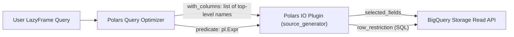

# `STRUCT` and `ARRAY` (`List`) Pushdown in `scan_table`
*Empirical investigation of Polars Python I/O plugin and BigQuery Storage Read API behavior*

*   **Created:** 2026-11-02
*   **Status:** Investigation / Reference

## Overview

This document records empirical findings on how nested `STRUCT` (`pl.Struct`) and `ARRAY` (`pl.List`) projection and filter operations behave across both stages of [`polars_bigquery.Client.scan_table`](../../py-polars-bigquery/polars_bigquery/_read_bigquery.py):

1.  **Stage 1 — Polars Query Optimizer $\rightarrow$ Polars Python I/O Plugin** (`polars.io.plugins.register_io_source`, tested on Polars `2.0.0-rc.1`): What Polars passes into `io_source(with_columns, predicate, n_rows, batch_size)`.
2.  **Stage 2 — Polars I/O Plugin $\rightarrow$ BigQuery Storage Read API** ([`arrow_bigquery.Client.read_table`](../../py-arrow-bigquery/arrow_bigquery/_read_bigquery.py)): What `CreateReadSession` and `ReadRows` accept or reject in `selected_fields` and `row_restriction`.



---

## 1. End-to-End Summary Matrix

### 1.1 Projection Pushdown (`.select(...)` / `.unnest(...)`)

| User Polars Pattern | Pushed to Polars I/O Plugin (`with_columns`)? | Supported by BigQuery `selected_fields`? | End-to-End Outcome |
|---|---|---|---|
| `lf.select("id")` | **Yes** (`with_columns=['id']`) | **Yes** (`selected_fields=['id']`) | Prunes unselected top-level columns. |
| `lf.select(pl.col("totals.pageviews"))` | **No** — fails in Polars plan resolution (`ColumnNotFoundError`) | N/A (BigQuery returns nested `Struct`, not a flat `"totals.pageviews"` column) | Invalid column reference in Polars. |
| `lf.select(pl.col("totals").struct["pageviews"])` | **Top-level only** (`with_columns=['totals']`); subfield `"pageviews"` is **not** passed to plugin | **Yes** (`selected_fields=['totals.pageviews']` returns `Struct({'pageviews': Int64})`) | Blocked by `register_io_source`: only receives top-level names and rejects partial `Struct` batches with `SchemaError`. |
| `lf.select("totals").unnest("totals").select("pageviews")` | **Top-level only** (`with_columns=['totals']`) | **Yes** (for non-repeated `STRUCT`) | Same I/O plugin limitation as `.struct["pageviews"]`. |
| `lf.select(pl.col("hits").list.eval(pl.element().struct["hour"]))` | **Top-level only** (`with_columns=['hits']`) | **No** — BigQuery rejects `hits.hour` on `REPEATED RECORD` (`INVALID_ARGUMENT`) | Cannot prune subfields inside `ARRAY<STRUCT>` in either layer. |

> [!TIP]
> **Workaround for `STRUCT` subfield pruning**: Passing an explicitly pruned `Struct` in `client.scan_table(table, schema={"totals": pl.Struct({"pageviews": pl.Int64})})` avoids `SchemaError` if `scan_table` expands user-supplied non-repeated `pl.Struct` fields into unquoted `selected_fields=["totals.pageviews"]` (matching BigQuery's table schema field order).

---

### 1.2 Predicate Pushdown (`.filter(...)`)

| User Polars Pattern | Pushed to Polars I/O Plugin (`predicate`)? | Supported by BigQuery `row_restriction`? | Target BigQuery `row_restriction` SQL |
|---|---|---|---|
| `lf.filter(pl.col("totals").struct["pageviews"] == 5)` | **Yes** (`StructExpr.FieldByName`) | **Yes** | `` `totals`.`pageviews` = 5 `` |
| `lf.filter(pl.col("trafficSource").struct["adwordsClickInfo"].struct["slot"] == "Top")` | **Yes** (chained `FieldByName`) | **Yes** | `` `trafficSource`.`adwordsClickInfo`.`slot` = 'Top' `` |
| `lf.filter(pl.col("partOf").is_null())` / `.struct["sub"].is_null()` | **Yes** (`Boolean.IsNull`) | **Yes** | `` `partOf` IS NULL `` |
| `lf.unnest("totals").filter(pl.col("pageviews") == 5)` | **No** (`predicate=None`; `UNNEST` blocks pushdown) | Yes (if written without `unnest`) | Not pushed down — filter runs in Polars after scanning all rows. |
| `lf.filter(pl.col("category").list.len() > 0)` | **Yes** (`ListExpr.Length`) | **Yes** (scalar & struct arrays) | `` ARRAY_LENGTH(`category`) > 0 `` |
| `lf.filter(pl.col("category").list.get(0, null_on_oob=True) == "food")` / `.list.first()` | **Yes** (`ListExpr.Get(true)`) | **Yes** (for non-negative index $i \ge 0$) | `` `category`[SAFE_OFFSET(0)] = 'food' `` |
| `lf.filter(pl.col("category").list.contains("food"))` | **Yes** (`ListExpr.Contains`) | **Yes** (for non-null literals) | `` 'food' IN UNNEST(`category`) `` |
| `lf.filter(pl.col("customDimensions").list.contains({"index": 4, "value": "North America"}))` | **Yes** (`ListExpr.Contains` w/ `Struct` literal) | **Yes** | `` STRUCT(4 AS index, 'North America' AS value) IN UNNEST(`customDimensions`) `` |
| `lf.filter(pl.col("customDimensions").list.eval(pl.element().struct["value"] == "North America").list.any())` | **Yes** (`Eval` + `ListAgg`) | **No** — `EXISTS (SELECT ... FROM UNNEST(...))` rejected (`INVALID_ARGUMENT`) | Cannot push down to Storage Read API; must filter locally in Polars. |
| `lf.explode("category").filter(pl.col("category") == "food")` | **No** (`predicate=None`; `EXPLODE` blocks pushdown) | Yes (if written via `list.contains`) | Not pushed down — filter runs in Polars after scanning all rows. |

> [!IMPORTANT]
> **Write `.filter()` before `.unnest()` or `.explode()`**: Polars treats both `UNNEST` and `EXPLODE` as predicate-pushdown barriers (`predicate=None` at the I/O plugin). Filtering via `.struct["field"]` or `.list.contains(...)` pushes the `pl.Expr` directly into `io_source`.

---

## 2. Runnable Example: What Polars Pushes (and Does Not Push) to an I/O Plugin

The self-contained script below registers a mock `polars.io.plugins.register_io_source` plugin and prints the optimized query plan, `with_columns`, `predicate`, and serialized JSON AST (`predicate.meta.serialize(format="json")`) received by the I/O plugin.

Run with `uv`:
```bash
uv run --project py-polars-bigquery python - <<'EOF'
import json
import polars as pl
import polars.io.plugins

SCHEMA = pl.Schema({
    "id": pl.String,
    "unused": pl.String,
    "totals": pl.Struct({"visits": pl.Int64, "pageviews": pl.Int64}),
    "trafficSource": pl.Struct({
        "source": pl.String,
        "adwordsClickInfo": pl.Struct({"slot": pl.String, "page": pl.Int64}),
    }),
    "category": pl.List(pl.String),
    "customDimensions": pl.List(pl.Struct({"index": pl.Int64, "value": pl.String})),
})

DATA = pl.DataFrame(
    {
        "id": ["row1", "row2"],
        "unused": ["u1", "u2"],
        "totals": [{"visits": 1, "pageviews": 5}, {"visits": 1, "pageviews": 1}],
        "trafficSource": [
            {"source": "google", "adwordsClickInfo": {"slot": "Top", "page": 1}},
            {"source": "(direct)", "adwordsClickInfo": None},
        ],
        "category": [["food"], []],
        "customDimensions": [
            [{"index": 4, "value": "North America"}],
            [{"index": 4, "value": "EMEA"}],
        ],
    },
    schema=SCHEMA,
)


def inspect_pushdown(label: str, build_query) -> None:
    captured: dict = {}

    def io_source(
        with_columns: list[str] | None,
        predicate: pl.Expr | None,
        n_rows: int | None,
        batch_size: int | None,
    ):
        captured["with_columns"] = with_columns
        captured["predicate"] = str(predicate) if predicate is not None else None
        captured["predicate_json"] = (
            json.loads(predicate.meta.serialize(format="json"))
            if predicate is not None
            else None
        )
        captured["n_rows"] = n_rows

        df = DATA
        if predicate is not None:
            df = df.filter(predicate)
        if with_columns is not None:
            df = df.select(with_columns)
        if n_rows is not None:
            df = df.head(n_rows)
        yield df

    lf = polars.io.plugins.register_io_source(
        io_source=io_source,
        schema=SCHEMA,
        explain_name="bigquery",
    )
    q = build_query(lf)
    plan = q.explain()
    q.collect()
    print(f"=== {label} ===")
    print("Plan:\n" + "\n".join("  " + line for line in plan.strip().splitlines()))
    print(f"with_columns = {captured['with_columns']}")
    print(f"predicate    = {captured['predicate']}")
    if captured["predicate_json"] is not None:
        print(f"json         = {json.dumps(captured['predicate_json'])}")
    print()


# --- PUSHED DOWN TO IO PLUGIN ---
inspect_pushdown(
    "Pushed: Top-level column projection",
    lambda lf: lf.select("id"),
)
inspect_pushdown(
    "Pushed: Struct subfield filter (1-level & 2-level nested)",
    lambda lf: lf.filter(
        pl.col("trafficSource").struct["adwordsClickInfo"].struct["slot"] == "Top"
    ).select("id"),
)
inspect_pushdown(
    "Pushed: List length, safe get / first(), and contains()",
    lambda lf: lf.filter(
        (pl.col("category").list.len() > 0)
        & (pl.col("category").list.get(0, null_on_oob=True) == "food")
        & pl.col("category").list.contains("food")
    ).select("id"),
)
inspect_pushdown(
    "Pushed to IO plugin (but rejected by BQ row_restriction): list.eval(...).list.any()",
    lambda lf: lf.filter(
        pl.col("customDimensions")
        .list.eval(pl.element().struct["value"] == "North America")
        .list.any()
    ).select("id"),
)

# --- NOT PUSHED DOWN TO IO PLUGIN ---
inspect_pushdown(
    "NOT pushed (subfield): Struct subfield projection only passes with_columns=['totals']",
    lambda lf: lf.select(pl.col("totals").struct["pageviews"]),
)
inspect_pushdown(
    "NOT pushed (predicate=None): .unnest() before .filter() blocks pushdown",
    lambda lf: lf.unnest("totals").filter(pl.col("pageviews") == 5).select("id"),
)
inspect_pushdown(
    "NOT pushed (predicate=None): .explode() before .filter() blocks pushdown",
    lambda lf: lf.explode("category").filter(pl.col("category") == "food").select("id"),
)
EOF
```

### 2.1 Key Polars I/O Plugin Observations

1.  **`pl.col("totals.pageviews")` is not a struct subfield selector in Polars**:
    Calling `lf.select(pl.col("totals.pageviews"))` looks for a literal top-level column named `"totals.pageviews"` and fails before `io_source` is called:
    ```text
    ColumnNotFoundError: unable to find column "totals.pageviews"; valid columns: ["id", "unused", "totals", ...]
    ```
2.  **`with_columns` only passes top-level column names (`list[str] | None`)**:
    For `lf.select(pl.col("totals").struct["pageviews"])`, Polars produces:
    ```text
    SELECT [col("totals").struct.field_by_name(pageviews)()]
      PYTHON[bigquery] SCAN []
      PROJECT 1/6 COLUMNS
    ```
    `io_source` receives `with_columns=['totals']` and cannot see which subfields of `totals` are projected downstream. Furthermore, if `io_source` yields a pruned `Struct({'pageviews': Int64})` batch instead of the full `Struct({'visits': Int64, 'pageviews': Int64})` registered in `schema`, Polars raises:
    ```text
    SchemaError: data type mismatch for column totals: incoming: Struct({'pageviews': Int64}) != target: Struct({'visits': Int64, 'pageviews': Int64}), encountered missing struct field: visits
    ```
3.  **Serialized JSON AST for `Struct` and `List` predicates**:
    *   `pl.col("totals").struct["pageviews"]`:
        ```json
        {"Function": {"input": [{"Column": "totals"}], "function": {"StructExpr": {"FieldByName": "pageviews"}}}}
        ```
    *   `pl.col("category").list.len()`:
        ```json
        {"Function": {"input": [{"Column": "category"}], "function": {"ListExpr": "Length"}}}
        ```
    *   `pl.col("category").list.get(0, null_on_oob=True)` (and `.list.first()`):
        ```json
        {"Function": {"input": [{"Column": "category"}, {"Literal": {"Dyn": {"Int": 0}}}], "function": {"ListExpr": {"Get": true}}}}
        ```
    *   `pl.col("category").list.contains("food")`:
        ```json
        {"Function": {"input": [{"Column": "category"}, {"Literal": {"Scalar": {"String": "food"}}}], "function": {"ListExpr": {"Contains": {"nulls_equal": true}}}}}
        ```
4.  **`with_columns` includes columns referenced by `predicate`**:
    Even when `.select("id")` drops `"trafficSource"` right above the scan, `PYTHON SCAN` passes `with_columns=['id', 'trafficSource']` whenever `"trafficSource"` appears in `predicate`, so `io_source` must yield `"trafficSource"` for the matching rows.

---

## 3. Empirical BigQuery Storage Read API Findings

Tested via `arrow_bigquery.Client.read_table` against three public tables:

*   `bigquery-public-data.google_analytics_sample.ga_sessions_20170801` (15.86 MB, 2,556 rows)
*   `bigquery-public-data.fhir_synthea.organization` (0.057 MB, 129 rows)
*   `bigquery-public-data.fhir_synthea.allergy_intolerance` (23.15 MB for `id, category`, 551,781 rows)

### 3.1 Case A: `selected_fields` on Non-Repeated `STRUCT` (`NULLABLE` / `REQUIRED` `RECORD`) — **Succeeds**

| Input `selected_fields` | Result | Exact Returned Polars Schema | Notes |
|---|---|---|---|
| `["totals.pageviews"]` | **SUCCESS** (2,556 rows) | `{'totals': Struct({'pageviews': Int64})}` | All 12 sibling subfields of `totals` are omitted. |
| `["totals.visits", "totals.pageviews"]` | **SUCCESS** (2,556 rows) | `{'totals': Struct({'visits': Int64, 'pageviews': Int64})}` | Only requested subfields are returned. |
| `["totals.pageviews", "totals.visits"]` | **SUCCESS** (2,556 rows) | `{'totals': Struct({'visits': Int64, 'pageviews': Int64})}` | Subfields are returned in **table schema order** (`visits`, `pageviews`), not request order. |
| `["trafficSource.adwordsClickInfo.slot"]` | **SUCCESS** (2,556 rows) | `{'trafficSource': Struct({'adwordsClickInfo': Struct({'slot': String})})}` | Multi-level nested `STRUCT` pruning works cleanly. |
| `["trafficSource.source", "trafficSource.adwordsClickInfo.slot", "trafficSource.adwordsClickInfo.page"]` | **SUCCESS** (2,556 rows) | `{'trafficSource': Struct({'source': String, 'adwordsClickInfo': Struct({'page': Int64, 'slot': String})})}` | Mixed-depth `STRUCT` pruning works; `page` precedes `slot` per table schema order. |
| `["meta.profile"]` (`STRUCT` $\rightarrow$ `ARRAY<STRING>`) | **SUCCESS** (129 rows) | `{'meta': Struct({'profile': List(String)})}` | Selecting a `REPEATED` leaf inside a `NULLABLE STRUCT` succeeds. |
| `["meta.tag"]` (`STRUCT` $\rightarrow$ `ARRAY<STRUCT>`) | **SUCCESS** (129 rows) | `{'meta': Struct({'tag': List(Struct({'system': String, 'version': String, 'code': String, 'display': String, 'userSelected': Boolean}))})}` | Selecting a whole `REPEATED RECORD` leaf inside a `NULLABLE STRUCT` succeeds. |
| `["partOf.organizationId"]` (all-`NULL` parent `STRUCT`) | **SUCCESS** (129 rows) | `{'partOf': Struct({'organizationId': String})}` | Outer `STRUCT` null validity is preserved (`null_count() == 129`, values are `None` rather than `{'organizationId': None}`). |
| `["totals", "totals.pageviews"]` | **SUCCESS** (2,556 rows) | Full 13-field `totals` `Struct` | Parent + child returns full parent `Struct`. |
| ``["`totals`.`pageviews`"]`` | **ERROR** (`INVALID_ARGUMENT`) | — | **Backticks are rejected** in `selected_fields`. |

*   **Exact error for backtick-quoted ``selected_fields=["`totals`.`pageviews`"]``**:
    ```text
    arrow_bigquery.exceptions.BigQueryError: BigQuery Storage API error: the service reports an error with code INVALID_ARGUMENT described as: request failed: The following selected fields do not exist in the table schema: `totals`.`pageviews`: caused by: code: 'Client specified an invalid argument', message: "request failed: The following selected fields do not exist in the table schema: `totals`.`pageviews`"
    ```

### 3.2 Case B: `selected_fields` on `ARRAY<STRUCT>` (`REPEATED RECORD`) — **Rejected**

BigQuery Storage Read API **rejects** any `selected_fields` dot-path that traverses *into* a `REPEATED RECORD` (`ARRAY<STRUCT>`), at any nesting depth:

*   Tested and all rejected with `INVALID_ARGUMENT`:
    *   `selected_fields=["customDimensions.value"]` (`REPEATED RECORD` $\rightarrow$ scalar)
    *   `selected_fields=["hits.hitNumber", "hits.hour"]` (`REPEATED RECORD` $\rightarrow$ multiple scalars)
    *   `selected_fields=["hits.page.pagePath"]` (`REPEATED RECORD` $\rightarrow$ `NULLABLE RECORD` $\rightarrow$ scalar)
    *   `selected_fields=["hits.product.v2ProductName"]` (`REPEATED RECORD` $\rightarrow$ `REPEATED RECORD` $\rightarrow$ scalar)
    *   `selected_fields=["address.line"]` (`REPEATED RECORD` $\rightarrow$ `REPEATED STRING`)
    *   `selected_fields=["meta.tag.code"]` (`NULLABLE RECORD` $\rightarrow$ `REPEATED RECORD` $\rightarrow$ scalar)
*   **Exact error (`selected_fields=["customDimensions.value"]`)**:
    ```text
    arrow_bigquery.exceptions.BigQueryError: BigQuery Storage API error: the service reports an error with code INVALID_ARGUMENT described as: request failed: Query error: Cannot access field value on a value with type ARRAY<STRUCT<index INT64, value STRING>> at [1:93]: caused by: code: 'Client specified an invalid argument', message: "request failed: Query error: Cannot access field value on a value with type ARRAY<STRUCT<index INT64, value STRING>> at [1:93]"
    ```

### 3.3 Case C: `row_restriction` on `STRUCT` Subfields — **All Succeed** (Selected or Unselected)

Both unquoted (`col.subfield = ...`) and backtick-quoted (`` `col`.`subfield` = ... ``) `row_restriction` predicates succeed at arbitrary `NULLABLE STRUCT` nesting depths, **even when `selected_fields` omits `col` completely** and selects only an unrelated column:

| `row_restriction` | `selected_fields` | Result & Row Count (vs Ground Truth) | Returned Polars Schema |
|---|---|---|---|
| `"trafficSource.source = 'analytics.google.com'"` | `["trafficSource.source"]` | **SUCCESS**: `57` rows (GT: `57`) | `{'trafficSource': Struct({'source': String})}` |
| ``"`trafficSource`.`source` = 'analytics.google.com'"`` | `["trafficSource.source"]` | **SUCCESS**: `57` rows (GT: `57`) | `{'trafficSource': Struct({'source': String})}` |
| ``"`trafficSource`.`source` = 'analytics.google.com'"`` | `["trafficSource"]` | **SUCCESS**: `57` rows (GT: `57`) | `{'trafficSource': Struct({...all 9 fields...})}` |
| `"trafficSource.source = 'analytics.google.com'"` | `["fullVisitorId"]` *(different col)* | **SUCCESS**: `57` rows (GT: `57`) | `{'fullVisitorId': String}` |
| ``"`trafficSource`.`source` = 'analytics.google.com'"`` | `["fullVisitorId"]` *(different col)* | **SUCCESS**: `57` rows (GT: `57`) | `{'fullVisitorId': String}` |
| `"trafficSource.source = 'google'"` | `["trafficSource.medium"]` *(sibling subfield)* | **SUCCESS**: `0` rows (GT: `0`) | `{'trafficSource': Struct({'medium': String})}` |
| `"trafficSource.adwordsClickInfo.slot = 'Top'"` | `["fullVisitorId"]` *(nested 2-level, different col)* | **SUCCESS**: `58` rows (GT: `58`) | `{'fullVisitorId': String}` |
| ``"`trafficSource`.`adwordsClickInfo`.`slot` = 'Top'"`` | `["fullVisitorId"]` *(nested 2-level, different col)* | **SUCCESS**: `58` rows (GT: `58`) | `{'fullVisitorId': String}` |
| ``"`totals`.`pageviews` = 5"`` | `["fullVisitorId"]` *(INT64 subfield, different col)* | **SUCCESS**: `107` rows (GT: `107`) | `{'fullVisitorId': String}` |
| ``"`partOf` IS NULL"`` | `["id"]` *(whole STRUCT null check)* | **SUCCESS**: `129` rows (GT: `129`) | `{'id': String}` |

### 3.4 Case D: `row_restriction` on `ARRAY` Columns — **Expressions Succeed; `SELECT` Subqueries Fail**

| Case | `row_restriction` | Table / Column Type | Result | Details |
|---|---|---|---|---|
| **D1a** | `"ARRAY_LENGTH(category) > 0"` | `allergy_intolerance` (`ARRAY<STRING>`) | **SUCCESS** | `551,781` rows (GT: `551,781`). |
| **D1b** | `"ARRAY_LENGTH(customDimensions) > 0"` | `ga_sessions` (`ARRAY<STRUCT>`) | **SUCCESS** | `2,210` rows out of `2,556` (GT: `2,210`). |
| **D2a** | `"category[SAFE_OFFSET(0)] = 'food'"` | `allergy_intolerance` (`ARRAY<STRING>`) | **SUCCESS** | `551,781` rows; out-of-bounds `"category[SAFE_OFFSET(1)] = 'food'"` also **SUCCEEDS** with `0` rows. |
| **D2b** | `"customDimensions[SAFE_OFFSET(0)].value = 'North America'"` | `ga_sessions` (`ARRAY<STRUCT>`) | **SUCCESS** | `1,372` rows. Indexing `ARRAY<STRUCT>` with `SAFE_OFFSET(...)` then `.subfield` works even when `customDimensions` is omitted from `selected_fields`. |
| **D2c** | `"category[OFFSET(1)] = 'food'"` *(non-SAFE out-of-bounds)* | `allergy_intolerance` (`ARRAY<STRING>`) | **ERROR during `ReadRows`** (`OUT_OF_RANGE`) | `CreateReadSession` succeeds, then `ReadRows` fails mid-stream with gRPC `OUT_OF_RANGE`: `Array index 1 is out of bounds`. |
| **D3a** | `"'food' IN UNNEST(category)"` (and ``"'food' IN UNNEST(`category`)"`` with `selected_fields=["id"]`) | `allergy_intolerance` (`ARRAY<STRING>`) | **SUCCESS** | `551,781` rows; `"'medication' IN UNNEST(category)"` returns `0` rows. Works even when `category` is omitted from `selected_fields`. |
| **D3b** | `"STRUCT(4 AS index, 'North America' AS value) IN UNNEST(customDimensions)"` and `"(4, 'North America') IN UNNEST(customDimensions)"` | `ga_sessions` (`ARRAY<STRUCT>`, `selected_fields=["fullVisitorId"]`) | **SUCCESS** | `1,372` rows (GT: `1,372`) — full-struct equality `IN UNNEST(repeated_struct)` works. |
| **D4** | `"EXISTS (SELECT 1 FROM UNNEST(customDimensions) AS x WHERE x.value = 'North America')"` (also tested on 57 KB `organization.address` and scalar `allergy_intolerance.category`) | Both `ARRAY<STRUCT>` and `ARRAY<STRING>` | **ERROR** (`INVALID_ARGUMENT`) | **All `EXISTS (SELECT ... FROM UNNEST(...))` subqueries are rejected** at `CreateReadSession`. |
| **D5** | `"customDimensions.value = 'North America'"` *(dot-path without UNNEST/indexing)* | `ga_sessions` (`ARRAY<STRUCT>`) | **ERROR** (`INVALID_ARGUMENT`) | Rejected with `Query error: Cannot access field value on a value with type ARRAY<STRUCT<index INT64, value STRING>>`. |

*   **Exact gRPC error for `EXISTS (SELECT 1 FROM UNNEST(...) AS x WHERE ...)` (Case D4)**:
    ```text
    arrow_bigquery.exceptions.BigQueryError: BigQuery Storage API error: the service reports an error with code INVALID_ARGUMENT described as: request failed: Entity 'bigquery-public-data.google_analytics_sample.ga_sessions_20170801' is too complex to be processed. Consider executing a query instead.: caused by: code: 'Client specified an invalid argument', message: "request failed: Entity 'bigquery-public-data.google_analytics_sample.ga_sessions_20170801' is too complex to be processed. Consider executing a query instead."
    ```
*   **Exact gRPC error for out-of-bounds `OFFSET(1)` during `ReadRows` (Case D2c)**:
    ```text
    polars.exceptions.ComputeError: got external error: BigQuery Storage API read error: BigQuery Storage API error: the service reports an error with code OUT_OF_RANGE described as: there was an error operating on 'projects/.../locations/us/sessions/.../streams/...': Array index 1 is out of bounds: caused by: code: 'Operation was attempted past the valid range', message: "there was an error operating on 'projects/.../locations/us/sessions/.../streams/...': Array index 1 is out of bounds"
    ```

> [!WARNING]
> **Always emit `SAFE_OFFSET`, never `OFFSET`, in `row_restriction`**: `OFFSET(i)` passes `CreateReadSession` validation, then aborts `ReadRows` mid-stream with gRPC `OUT_OF_RANGE` if any scanned row has length $\le i$. `SAFE_OFFSET(i)` returns `NULL` cleanly.
