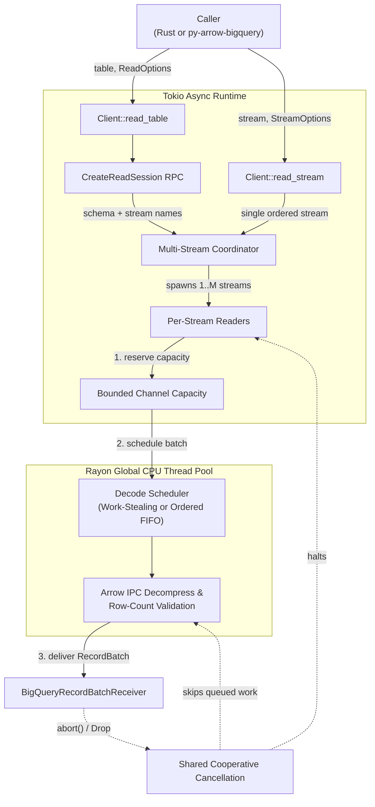
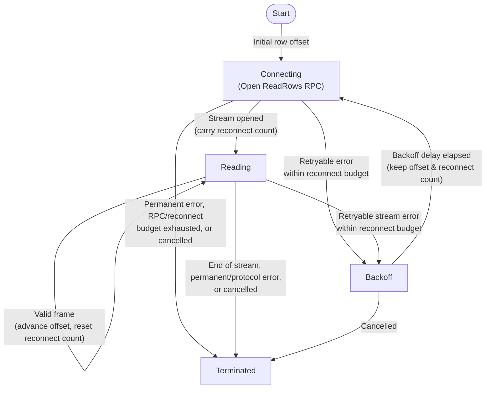

# BigQuery Table Read and Stream Reconnection State Machine

*   **Author:** @tswast
*   **Status:** Implemented
*   **Date:** 2026-10-28

--------------------------------------------------------------------------------

## Overview

The `arrow-bigquery` Rust crate reads tabular data from Google BigQuery into in-memory `polars_arrow::record_batch::RecordBatch` values so downstream bindings (`py-arrow-bigquery`) can export the stream zero-copy across the Apache Arrow C Data and C Stream Interface (C ABI, `ArrowArrayStream` via `__arrow_c_stream__`) to Polars and other Arrow-compatible consumers without coupling to a specific Arrow runtime version. Internally, `arrow-bigquery` connects to the BigQuery Storage Read API—BigQuery's gRPC streaming interface—to partition a table scan across parallel streams, decompress Arrow Inter-Process Communication (IPC) wire payloads on Rayon's global CPU thread pool, and recover from transient network or server interruptions mid-scan by reconnecting each affected stream at its exact row offset.

## The Problem

Analytical table scans against BigQuery frequently transfer gigabytes of compressed columnar data over long-lived HTTP/2 gRPC streams. A table reader serving Polars workloads faces four operational challenges:

1. **Mid-stream network and server disruptions**: Long-running gRPC `ReadRows` streams regularly encounter transient transport resets (`RST_STREAM`, broken pipes), load-balancer timeouts (`DeadlineExceeded`), rate-limiting (`ResourceExhausted`), and temporary backend unavailability (`Unavailable`, `Aborted`, `Internal`). Failing the entire scan on a transient disconnect forces callers to re-read gigabytes of already-transferred data and pay redundant network and compute costs.
2. **Duplicate or skipped rows during recovery**: Reconnecting after a failure without tracking exact row progress risks either duplicating rows already sent downstream or silently dropping rows, corrupting analytical query results.
3. **CPU decompression blocking network I/O**: BigQuery can transmit Arrow batches compressed with LZ4 frame or Zstandard (ZSTD) codecs. Microbenchmarks have shown that LZ4 tends to be optimal for lowering latency. Decompressing payloads synchronously on async network tasks stalls gRPC socket reads, while unbounded parallel decompression can either reorder rows when order matters (`maintain_order = true`) or exhaust memory if consumers read slowly.
4. **Orphaned background work on cancellation or failure**: Parallel table scans spawn multiple stream tasks and CPU decode jobs. If the caller stops reading early (for example, `LIMIT` pushdown or dropping the receiver) or one stream encounters a permanent error, sibling streams and queued decode jobs must halt immediately rather than continuing to consume network bandwidth and CPU threads in the background.

This design addresses these problems by combining a session-based parallel stream coordinator (`Client::read_table` and `Client::read_stream`) with an explicit per-stream reconnection state machine, pre-decode channel capacity reservation for backpressure, dual-mode CPU decode scheduling (ordered FIFO vs. concurrent multi-worker), and shared cooperative cancellation across all sibling tasks.

## Goals

*   **Zero-duplication, zero-loss mid-stream recovery**: Resume interrupted `ReadRows` gRPC streams from the exact next unread row offset without duplicating or skipping rows.
*   **Separate RPC retry and stream reconnection policies with shared adaptive throttling**: Distinguish retryable transient errors from permanent errors across two orthogonal policies—a time-bounded RPC retry policy (600-second window matching BigQuery Storage service configuration) for unary `CreateReadSession` session creation, and an attempt-bounded stream reconnection policy with exponential backoff (default limit: 10 consecutive failed attempts while no frames arrive, resetting whenever a valid stream frame arrives) for opening and resuming `ReadRows` streams—sharing an adaptive retry budget across all operations owned by a `Client`.
*   **Configurable scan parallelism and row-order preservation**: Read across multiple Storage Read API streams concurrently with work-stealing CPU decompression when `maintain_order = false`, and enforce single-stream reading with strict first-in, first-out (FIFO) batch delivery when `maintain_order = true`.
*   **Direct stream reading without session creation**: Support reading directly from a known stream resource path—such as BigQuery's job result stream `projects/{project}/locations/{location}/jobs/{job_id}/streams/_default`—at a caller-specified row offset, accepting either upfront Arrow schema bytes or lazy schema extraction from the first non-heartbeat `ReadRowsResponse`.
*   **Protocol integrity validation**: Verify that every decoded Arrow IPC payload matches the row count reported by the gRPC `ReadRowsResponse` envelope before delivering batches to the caller, failing immediately on truncation or framing mismatches.
*   **Bounded memory and immediate teardown**: Bound in-flight undecoded and decoded batches via async channel capacity reservation prior to CPU scheduling, and cancel all sibling stream tasks and queued decode jobs immediately when the consumer drops the receiver or any stream hits an unrecoverable error.

## Non-Goals

*   **SQL query execution and query-result routing**: Submitting BigQuery SQL jobs, polling job completion, and dynamically switching large query results to Storage Read sessions are out of scope for this specification and covered in a separate design specification (though out-of-scope query-fallback hooks currently reside in the shared stream coordinator and are tracked for extraction under Future Improvements).
*   **Table identifier string parsing**: Parsing string table references (including legacy `domain:project` prefixes and multi-segment BigLake/Iceberg catalog namespaces) into a structured table identifier is out of scope and covered in a separate design specification; this design assumes callers provide a pre-constructed `BigQueryTableId`.
*   **Recreating expired `ReadSession` resources mid-scan**: If an entire BigQuery Storage `ReadSession` expires on the server (returning permanent errors such as `FailedPrecondition` or `NotFound`), the client fails the scan rather than creating a replacement session. BigQuery does not guarantee identical stream partition boundaries or compatible per-stream row offsets across distinct read sessions.
*   **Writing or mutating BigQuery tables**: Storage Write API ingestion and Data Manipulation Language (DML) mutations are out of scope; this design covers read paths only.
*   **Exporting the Arrow C Stream ABI directly from `arrow-bigquery` in this document**: Currently, `arrow-bigquery` exposes `polars_arrow::record_batch::RecordBatch` while `py-arrow-bigquery` constructs the `ArrowArrayStream` C ABI iterator. Moving C Stream ABI construction into `arrow-bigquery` (with an interrupt-polling hook so Python callers keep `SIGINT` responsiveness) is out of scope for this as-built specification and is tracked under Future Improvements.

## Open Questions

None. Scope boundaries and as-built behavioral contracts are aligned.

## Critical User Journeys (CUJs)

### CUJ 1: Parallel Unordered Table Scan

*   **Given**: An initialized `Client` configured with a billing/quota project ID, a valid `BigQueryTableId`, and `ReadOptions` with `maintain_order = false` (along with optional column projection `selected_fields`, SQL `row_restriction`, `snapshot_time`, or `sample_percentage`).
*   **When**: The caller invokes `Client::read_table(&table, options)` and repeatedly awaits `BigQueryRecordBatchReceiver::recv()`.
*   **Then**: `read_table` creates an Arrow-formatted `ReadSession` requesting up to `max_stream_count` streams (defaulting to host CPU parallelism), returns the parsed `ArrowSchemaRef` before batch streaming completes, reads and decompresses batches concurrently off the async I/O runtime, and yields `Ok(RecordBatch)` items until all streams reach end-of-stream (`None`).

### CUJ 2: Deterministic Ordered Table Scan

*   **Given**: An initialized `Client`, a target `BigQueryTableId`, and `ReadOptions` with `maintain_order = true`.
*   **When**: The caller invokes `Client::read_table(&table, options)` and consumes batches from `BigQueryRecordBatchReceiver::recv()`.
*   **Then**: The client caps `max_stream_count` to `1` regardless of caller override, decompresses batches sequentially in arrival order, and yields `RecordBatch` values in exact stream row order.

### CUJ 3: Direct Stream Read Without `CreateReadSession` (`Client::read_stream`)

*   **Given**: An initialized `Client`, a pre-existing Storage Read stream resource name such as a BigQuery job's default result stream (`projects/{project}/locations/{location}/jobs/{job_id}/streams/_default`), and `StreamOptions` specifying a starting row `offset` (for example, `0` for an in-flight job or `N` to resume past an inline first page), optional serialized Arrow `schema` bytes, and optional `arrow_buffer_compression`.
*   **When**: The caller invokes `Client::read_stream(stream_name, options)` and consumes batches from `BigQueryRecordBatchReceiver::recv()`.
*   **Then**: Without issuing a `CreateReadSession` RPC, the client opens `ReadRows` directly on `stream_name` at `offset` (attaching per-request Arrow compression options when set). When `options.schema` is `Some`, `read_stream` parses and returns the `ArrowSchemaRef` immediately; when `options.schema` is `None`, `read_stream` skips leading zero-row heartbeat frames while a running job computes its result, resolves the `ArrowSchemaRef` from the first schema-bearing `ReadRowsResponse`, and yields subsequent `RecordBatch` items in strict stream order.

### CUJ 4: Mid-Stream Transient Disconnection and Offset Resumption

*   **Given**: An active `ReadRows` stream that has already yielded `N` rows and encounters a transient gRPC or transport interruption (such as `Unavailable`, `DeadlineExceeded`, `Aborted`, `Internal`, `ResourceExhausted`, or a connection reset).
*   **When**: The client recovers from the mid-stream interruption.
*   **Then**: The affected stream backs off under the shared client-wide adaptive retry budget and reopens `ReadRows` on the same stream resource starting at row offset `N`. Once a valid response frame arrives (including a zero-row heartbeat frame), the stream resets its consecutive-failure retry counter and continues delivering `RecordBatch` items from row `N` onward without duplicate or missing rows.

### CUJ 5: Permanent Failure or Early Consumer Drop

*   **Given**: A multi-stream `read_table` scan in progress with active network reads and pending Arrow IPC decompression work.
*   **When**: Either (a) one stream receives a non-retryable error (such as `PermissionDenied`), exhausts its consecutive reconnection limit without receiving a valid frame, or fails Arrow IPC row-count validation, OR (b) the caller drops `BigQueryRecordBatchReceiver` (or calls `abort()`) early.
*   **Then**: In case (a), the client cancels all sibling streams and pending decode work and surfaces `Some(Err(BigQueryError))` from `BigQueryRecordBatchReceiver::recv()`, followed by `None` on subsequent calls. In case (b), dropping or aborting the receiver cancels all in-flight stream reads and pending decode work immediately so background network and CPU consumption stops.

## Technical Plan (Architecture)

### System Architecture and Data Flow

`arrow-bigquery` splits execution across two runtimes: a reusable `Client` runs session setup, parallel gRPC stream consumption, and channel backpressure on **Tokio**, while Arrow IPC decompression and row-count verification run on **Rayon's global CPU thread pool** before delivering `RecordBatch` values through `BigQueryRecordBatchReceiver`:

*   **Permit-First Backpressure**: Stream tasks reserve bounded output-channel capacity on Tokio *before* dispatching compressed bytes to Rayon, capping total in-flight undecoded and decoded batches when the caller reads slowly. BigQuery never sends more than one Arrow `RecordBatch` in a single `ReadRowsResponse` message, so reserving one channel slot per non-empty response frame preserves a one-to-one mapping between frames and permits.
*   **Unordered vs. Ordered Decoding on Rayon's Global Pool**: Bounded channel slots cap memory rather than preserving completion order across concurrent CPU threads. Dispatching fire-and-forget decode jobs onto Rayon's global thread pool shares persistent worker threads across the process instead of allocating a duplicate thread pool, while avoiding short-lived per-batch `oneshot` completion-channel churn observed under `tokio-console`. Unordered scans decompress batches concurrently across Rayon's work-stealing pool via `rayon::spawn_fifo`, whereas ordered scans pair a single stream with a sequential FIFO decode queue on Rayon.
*   **Symmetric Cancellation**: Unrecoverable stream or decode errors broadcast a shared cancellation signal to halt sibling streams and skip queued decode work; dropping or aborting `BigQueryRecordBatchReceiver` triggers the same signal and aborts all spawned stream tasks.

### Separate RPC Retry and Stream Reconnection Policies

`arrow-bigquery` intentionally layers two separate recovery policies rather than sharing a single retry loop across RPC establishment and mid-stream recovery:

| Recovery Policy | Owner | Bound & Reset Rule | Exponential Backoff & Throttling | Scope & Purpose |
| :--- | :--- | :--- | :--- | :--- |
| **Unary RPC Retry** | `google-cloud-gax` transport client | **600-second** cumulative duration per unary RPC call (matching BigQuery Storage service configuration) | `100 ms` initial, `60 s` max, `1.3x` multiplier; shared `Client` adaptive throttler | Absorbs transient control-plane, authentication, or transport errors when dispatching unary `CreateReadSession` RPCs |
| **Stream Reconnection with Backoff** | Per-stream state machine | **10 consecutive failed attempts** while zero stream frames arrive; resets to `0` on any valid frame | `100 ms` initial, `60 s` max, `1.3x` multiplier; shared `Client` adaptive throttler | Opens `ReadRows` server streams and reopens interrupted streams at the exact unread row `offset` across scans that may run longer than 600 seconds |

*   **Why Session Retry and Stream Reconnection Are Separate**: A unary `CreateReadSession` call has a bounded request/response deadline (`600 s`), whereas an active multi-gigabyte `ReadRows` stream can legitimately transfer data for much longer than 600 seconds—making a fixed wall-clock timeout unsuitable for overall stream lifetime. In addition, the underlying transport client does not reconnect an already-open server stream mid-transfer or advance the request's row `offset`, so the per-stream state machine owns both initial `ReadRows` establishment and mid-stream offset resumption.
*   **Shared Throttling Without Retry Amplification**: Scoping the 600-second policy to unary session creation and the 10-attempt policy to `ReadRows` streams avoids nesting two retry loops on the same stream-opening call. Both policies share a `Client`-wide adaptive retry throttler so elevated failure rates across either policy feed a unified retry budget, and any exhausted-retry error is treated as non-retryable.

### Per-Stream Reconnection State Machine

Each stream reader isolates its row offset, consecutive reconnection count, and active stream inside a four-state machine advanced one transition at a time:

*   **Bridged Reconnection Budget & Liveness Reset**: Consecutive reconnection counts carry from `Connecting` into `Reading` until a valid frame arrives, ensuring streams that accept initial HTTP/2 headers and fail before delivering a frame still count toward the 10-attempt consecutive reconnection cap. Any valid frame—including a zero-row heartbeat—resets the consecutive reconnection count so later disconnects receive a fresh reconnection budget.
*   **Exact Offset Resumption**: The per-stream row offset advances by each frame's validated row count, and reconnections reopen the same stream resource at that offset without duplicating or skipping rows.
*   **Client-Wide Adaptive Throttling**: Transient errors are intended to enter exponential backoff gated by a `Client`-wide adaptive retry throttler shared across RPC retries and all stream readers; permanent errors or exhausted retry/reconnection budgets terminate the scan immediately.

## Alternatives Considered

### Alternative A: Imperative Nested Retry Loops Instead of an Explicit State Machine

*   **Pros**: Avoids defining a dedicated state enum and keeps connection establishment and frame reading inline within nested async loops.
*   **Cons**: Mutable connection progress (row offset, consecutive retry count, and the active stream handle) spans outer and inner loops, obscuring edge-case transitions—specifically carrying the consecutive failure count across `Connecting` into `Reading` until the first valid frame arrives—and preventing isolated single-transition unit tests without executing the full async loop.
*   **Reason for Rejection**: Encoding each state (`Connecting`, `Backoff`, `Reading`, `Terminated`) as an explicit variant advanced one transition at a time enforces state invariants in the type system and allows unit tests to verify individual transitions deterministically.

### Alternative B: Inline Tokio Decompression, Bounded Blocking-Pool Tasks, or a Dedicated Rayon Thread Pool

*   **Pros**: Inline decompression or bounded blocking-pool tasks on Tokio (paired with channel capacity reservation, or per-batch `oneshot` completion channels to preserve arrival order) avoids a `rayon` dependency and avoids retaining idle worker threads between scans; allocating a dedicated `rayon::ThreadPool` isolates Arrow IPC decode latency from external Rayon workloads in the same process.
*   **Cons**: Decompressing LZ4 or ZSTD Arrow IPC buffers directly on Tokio async tasks stalls Tokio I/O workers and concurrent HTTP/2 socket reads across sibling streams. Profiling blocking-task and per-batch `oneshot` designs with `tokio-console` revealed high creation and destruction churn of short-lived `oneshot` channel resources on every batch. Allocating a dedicated core-sized `rayon::ThreadPool` retains persistent idle worker threads alongside Tokio and host Rayon consumers such as Polars, oversubscribing host CPU cores and carrying internal pool-handle plumbing across client and stream types.
*   **Reason for Rejection**: Offloading decompression onto Rayon's global thread pool (`rayon::spawn_fifo`) keeps HTTP/2 socket reads responsive on Tokio, delivers batches directly through pre-reserved output-channel permits without per-batch `oneshot` resource churn, and shares worker threads across the process without allocating a duplicate thread pool.

### Alternative C: Delegating Reads to Python's `google-cloud-bigquery-storage` Client

*   **Pros**: Reuses Google's existing Python Storage Read client and retry configuration without maintaining a Rust gRPC read layer.
*   **Cons**: Driving gRPC streams, retry loops, and batch iteration through Python contends on the Python Global Interpreter Lock (GIL), incurs per-batch Python object overhead, and couples consumers to a `pyarrow` runtime dependency.
*   **Reason for Rejection**: Executing gRPC streaming, offset reconnection, and Arrow IPC decompression natively in Rust keeps network I/O and CPU decoding off the Python GIL and enables zero-copy batch export across the Arrow C Stream ABI (`ArrowArrayStream`) without requiring `pyarrow`.

--------------------------------------------------------------------------------

## Non-Functional Requirements

*   **Security & Billing Attribution**: Uses `rustls` (`aws_lc_rs` crypto provider) for TLS, supports caller-injected `Credentials` or Google Application Default Credentials, and requires a non-empty `quota_project_id` (`x-goog-user-project`) at client construction so quota and billing attribution are explicit on every RPC. Causal error formatting surfaces transport and status causes without exposing credential secrets.
*   **Performance, Latency & Memory Bounds**: Reuses persistent gRPC channels across calls on `Client`, defaults Arrow serialization compression to `Lz4Frame` based on latency microbenchmarks, and bounds in-flight batch count by reserving bounded channel capacity proportional to decode parallelism prior to CPU decompression.

--------------------------------------------------------------------------------

### Additional Resources

*   [BigQuery Storage v1 gRPC Service Configuration (`bigquerystorage_grpc_service_config.json`)](https://github.com/googleapis/googleapis/blob/master/google/cloud/bigquery/storage/v1/bigquerystorage_grpc_service_config.json) — Canonical upstream retry, timeout, backoff, and retryable status-code settings for BigQuery Storage API clients.

### Future Improvements

1.  **High Priority — Migrate from `polars-arrow` to `arrow-rs` and export the Arrow C Stream ABI (`ArrowArrayStream`) from `arrow-bigquery`**: `arrow-bigquery` currently depends on `polars-arrow` (an internal Polars crate with frequent breaking releases) and returns `polars_arrow::record_batch::RecordBatch`, while `py-arrow-bigquery` builds the `ArrowArrayStream` C ABI iterator interleaved with periodic Python signal polls. Replacing `polars-arrow` with upstream `arrow-rs` (`arrow-ipc` / `arrow-array`) and moving `ArrowArrayStream` construction into `arrow-bigquery` (with an optional interrupt-polling callback so Python callers keep `Ctrl-C` responsiveness) will decouple Rust and FFI callers from `polars-arrow`.
2.  **Medium Priority — Add per-frame idle read timeouts or HTTP/2 keepalive probes**: Stream readers currently await the next gRPC frame without a per-frame deadline and client construction does not configure HTTP/2 keepalive pings. If a NAT gateway or firewall silently drops an idle connection without sending `RST`, an open stream can stall indefinitely instead of entering `Backoff` and reconnecting.
3.  **Medium Priority — Gate outbound stream reconnection RPCs on the adaptive retry throttler**: Stream error handling currently checks the client-wide adaptive retry throttler immediately after recording a stream failure and increments the consecutive failure count a second time when throttled, while `Connecting` dispatches `ReadRows` unconditionally once backoff elapses (and removing the second increment alone under an attempt-bounded policy would turn the throttler check into a no-op). Checking the throttler before dispatching `ReadRows` in `Connecting`—and re-entering `Backoff` without sending an RPC while throttled—will suppress outbound reconnection calls during backend overload without halving the 10-attempt reconnect limit.
4.  **Medium Priority — Decouple SQL query session fallback from core stream readers via a callback boundary**: Out-of-scope SQL query fallback logic currently resides inside the core stream reader and coordinator, creating a cyclic dependency with the query module and duplicating multi-stream task setup. Extracting query fallback heuristics behind a caller-supplied closure/callback (or unidirectional composition from the query layer) and sharing a single multi-stream coordination path will keep the transport reader independent of SQL job execution.
5.  **Low Priority — Bound backpressure by byte footprint rather than frame count**: Reserving a fixed number of channel slots per decode worker bounds batch count rather than uncompressed byte size, which can buffer multiple gigabytes on high-core-count hosts scanning wide rows under a slow consumer.
6.  **Low Priority — Unify background stream-task ownership on `tokio::task::JoinSet`**: `BigQueryRecordBatchReceiver` currently tracks spawned stream tasks in a manual `Vec<tokio::task::JoinHandle<()>>` (aborting handles in a loop on teardown), whereas `Client::switch_to_read_session` manages fallback stream tasks with `tokio::task::JoinSet`. Standardizing background stream-task ownership on `tokio::task::JoinSet` across `BigQueryRecordBatchReceiver` and stream coordinators will eliminate manual handle-vector bookkeeping and guarantee automatic abort-on-drop semantics.
7.  **Low Priority — Mitigate straggler streams via `SplitReadStream`**: Stream partitions are currently static after `CreateReadSession`; invoking BigQuery's `SplitReadStream` RPC when sibling streams finish early could reduce tail latency from partition skew or per-stream backoff delays.

--------------------------------------------------------------------------------

## Detailed Implementation Plan

### Target Files to Create/Modify

Because this document specifies an already-implemented subsystem, each entry below records the as-built files, type and function signatures, state invariants, and unit test coverage that implement `read_table` and the stream reconnection state machine in `crates/arrow-bigquery`.

#### 1. `crates/arrow-bigquery/Cargo.toml` (As-Built)

*   **Type / Scope**: Rust Crate Manifest and Feature Configuration
*   **Rationale**: Declares the gRPC Storage Read client, retry primitives, Arrow IPC decompression codecs, async/CPU runtimes, TLS provider, and benchmark target required by the table reader.
*   **Proposed Changes**:
    *   Configure runtime dependencies used by the table and stream reader:
        *   `google-cloud-bigquery`, `google-cloud-gax`, and `google-cloud-auth` for the Storage Read gRPC client, retry/backoff/throttler policies, and credentials.
        *   `polars-arrow` (`default-features = false`, features `["io_ipc", "io_ipc_compression"]`) and `polars-error` for Arrow IPC schema parsing and LZ4/ZSTD record-batch decompression.
        *   `tokio` (features `["macros", "rt", "sync", "time"]`) and `rayon` for async stream tasks, bounded `mpsc`/`watch`/`oneshot` channels, backoff timers, and dispatching CPU decode jobs onto Rayon's global thread pool.
        *   `rustls` (feature `["aws_lc_rs"]`) for gRPC TLS cryptography, `bytes` for zero-copy IPC payload slices, and `chrono` + `google-cloud-wkt` for `ReadOptions::snapshot_time` timestamps.
    *   Expose feature flags `testing` (unlocks `Client::new_for_testing` and `BigQueryRecordBatchReceiver::new_for_testing` for downstream tests) and `tracing` (enables optional `tokio-console` and `tracing` instrumentation).
    *   Register Criterion async benchmark target `[[bench]] name = "read"` (`harness = false`, using dev-dependencies `criterion` with `async_tokio` and `tokio` with `rt-multi-thread`).

#### 2. `crates/arrow-bigquery/src/error.rs` (As-Built)

*   **Type / Scope**: Crate Error Model and Causal Chain Formatting
*   **Rationale**: Unifies transport, builder, Arrow IPC, configuration, and wire-protocol failures into a single `Send + Sync + 'static` error type that preserves underlying `std::error::Error::source()` chains for Python and Rust callers.
*   **Proposed Changes**:
    *   Define `pub enum BigQueryError` with variants separated by failure origin:
        *   `Grpc(google_cloud_bigquery::Error)`: Storage Read API RPC and stream errors from `CreateReadSession` and `ReadRows`, including permanent gRPC status codes (`PermissionDenied`, `NotFound`, `InvalidArgument`, etc.), exhausted retry budgets, and underlying transport or token-refresh errors during RPC execution.
        *   `ClientBuilder(google_cloud_gax::client_builder::Error)`: Client initialization errors returned while building underlying Google Cloud service clients in `ServiceConfigBuilder::build()` (for example, invalid endpoint URIs or credential initialization failures).
        *   `Arrow(polars_error::PolarsError)`: Arrow IPC schema parsing or LZ4/ZSTD record-batch decompression errors raised by `polars-arrow` (`parse_arrow_schema` and `decode_arrow_record_batches`).
        *   `JobFailed(Box<JobFailedError>)`: Structured BigQuery SQL job execution errors (`project_id`, `location`, `job_id`, primary and additional `JobError` entries); populated by the out-of-scope `query` module rather than `read_table` or `read_stream`.
        *   `Protocol(String)`: Server responses that violate Storage Read API expectations despite valid gRPC framing—specifically non-Arrow schema or row formats, streams closing without sending an expected schema, decoded Arrow row counts not matching `ReadRowsResponse.row_count`, or `i64` row-count/offset overflow.
        *   `InvalidConfig(String)`: Invalid caller configuration rejected locally before making network calls, such as a missing or whitespace-only `quota_project_id` in `ServiceConfigBuilder::build()`.
        *   `Other(Box<dyn std::error::Error + Send + Sync>)`: Client-side errors outside gRPC, Arrow, and server protocol checks, such as unexpected stream-task drops before delivering a schema on `schema_rx` (also wraps `InvalidTableId` from out-of-scope table-ID string parsing).
    *   Implement `Display`, `std::error::Error` (delegating `source()` for `Grpc`, `ClientBuilder`, `Arrow`, and `Other`), and `From` conversions from `google_cloud_bigquery::Error`, `google_cloud_gax::client_builder::Error`, and `polars_error::PolarsError`.
    *   Implement `pub fn format_causal_chain(&self) -> String` to walk `source()` links and append `: caused by: <msg>` segments whenever the child message is non-empty and not already a substring of the parent message.
    *   **Unit tests (by function / trait under test)**:
        *   `BigQueryError` trait bounds: verifies `Send + Sync + 'static` compatibility so errors can cross Tokio and Rayon thread boundaries.
        *   `Error::source()` & `BigQueryError::format_causal_chain()`:
            *   Multi-layer `ClientBuilder` -> `CredentialsError` -> `io::Error` chain: walks each nested cause and deduplicates outer error messages that already embed their direct child's text.
            *   Multi-layer `Grpc` (`Exhausted` -> `Authentication` -> `CredentialsError` -> `io::Error`) chain: preserves root token-refresh and socket causes after retry exhaustion.
            *   Leaf variants (`InvalidConfig`, `Protocol`): verifies `source()` is `None` and `format_causal_chain()` returns the standalone message without extra separators.

#### 3. `crates/arrow-bigquery/src/client_builder.rs` (As-Built)

*   **Type / Scope**: Client Configuration, TLS Initialization, and Shared Retry Throttler Setup
*   **Rationale**: Enforces billing/quota attribution before opening network connections, initializes the process-wide `rustls` crypto provider once, and wires a single adaptive retry throttler across session creation and stream readers.
*   **Proposed Changes**:
    *   Define `pub struct ServiceConfigBuilder` with fluent setters `new()`, `with_cred(Credentials)`, `with_bq_endpoint(impl Into<String>)`, `with_bqstorage_endpoint(impl Into<String>)`, `with_user_agent(Option<String>)`, `with_quota_project_id(Option<String>)`, and `pub async fn build(self) -> Result<Client, BigQueryError>`.
    *   Reject `None` or whitespace-only `quota_project_id` values in `build()` with `BigQueryError::InvalidConfig("quota_project_id is required".into())`.
    *   Initialize `rustls::crypto::aws_lc_rs::default_provider().install_default()` inside a `std::sync::Once` guard (`init_crypto()`), ignoring errors if the host process already installed a default provider.
    *   Construct `pub(crate) fn default_retry_throttler() -> SharedRetryThrottler` from `AdaptiveThrottler::default()`, attach it along with `create_read_session_retry_policy()` (`600 s` RPC retry policy) and `default_backoff_policy()` as client-level RPC defaults on `google_cloud_bigquery::client::Read::builder()`, and pass the same `SharedRetryThrottler` into `Client::from_parts(...)` so `StreamRetryConfig` shares the adaptive retry budget with the separate per-stream reconnection policy.
    *   **Unit tests (by function under test)**:
        *   `ServiceConfigBuilder::new()` & fluent setters (`with_*`): verifies all optional fields default to `None` and record custom credentials, service endpoints, `user_agent`, and `quota_project_id`.
        *   `ServiceConfigBuilder::build()`: verifies valid settings construct a `Client` exposing the configured `quota_project_id()`, while `None` or whitespace-only (`"   "`) `quota_project_id` values fail fast with `BigQueryError::InvalidConfig`.

#### 4. `crates/arrow-bigquery/src/bigquery_read_retry.rs` (As-Built)

*   **Type / Scope**: Storage Read RPC Retry Policy, Stream Reconnection Policy, and Shared Exponential Backoff
*   **Rationale**: Encodes BigQuery Storage Read API transient-vs-permanent error classification using `google_cloud_gax` traits while intentionally defining separate policy bounds for RPC establishment (`600 s` time limit) versus mid-stream reconnection with backoff (`10` consecutive no-progress attempts), sharing exponential backoff parameters and adaptive throttling across both layers. Retry timings, backoff parameters, and retryable status codes match [`bigquerystorage_grpc_service_config.json`](https://github.com/googleapis/googleapis/blob/master/google/cloud/bigquery/storage/v1/bigquerystorage_grpc_service_config.json).
*   **Proposed Changes**:
    *   Keep backoff parameters, RPC timeouts, and retryable status codes aligned with [`bigquerystorage_grpc_service_config.json`](https://github.com/googleapis/googleapis/blob/master/google/cloud/bigquery/storage/v1/bigquerystorage_grpc_service_config.json): `INITIAL_DELAY = 100 ms`, `MAXIMUM_DELAY = 60 s`, `SCALING_FACTOR = 1.3`, and `CREATE_READ_SESSION_TIMEOUT = 600 s` for RPC retries, alongside `STREAM_RECONNECT_MAX_ATTEMPTS = 10` for consecutive mid-stream reconnection failures with no frame progress.
    *   Implement `RetryPolicy` for `pub(crate) struct RetryableErrors` backed by `pub(crate) fn is_retryable_error(error: &Error, idempotent: bool) -> bool`:
        *   Always return `true` when `error.is_transient_and_before_rpc()`.
        *   Return `false` when `!idempotent`.
        *   When `idempotent == true`, return `true` for `error.is_io()`, `error.is_timeout()`, `error.is_connect()`, `error.is_transport()` (when `http_status_code().is_none()`), HTTP status codes `429 | 500 | 502 | 503 | 504`, and gRPC status codes `Code::{DeadlineExceeded, Aborted, ResourceExhausted, Unavailable, Internal}`. Treat all other gRPC codes (`Cancelled`, `Unknown`, `InvalidArgument`, `NotFound`, `AlreadyExists`, `PermissionDenied`, `FailedPrecondition`, `OutOfRange`, `Unimplemented`, `DataLoss`, `Unauthenticated`)—as well as outer `Error::exhausted` wrappers emitted when an inner RPC retry policy exhausts its 600-second window—as `RetryResult::Permanent`.
    *   Provide separate `google_cloud_gax` policy constructors for RPC retry versus stream reconnection because `RetryableErrors` alone only classifies errors without bounding duration or attempt count, and RPC establishment has different lifecycle bounds than resuming an open multi-gigabyte stream:
        *   `default_backoff_policy() -> Arc<dyn BackoffPolicy>`: Builds the `ExponentialBackoff` schedule (`INITIAL_DELAY`, `MAXIMUM_DELAY`, `SCALING_FACTOR`) shared by both RPC retries and per-stream reconnection backoff sleeps.
        *   `create_read_session_retry_policy() -> Arc<dyn RetryPolicy>`: Wraps `RetryableErrors.with_time_limit(CREATE_READ_SESSION_TIMEOUT)` (`600 s`) for unary `CreateReadSession` RPC retries driven by `google-cloud-gax` (configured as the client-level unary RPC policy on `Read::builder()` in `ServiceConfigBuilder::build()` and attached per request on idempotent `CreateReadSession` calls so `Client::new_for_testing` stubs also enforce the 600-second bound).
        *   `stream_reconnect_retry_policy() -> Arc<dyn RetryPolicy>`: Wraps `RetryableErrors.with_attempt_limit(STREAM_RECONNECT_MAX_ATTEMPTS)` (`10`) as the separate policy for `ReadStream`'s reconnection state machine. Because `google-cloud-gax` does not reconnect open `ResponseStream`s mid-stream or update `ReadRowsRequest.offset`—and healthy multi-gigabyte scans can run longer than 600 seconds—`ReadStream` owns both initial `ReadRows` establishment and mid-stream resumption, bounding consecutive failed attempts while zero frames arrive instead of total scan duration.
        *   `pub(crate) struct StreamRetryConfig { retry_policy, backoff_policy, retry_throttler }`: Bundles `stream_reconnect_retry_policy()`, `default_backoff_policy()`, and the client-wide `SharedRetryThrottler` for cloning across spawned `ReadStream` tasks, while allowing unit tests (`StreamRetryConfig::new(Some(...), Some(...), ...)`) to substitute zero-delay backoff or deterministic throttlers without real-time sleeps.

#### 5. `crates/arrow-bigquery/src/decode.rs` (As-Built)

*   **Type / Scope**: Arrow IPC Deserialization, Row-Count Validation, and Rayon Decode Scheduling
*   **Rationale**: Offloads LZ4/ZSTD Arrow IPC decompression from Tokio I/O threads onto Rayon's global thread pool (sharing worker threads across the process and avoiding per-batch `oneshot` completion-channel churn observed in `tokio-console`), verifies wire payload row counts before emitting batches, and preserves strict FIFO batch ordering when `maintain_order = true`.
*   **Proposed Changes**:
    *   Implement `pub(crate) fn parse_arrow_schema(schema_bytes: &[u8]) -> Result<StreamMetadata, BigQueryError>` via `polars_arrow::io::ipc::read::read_stream_metadata`.
    *   Implement `pub(crate) fn validate_non_empty_arrow_bytes(serialized_record_batch: Option<Bytes>, expected_row_count: i64) -> Result<Option<Bytes>, BigQueryError>` to return `Ok(None)` when bytes are absent/empty and `expected_row_count == 0`, `Err(BigQueryError::Protocol)` when bytes are absent/empty with non-zero `expected_row_count`, and `Ok(Some(bytes))` otherwise.
    *   Implement `pub(crate) fn decode_arrow_record_batches(serialized_record_batch: Bytes, expected_row_count: i64, metadata: StreamMetadata) -> Result<Vec<RecordBatch>, BigQueryError>` using `StreamReader`, accumulating decoded batch row counts via `i64::checked_add` and returning `BigQueryError::Protocol` on overflow or `actual_rows != expected_row_count` (and `BigQueryError::Arrow` on IPC decode errors).
    *   Define `pub(crate) struct DecodeJob` holding `serialized_record_batch`, `expected_row_count`, `metadata: Arc<StreamMetadata>`, `permit: OwnedPermit<Result<RecordBatch, BigQueryError>>`, `cancel_tx`, and `cancel_rx`. `DecodeJob::run` short-circuits before and after decoding if `*cancel_rx.borrow()` is `true`, delivers the decoded batch through `permit.send(Ok(first))` (BigQuery never sends more than one `RecordBatch` in a `ReadRowsResponse` message, so the trailing `tx.blocking_send` loop in `DecodeJob::run` is defensive fallback code that never executes on BigQuery responses), and on decode/protocol failure broadcasts `cancel_tx.send_replace(true)` before sending `Err(err)` via `permit`.
    *   Define `OrderedDecodeQueue` (`OrderedDecodeQueue::new()`) and `pub(crate) enum DecodeQueue` (`DecodeQueue::new(maintain_order)`) to dispatch `DecodeJob` items onto Rayon via `rayon::spawn_fifo` according to the caller's ordering requirement (see dispatch table below).
    *   **Unit tests (by function / type under test)**:
        *   `DecodeQueue::new(true)` (`OrderedDecodeQueue`): enqueues alternating large (`50_000`-row) and 1-row batches from Tokio onto Rayon's global pool and verifies batches and row values arrive in strict submission order rather than smaller batches overtaking earlier large ones.
        *   `DecodeQueue::new(false)` (`DecodeQueue::WorkStealing`): enqueues variable-sized batches from Tokio onto Rayon's global work-stealing pool and verifies all rows decode without loss or corruption regardless of worker completion order.
        *   `DecodeJob::run`: enqueues a batch with a mismatched `expected_row_count` followed by a valid batch onto Rayon's global pool, verifying the failing job sends `Err(BigQueryError::Protocol)` and sets `cancel_tx` to `true` while the queued follow-up job observes cancellation and drops its permit without emitting a batch.

**Rayon `DecodeQueue` Dispatch Modes**

When Tokio stream tasks call `rayon::spawn_fifo` directly across multiple worker threads, an idle worker can finish decompressing a smaller batch `N + 1` before another worker finishes a larger batch `N` and calls `permit.send(...)`. `DecodeQueue` selects between concurrent multi-worker execution and a single-runner sequential queue based on `maintain_order`:

| `DecodeQueue` Variant | Entry Points & Trigger | Stream Parallelism | Rayon Scheduling Mechanism (`push`) | Batch Delivery Order |
| :--- | :--- | :--- | :--- | :--- |
| `WorkStealing` | `Client::read_table` with `maintain_order = false` | `1..=max_stream_count` (defaults to `available_parallelism()`) | Calls `rayon::spawn_fifo(move \|\| job.run())` per batch from Tokio into Rayon's global FIFO injector so pool workers decompress batches concurrently across streams | Unordered (whichever worker finishes decompression first sends on `tx`) |
| `Ordered(Arc<OrderedDecodeQueue>)` | `Client::read_table` with `maintain_order = true`, and `Client::read_stream` (always `maintain_order = true`) | `1` stream | Pushes `job` onto `Mutex<OrderedQueueState { queue: VecDeque, running: bool }>`; spawns at most one `rayon::spawn_fifo` `drain()` runner at a time on Rayon's global pool to execute jobs back-to-back | Strict stream-offset FIFO order (`permit.send` runs sequentially inside `drain()`) |

#### 6. `crates/arrow-bigquery/src/bigquery_read_stream.rs` (As-Built)

*   **Type / Scope**: Per-Stream gRPC Reader and `ReadStreamState` Reconnection State Machine
*   **Rationale**: Isolates per-stream mutable connection progress (`offset`, `retry_state`, open `ResponseStream`, and backoff `deadline`) inside an explicit state enum driven one step at a time so transient disconnects resume at the exact unread row offset and every transition is directly unit-testable.
*   **Proposed Changes**:
    *   Define `pub(crate) enum ReadStreamState` with variants:
        *   `Connecting { offset: i64, retry_state: RetryState }`
        *   `Backoff { offset: i64, retry_state: RetryState, deadline: Instant }`
        *   `Reading { offset: i64, retry_state: Option<RetryState>, stream: ResponseStream<ReadRowsResponse> }`
        *   `Terminated(TerminationReason)` (where `TerminationReason::Finished` covers normal EOF, fatal error, or receiver cancellation; `SwitchToReadSession` alongside `FirstPageCheck`, `estimate_remaining_bytes`, and `read_query_stream` are out-of-scope `query.rs` fallback hooks currently hosted in this module and tracked for extraction in Future Improvements #4).
    *   Define `ReadStreamOptions`, `ReadStream`, `extract_response_arrow_bytes(ReadRowsResponse) -> Result<Option<(Bytes, i64)>, BigQueryError>` (rejecting non-Arrow payloads with `BigQueryError::Protocol`), `enqueue_decode_batch(...) -> bool` (racing `cancel_rx.changed()` before `tx.clone().reserve_owned()` via `biased` `tokio::select!`), and task entry point `pub(crate) async fn read_stream(options: ReadStreamOptions) -> TerminationReason`.
    *   Implement `pub(crate) async fn step(&mut self)` on `ReadStream`:
        *   **Cancellation guard**: Check `*self.cancel_rx.borrow_and_update()` before matching `self.state`, transitioning any non-terminated state immediately to `Terminated(Finished)` when cancelled.
        *   **`Connecting`**: Clone `read_rows.set_offset(offset)` and race `cancel_rx.changed()` against `req.send()` (`biased` `tokio::select!`). Transition to `Reading { offset, retry_state: Some(retry_state), stream }` on `Ok(stream)`, or delegate to `handle_error` on `Err(err)` so transient stream-opening errors enter `Backoff` under `stream_reconnect_retry_policy()` (`10` attempts) while permanent or `Error::exhausted` errors terminate immediately.
        *   **`Backoff`**: Race `cancel_rx.changed()` against `tokio::time::sleep_until(deadline)` (`biased` `tokio::select!`), transitioning to `Connecting { offset, retry_state }` once `deadline` elapses.
        *   **`Reading`**: Race `cancel_rx.changed()` against `stream.next()` (`biased` `tokio::select!`) and apply the `Reading` dispatch rules in the table below.
        *   **`Terminated`**: No-op; `ReadStream::run` exits its loop and returns `TerminationReason`.
    *   Implement `ReadStream::handle_error(offset, retry_state, err)` and `send_fatal_error(err)`:
        *   Increment `retry_state.attempt_count`, evaluate `retry_policy.on_error(&retry_state, err)`, and record the outcome on `retry_throttler.on_retry_failure(&flow)`, terminating via `send_fatal_error` on `Permanent` or `Exhausted`.
        *   Query `retry_throttler.throttle_retry_attempt()`; when throttled, increment `retry_state.attempt_count` a second time and evaluate `retry_policy.on_throttle(&retry_state, err)`, terminating via `send_fatal_error` if `Exhausted` (in the as-built state machine, throttling accelerates exhaustion of the 10-attempt cap inside `handle_error` while `Connecting` dispatches `req.send()` unconditionally after `Backoff`; gating `Connecting` on `throttle_retry_attempt()` is tracked in Future Improvements #3).
        *   Compute `delay = backoff_policy.on_failure(&retry_state)`. If `retry_policy.remaining_time(&retry_state)` is `<= delay`, terminate with `Error::exhausted`; otherwise return `Backoff { offset, retry_state, deadline: Instant::now() + delay }`.
        *   `send_fatal_error` broadcasts `cancel_tx.send_replace(true)` and sends `Err(err)` to `schema_tx` (if still `Some`) or `tx`.
    *   **Unit tests (by function under test)**:
        *   `extract_response_arrow_bytes` & `decode_arrow_record_batches`:
            *   Empty / heartbeat responses (`rows: None` or empty `ArrowRecordBatch` with `row_count == 0`): returns `Ok(None)`.
            *   Non-Arrow row variant (`AvroRows`): fails with `BigQueryError::Protocol`.
            *   Corrupt Arrow schema or batch bytes: fails with `BigQueryError::Arrow`.
            *   Row-count verification: succeeds when decoded batch length matches `response.row_count`; fails with `BigQueryError::Protocol` both when decoded row count differs from `row_count` and when non-empty IPC end-of-stream marker bytes yield zero batches against a non-zero `row_count`.
        *   `ReadStream::step` & `ReadStream::handle_error` (single-transition tests):
            *   `Connecting` -> `Reading`: sends `ReadRowsRequest` at `offset` and bridges `Some(retry_state)` (retaining prior `attempt_count`) into `Reading`.
            *   `Connecting` error handling: increments `attempt_count` and enters `Backoff` on transient error; transitions to `Terminated(Finished)` and emits `BigQueryError::Grpc` on permanent error (`PermissionDenied`) or when computed backoff delay exceeds `retry_policy.remaining_time` (`is_exhausted()`).
            *   `Backoff` -> `Connecting`: resumes `Connecting` with unchanged `offset` and `retry_state` once `deadline` elapses without sending a request during backoff.
            *   `Reading` first-frame retry-budget bridging: clears `retry_state` to `None` and advances `offset` on the first valid batch; retains and increments the `Connecting` `attempt_count` when the first `stream.next()` item after connecting is a transient error.
            *   `Reading` steady-state, error, and EOF transitions: advances `offset` on subsequent batches with `retry_state == None`; starts a fresh `RetryState` (`attempt_count == 1`) when a transient error occurs after prior data progress; transitions to `Terminated(Finished)` on permanent error or `None` (EOF).
            *   `Terminated` idempotency: calling `step()` on `Terminated` variants performs no transitions or RPCs.
            *   `handle_error` under active `RetryThrottler`: verifies a throttled retry triggers `retry_policy.on_throttle` and terminates immediately when the attempt limit is reached.
        *   `read_stream` (multi-step execution loop):
            *   Initial connection retry: recovers from a transient `Unavailable` error on initial `ReadRows` establishment and streams from `offset = 0`.
            *   Mid-stream offset resumption: reads a 3-row batch starting at `offset = 10`, encounters `Unavailable`, reconnects at `offset = 13`, and yields the remaining 2-row batch without duplicate or missing rows.
            *   Permanent failure & retry exhaustion: terminates without retry on `PermissionDenied`, terminates after exhausting `max_attempts` on repeated immediate disconnects, and sets `cancel_tx` to `true` in both cases.
            *   Cooperative sibling cancellation: exits promptly when `cancel_tx` fires while blocked awaiting `stream.next()`.

**`Reading` State Dispatch (`ReadStream::step`)**

When `self.metadata` is `None` (`Client::read_stream` called with `StreamOptions { schema: None, .. }`), the first non-heartbeat `Some(Ok(resp))` frame must carry an `ArrowSchema`: `step()` parses `StreamMetadata`, caches `self.metadata`, sends `Ok(Some(schema_ref))` over `schema_tx`, and then evaluates the same frame's row payload below.

| Select Outcome / Frame Condition | State & Retry-Budget Actions | Next State |
| :--- | :--- | :--- |
| `cancel_rx.changed()` (sibling error or receiver drop) | None | `Terminated(Finished)` |
| `Some(Ok(resp))` — Pre-schema heartbeat (`metadata` is `None`, `schema` is `None`, `rows` is `None`, `row_count == 0`) | Set `*retry_state = None`; call `record_success()` | `Reading` (unchanged `offset`) |
| `Some(Ok(resp))` — Missing/non-Arrow schema or schema IPC parse error (while `metadata` is `None`) | Call `send_fatal_error(Protocol` or `Arrow)` | `Terminated(Finished)` |
| `Some(Ok(resp))` — Zero-row frame (`extract_response_arrow_bytes` returns `Ok(None)` for empty bytes with `row_count == 0`) | Set `*retry_state = None`; call `record_success()` | `Reading` (unchanged `offset`) |
| `Some(Ok(resp))` — Framing or offset error (non-Arrow rows, empty bytes with `row_count != 0`, or `offset.checked_add(row_count)` overflow) | Call `send_fatal_error(Protocol)` | `Terminated(Finished)` |
| `Some(Ok(resp))` — Non-empty Arrow payload (`extract_response_arrow_bytes` returns `Ok(Some((bytes, row_count)))`) | Set `*offset += row_count`; set `*retry_state = None`; call `record_success()`; await `enqueue_decode_batch(...)` | `Reading` if enqueued; `Terminated(Finished)` if receiver closed or cancelled |
| `Some(Err(err))` — Stream gRPC/transport error | Take `retry_state` (retaining `Connecting` count if `Some`, or `RetryState::new(true)` if `None`) and call `handle_error(...)` | `Backoff` if retryable & within budget; `Terminated(Finished)` otherwise |
| `None` — End of stream (EOF) | Call `record_success()`; if `schema_tx` is still `Some`, send `Ok(None)` (used by out-of-scope empty/DDL SQL query streams in `query.rs`, whereas `Client::read_streams` maps `None` to `Err(BigQueryError::Protocol)`) | `Terminated(Finished)` |

#### 7. `crates/arrow-bigquery/src/lib.rs` (As-Built)

*   **Type / Scope**: Public Rust API (`Client`, `BigQueryTableId`, `ReadOptions`, `StreamOptions`, `BigQueryRecordBatchReceiver`) and Multi-Stream Session Coordinator
*   **Rationale**: Exposes the public table and stream reading entry points, formats table resource paths, creates Arrow-formatted `ReadSession` resources, spawns per-stream tasks wired to bounded backpressure and shared cancellation, and guarantees task cleanup on receiver drop or fatal error.
*   **Proposed Changes**:
    *   Define `DEFAULT_COMPRESSION = CompressionCodec::Lz4Frame` and re-export `CompressionCodec`, `ServiceConfigBuilder`, and `BigQueryError`.
    *   Implement `pub struct BigQueryTableId { pub project_id: String, pub dataset_id: String, pub table_id: String }` with `new(...)`, `Display`, and `to_table_path(&self) -> String` (`projects/{project_id}/datasets/{dataset_id}/tables/{table_id}`). (`FromStr` / `TryFrom<&str>` string parsing via `parse_table_id` is out of scope and covered in a separate design specification.)
    *   Define `pub struct ReadOptions` (`maintain_order`, `snapshot_time`, `selected_fields`, `row_restriction`, `arrow_buffer_compression`, `sample_percentage`, `max_stream_count`) with `build_request(self, table_path: String, quota_project_id: &str) -> CreateReadSessionRequest` setting `DataFormat::Arrow`, defaulting compression to `DEFAULT_COMPRESSION`, clamping `snapshot_time` via `Timestamp::clamp`, and resolving `max_stream_count` to `1` when `maintain_order == true` or `max_stream_count.unwrap_or(available_parallelism())` when `false`.
    *   Define `pub struct StreamOptions` (`offset: i64`, `schema: Option<bytes::Bytes>`, `arrow_buffer_compression: Option<CompressionCodec>`).
    *   Implement `pub struct BigQueryRecordBatchReceiver` wrapping `rx: mpsc::Receiver<Result<RecordBatch, BigQueryError>>`, `cancel_tx: Option<Arc<watch::Sender<bool>>>`, and `handles: Vec<JoinHandle<()>>` (migrating manual handle vectors to `tokio::task::JoinSet` is tracked in Future Improvements #6):
        *   `pub async fn recv(&mut self) -> Option<Result<RecordBatch, BigQueryError>>`: awaits `self.rx.recv()` and calls `self.abort()` immediately on `None` or `Some(Err(_))`.
        *   `pub fn abort(&mut self)` (also invoked from `Drop::drop`): sends `true` on `cancel_tx`, calls `self.rx.close()`, and aborts every `JoinHandle` in `self.handles`.
    *   Implement `pub struct Client` (holding `bq_client`, `read_client`, `quota_project_id`, `user_agent`, `retry_throttler: SharedRetryThrottler`, and `retry_config: StreamRetryConfig` containing a cloned handle to the same `SharedRetryThrottler`) along with read methods and helpers:
        *   `create_table_read_session(&self, table: &BigQueryTableId, options: ReadOptions) -> Result<(Bytes, Vec<String>), BigQueryError>`: sends an idempotent `CreateReadSession` RPC (`with_idempotency(true)`) carrying `x-goog-user-project` and optional `user_agent`, attaching `create_read_session_retry_policy()` (`600 s` RPC retry policy), `default_backoff_policy()`, and `self.retry_throttler.clone()` per request so unary session creation enforces the 600-second GAX RPC retry policy in both production and `Client::from_parts` / `Client::new_for_testing` stubs.
        *   `prepare_read_rows(&self, stream_name: String, offset: i64, arrow_buffer_compression: Option<CompressionCodec>) -> ReadRows`: builds a `ReadRows` request at `offset` with optional `ArrowSerializationOptions` and request headers (`quota_project` and `user_agent`), leaving `ReadRows` opening retries, mid-stream offset resumption, and reconnection backoff to `ReadStream`'s separate `StreamRetryConfig`.
        *   `pub async fn read_table(&self, table: &BigQueryTableId, options: ReadOptions) -> Result<(ArrowSchemaRef, BigQueryRecordBatchReceiver), BigQueryError>`: calls `create_table_read_session(table, options)` and delegates the returned `(schema, streams)` to `read_streams(..., StreamOptions { offset: 0, schema: Some(schema), arrow_buffer_compression: None }, maintain_order)`.
        *   `pub async fn read_stream(&self, stream: impl Into<String>, options: StreamOptions) -> Result<(ArrowSchemaRef, BigQueryRecordBatchReceiver), BigQueryError>`: delegates a single stream to `read_streams(vec![stream.into()], options, true)`.
        *   `read_streams` / `read_streams_inner`: sizes the `mpsc` channel to `rayon::current_num_threads().max(1) * 2` (via `channel_size()`), creates the shared `watch::channel(false)` cancellation pair, either parses `options.schema` upfront or attaches a `oneshot` `schema_tx` to the first stream task (failing with `BigQueryError::Protocol` if `streams.is_empty()` and `options.schema.is_none()`, or if the stream closes before yielding a schema), spawns one `bigquery_read_stream::read_stream` Tokio task per stream, and wraps `rx`, `cancel_tx`, and `handles` in `BigQueryRecordBatchReceiver` before awaiting `schema_rx` so cancellation while waiting for the first response still aborts spawned tasks. (`read_streams_inner` also accepts optional out-of-scope query fallback state via `FallbackReadSession` and `switch_to_read_session`, which currently calls `query::get_destination_table` and duplicates the `ReadStreamOptions` task-spawning loop; tracked in Future Improvements #4.)
    *   **Unit tests (by function / type under test)**:
        *   `BigQueryTableId::to_table_path()`: formats `projects/{project_id}/datasets/{dataset_id}/tables/{table_id}` resource paths for standard and domain-prefixed project IDs (`FromStr` string-parsing tests belong to the separate table-ID parsing design).
        *   `ReadOptions::build_request`:
            *   Defaults: sets `DataFormat::Arrow`, `Lz4Frame` compression, `max_stream_count = available_parallelism()`, empty projection/filter, and `parent = projects/{quota_project_id}`.
            *   Custom options & ordering override: plumbs `snapshot_time` (clamped `Timestamp`), `selected_fields`, `row_restriction`, `sample_percentage`, `max_stream_count`, and all `CompressionCodec` variants (`Lz4Frame`, `Zstd`, `CompressionUnspecified`); forces `max_stream_count = 1` whenever `maintain_order = true`.
        *   `Client::read_table`:
            *   Request metadata propagation: verifies both `CreateReadSession` and spawned `ReadRows` RPCs carry `quota_project` and custom `user_agent`.
            *   Causal error chain preservation: verifies authentication failures during `CreateReadSession` retain their full `Error::source()` hierarchy (`GaxError` -> `CredentialsError` -> `io::Error`) and `format_causal_chain()` output.
            *   Shared retry throttler wiring: verifies stream reader failures notify the client-wide `SharedRetryThrottler` configured on `Client`.
        *   `Client::read_stream`:
            *   Lazy schema extraction: skips leading zero-row heartbeat frames, extracts `ArrowSchema` from the first schema-bearing `ReadRowsResponse`, and streams subsequent batches with `quota_project` and `user_agent` headers.
            *   Caller-provided schema & options: parses upfront `StreamOptions.schema` bytes immediately and forwards custom `offset` and `arrow_buffer_compression` (`Zstd`) to `ReadRows`.
            *   Pre-schema vs. post-schema error routing: returns `Err(BigQueryError::Protocol)` directly from `read_stream()` if the stream yields only a heartbeat or closes at EOF without sending a schema; returns `Err(BigQueryError::Arrow)` immediately for invalid `StreamOptions.schema` bytes; returns `Err(BigQueryError::Grpc)` from `read_stream()` when `ReadRows` fails before schema resolution, or via `receiver.recv()` when `StreamOptions.schema` was provided upfront.

#### 8. `crates/arrow-bigquery/tests/integration_test.rs` & `crates/arrow-bigquery/benches/read.rs` (As-Built)

*   **Type / Scope**: Live BigQuery Integration Test and Criterion Throughput/Latency Benchmarks
*   **Rationale**: Validates end-to-end authentication, `CreateReadSession`, multi-stream `ReadRows` consumption, and LZ4 Arrow IPC decoding against public BigQuery datasets across small and multi-gigabyte scan sizes.
*   **Proposed Changes**:
    *   In `crates/arrow-bigquery/tests/integration_test.rs`, `test_read_small_public_table` builds a `Client` using Application Default Credentials and `GOOGLE_CLOUD_PROJECT`, scans `bigquery-public-data.usa_names.usa_1910_2013` with `maintain_order = false`, and asserts `total_rows > 0`. (Other tests in the file exercise out-of-scope `Client::query`.)
    *   In `crates/arrow-bigquery/benches/read.rs`, Criterion benchmark group `read_table` benchmarks `Client::read_table` (`maintain_order = false`) on `bigquery-public-data.sec_quarterly_financials.sic_codes`, `submission`, and `numbers` across `PROPORTIONS = [0.1, 0.5, 1.0]` (~500 MB to ~5 GB via `row_restriction`), with optional `console-subscriber` initialization under `--features tracing`.

### Verification Plan

*   **Compilation/Build**: `cargo build -p arrow-bigquery --all-targets`
*   **Unit Tests**: `cargo test -p arrow-bigquery --lib` (and full workspace Rust tests via `cargo test`; Python binding tests via `uv run pytest py-arrow-bigquery`)
*   **Static Analysis & Linting**: `cargo clippy -p arrow-bigquery --all-targets -- -D warnings` and `cargo fmt --all -- --check`
*   **Test Coverage Requirement**: Unit tests in `decode`, `bigquery_read_stream`, `client_builder`, `error`, and `lib` cover every `ReadStreamState` edge (`Connecting`, `Backoff`, `Reading`, `Terminated`), retryable vs. permanent status classification, adaptive throttler exhaustion, ordered vs. work-stealing decode queues, row-count mismatch protocol errors, and sibling cancellation on error or receiver drop.
*   **E2E/Integration**: With Application Default Credentials and `GOOGLE_CLOUD_PROJECT` configured:
    *   Live table scan test: `GOOGLE_CLOUD_PROJECT=<project-id> cargo test -p arrow-bigquery --test integration_test test_read_small_public_table`
    *   Throughput/latency benchmark: `GOOGLE_CLOUD_PROJECT=<project-id> cargo bench -p arrow-bigquery --bench read`

--------------------------------------------------------------------------------

<!-- Provenance: Indicates initial structural drafting via EGM. -->

*Drafted with EGM*
